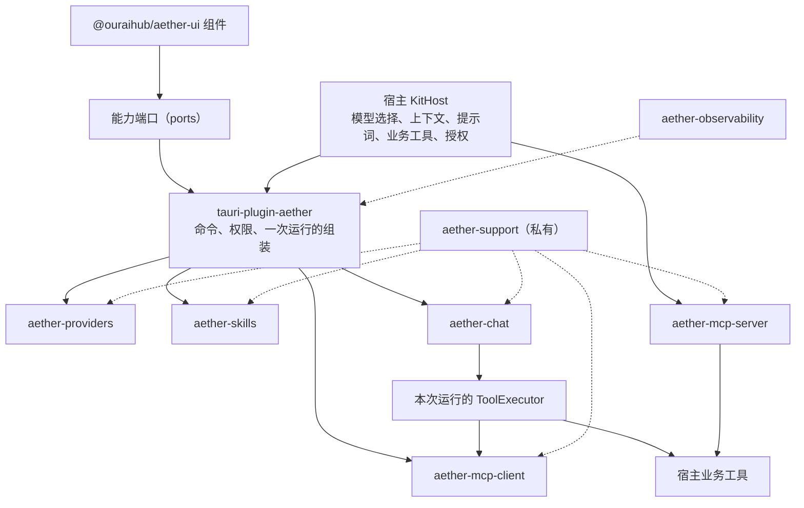
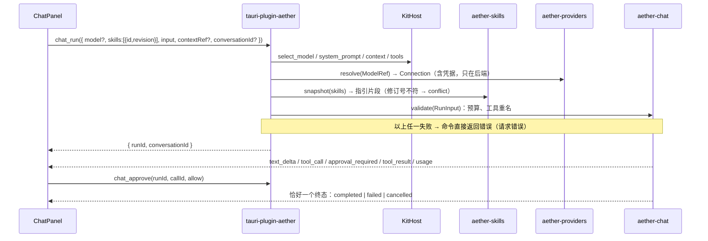

# 00 概要设计：Aether 共享 AI 能力框架

> 版本 0.2，对齐 [推荐版共享能力架构方案.md](../../推荐版共享能力架构方案.md) v0.2。状态：已实现至 R6-2；R6-1 §12.1 文档待补。
> 读者：实施本框架的开发者与大模型。阅读顺序：推荐版方案（原则）→ 本文（实现契约总览）→ 所属模块详细设计 → [90-开发任务清单.md](90-开发任务清单.md)。
> 契约关系：推荐版定原则与边界，本目录是实现契约。§12 列出本目录对推荐版的具体化与偏离，经确认后生效。冲突时先改文档再改代码，不把两套要求叠加进实现。
> 背景分析见 [桌面程序共享插件方案.md](../../桌面程序共享插件方案.md)；其中"以四个旧项目迁移为主线"的部分已被本版取代。
> 思考强度、三协议思考重放及上下文/累计用量增量合同见 [18-思考强度与用量统计.md](18-思考强度与用量统计.md)。

## 1. 原则（实现时必须遵守）

1. **为新项目设计公共能力，不为旧项目做兼容层。** 核心里没有项目名分支、旧 DTO 别名、旧目录探测、旧包格式特判。
2. **统一语义，不统一业务。** 模型选择、角色与回落、上下文、提示词、工具副作用授权都归宿主。
3. **每项能力可单独使用。** 只用 Providers、纯 Chat、Skills 不装 MCP、只开 MCP Server，都必须能启动并完成各自场景。
4. **编译时复用。** Rust crate + 一个 Tauri 接入插件 + 一个前端包；不做动态库、WASM、服务总线、插件市场、常驻后台进程。
5. **少量具体接口。** 只有存在两种以上真实实现时才定义 trait；其余用普通数据、函数和闭包。
6. **安全不让步。** 去掉历史包袱不等于放宽密钥保护、跳过授权或自动删除用户数据。

旧应用按新契约重写调用方；需要保留的用户数据由应用侧一次性迁移工具处理，不进框架启动流程和公共 API。

## 2. 模块与边界

| 模块 | 类型 | 提供 | 不做 |
| --- | --- | --- | --- |
| `aether-providers` | 核心 | 服务商/线路/模型配置、凭据三态、模型探测、能力元数据推断、解析连接快照 | 聊天、业务角色与回落、CLI 配置生成 |
| `aether-chat` | 核心 | 三协议适配、流式运行、工具循环、授权等待、取消、预算；可选会话存储 | 读其他模块数据、选模型、业务提示词、实现 MCP |
| `aether-skills` | 核心 | 技能导入/预览/编辑/修订、按次选择、指引片段与预算检查；保存包内 `scripts/`、`references/`、`assets/` 文件并按修订读取 | 执行脚本、把包内文件写到磁盘、登记或管理 MCP、扩大工具权限 |
| `aether-mcp-client` | 核心 | MCP 服务配置、凭据、信任、地址策略、Streamable HTTP 与 stdio 连接（stdio 按会话启停子进程、过滤敏感环境变量）、工具发现与调用、工具审批策略 | 聊天循环、技能存储、业务授权决策、常驻托管 stdio 进程 |
| `aether-mcp-server` | 核心 | 对外 MCP 协议、token、作用域、只暴露宿主显式注册的工具 | 自动暴露宿主工具；依赖 Chat 或 MCP Client |
| `aether-observability` | 核心 | tracing 订阅器、轮转、运行时改级别、tail、前端日志接入、脱敏 | 初始化业务模块、承载业务类型 |
| `aether-support` | 私有工作区 crate | 错误类型、原生凭据保护（DPAPI / Keychain / Secret Service）、SSE 解析、HTTP 客户端构造、SQLite 迁移与备份、ID、打码 | 直接对宿主暴露 API（宿主经公开能力 crate 的最小导出复用） |
| `tauri-plugin-aether` | 接入层 | 按 Cargo feature 注册命令与权限；组合各模块完成一次运行 | 业务逻辑；未启用 feature 的命令、数据库、后台任务 |
| `@ouraihub/aether-ui` | 前端包 | 能力端口、Tauri 端口实现、各能力组件，子路径导出 | 应用布局、路由、全局状态库、业务按钮 |

## 3. 组合架构

箭头表示调用方向，不是启动顺序。



依赖规则（CI 用 `cargo metadata` 脚本检查）：

- Providers、Skills、MCP Client、MCP Server **互不依赖，也不依赖 Chat**。
- Chat 不依赖 Providers、Skills、MCP：它只接收已解析的连接快照、指引片段和一个 `ToolExecutor`。
- MCP Client 与 Server 互不依赖，可共用 `rmcp`。
- 只有 `tauri-plugin-aether` 同时依赖多个模块，模块间组合**只**在这里发生。
- 核心 crate 不依赖 `tauri`；可被 CLI 直接使用。
- 宿主显式创建实例并交给接入层；不用全局单例、不靠插件注册顺序、不用 `try_state` 探测。缺少所需实例在 `build()` 时报错。
- 未启用的 feature 不注册命令、不创建数据库、不启动后台任务、不拉入其运行时依赖。

## 4. 一次运行（核心流程）



- **请求错误**与**运行终态**分两条通道，不重复报告。
- 运行开始时固定 Skill 快照和工具目录；运行中的编辑不影响本次运行。
- 输出部分内容后失败，不自动重放整次请求。
- UI 连接断开（窗口关闭、Channel 发送失败）默认取消运行。

## 5. 宿主接入

### 5.1 唯一的宿主 trait：`KitHost`

每个应用都要实现它（多个真实实现），因此是 trait；全部方法有默认实现，只用 Providers 或只用 MCP Server 的应用一个方法都不用写。

```rust
#[async_trait]
pub trait KitHost: Send + Sync + 'static {
    /// 本次运行用哪个模型。角色、回落、"写作用写作模型"都在这里由应用决定。
    /// 默认：请求显式带了 model 就用它，否则 needs_config。
    fn select_model(&self, req: &RunRequest) -> Result<ModelRef, KitError> { default_select(req) }
    fn system_prompt(&self, req: &RunRequest) -> Option<String> { None }
    /// req.context 由 UI 传入的 ContextRef（kind/id 由应用定义）。在 spawn_blocking 中调用。
    fn context(&self, req: &RunRequest) -> Result<Option<ContextBlock>, KitError> { Ok(None) }
    /// 服务端 run_id 绑定本次工具快照与批准 capability。
    fn tools(&self, req: &RunRequest, run_id: &str) -> Vec<HostTool> { Vec::new() }
    fn run_finished(&self, run_id: &str) {} // 同步释放本 run 的内存快照，组装失败也调用
    fn permission_modes(&self, req: &RunRequest) -> Vec<PermissionMode> { PermissionMode::BASELINE.to_vec() }
    fn mcp_tools(&self, req: &RunRequest) -> bool { true }
    async fn call_tool(&self, call: &ToolCall, cancel: &CancellationToken) -> Result<ToolOutput, ToolError> { Err(ToolError::not_found()) }
    /// 矩阵建议后的内存终裁；目录 Deny 不可放宽。
    fn authorize(&self, call: &ToolCall, ctx: &AuthorizeContext<'_>) -> Approval { ctx.proposed }
}
```

`RunRequest` 是 UI 传来的业务输入（模型选择、技能、上下文引用、输入文本、`purpose` 标签如 `"chat"`/`"polish"`），宿主据此决定上面各项。

### 5.2 组装

```rust
// main.rs
let root = aether_observability::data_root("autobee")?; // 决策 D1；aether-support 私有，由 aether-observability 重导出
let logs = aether_observability::init(&root.join("logs"), LogConfig::default(), None)?; // Builder 之前
let host = Arc::new(MyHost::new(/* 业务依赖 */));

let aether = tauri_plugin_aether::Builder::new(host.clone(), logs)
    .providers(aether_providers::Store::open(&root)?)          // feature "providers"
    .skills(aether_skills::Store::open(&root, BUILTIN_SKILLS)?)        // feature "skills"；没有内置技能传 &[]
    .mcp_client(aether_mcp_client::Store::open(&root)?)        // feature "mcp-client"
    .chat(ChatConfig::default(), Some(Arc::new(aether_chat::SqliteStore::open(&root)?))) // feature "chat"，None = 无历史
    .build()?;                                              // 声明了 chat 却缺 providers → 报错

tauri::Builder::default().plugin(aether).run(ctx)?;
```

- `Store::open` 只在宿主调用时创建数据库；没调用就没有文件。
- `build()` 校验组合：chat 需要 providers；其他能力相互独立。
- MCP Server 与运行组装无关：`.mcp_server(McpServer::new(&root, ServerConfig { .. }, scopes, tools)?)`，工具以闭包注册，见 13 文档 §7。
- 退出顺序见 15 文档 §6。

### 5.3 新项目怎么选

| 需求 | 启用 feature | 应用要写 |
| --- | --- | --- |
| 只管模型配置（如安装器） | `providers` | 配置如何用于自身业务（读 `resolve` 结果写 CLI 配置） |
| 无历史的简单生成 | `providers` + `chat` | `select_model`、`system_prompt` |
| 有历史的对话 | 上项 + `chat` 传 `SqliteStore` | 上下文 |
| 技能驱动的对话 | 上项 + `skills` | 技能选择入口；**不需要 MCP** |
| 使用外部工具 | 上项 + `mcp-client` | 工具审批策略 |
| 对外开放能力 | `mcp-server` | 工具实现与外部作用域；**不需要 Chat/Skills** |

任意 feature 都隐含 `observability`（日志命令与面板）。

## 6. 仓库结构与依赖

```text
Aether/
  crates/
    aether-support/         # 私有：error、secret(原生凭据保护)、sse、http、db(迁移+备份)、id、mask
    aether-observability/
    aether-providers/  aether-chat/  aether-skills/  aether-mcp-client/  aether-mcp-server/
  plugin/tauri-plugin-aether/   # features: providers chat skills mcp-client mcp-server（默认全关）
  packages/ui/               # @ouraihub/aether-ui，子路径 /providers /chat /skills /mcp /logs /tauri /ports
  fixtures/                  # 跨语言共享测试数据：sse/、model-classify.json、skills/
  examples/
    assistant/               # providers + chat + skills + mcp-client，真实窗口验收
    providers-only/          # 只有 providers
    mcp-server-only/         # 只有 mcp-server
    cli/                     # 无 Tauri，直接调用核心 crate
```

依赖基线（K0-1 在 workspace 中固定，升级只在 Aether 仓库做）：tauri 2.12、tokio 1.53 / tokio-util 0.7、reqwest 0.12（rustls、stream）、rusqlite 0.40（bundled）、tracing 0.1 / tracing-subscriber 0.3、rmcp 3.5、windows 0.62、zeroize 1.8、serde / thiserror、`ts-rs`（DTO 生成）、`zip`（技能包）；前端 svelte 5.57、shadcn-svelte（组件源码经 CLI 加入，底层 bits-ui 2.19）、svelte-sonner、@lucide/svelte 1.49、tailwindcss 4.3、typescript 5.9、vitest 4.1、dompurify 3.4。新增依赖固定版本并写明用途。
原生凭据额外固定 `keyring = 3.6.3`（macOS `apple-native`；Linux `sync-secret-service` + `crypto-rust`）与 `aes-gcm = 0.10.3`（AEAD BLOB）；这些依赖仅在对应 Unix target 编译，Windows 继续使用现有 DPAPI。
stdio MCP 服务的进程树额外固定 `process-wrap = 10.0.1`（`tokio1`、`job-object`、`process-group`、`kill-on-drop`、`creation-flags`，不开默认特性）：Windows kill-on-close Job Object、Unix 进程组；自写 Job Object 需要 FFI，而工作区只允许 DPAPI 一处 `unsafe`。

版本：共享仓库统一版本号，git tag 发布；应用只引用 tag。公开 API 在大版本升级时清洁切换，不保留废弃别名；每次发布记录契约变更、数据升级与回退条件。

## 7. 横切契约

### 7.1 数据根与存储

- 数据根（已定）：宿主在启动时调用一次 `data_root(app_slug)`。exe 同级 `data\` 可写就用它（便携）；否则用系统用户数据目录下的 `<app_slug>`（Windows `%LOCALAPPDATA%`，macOS `~/Library/Application Support`）。解析结果启动时记 `info`，**运行中不换目录**；之后写入失败直接报错，不静默回落。宿主也可以不用该函数，直接传自己的目录。
- 每个桌面程序存自己的数据与日志（已定）：不跨程序共享配置库，`data_root` 的 `app_slug` 即隔离边界。
- 需要持久化的模块独占一个 SQLite 文件：`providers.db`、`chat.db`、`skills.db`、`mcp-client.db`、`mcp-server.db`。未调用 `Store::open` 不创建文件。
- 库之间不互查、不建跨库外键、不假装共享事务。
- 迁移：`PRAGMA user_version`；**迁移前**用 `VACUUM INTO` 备份为 `<name>.db.bak-v<旧版本>`（保留最近一份）；每步一个事务，失败保留原数据并报错；库版本高于代码 → `incompatible_db`，拒绝打开。
- 代码回退不等于数据回退：需要回退时由用户用备份恢复，界面提示升级后新增的数据会丢失。

### 7.2 错误 DTO

```ts
interface KitError { code: KitErrorCode; message: string; details?: Record<string, unknown> }
type KitErrorCode = 'bad_request' | 'not_found' | 'conflict' | 'unsupported' | 'cancelled' | 'unauthorized'
  | 'forbidden' | 'rate_limited' | 'upstream' | 'timeout' | 'network' | 'needs_config' | 'budget_exceeded'
  | 'incompatible_db' | 'internal'
```

- `message` 为安全的英文兜底；UI 按 `code` 翻译。`details` 只放白名单字段（`field`、`reason`、`status`、`limit`、`entity`、`port`）。
- 内部错误链只进诊断日志（已脱敏），不序列化；`internal` 只给错误 ID。

### 7.3 凭据

- 明文只出现在：用户输入 → 命令层 → 加密之间，以及后端发请求前解密之后；均为 `Zeroizing<String>`。
- 落库只存系统保护的密文，经 `aether_support::secret` 加解密（10 文档 §2）。Windows 保持 `0x01` DPAPI；macOS Keychain / Linux Secret Service 保存随机主密钥，`0x02` / `0x03` BLOB 存 AES-256-GCM nonce、密文及 tag。主密钥创建跨进程加锁，不写普通文件；服务不可用就拒绝保存，不回落明文。宿主字节凭据通过 `aether_providers::secrets::{protect, unprotect}` 复用，返回明文用 `Zeroizing<Vec<u8>>`。
- 读取配置只返回 `hasKey` / 打码值；无"导出明文"命令。是否提供"显示明文"由应用决定，单独权限，默认不启用。
- 更新三态 `Keep / Clear / Set`：字段缺省 = Keep，`""` = Clear，非空 = Set。**更新失败不覆盖原凭据。**

### 7.4 日志

- 核心 crate 只发 `tracing` 事件，不安装订阅器；应用在 `tauri::Builder` 之前调用一次 `aether_observability::init`。
- 禁止记录密钥、URL query 中的凭据、用户正文、模型输出、技能正文、工具参数原文。
- 每个命令失败记一条 `warn!(command, code, "aether.command.failed")`，由插件统一生成。

### 7.5 IPC 与 DTO

- 命令名 `plugin:aether|<module>_<action>`；前端只经 `@ouraihub/aether-ui/tauri` 调用。
- 请求 DTO camelCase + `deny_unknown_fields`；所有 DTO 由 Rust 结构经 `ts-rs` 生成 TS 类型（`packages/ui/src/ports/generated/`），CI 检查生成结果与提交一致。
- 每条命令有输入上限与单独权限；不提供万能 SQL、万能文件读写、任意工具执行命令。
- 前端只传选择与业务输入（模型引用、技能 id+revision、上下文引用、文本）；权限与请求组装在后端完成，前端不能声明自己拥有权限。

### 7.6 国际化

用户可见文案只在 `@ouraihub/aether-ui` 的 `zh-CN` / `en-US`；Rust 返回 `code` + `details`。需要进提示词的固定文本（如技能来源声明）是 Rust 常量，按 `RunRequest.language` 选择。

## 8. 安全基线

| 风险 | 措施 | 所在模块 |
| --- | --- | --- |
| 外部内容注入 | MCP 工具结果、技能正文标为外部内容（随机边界 + 来源声明）。**声明只是来源说明，不是安全保证**；真正边界是工具目录、审批与宿主授权 | chat、mcp-client |
| 工具副作用 | 工具目录在运行开始时固定；执行前审批（`auto`/`ask`/`deny`）+ `KitHost::authorize` 终裁；结果未知不自动重试；取消后不启动新工具 | chat、接入层 |
| SSRF | 服务商与 MCP 地址：HTTPS，或 HTTP 且解析后为回环；连接时校验实际地址（防 DNS 重绑定）；禁止重定向；内网目标需用户逐个显式授权 | support、providers、mcp-client |
| 凭据泄露 | §7.3；日志脱敏；上游错误原文打码后截 300 字符 | 全部 |
| 技能包 | 内存解析、白名单、累计解压上限、拒绝链接与重复路径、两次读取比对摘要、疑似凭据拒绝 | skills |
| 对外 MCP | 只监听回环；token 只存哈希、可撤销、有作用域；校验 `Origin`；只暴露显式注册的工具 | mcp-server |

## 9. 文档索引

| 文档 | 内容 |
| --- | --- |
| [04-工程规范.md](04-工程规范.md) | 面向接口/对象、日志、异常、TS、Svelte 5、Tauri 2、Rust、测试、工具强制、评审清单 |
| [10-详细设计-基础与可观测性.md](10-详细设计-基础与可观测性.md) | aether-support、aether-observability |
| [11-详细设计-kit-providers.md](11-详细设计-kit-providers.md) | 配置、凭据、探测、推断、连接快照 |
| [12-详细设计-kit-chat.md](12-详细设计-kit-chat.md) | 运行输入、协议、事件、工具循环、审批、会话存储 |
| [13-详细设计-kit-mcp.md](13-详细设计-kit-mcp.md) | MCP 客户端与服务端 |
| [14-详细设计-kit-skills.md](14-详细设计-kit-skills.md) | 包格式、导入、修订、选择与预算 |
| [15-详细设计-接入层.md](15-详细设计-接入层.md) | `tauri-plugin-aether`、`KitHost`、命令与权限、生命周期 |
| [16-详细设计-kit-ui.md](16-详细设计-kit-ui.md) | 端口、组件、主题、i18n |
| [90-开发任务清单.md](90-开发任务清单.md) | 任务、依赖、判据、构建顺序 |

## 10. 构建顺序

按"验证组合"推进，不按旧应用逐个迁移（详见 90 文档）：

1. 固定公开契约（运行输入、事件、工具契约、技能快照、错误 DTO、端口），小型编译验证 Tauri Channel 与异步取消可行。
2. Providers → Chat 纵向场景：`examples/assistant` 配置模型、流式、取消。
3. Skills（不装 MCP）：导入、确认、选择、预算。
4. 宿主工具 → MCP Client：同一工具契约，验证审批与取消。
5. MCP Server 独立：`examples/mcp-server-only` 对外提供一个受控工具。
6. 稳定 UI 与发布：`assistant` 与 `providers-only` 两个示例验证按需组合。

旧应用接入是框架稳定后的独立工作，不进本清单。

## 11. 决策记录

| 编号 | 问题 | 结论 |
| --- | --- | --- |
| D1 | 数据目录 | **已定**：exe 旁 `data\` 可写时用，否则系统用户数据目录（§7.1） |
| D2 | 模型配置是否跨程序共用 | **已定**：每个桌面程序存自己的 |
| D3 | 跨平台凭据 | **已定**：Windows DPAPI 兼容旧 BLOB；macOS Keychain、Linux Secret Service 保存随机主密钥，数据库 BLOB 使用 AES-256-GCM；原生服务不可用不回落（§7.3、10 §2） |
| D4 | 后台运行（关闭面板后继续） | 待定，默认不做；UI 断开即取消 |
| D5 | 模型按需读取技能正文 | 待定，默认不做；需要时由宿主提供只读工具，作为新任务 |
| D6 | 多工具并发执行 | 待定，默认一期顺序执行；并发作为新任务（推荐版 §6.3 的"先全部 preflight 再并发、按原顺序归档"） |
| D7 | 按次权限模式 | **已定**：Default／Plan／AcceptEdits 默认提供，Auto／FullAccess 由宿主显式启用；模式随 run 固定，仅改变逐次审批、不扩大资源边界，Deny 永不放宽。FullAccess 仅本次交互确认且不持久化。MCP effect 恒为 Other；宿主可按用途彻底禁用 MCP。risk 规则是护栏不是沙箱（12 §5、15 §3.1、16 §4.2）。 |

## 12. 对推荐版的具体化与偏离

| 推荐版条目 | 本目录的处理 | 理由 |
| --- | --- | --- |
| §2 不建 foundation/base 大包 | 采纳语义：错误、原生凭据、SSE、HTTP、迁移放进私有 `aether-support`，宿主经公开能力 crate 复用 | 这些已在 Providers、Chat、MCP 三处真实重复；放各模块内会复制三份 |
| §6.3 direct / deferred / hidden | 只做 `direct`（进目录即声明给模型）；宿主自己编排的工具不进目录即可 | deferred/hidden 目前没有使用方；按需新增 |
| §6.3 并发执行 | 一期顺序执行（D6） | 简单且结果顺序天然稳定 |
| §7.1 框架不检测目录 | 提供可选的 `data_root(app_slug)`：启动时检测一次 exe 旁是否可写（用户决策 D1），运行中不换目录、写入失败不回落 | 便携优先是产品决策；只在启动时决定一次，仍满足"写入失败后不静默换目录" |
| §4.4 MemoryConversationStore | 无历史时传 `None`，不提供内存实现 | 一次运行本身就在内存里；内存存储没有调用方 |
| §10 ResourceLoader、manifest 打包 | 不做 | 无使用方 |
| §5.2 安全 YAML 解析 | 自写受限解析器：只接受扁平 `key: 标量`，拒绝重复键、嵌套、锚点、标签、多文档 | 比引入通用 YAML 库更小、更严，且满足"不按冒号切分冒充 YAML" |

