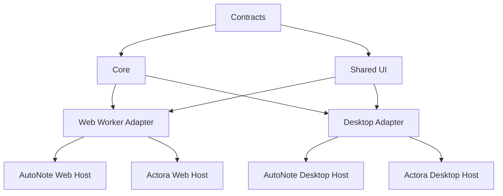
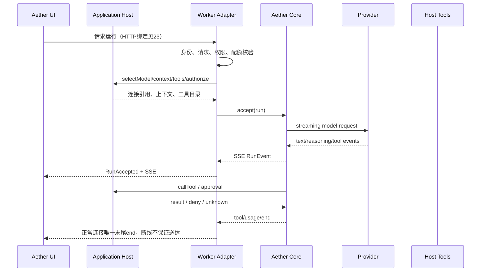

# 02 概要设计：Aether Web 共享基座

> 状态：TS contracts/core/worker、Web客户端与真实Cloudflare绑定示例已实现；HTTPS workerd冒烟已执行，完整CI/UI/重启及跨平台证据统一见90，不能把实现存在当成全量验收。
> 上位规划：[01-多产品基座与Web运行时演进规划.md](01-多产品基座与Web运行时演进规划.md)。桌面基座契约：[00-概要设计.md](00-概要设计.md)。
> 本文只设计 Aether 的公共能力与运行时组合，不定义 AutoNote 或 Actora 的业务表、路由和工具实现。
> 契约优先与职责拆分见 [03](03-契约优先架构与职责拆分设计.md)，模块详细设计入口见 [24](24-详细设计-职责分层与实现契约.md)。Rust与TypeScript分别实现共同合同；Worker实际API与平台组合见23/29。

## 1. 目标与非目标

### 1.1 目标

Aether 提供同一套 AI 运行语义，支持两个应用和两类运行时：

```text
Aether contracts + core semantics + UI
                 │
        ┌────────┴────────┐
        │                 │
  Web Worker adapter  Desktop/Tauri adapter
        │                 │
 AutoNote Web        AutoNote Desktop
 Actora Web          Actora Desktop（未来）
```

公共基座覆盖：

- Providers、Endpoint、Model 和凭据引用；
- 三协议模型请求与 SSE 流；
- 对话运行、reasoning、工具循环、审批、取消和终态；
- Search/Fetch 及引用模型；
- MCP Client 与 MCP Server 协议能力；
- OAuth/API key/grant/scope 的公共语义；
- usage/cost/context 统计；
- 错误、日志字段和安全边界；
- Chat、模型、搜索、MCP 和审批 UI。

### 1.2 非目标

Aether 不包含：

- AutoNote 的 notes、folders、tags、attachments、versions、shares、sync、backup；
- Actora 的 apps、commands、resources、prompts、operations、workflows、GitHub、channels；
- 任一应用的业务数据库、业务身份字段和业务迁移；
- Web Worker 的本机 stdio、shell、脚本执行；
- Desktop 的 Cloudflare D1、R2、KV 等实现细节；
- 自动选择业务角色模型、业务提示词和业务上下文。

## 2. 设计原则

1. **Aether 是唯一基座。** AutoNote 与 Actora 都是宿主应用，互不依赖。
2. **公共语义一次定义。** Web/桌面使用同一请求、事件、错误、工具和终态语义；传输可以不同。
3. **运行时适配隔离。** Worker 的 `fetch`/D1/DO/R2/KV 与 Desktop 的 Tauri/SQLite/原生凭据/stdio 不进入 Core。
4. **宿主负责业务。** 宿主选择模型、生成上下文、注册工具、实现工具和最终授权；Aether 负责运行。
5. **接受后单通道。** 请求未接受前的错误走响应；接受后的错误只走事件流中的唯一 `end`。
6. **失败关闭。** 不认识的协议、权限、身份、scope、状态或外部结果不自动降级。
7. **不做长期兼容壳。** 公共契约变更时先迁宿主，再删除旧实现、别名和重复类型。
8. **敏感信息后端持有。** API key、OAuth token、MCP secret 和完整工具参数不进入前端事件、URL 或日志。

## 3. 分层与依赖

### 3.1 分层

| 层               | 责任                                                       | 允许依赖                  | 禁止依赖                                           |
| ---------------- | ---------------------------------------------------------- | ------------------------- | -------------------------------------------------- |
| Contracts        | DTO、事件、错误、能力、权限语义                            | 序列化/校验库             | Worker、Tauri、应用业务                            |
| Core             | 协议、运行状态机、工具循环、搜索规范化、MCP 纯逻辑         | Contracts、端口           | D1、DO、R2、SQLite、应用类型                       |
| UI               | 公共设置、Chat、审批、结果显示、ports                      | Contracts                 | Worker URL、D1、业务库、Tauri API（非 tauri 端口） |
| Worker Adapter   | HTTP、SSE、Cloudflare 端口、OAuth/MCP endpoint、持久化适配 | Contracts、Core、UI ports | AutoNote/Actora 业务实现                           |
| Desktop Adapter  | Tauri IPC、SQLite、原生存储、stdio                         | Contracts、Core、UI ports | Worker 专用环境                                    |
| Application Host | 模型选择、业务上下文、业务工具、应用路由和数据库           | Aether API                | 修改 Aether 内部状态机                             |

依赖图：



禁止依赖：

```text
Aether → AutoNote
Aether → Actora
AutoNote → Actora
Actora → AutoNote
Worker Core → D1/R2/KV concrete API
Desktop Core → Tauri concrete API
```

### 3.2 推荐目录

语言无关schema/行为资产位于`contracts/`；公共TS类型和预编译校验为`packages/contracts`，canonical DTO位于`packages/contracts/src/generated`；TS执行为`packages/core`，Cloudflare适配与应用服务为`packages/worker`，前端为`packages/ui`，Rust能力在`crates/`，桌面接入在`plugin/`。这些包均已有真实实现，不是空包规划。

Web的TS协议/引擎与WorkerRuntime不依赖UI、Tauri或产品实体；UI Web端口与Worker共享contracts。分层见03，wire见22，实际公共HTTP和原生fetch组合见23，数据/可信egress与凭据见29。产品路由、身份系统和业务授权仍由宿主负责。

## 4. 公共运行流程



### 4.1 请求前

1. 解析身份和应用主体。
2. 校验 JSON body、`Content-Type`、请求大小和公共权限。
3. 宿主根据 `RunRequest` 选择模型、上下文、工具和业务授权策略。
4. Aether 解析 provider connection，但绝不把密钥返回 UI。
5. 固定本次运行的工具目录、技能/上下文快照和策略。
6. 所有校验通过后生成 `runId`，返回接受结果。

请求前失败返回结构化 `KitError`，不创建运行，不打开 SSE。

### 4.2 请求接受后

- HTTP 返回 `202` 或协议定义的接受响应，并提供事件流地址/连接；
- 所有进度通过 `RunEvent`；
- 浏览器断开触发取消；
- 上游已发出但结果不确定的工具调用只能标记 `unknown`，禁止自动重试副作用操作；
- 后端只完成一次终态转换，正常连接发送唯一末尾end；断线不保证送达，客户端查询快照；
- Worker重启不能伪造completed；运行/工具未知语义遵守22，持久恢复能力由平台实现另验。

## 5. 宿主接入契约

后端宿主接缝与运行应用服务见 [25](25-详细设计-运行应用服务.md)，会话领域见 [26](26-详细设计-会话与历史存储.md)，公共wire见 [22](22-详细设计-跨运行时公共契约.md)。TS实现可以使用Promise/AbortSignal等本地表达，但必须保留模型选择、上下文、工具目录、最终授权和unknown语义，不在概要另定义近似AetherAppHost类型。

Worker平台端口、绑定、请求身份和凭据实现归23/29；产品持有业务数据库与身份系统。只有真实I/O/宿主边界定义接口，不为单个内部函数预建框架。

## 6. 能力归属

| 能力                    | Aether                                 | AutoNote               | Actora                   |
| ----------------------- | -------------------------------------- | ---------------------- | ------------------------ |
| Provider/Endpoint/Model | 配置语义、连接解析、协议               | 页面默认值/业务场景    | 页面默认值/业务场景      |
| AI Chat                 | 运行器、流、工具循环                   | 笔记上下文和功能入口   | 工作台上下文和功能入口   |
| Search/Fetch            | 供应商适配、结果模型、出站策略         | 笔记搜索入口/默认策略  | 工作台搜索入口/默认策略  |
| MCP Client              | transport、trust、发现、调用、审批语义 | 笔记场景的外部服务配置 | 工作台场景的外部服务配置 |
| MCP Server              | HTTP/RPC、token、OAuth、grant、scope   | 注册笔记工具           | 注册工作台工具           |
| 对话历史                | 会话图/预留/分支语义、通用D1文档schema | 产品数据迁移/笔记关联  | 产品数据迁移/工作台关联  |
| 身份                    | 公共主体/凭据端口与安全规则            | 产品登录和笔记授权     | 产品登录和工作台授权     |

## 7. 关键架构决策

### D-W1：Aether Worker 是 Adapter，不是新产品

Worker 包只提供 Cloudflare 运行适配和公共路由组合。AutoNote/Actora 的应用入口向它注册能力；不把任何一个应用的 Worker 目录复制进 Aether。

### D-W2：模型选择归宿主

Aether 保存 provider/endpoint/model 及能力；宿主决定当前场景选哪一个 `ModelRef`。Aether 不知道“笔记润色模型”“代码审查模型”或“工作台默认模型”。

### D-W3：MCP Client 与 Server 分离

两者共享合同、scope 和工具结果模型，但生命周期、认证方向和持久对象不同。Worker 不启动 stdio；Desktop 可通过 Aether MCP Client adapter 启动。

### D-W4：公共历史与产品数据分离

Aether Worker已提供通用会话服务、D1 JSON CAS及公共迁移；AutoNote/Actora仍拥有产品业务表、旧数据迁移和资源关联/授权。公共owner绑定application/tenant/subject，不共读两产品旧表，不把产品数据删除语义并入基座。

### D-W5：Worker运行状态由DO协调

已实现每run一个Durable Object，持久phase/owner/计划handle/snapshot/审批，不持久秘密准备输入；首次SSE订阅才执行，断开取消，无正文replay。重启未终态标failed/interrupted，不能靠isolate内存声称继续执行或幂等重派。精确状态机见23。

## 8. 实施顺序

1. `22` 冻结跨运行时公共契约与 fixtures；
2. `23` 冻结 Worker HTTP、Cloudflare ports 和运行协调；
3. `29` 冻结身份、凭据、权限、数据隔离和密钥策略；
4. B1/B2 实现公共合同与纯逻辑；
5. B3/B4/B5 建立 Provider、Chat、Search、MCP Worker adapter；
6. AutoNote Web 和 Actora Web 分别实现 host/业务端口并切换；
7. 以真实 Web 场景验收后，再扩展 Actora Desktop。

在 `22/23/29` 未冻结前，不迁移 AutoNote/Actora 的生产 Worker 路由。

## 9. 验收

- 依赖图无 Aether → 产品、产品互依赖和 Core → Cloudflare concrete API；
- 同一公共运行输入在 Web/Desktop 的事件、错误和终态语义一致；
- Worker 请求断开、重启、上游错误、审批等待和副作用 unknown 均有明确结果；
- AutoNote 和 Actora 能分别注册业务工具且工具目录互不泄漏；
- Aether 公共测试不导入任何产品仓库；
- 未完成的 Worker 能力不被文档或版本声明为已实现。

## 10. 已冻结与部署边界

1. contracts/core/worker采用private monorepo workspace包，公共DTO在`packages/contracts/src/generated`。
2. Rust和TypeScript分别实现共同合同；WASM是可能的实现替换，不是前置要求。
3. 长运行固定每run一个DO、两阶段订阅、creating计划handle恢复、不重放执行（23）。
4. Aether抽象Actor/IdentityPort，产品真实登录、session/CSRF、scope与资源授权由宿主提供，不要求两产品身份表同构。
5. CredentialPort采用AES-GCM key ring与scope AAD；可信egress和DNS checker需真实部署及安全证明，binding声明本身不够（29）。Public MCP/OAuth只支持HTTPS。
6. 公共HTTP使用`/api/v1`与23实际路由；产品路由仍归产品。实现与真实HTTPS冒烟已有，完整CI/UI/重启及外仓切换证据统一记录90，不预写通过。
