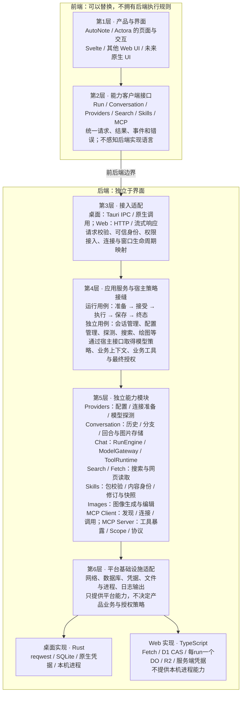

# 03 概要设计：契约优先架构与全基座职责拆分

> 状态：Native职责重构与TS contracts/core/worker已实施，基线2026-10-28；实现及实际验证记录见 [90](90-开发任务清单.md)。真实workerd HTTPS冒烟不代替完整CI、UI与重启验收。
> 决策方向：先统一接口、协议与语义，允许 Rust 和 TypeScript 分别实现；桌面与 Web 均前后端分离，便于替换 UI；职责治理覆盖整个基座，不只 Chat。
> 本轮实施：重构已有能力、客户端与调用方，并实现独立TS执行层和Cloudflare Worker适配；不迁产品业务、不整体Rust/WASM化。各能力接口归所属详细设计；[24](24-详细设计-职责分层与实现契约.md)提供索引与迁移，Worker实际组合/API归23。

## 1. 文档关系与适用范围

- [00 概要设计](00-概要设计.md)：统一架构入口与模块归属。
- [01 多产品基座与 Web 运行时演进规划](01-多产品基座与Web运行时演进规划.md)：Aether、AutoNote、Actora 的产品归属。
- [02 Web 共享基座](02-概要设计-Web共享基座.md)：Web 目标能力。
- [22 跨运行时公共契约](22-详细设计-跨运行时公共契约.md)：请求、事件、错误及行为合同。
- [23 Web Worker 运行时](23-详细设计-Web%20Worker运行时.md)、[29 Web 数据与安全](29-详细设计-Web数据与安全.md)：Web 平台实现边界。

本文只规定分层、职责和设计取舍。22定义公共wire合同，25定义运行用例，26定义会话存储，其余能力在原有详细设计中直接更新；内容过长按职责拆分并链接。24只负责跨模块迁移，90记录实施状态。删除被替代的旧描述，不用优先级免责声明保留双重规范；历史由Git追溯。冲突时先修订唯一规范再实施。

## 2. 架构原则

### 2.1 契约统一，实现可替换

Aether 首先定义稳定的能力合同与行为，其次提供 Rust crate、TS 包、平台适配和 UI。

- 桌面保留现有 Rust 实现，Web 可使用 TS 实现。
- 两端共同遵守请求、结果、事件、错误、审批、取消、预算和工具结果语义。
- 内部异步模型、网络库、数据库、调度与类型组织允许不同。
- 未来采用 Rust/WASM 是实现替换，不重新定义公共接口。
- 相同能力遵守相同合同；平台能力差异显式声明，不提供空实现冒充支持。

本轮产品收敛覆盖 AutoNote 与 Actora 的实际 Web/桌面消费者：模型能力、思考控制、上下文预算/用量、绘图和聊天展示属于 Aether；产品只保留业务上下文、最终授权、付费审批、历史归属与持久运行策略。复用既有 contracts/core/worker/ui 和 Rust crate，不新增聊天框架、供应商插件系统或本地 HTTP 服务。公共规则修复必须同步双端行为场景，并删除消费者被替代的协议实现，不能只共享控件外观。

### 2.2 前后端分离不等于分进程

桌面可以通过 Tauri IPC 或原生进程内调用连接后端；Web 使用 HTTP 与流式响应。无需为了逻辑分层先增加本地 HTTP 服务、守护进程或服务总线。

后端不能依赖组件、窗口和前端状态。更换 UI 需要重做展示与客户端适配，不应重写模型调用、业务授权、工具循环或会话用例。

### 2.3 拆职责，不机械拆文件和包

- 拆分依据是独立消费、依赖隔离、生命周期或不变量，而不是文件大小。
- 先划分现有模块；确有独立消费或发布需要再拆 crate/package。
- I/O、宿主与实现替换边界使用接口；内部纯变换使用普通函数。
- 不为每个步骤增加 trait、class、factory 或可注册插件。
- 有事务和安全一致性要求的操作必须保留一个协调入口，不能转交前端拼接。

## 3. 统一的三个层次

| 层次             | 统一内容                                            | 允许不同                              |
| ---------------- | --------------------------------------------------- | ------------------------------------- |
| 应用契约         | 请求、结果、事件、错误、审批与会话操作              | Rust trait 与 TS interface 的语言表达 |
| 传输绑定         | 请求映射、接受与结束、取消送达、断线语义            | Tauri IPC、HTTP/流式响应、原生调用    |
| 模型协议适配规范 | 三协议到统一模型输入、增量、工具调用与 usage 的映射 | reqwest、Fetch、编码器与解析器实现    |

前端只消费应用契约，不处理 OpenAI/Anthropic 等供应商流格式。

### 3.1 契约权威与语言绑定

目标是在 Aether 内提供独立于 UI 和具体后端的公共契约资产：

- JSON Schema：公共请求、结果、事件与错误。
- 行为规范：状态转换、审批、取消、失败与未知结果。
- Fixtures：合法/非法输入、模型协议样本、预期行为。

公共 Rust/TS 类型是契约的语言绑定，不以某一实现的内部类型作为永久权威。现有 `ts-rs` 在迁移期间及 Rust 专属 DTO 中继续使用；先以样本验证公共形状，不因契约整理立即更换整条生成链。外部输入仍须运行时校验，TS 类型不能替代校验。

公共契约不包含运行时内部的明文凭据对象。凭据管理请求和经授权的 reveal 操作必须另行规定权限及敏感数据生命周期，不能与普通模型/运行事件混用。

## 4. 总体分层与依赖

> 从上到下逐层展开：用户看到什么 → 通过什么调用 → 后端如何接入 → 谁组织用例 → 哪些能力完成工作 → 平台如何提供资源。下图是目标逻辑分层，不表示全部已实现；箭头表示向下消费，不表示每次操作必须经过所有模块。

**贯穿各层的规则：**公共契约规定接口、数据、错误、事件与状态语义，Fixtures验证实现是否一致。它是共同遵守的规范，不是每次调用必须经过的“协议服务”。Rust与TS允许分别实现，不要求共享代码。

**不是所有能力都经过Chat：**只做探测、搜索、读取、Skills管理、绘图或MCP调用时，应用服务直接组合相应能力；只有模型与工具循环才使用RunEngine。各能力也可以由CLI或其他后端调用方独立消费。

**职责与代码位置不同：**图中的第5层按能力分组，不表示同组内部处于同一调用深度，也不表示每个名字都要建独立包。例如Conversation本轮位于`aether-runtime::conversations`，ToolRuntime由运行应用服务组合；日志是横切设施，不是会话状态数据库。模块之间的具体接口与依赖在对应详细设计展开。

**宿主不下沉成公共业务：**AutoNote与Actora各自实现业务策略和工具，Aether通过显式接口调用，不反向依赖产品代码。前后端分层不要求分进程，也不自动统一两端平台能力。

### 4.1 各层职责

| 层           | 负责                                                  | 不负责                       |
| ------------ | ----------------------------------------------------- | ---------------------------- |
| UI           | 输入、展示、交互、草稿、滚动和展开状态                | 模型协议、权威授权、工具执行 |
| 客户端适配   | 将能力操作绑定到传输，归一化错误与连接生命周期        | 业务策略、后端运行状态机     |
| 接入层       | 请求校验、可信身份上下文、IPC/HTTP 映射、连接生命周期 | 会话算法、模型循环、SQL      |
| 应用服务     | 编排完整用例、管理资源归属、协调保存与终态            | 组件、窗口、底层协议解析     |
| 能力模块     | 模型、工具、搜索、Skills、MCP 等能力规则              | 产品业务、平台全局状态       |
| 基础设施适配 | 网络、存储、凭据、进程和平台日志                      | 重新定义公共语义             |
| 产品宿主     | 模型选择策略、业务上下文、业务工具与最终授权          | 修改 Aether 内部执行状态机   |

前端提交的模型、权限模式和工具选项只是请求意图，不能扩大后端授予的权限。AutoNote 和 Actora 的业务与数据仍分别归各自宿主，不合并为公共业务服务。

## 5. Chat 职责拆分

现有 Core 已不依赖 Tauri；问题在于插件仍拥有大量用例组装和收尾，且 Chat 包混合了协议、Native 网络、会话存储与绘图。目标如下。

| 模块                | 单一职责                                      | 明确不负责                           |
| ------------------- | --------------------------------------------- | ------------------------------------ |
| RunService          | 接受请求、管理运行、协调模块与收尾            | 供应商协议、SQL、窗口展示            |
| RunPreparation      | 准备连接、历史、上下文、技能、工具与预算      | 执行循环、持久化终态                 |
| ConversationService | 会话分支、动作与历史选择、回合保存            | 模型调用、审批等待                   |
| RunEngine           | 模型—工具循环、轮数预算、运行内去重与停止规则 | 查询 Provider 数据库、处理 HTTP 路由 |
| ToolRuntime         | 工具校验、最终授权、审批、分派和结果规范化    | 选择模型、会话分支                   |
| ModelGateway        | 一次模型调用与统一增量输出                    | 工具循环、业务上下文、会话存储       |

### 5.1 应用服务与执行准备

RunService 的生命周期是：准备 → 预留运行/回合 → 执行 → 保存结果 → 发布终态 → 释放资源。

RunPreparation 可以读取技能与历史，不假装成无 I/O 纯函数；预算计算、裁剪、提示词拼装等纯部分保持函数化。执行输入固定后，运行期间的配置编辑不得隐式改变本次运行。

从 Tauri 插件提取已有组装和收尾，而不是重写。Tauri 保留命令、Channel、窗口归属和销毁取消。CLI 应消费同一应用服务，不能仅以“调用了同一个 Runner”代表全部用例已复用。

### 5.2 会话与执行独立

- 无历史模式也能执行一次生成。
- 不调用模型也能查询、编辑、分叉和选择会话。
- RunEngine 只接受准备好的历史，不查询数据库。
- 启用历史时，保存结果后才能发送成功终态；保存失败须体现在失败结果中。

### 5.3 工具与模型边界

宿主保留最终授权，审批UI只提交决定。MCP与绘图通过工具适配接入；当前外部搜索是运行服务的预搜索用例，原生搜索由模型协议声明，不假称已存在通用模型自主搜索工具。引擎不承载这些能力的业务实现。

ModelGateway 内部划分协议编码/解析与网络执行；Rust 可用 reqwest，TS 可用 Fetch，不要求共用代码。

### 5.4 客户端能力接口

| 接口                     | 操作范围                                      |
| ------------------------ | --------------------------------------------- |
| RunClient                | start、cancel、approve、getSnapshot           |
| ConversationClient       | list、get、rename、edit、fork、select、remove |
| ProvidersClient          | 配置、模型选项、探测及授权的凭据操作          |
| Skills/Search/MCP 客户端 | 各自能力操作                                  |

会话不再只是 Chat 接口内部的历史附属物。页面可以组合多个接口，但能力应能独立消费。

## 6. 全基座职责审查与目标边界

本节代码位置是基线定位，不是已经完成的改造。

### 6.1 Providers：配置、连接准备与探测

**现状证据：**`crates/aether-providers/src/store.rs:516–682` 同时解析连接、解密与推进轮转；`probe.rs:26–110` 以 Store 方法执行探测。

目标分为：

1. 配置管理：provider/endpoint/model、归属、密文与事务。
2. 连接准备：配置快照 → 本次调用的连接、能力及候选凭据顺序。
3. 模型探测：显式的地址、协议、凭据、headers、地址策略与取消输入 → 探测结果。

独立场景：CLI 临时端点检查、配置导入验证、Web 自有配置库、后台模型任务。探测能力不应要求先创建 `providers.db`。

保留：密钥 seal、归属检查、事务写入与旧密文处理由一个用例协调；推断模块保留各协议与模型族的真实差异；模型地址归一规则不能推广成所有服务商的通用 URL 规则。

### 6.2 Search 与网页读取：配置和执行分开

**现状证据：**`crates/aether-search/src/lib.rs:479–490,751–905` 的 Store 同时持有配置、网络策略、轮转和执行；`protocol.rs` 已有协议实现，但入口依赖私有运行配置。

目标模块：配置管理、搜索执行、网页读取、服务商协议适配、结果策略纯函数。

- 搜索输入查询，输出命中列表。
- 网页读取输入 URL，输出页面内容。
- 执行接收已解析配置与策略，不强制绑定 SQLite Store。
- 允许同包不同入口，不要求另建服务进程或为每个服务商增加 trait。

独立场景：资料检索、剪藏、链接预览、知识库导入和 CLI。

保留：`check` 复用正式执行路径；每跳重定向的地址与黑名单检查留在读取流程内；搜索结果与页面结果不合并成含糊的通用响应；各家认证和请求差异保留在协议适配内。

### 6.3 MCP Client：配置仓储与运行时分开

**现状证据：**`crates/aether-mcp-client/src/store.rs:241–428` 负责刷新、缓存、会话、后台任务和连接；`session.rs:30–49,149–160` 将成功结果提前压为文本。

目标模块：

- 配置管理：服务、信任、凭据和默认审批。
- 发现与缓存：发现结果、有效期、更新策略。
- 连接与会话：握手、调用、取消、连接/进程生命周期。
- Chat 工具适配：模型工具目录及模型侧结果转换。

后台刷新由应用或运行时所有者显式管理，仓储不隐式拥有 detached 任务。数据库行类型不兼任启动子进程的运行对象。

MCP 层保留有界且校验后的 content、结构化结果与错误/unknown；Chat、UI、自动化分别适配。不能先丢失非文本数据，再让调用方从显示文本恢复。

保留：已有 HTTP/stdio 传输分层；两者清理与恢复不同。MCP 会话不增加第二套交互授权系统，宿主仍最终裁决；凭据变更与传输切换保护仍由同一用例协调。

### 6.4 MCP Server：协议接入与授权规则分清

**现状证据：**`crates/aether-mcp-server/src/lib.rs:35–93` 注册工具与 scope；`http.rs:103–139,198–269` 包含 HTTP 身份接入及协议工具处理。Server 已能独立于 Chat 使用。

目标是局部边界整理，不整体重写：工具注册与调用规则、token/scope 管理、MCP 协议处理、平台 HTTP 接入各有责任。

Native 回环 Bearer 与 Web OAuth 可以不同，最终生成可信调用授权上下文。统一授权语义，不强制合并身份系统。

保留：工具列表与实际调用采用同一有效 scope 规则；撤销与总开关的生效语义须明确，不能擅自改变在途调用。无需新增通用工具注册框架或独立 token crate。

### 6.5 Skills：内容规则独立，事务保持聚合

**现状证据：**`crates/aether-skills/src/package.rs:19` 引用存储层 hex；`store.rs:451–509` 将内容 digest 与数据库文件 hash 查询关联。

目标链路：来源读取 → 包校验与内容身份 → 目录/修订管理 → 运行快照读取。

内容身份计算接收已校验字段与排序后的文件 hash，不查询数据库。Rust/TS 明确同一 digest 规则，包括长度前缀、空值区别、参与字段与排序，不将其误称为原始 ZIP 字节 hash。

独立场景：无数据库包检查、Web 上传、桌面导入、运行准备。

保留：安装替换、修订递增、文件写入处于同一事务；内置同步与用户副本保护聚合管理；当前运行快照不是永久完整包版本档案。Skills 管理不执行脚本，未来执行归宿主或执行器，不能因保存 `scripts/` 就扩大权限。

### 6.6 绘图：独立能力，通过工具接入 Chat

**现状证据：**`crates/aether-chat/src/painting.rs:33–87` 混合图像工具描述与调用；`plugin/tauri-plugin-aether/src/tools.rs:235–278` 负责引用解析、次数限制、调用及会话图片保存。

目标划分：

- 图像生成/编辑：明确图像请求与结果。
- 图像存储适配：保存、读取及引用。
- Chat 绘图工具适配：工具描述、会话图片选择和本次运行限制。

独立绘图页面或批量任务无需依赖 Chat 循环。图片输入/结果合同不能依赖 UI 组件，也不为此建立全产品通用媒体资产系统。

### 6.7 support：契约、纯逻辑与 Native 基础设施分离

**现状证据：**`crates/aether-support/src/lib.rs:6–17` 同时导出契约、数据库、网络、路径及凭据；`connection.rs:72–87` 含 reqwest 操作；`error.rs:342–345` 直接转换 SQLite 错误。

目标按依赖性质划分：

| 边界            | 内容                                     |
| --------------- | ---------------------------------------- |
| 公共契约        | 错误、能力与公共数据类型                 |
| 通用纯逻辑      | 费用、推理映射、脱敏、流解析等           |
| Native 基础设施 | reqwest、DNS、SQLite、原生凭据、本机路径 |
| Web 基础设施    | Fetch、D1、服务端凭据等对应实现          |

公共数据不因同模块内的 SQL/HTTP helper 被迫依赖 Native 库。网络错误转换和 header 应用放到适配边界；既有原生凭据保护实现继续复用，不另造密钥系统。

### 6.8 日志：记录、诊断与本机操作分开

**现状证据：**`crates/aether-observability/src/lib.rs:75–81,147–203` 聚合日志句柄；`packages/ui/src/ports/contract.ts:42–49` 的 LogsPort 要求 `openDir`。

目标边界：结构化记录与脱敏合同、诊断查询与级别管理、平台输出适配、本机壳操作。

桌面保留文件轮转，Web 使用平台可用日志方式；“打开目录”是桌面能力，不是日志公共合同的必选方法。现有 writer/tail/ingest 分层可保留，不另造遥测平台。诊断日志不充当运行状态数据库或副作用幂等记录。

### 6.9 接入层：薄适配与应用服务分开

Tauri/HTTP 保留参数映射、可信身份、传输取消、错误映射与平台生命周期。完整用例编排下沉到无 UI 应用服务。

现有薄转发无需再包一层，例如 `plugin/tauri-plugin-aether/src/skills.rs:25–59`。一个适配入口组装多个能力是合理聚合，不因涵盖多个命令就创建通用路由/分派框架。

### 6.10 UI：抽流程，不把表单搬后端

**现状证据：**Provider 保存/批量探测在 `ProvidersSettings.svelte:176–205,309–346`；Search 保存与凭据会话在 `SearchSettings.svelte:125–178`；MCP 配置生成在 `McpServerSettings.svelte:111–117`。

| 可复用模块        | 提取内容                             | 留在 UI            |
| ----------------- | ------------------------------------ | ------------------ |
| Provider 编辑会话 | 保存合并、回填、探测与模型合并       | 筛选、当前项、弹窗 |
| Search 配置流程   | 保存与检查顺序、失败草稿规则         | 表单与结果展示     |
| 凭据会话规则      | 明文失效、密码清理、过期异步结果处理 | 显示、复制、提示   |
| MCP 配置转换      | 输入转换、客户端配置片段生成         | 剪贴板与确认交互   |

优先复用现有 `providers/draft.ts` 等纯逻辑，必要时增加小型普通 TS 模块，不建立万能 settings controller。

前端校验改善交互，后端仍权威校验。Provider/Search 的 reveal 与 MCP 的 write-only 凭据保持不同合同；统一生命周期，不强行统一 DTO 或万能组件。Skills 现有文件选择与预览/确认分层合理，不因存在页面状态就继续拆散。

## 7. 跨实现必须一致的行为

### 7.1 接受、终态与保存

- 接受前失败不启动上游；接受后失败只走运行结果，不重复报告请求错误。
- 后端一个运行最多完成一次终态转换，正常连接应收到唯一且最后的 `end`。
- 崩溃或断线不保证 `end` 送达；UI 标记连接中断/待确认，查询快照，不伪造成功。
- 启用历史时先保存结果，再发送成功终态；保存失败必须体现为失败。
- 快照不承诺恢复丢失正文或自动继续任务；恢复能力另行声明。

### 7.2 取消、审批和副作用

- cancel 响应表示取消请求已受理，不表示外部副作用已撤回。
- 未派发动作不再执行；已派发且不可确认结果的工具为 unknown，不自动重放。
- 过期或重复审批不重复执行工具。
- 相同 callId 和内容按合同复用结果；相同 callId 但名称或参数冲突明确拒绝。
- 运行内去重、跨重启幂等和业务幂等分别声明，不能互相代替。
- 能力声明不等于授权；每次动作仍检查可信主体、资源和有效权限。

### 7.3 传输生命周期

桌面继续使用 IPC/Channel，窗口标识留在接入层；未来原生 UI 可使用 typed 调用和事件接收器。

Web接受与事件订阅绑定统一在23定义，必须解决接受后、订阅前的事件与资源生命周期；本页不维护第二套HTTP路由方案。桌面与Web都遵守22的单终态、快照与unknown语义。

## 8. 契约验收

| 层       | 行为验收                                                       |
| -------- | -------------------------------------------------------------- |
| 数据     | 字段、枚举、可选/null、错误、非法输入                          |
| 模型协议 | 分片、UTF-8、工具参数、reasoning、usage、截断                  |
| 运行     | 审批、取消、重复调用冲突、轮数预算、unknown                    |
| 应用服务 | 接受前失败、保存失败、终态顺序、会话分支                       |
| 能力     | 探测无需数据库、搜索/读取独立、MCP 结构化结果、Skills 内容身份 |
| 接入     | 连接建立、取消送达、断线、慢消费者、主体隔离                   |

Rust/TS 消费同一套语言无关样本和场景，各自提供测试适配器。比较用户可观察行为，不比较内部分片、SQL、函数调用次数或内存结构。平台集成另行冒烟，契约测试不能替代真实传输与存储验证。

拆分后的目标消费场景：

- 只做模型探测，不需要配置数据库。
- 只用搜索或网页读取，不需要 Chat。
- 直接调用 MCP，保留结构化结果。
- Skills 包检查不需要运行时或脚本权限。
- 独立绘图不需要模型工具循环。
- CLI 与桌面 UI 消费同一 Rust 应用服务；Web由TS Core与WorkerRuntime实现对应协议/用例，公共绑定统一在`packages/contracts/src/generated`，两端按同一合同验收而非共享Native I/O。
- 替换 UI 不改后端用例；替换实现语言不改变公共行为。

## 9. 实施顺序与非目标

| 批次 | 工作                                                     | 完成门禁                                                     |
| ---- | -------------------------------------------------------- | ------------------------------------------------------------ |
| 1    | 同步架构文档，冻结最小运行与错误合同                     | 字段、状态、能力和传输责任明确，不新增空包                   |
| 2    | Chat 应用服务与接入分开，Providers/Search 配置与执行解耦 | 原有桌面行为保留；CLI 复用应用服务；能力独立消费             |
| 3    | 公共合同、TS客户端及Core/Worker实现                      | 模型流、工具、审批、取消和保存消费共同合同；真实绑定与UI另验 |
| 4    | MCP Client 运行时与结果合同、绘图独立                    | 生命周期可管理；通用结果不提前丢失                           |
| 5    | Skills 内容身份、日志平台边界、UI 流程                   | 保留事务与安全约束；其他入口实际复用                         |

各切片实施时更新对应详细设计、调用者和测试，不保留长期别名/兼容壳。批次不是要求一次修改所有模块，先完成可运行的纵向切片。

非目标：整体 Rust 化、全仓重写、自动迁移 GPUI、统一产品数据库、万能仓储/工具框架、服务总线、预建后台守护进程、无证据性能优化。独立 Rust 预研提供可行性证据，不替代本项目的正式能力实现与契约验收。

## 10. 审查记录与证据边界

本轮检查覆盖 Chat、Providers、Search/Fetch、Skills、MCP Client/Server、绘图、support、observability、Tauri 接入与 UI ports/设置流程。结论基于相关实现静态阅读，未声称穷尽每个文件或完成性能分析。

实际执行 `node scripts/check-deps.mjs`，结果为 `check-deps: 13 workspace crates OK`。该结果只证明现有脚本规定的依赖规则通过，不证明目标分层已经实现，也不证明 Worker 或跨语言行为等价。本文不将历史测试记录视为本轮重新执行的结果。
