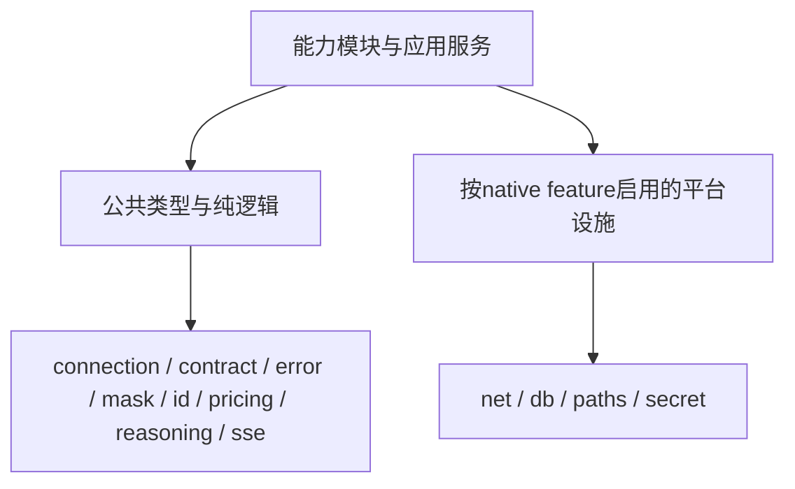

# 10 详细设计：aether-support 与 aether-observability

> `aether-support`：私有工作区 crate（`publish = false`，公开项 `#[doc(hidden)]`），只给 aether 内部模块用；宿主不直接依赖。
> `aether-observability`：公开 crate，宿主在 `main` 中初始化日志。
> 蓝本：AutoNote `desktop/src-tauri/shell/src/{logging,logs}.rs`（轮转、写盘诊断、tail）、`desktop/src/lib/log/ipc-logger.ts`（前端批量上报）；AutoBee `shell/src/llm/sse.rs`（SSE 解析）、`credentials/crypto.rs`（DPAPI）。
> 状态：纯/Native编译边界、公共日志DTO与桌面动作拆分已实施；本轮验证记录见 [90](90-开发任务清单.md)。公共wire错误见22；本页只定义实现边界、Native适配与日志设施，不复制第二份DTO权威。

# 第一部分：aether-support

```text
crates/aether-support/src/
  error.rs   paths.rs   secret.rs   mask.rs   id.rs   sse.rs   net.rs   db.rs
```

## 0. 纯逻辑与Native编译边界



`native`默认开启以保留现有Native消费者；关闭时不编译db/net/paths/secret，不拉reqwest/rusqlite/Tokio net/原生凭据依赖。公共模块不能引用这些模块。此门禁只证明纯依赖闭包，不自动证明WASM目标或getrandom浏览器后端可用。

url解析库属于纯数据处理，mask_url仍使用它；关闭native只移除网络/数据库/原生凭据运行依赖，不为了“零依赖”手写不完整URL解析器。

网络请求构造留net；`connection::custom_headers`迁`net::custom_headers`，所有消费者迁移，不留旧路径。`From<rusqlite::Error>`归db模块（同crate实现），公共error不引用rusqlite，Native的`?`错误转换行为保持。原生密钥保护与数据库事务不因编译分层改变。

## 1. error

公共KitError/KitErrorCode/Details的字段唯一规范见 [22 §7](22-详细设计-跨运行时公共契约.md)。Rust错误包含不可序列化cause，错误码和安全信息形成公共投影；不将底层异常String直接作为用户消息。

- 各核心模块对外函数都返回 `KitError`（推荐版允许各模块自有错误类型再映射；此处统一为一个类型，因为五个模块的错误码集合完全相同，分开只会多五份 `From`）。
- 构造：`bad_request(field, reason)`、`not_found(entity)`、`conflict(reason)`、`upstream(status, body)`（body 打码、折叠空白、截 300 字符）、`internal(cause)`（生成 8 位 `error_id`，`error!` 记录 cause）。
- `Serialize`仅输出22规定的code/message/details；Native `From<rusqlite::Error>`在db模块实现，`From<io::Error>`保持安全internal映射。
- `KitError::public_copy()` 仅复制公共 code/message/details（含原 errorId），不复制诊断 cause；运行快照保留和复制该安全投影，不为含 cause 的错误实现通用 Clone。
- ts-rs：`KitErrorCode`、`Details`（全部可选）直接派生；`KitError` 的 `Serialize` 是手写的，用 `#[ts(as = "KitErrorShape")]` 指向一个只供生成用的同形结构（导出名仍为 `KitError`）。
- 判据：序列化结果无 cause；`upstream` 中的 `sk-...` 被打码；`details` 只出现白名单键。

## 1.1 paths（数据根，决策 D1）

```rust
/// 启动时调用一次。app_slug：小写 ASCII 与 '-'，1~32 字符。
pub fn data_root(app_slug: &str) -> Result<PathBuf, KitError>;
```

- `<exe 所在目录>/data` 可写（不存在则尝试创建；写入并删除探针文件 `.aether-write-probe`）→ 用它。
- 否则：Windows `%LOCALAPPDATA%\<app_slug>`；macOS `~/Library/Application Support/<app_slug>`；Linux `$XDG_DATA_HOME/<app_slug>`（缺省 `~/.local/share/<app_slug>`）。只用 `std::env`，不引入 `dirs` crate。
- macOS 的 `.app` 包内目录通常不可写（且签名后不能写），自然回落到用户目录。
- 返回前 `info!(root = %path, portable = bool, "aether.data_root")`。不缓存、不在运行中重新判断。
- 判据：exe 旁可写 → 便携目录；只读（测试中用一个不可写目录模拟）→ 用户目录；路径含中文和空格正常。

## 2. secret（决策 D3：Windows / macOS / Linux 原生存储）

```rust
pub fn seal(plain: &str) -> Result<Vec<u8>, KitError>;
pub fn open(sealed: &[u8]) -> Result<Zeroizing<String>, KitError>;
pub fn protect(plain: &[u8]) -> Result<Vec<u8>, KitError>;
pub fn unprotect(sealed: &[u8]) -> Result<Zeroizing<Vec<u8>>, KitError>;
pub fn forget(sealed: &[u8]) -> Result<(), KitError>;
pub fn available() -> bool;
pub enum KeyChange { Keep, Clear, Set(Zeroizing<String>) }
impl KeyChange { pub fn from_field(f: Option<String>) -> Self } // None=Keep, ""=Clear, 其他=Set
```

- 宿主通过公开的 `aether_providers::secrets::{protect, unprotect}` 复用字节加密，不直接依赖私有 support。字符串接口只负责 UTF-8 转换；明文返回值用 `Zeroizing` 擦除。
- BLOB 第 1 字节为格式标记：`0x01` Windows 当前用户 DPAPI 输出（原格式不变）；`0x02` macOS、`0x03` Linux，其后为 12 字节随机 nonce、AES-256-GCM 密文、16 字节认证 tag。格式标记同时作为认证附加数据；没有明文、主密钥或由凭据推导的身份信息。
- macOS 固定 `keyring = 3.6.3` 的 `apple-native` 使用 Keychain；Linux 固定同版本的 `sync-secret-service` + `crypto-rust` 使用持久 Secret Service（包括 D-Bus 传输加密），不使用易失 keyutils 或 mock。平台依赖仅在对应 target 编译；AES-GCM 固定 `0.10.3`。
- 每个规范化的绝对 `HOME` 只创建一个随机 32 字节主密钥。service 为 `com.ouraihub.aether.credentials.v1`，account 为规范化 HOME 路径字节的 SHA-256 hex；不同测试 HOME 不会覆盖日常主密钥。同用户的宿主共享该主密钥，不共享各自配置数据库，不构成同用户应用间的隔离承诺。
- `HOME/.aether/credential-v1.lock` 是权限 `0600` 的非秘密空文件，目录新建权限 `0700`；Rust 标准库 `File::lock` 在读取/创建 Keychain 条目期间跨线程、进程和宿主持有排他锁，防止首次并发写入更换主密钥。锁文件不能在运行中删除；不写入主密钥或凭据。需要稳定、绝对、可规范化的 HOME；没有可用 HOME 时拒绝加密，不回落 cwd/TEMP。
- 只有 `protect` 可在条目不存在时创建主密钥，`unprotect` 不创建；长度不等于 32 的已有条目拒绝使用，不覆盖。主密钥每次从原生存储读取，不永久缓存，也不在应用启动时访问系统存储。随机 nonce 使用 OS 随机源；无服务、锁定、访问失败、锁/随机源失败均返回 `needs_config{secret_store_unavailable}`，不保存明文、普通文件主密钥或临时密钥。
- 缺失主密钥、未知/外平台标记、篡改、错误密钥、非法 UTF-8 返回 `needs_config{key_unreadable}`。原生存储错误和秘密字节不附加到错误链或日志。平台无实现才返回 `unsupported{secret_store}`；`available` 仅表示目标支持，不探测运行时服务。
- 所有格式均无逐 BLOB 系统条目，`forget` 保留调用契约但无需删除平台资源。不能删除共享主密钥来清除单条凭据；其他 BLOB 和数据库备份仍依赖它。cookie 每次写入不会泄漏新的 Keychain 条目。
- `seal`/`protect` 失败 → 调用方整个保存失败，原密文不变。单元测试用固定 key/nonce 验证二进制/空值往返、逐字节篡改、截断、扩展和错误密钥拒绝，不依赖开发者原生存储。真实存储与跨进程持久化由 `native-secrets` 示例在 CI 原生会话执行；不以 `#[ignore]` 跳过测试。原生执行命令与依赖见 README。

## 3. mask

`mask_secret`（≤8 字符全 `*`，否则首 4 + `*` + 尾 4）、`mask_url`（去 userinfo；query 中 `key|token|ak|sk|secret|password|api_key|access_token` 的值打码）、`looks_like_secret`（`sk-`、`sk-ant-`、`AKIA`、`ghp_`、`xox[bp]-`、`Bearer <≥20>`、PEM 头；返回命中位置）、`redact(text, known: &[&str])`。

## 4. id

`new_id() -> String`：26 字符 Crockford base32（48 位毫秒 + 80 位 `getrandom`），字典序即时间序。

## 4.1 connection（共享数据类型）

Connection是仅后端的已解析调用快照：base_url、protocol、按本次尝试顺序的Zeroizing密钥、model/endpoint身份、模型能力/reasoning/pricing、自定义headers及独立生成/编辑地址。完整生产字段由providers连接准备（11）产生，chat/images消费同一类型，不查询配置库。

禁止Serialize/导出到TS；Debug只显示密钥与headers个数，URL打码，不打印明文。RESERVED_HEADERS是纯规则常量；将headers应用到reqwest builder属于net::custom_headers。ModelRef和UI可见线路视图不等于Connection，不能复用来暴露秘密。

## 5. sse

```rust
pub struct SseEvent { pub event: Option<String>, pub data: String }
impl SseParser { pub fn new() -> Self; pub fn feed(&mut self, chunk: &[u8]) -> Vec<SseEvent>; pub fn finish(self) -> Vec<SseEvent>; }
```

- 兼容 `\n` / `\r\n`、跨 chunk 断行、跨 chunk 的 UTF-8 多字节字符（按字节缓冲，按整行解码）；同一事件多条 `data:` 用 `\n` 合并；忽略注释行、`id:`、`retry:`。
- 判据：同一份样本按 1 字节、7 字节、整块三种方式喂入，事件序列相同；中文被切在字节中间时不出现乱码。

## 6. net（HTTP 客户端与地址策略）

```rust
pub struct HostPort { pub host: String, pub port: u16 }       // IPv6 不带方括号；端口取显式或协议默认
pub struct AddressPolicy { pub allow_private: Vec<HostPort> } // 用户逐个显式授权的内网目标
pub fn client(policy: AddressPolicy, connect_timeout: Duration) -> Result<reqwest::Client, KitError>; // TLS 后端初始化失败 → internal
pub fn check_url(url: &str, policy: &AddressPolicy) -> Result<Url, KitError>; // bad_request(url, invalid_url|userinfo|scheme|plain_http|blocked_address)
pub fn is_blocked(err: &reqwest::Error) -> bool;              // 连接时被地址策略拒绝（上层映射 blocked_address）

```

`net::custom_headers(builder, headers)`在请求边界应用用户headers并再次跳过RESERVED_HEADERS；协议系统头和认证最后应用，用户配置不能覆盖。该函数只在native开启时可用，不污染公共connection类型。

Native网络共用`net::next_key(&KitError)->bool`限定401/403/429的候选密钥切换判定，以及`net::transport(reqwest::Error)->KitError`：先移除URL，地址阻断映射bad_request(url,blocked_address)，其余映射timeout/network并保留受控cause。chat与images调用同一实现，不互相依赖或复制。调用方仍负责只在允许的派发/首字节阶段使用换钥判定，函数本身不重试。

`net::check_target(url,policy).await -> Result<Url,KitError>`先check_url再预检域名所有本机DNS结果，无地址/解析失败为network，任何未授权受限IP为blocked_address；字面量无需重复解析。调用方在总deadline内执行。用于向第三方读取代理提交目标URL之前；不能锁定代理侧DNS或其重定向，不能宣称替代实际连接检查。直接请求仍使用client的连接时resolver。

- `check_url`：只允许 `https`，或 `http` 且主机为 `localhost`/回环字面量；拒绝 userinfo；在 `allow_private` 中的 `host:port` 允许 http 与私网地址。IP 字面量不经过 DNS 解析器，所以私网 IP 字面量在这里直接拒绝。
- `client`：rustls；`redirect::Policy::none()`；不走代理（代理替我们解析目标，会绕过连接时校验）；User-Agent `aether/<ver>`；自定义 DNS 解析器（`reqwest::dns::Resolve`）在**连接时**检查解析出的每个地址：私网/链路本地/回环/组播/未指定地址，若目标不在 `allow_private` 且不是“字面回环 + http 已允许”的情况 → 拒绝；只要有一个地址受限，整次解析结果都拒绝。
- 各模块不得自行构造 `reqwest::Client`。
- 判据：`https://evil.example` 解析到 `127.0.0.1` → 拒绝；`http://localhost:3000` 允许；`http://192.168.1.2` 默认拒绝、加入 `allow_private` 后允许；302 不跟随。

## 7. db

```rust
pub struct Migration { pub version: u32, pub sql: &'static str }
pub fn open(path: &Path, steps: &[Migration]) -> Result<Connection, KitError>;
```

- 连接参数：WAL、`foreign_keys=ON`、`busy_timeout=5000`。
- `steps` 必须从 1 严格递增（否则 panic，属编程错误）。
- 当前版本 > 最大版本 → `incompatible_db`，不改动文件。
- 需要升级时：先 `VACUUM INTO '<name>.db.bak-v<旧版本>'`（覆盖同名旧备份），再逐步执行；每步一个事务（`execute_batch` + `PRAGMA user_version`）。任一步失败：回滚该步并返回 `internal`，已完成步骤保留，备份文件保留。
- 新库（版本 0）不备份。
- 判据：新库迁到最新；重复打开幂等；高版本拒绝；第 2 步失败时第 1 步已提交且备份存在；升级中途杀进程后重开可继续升级。

# 第二部分：aether-observability

```text
crates/aether-observability/src/
  lib.rs   writer.rs   tail.rs   ingest.rs
```

## 8. 接口

```rust
pub struct LogConfig {
    pub file_stem: &'static str,          // 默认 "app" → app.log
    pub max_bytes: u64,                   // 默认 5 MiB
    pub keep: u8,                         // 轮转保留份数，默认 3
    pub daily: bool,                      // 跨天也轮转，默认 false
    pub default_level: Level,             // 默认 INFO
    pub env_var: Option<&'static str>,    // 设置时覆盖持久化级别
}
pub type ExtraLayer = Box<dyn Layer<Registry> + Send + Sync>;

/// 进程内只能调用一次，第二次返回 conflict。宿主可追加自己的 layer（如单独的检索日志）。
pub fn init(logs_dir: &Path, config: LogConfig, extra: Option<ExtraLayer>) -> Result<LogHandle, KitError>;

/// 重导出 aether_support::paths::data_root（§1.1），宿主不必依赖私有的 aether-support。
pub use aether_support::paths::data_root;

#[derive(Clone)]
pub struct LogHandle { /* reload 句柄、路径、可用性 */ }
impl LogHandle {
    pub fn set_level(&self, level: Level) -> Result<(), KitError>;  // 立即生效 + 写 logs/level.json
    pub fn level(&self) -> Level;
    pub fn path(&self) -> &Path;
    pub fn available(&self) -> bool;                                 // 最近一次写/flush/轮转是否成功
    pub fn flush(&self) -> io::Result<()>;
    pub fn tail(&self, limit: usize) -> io::Result<Vec<LogEntry>>;
    pub fn ingest(&self, batch: &IngestBatch) -> IngestReceipt;
}
```

- 订阅器：`registry()` + `reload::Layer<EnvFilter>` + `fmt::layer().with_ansi(false).with_writer(RotatingWriter)` + `extra`。级别优先级：`env_var` > `level.json` > `default_level`。
- 固定行格式（`tail` 依赖）：`<RFC3339 UTC> <LEVEL> <target>: <message> <k=v ...>`。
- 安装 panic hook：先 `error!` 记录，再调用原 hook。
- 必须在 `tauri::Builder` 之前调用，否则其他插件 setup 期间的日志丢失。

## 9. 轮转写入（沿用 AutoNote）

- 写入前：当前大小 + 本次长度 > `max_bytes`，或 `daily` 且日期变化 → 轮转（删 `.keep`，`.n` → `.n+1`，活动文件 → `.1`，新建活动文件）。
- 任一 IO 失败：`available=false`，本次丢弃，不 panic、不阻塞业务；下次写入重试打开。
- 同步写（`Mutex<File>`），不用 non_blocking：桌面日志量小，保证退出时不丢最后几行。
- 判据：超大小轮转且最多 `keep` 份；`.2` 被目录占用 → `available=false` 且进程不崩；注入时钟验证跨天轮转。

## 10. tail 与 ingest

- `tail`：读活动文件末尾 256 KiB，`limit ≤ 2000`；解析失败的行整行放 `message`、`level=INFO`。
- `ingest`：单批 ≤ 50 条；`event` 匹配 `^[a-z][a-z0-9_]*(\.[a-z0-9_]+){1,5}$`；`fields` ≤ 16 个，key 匹配 `^[a-z][a-z0-9_]*(\.[a-z0-9_]+){0,5}$`（允许单段，如 `count`），value 只能是 bool/number/≤200 字符字符串且 `looks_like_secret` 为假。不合规计入 `rejected`，只记一条 `warn!(count, dropped, "logs.ingest.rejected")`（`dropped` 为前端上报的 `droppedCount`）。target 固定 `frontend`。

```ts
interface LogEntry {
  seq: number
  time: string
  level: 'ERROR' | 'WARN' | 'INFO' | 'DEBUG' | 'TRACE'
  target: string
  message: string
}
interface IngestBatch {
  entries: { level: 'debug' | 'info' | 'warn' | 'error'; event: string; fields?: Record<string, unknown> }[]
  droppedCount: number
}
interface IngestReceipt {
  accepted: number
  rejected: number
}
```

日志命令由接入层注册（15 文档 §4），本 crate 不依赖 Tauri。

### 10.1 日志公共操作与桌面壳操作

日志记录、tail/ingest、级别与可用状态由observability及其公共DTO负责；Tauri日志命令只校验、转换、派发。日志等级和LogStatus不留在插件私有模块作为唯一类型源。TS日志端口见16，不再含openDir；打开本机日志目录归可选DesktopActions，浏览器未提供时隐藏该动作，不影响诊断能力。

Native tracing安装、文件轮转、level.json与data_root是平台实现；Web可用平台日志适配相同安全字段，不要求模拟本机目录。日志不是运行状态存储、审批表、工具幂等账本或会话正文备份。默认值与已有写盘失败可用性规则保持，不为分层新增遥测系统。

### 10.2 本轮验收

纯feature构建和依赖闭包不能包含Native库；默认Native现有凭据/数据库/网络行为继续通过。请求头真实loopback验证保留用户头但认证不可覆盖。日志DTO序列化与前端字段预算一致；无DesktopActions时日志UI仍可用；打开目录只由桌面接入执行。实际结果写90，不在设计预填成功。

## 11. 陷阱

1. 全局订阅器只能设一次；测试用 `tracing::subscriber::with_default`，不调用 `init`。
2. DPAPI 与 Windows 用户绑定：换账户后密文不可解，表现为"密钥不可读"，UI 提示重新填写。
3. `VACUUM INTO` 需要目标文件不存在：先删旧备份再执行。
4. 地址策略必须在连接时校验解析结果；只校验 URL 字符串挡不住指向内网的域名。
