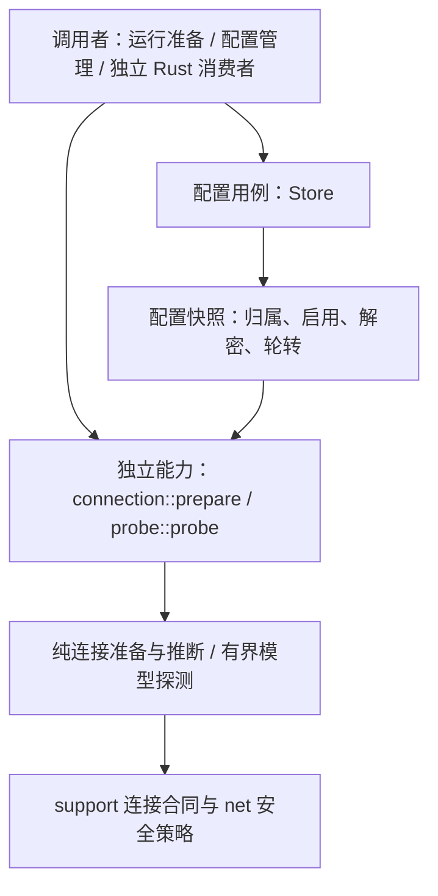

# 11 详细设计：aether-providers

> 状态：2026-10-28职责拆分已实施；本轮验证记录见 [90](90-开发任务清单.md)。本文件是Providers模块、Rust API、探测与配置事务的唯一详细权威；概要见 [03](03-契约优先架构与职责拆分设计.md)，跨模块迁移见 [24](24-详细设计-职责分层与实现契约.md)。历史数据库修复记录不代表本轮验证。
> 依赖：aether-support。不依赖任何其他 aether 模块。
> 蓝本：AutoNote `desktop/src-tauri/ai/src/{probe,classify,url}.rs`、`core/src/ai.rs`（存储、三态密钥）；agent_installer `src-tauri/src/probe/client.rs`（错误提示）。蓝本只作参考实现，不保留其 DTO 与角色表。
> Web实现：`packages/core/src/providers` 提供connection/infer/probe，`packages/worker/src/providers` 的ProviderService组合actor隔离D1文档、CredentialPort与OutboundHttp。公共DTO来自`packages/contracts/src/generated`；配置/keys/probe/model-options实际HTTP见23。密钥仅密文落库、列表返回mask，显式reveal必须通过宿主fresh-auth回调；准备固定连接不回写已接受run。Native数据库迁移不变，Worker使用独立公共文档schema，不读取产品旧表；平台与验收证据见29/90。

## 目录

- [1. 边界与能力图](#1-边界)
- [2. 数据模型与迁移](#2-数据模型providersdbmigration-1)
- [3. DTO 与配置语义](#3-dtots-rs-生成请求-deny_unknown_fields)
- [4. 模块与 Rust API](#4-模块与-rust-api)
- [5. 获取模型](#5-获取模型)
- [6. 推断](#6-推断)
- [7. 陷阱](#7-陷阱)
- [8. 切换与独立消费验收](#8-切换与独立消费验收)

## 1. 边界

- 管：服务商 → 线路 → 已选模型的增删改查；线路多密钥的加密存储与轮转；显式连接快照的准备；可独立调用的模型列表探测及其限定密钥失败切换；按模型名推断能力元数据。
- 不管：**角色与回落**（“对话用哪个模型”“写作没配就用对话模型”是应用策略，由运行应用服务中的 `KitHost::select_model` 决定，应用自己存偏好）；发起对话；生成第三方 CLI 配置。应用编排归 [25 运行应用服务](25-详细设计-运行应用服务.md)，不是 Tauri 插件中的另一套 Providers 逻辑。
- 协议：`anthropic-messages`、`openai-chat`、`openai-responses`。其他协议名（如某 CLI 的 `openai-completions`）是应用写配置时的映射，不进枚举。
- 思考能力由 `infer_reasoning(model_id, protocol, max_output)` 在探测、列表、model_options、resolve一致推断；已有null自动生效、不写库迁移，非空手工声明优先。当前保守支持Claude预算/adaptive与OpenAI o系列/GPT5族，协议不兼容或未知模型保持未知；实际强度只在聊天时调整。Cherry的registry补能力是交互依据，不移植整套目录。
- 不做：代理、每线路超时、预置服务商、用量统计、无差别重试。



图中 Store 不是网络执行的强制入口：持久化消费者通过 Store 准备快照；已有显式配置的消费者直接调用公开能力。只需要配置管理、只需要连接准备、只需要探测均可独立消费，不要求 Chat、runtime、Tauri 或产品实体。

## 2. 数据模型（`providers.db`，migration 1）

```sql
CREATE TABLE providers (
  id TEXT PRIMARY KEY, name TEXT NOT NULL, position INTEGER NOT NULL,
  created_at INTEGER NOT NULL, updated_at INTEGER NOT NULL
);
CREATE TABLE endpoints (
  id TEXT PRIMARY KEY,
  provider_id TEXT NOT NULL REFERENCES providers(id) ON DELETE CASCADE,
  slug TEXT NOT NULL, base_url TEXT NOT NULL,
  protocol TEXT NOT NULL CHECK (protocol IN ('anthropic-messages','openai-chat','openai-responses')),
  key_ciphertext BLOB, position INTEGER NOT NULL,
  UNIQUE (provider_id, slug)
);
CREATE TABLE models (
  endpoint_id TEXT NOT NULL REFERENCES endpoints(id) ON DELETE CASCADE,
  model_id TEXT NOT NULL,
  model_type TEXT NOT NULL CHECK (model_type IN ('chat','image','video','tts','stt','embedding','rerank','unknown')),
  type_source TEXT NOT NULL CHECK (type_source IN ('inferred','user')),
  context_window INTEGER, max_output INTEGER,
  can_vision INTEGER NOT NULL DEFAULT 0,
  supports_tools INTEGER,                  -- NULL = 未知
  position INTEGER NOT NULL,
  PRIMARY KEY (endpoint_id, model_id)
);
```

migration 5（不迁移旧密钥，旧单密钥作废）：删 `endpoints.key_ciphertext`，新增

```sql
CREATE TABLE endpoint_keys (
  id TEXT PRIMARY KEY,
  endpoint_id TEXT NOT NULL REFERENCES endpoints(id) ON DELETE CASCADE,
  label TEXT NOT NULL DEFAULT '', enabled INTEGER NOT NULL DEFAULT 1,
  key_ciphertext BLOB NOT NULL, position INTEGER NOT NULL
);
CREATE INDEX idx_endpoint_keys ON endpoint_keys(endpoint_id, position, id);
```

migration 6（请求配置，docs/36 of AutoNote）：

```sql
ALTER TABLE endpoints ADD COLUMN image_base_url TEXT;               -- 绘图 /images/generations 地址；NULL = 用 base_url
ALTER TABLE endpoints ADD COLUMN headers TEXT NOT NULL DEFAULT '{}'; -- 自定义请求头 JSON 对象
```

- `imageBaseUrl`：trim，空 → null；非空须 `http(s)://` 且 ≤ 2048 字节，否则 `bad_request{imageBaseUrl, invalid_url}`；运行时同样经 `api_base`。
- migration 7（图像编辑，AutoNote docs/37）：`ALTER TABLE endpoints ADD COLUMN image_edit_base_url TEXT;` —— 改图 `/images/edits` 地址，NULL = 用 `base_url`。`imageEditBaseUrl` 校验同 `imageBaseUrl`（错误 `bad_request{imageEditBaseUrl, invalid_url}`，省略 = 保持），运行时经 `api_base` 成为 `Connection.image_edit_base_url`。
- `headers`：≤ 20 个（`too_many`）；名称 trim 后为 HTTP token 1~100 字符、大小写不敏感去重，值 ≤ 2048 字符且无 `\r\n`（`invalid`）；保留名 `authorization`、`x-api-key`、`anthropic-version`、`host`、`content-type`、`content-length`、`accept`、`connection`、`transfer-encoding`、`cookie`（`reserved`）。字段均为 `bad_request{headers, …}`。
- `EndpointSave.headers` 省略保持已有配置，显式 `{}` 清空；不把 `null` 或空字符串定义为另一套清空请求。图像覆盖字段独立采用省略保持、null/空串恢复 base 的三态规则。
- 运行时（聊天每轮、绘图、探测 saved / 带 `endpointId` 的 draft）先加自定义头、后加系统头，`custom_headers` 再次跳过保留名，鉴权头不可能被覆盖；`Connection` 的 `Debug` 只打印请求头个数。

- 上限：服务商名 1~80 字符；每服务商 ≤ 20 条线路；每线路 ≤ 1000 个模型、≤ 16 个密钥；`slug` 1~40 个 `[a-z0-9-]`；`base_url` 为空或 `http(s)://` 且 ≤ 2048；密钥 ≤ 4096 字节；标签 ≤ 40 字符。
- 没有 `roles` 表。应用若要"记住对话默认模型"，自己存一个 `ModelRef`；模型被删后 `resolve` 返回 `not_found`，由应用提示重新选择。

## 3. DTO（`ts-rs` 生成；请求 `deny_unknown_fields`）

```ts
type Protocol = 'anthropic-messages' | 'openai-chat' | 'openai-responses'
type ModelType = 'chat' | 'image' | 'video' | 'tts' | 'stt' | 'embedding' | 'rerank' | 'unknown'
interface Model {
  id: string
  modelType: ModelType
  typeSource: 'inferred' | 'user'
  contextWindow: number | null
  maxOutput: number | null
  canVision: boolean
  supportsTools: boolean | null
  reasoning: ReasoningConfig | null
  nativeWebSearch: boolean
}
interface EndpointKey {
  id: string
  label: string
  enabled: boolean
  masked: string | null
  readable: boolean
}
interface Endpoint {
  id: string
  slug: string
  baseUrl: string
  protocol: Protocol
  keys: EndpointKey[]
  probeUrl: string
  models: Model[]
  imageBaseUrl: string | null
  imageEditBaseUrl: string | null
  headers: Record<string, string>
}
interface Provider {
  id: string
  name: string
  enabled: boolean /* 关闭 = 模型不出现在选择器且不能运行 */
  endpoints: Endpoint[]
}
interface EndpointSave {
  id?: string
  slug: string
  baseUrl: string /* 可为 '' */
  protocol: Protocol
  models: Model[]
  imageBaseUrl?: string | null
  imageEditBaseUrl?: string | null
  headers?: Record<string, string> /* 省略 = 保持；清空规则见§2 */
}
interface EndpointKeySave {
  endpointId: string
  id?: string /* 缺省 = 新增 */
  key?: string
  label?: string
  enabled?: boolean
}
interface ProviderSave {
  id?: string
  name: string
  enabled?: boolean /* 缺省 = 保持；新建默认 true */
  endpoints: EndpointSave[]
}
interface ModelRef {
  endpointId: string
  modelId: string
}
interface ModelOption extends ModelRef {
  label: string /* "服务商 · 线路 · 模型" */
  modelType: ModelType
  supportsTools: boolean | null
  reasoning: ReasoningConfig | null
  nativeWebSearch: boolean
}
interface ProbeResult {
  probeUrl: string
  models: (Model & { group: string | null })[]
  error: ProbeError | null
  suggestedProtocol: Protocol | null
}
interface ProbeError {
  kind:
    | 'missing_key'
    | 'unauthorized'
    | 'not_found'
    | 'rate_limited'
    | 'status'
    | 'timeout'
    | 'connect'
    | 'blocked_address'
    | 'invalid_body'
  status: number | null
  message: string | null /* 上游原文，已打码，≤300 字符 */
  hint: string | null /* i18n key */
}
```

nativeWebSearch默认false，用户显式声明；只允许chat模型与Messages/Responses协议，保存拒绝Chat Completions声明。搜索优先路由见17；不凭兼容端点模型名字猜测原生搜索。ModelSave的reasoning可省略/nullable，其他字段按生成DTO提交。

providers.db保留migration1原始建表、migration2新增reasoning；migration3新增native_web_search（NOT NULL DEFAULT 0）；migration4新增providers.enabled；migration5换成endpoint_keys（见§2）。2026-10-14修复：首个原生搜索版本误改migration1而保留user_version=2，导致旧库模型列表/能力/连接查询缺列。打开时按实际列区分两种v2，经既有升级事务/备份升至v3；已包含列的v2只推进版本，保留原生声明。不得删库、清空模型或用空列表吞掉SQL错误。回归覆盖两种v2、v4、重启、模型/思考参数保留。

migration 10（AutoNote docs/41）：`models` 增加 `name TEXT`、`group_name TEXT`（trim，空串存 NULL，≤80 字符，`bad_request{name|groupName: too_long}`）、`pricing TEXT`（JSON `ModelPricing`，仅 chat，`bad_request{pricing: invalid}`）。`ModelOption` 增加 `name`，`label` 不变。`reasoning` 列：NULL = 未设置（chat 读取时推断），字面量 `'none'` = 用户关闭（读取为 null，不推断），其他为 JSON；唯一读取函数 `read_reasoning`。`ModelSave.reasoning`：省略 = 保留并按新协议/max_output 重新校验，`null` = 关闭，对象 = 替换。校验原因：`contextWindow|maxOutput invalid`（< 1）、`maxOutput exceeds_context`（chat 且 ≥ contextWindow）、`reasoning invalid_efforts|protocol_mismatch|invalid_budget|unexpected_budget`。

- 密钥（详见 AutoNote `docs/34` §3）：`keys` 按 `position, id`；`masked` 首 4 尾 4 打码，解不开时 `masked=null, readable=false`（换了 Windows 账户）。每个动作立即走 `save_key`/`remove_key`，密钥不进 `ProviderSave`。新增必须带 `key`；修改时省略字段保持不变。`key`/`label` trim 后保存。错误：`not_found{endpoint|key}`；`bad_request{apiKey: empty|too_long|duplicate}`（重复按同线路明文比较）、`bad_request{label: too_long}`、`bad_request{keys: too_many}`。先加密再写库，加密失败原数据不变；删线路/服务商/密钥、换密钥后在提交后 `forget` 旧密文。
- 轮转的跨请求状态只归 Store：启用密钥按 `position, id`，游标为进程内“线路 id → 下次起点”，重启从头。一次成功的配置快照读取只预留一个起点，返回循环一圈的尝试顺序；全部停用 = 无密钥。任一启用密钥解不开 → `needs_config{key_unreadable}`，不跳过坏密钥。指定单个 `key_id` 时不推进整条线路的游标。
- 本次失败切换只归相应执行能力：聊天每一轮、绘图、模型探测消费已固定的顺序；上游在首字节前返回 401/403/429 且还有下一个 → 换下一个；其他错误、已开始输出或已试完 → 报错。不同能力的执行规则由各自模块实施，不由 Store 发请求；脱敏 `known` 包含本次全部密钥。
- 保存是**整服务商替换**：事务内按 `ProviderSave` 重写线路与模型，请求里没有的线路被删除（连同其密钥）。已有线路必须带回 `id`。事务失败回滚，旧配置和密文保持；替换/删除后仅在提交成功后 `forget` 旧密文，不在未提交时破坏凭据。

## 4. 模块与 Rust API

### 4.1 职责与公开路径

| 模块                  | 职责                                                                                          | 禁止承担                                  |
| --------------------- | --------------------------------------------------------------------------------------------- | ----------------------------------------- |
| `store`               | providers.db、配置/密文事务、归属与启用判断、读取模型能力、凭据解密、每线路轮转；组合配置用例 | HTTP 请求实现、跨网络持数据库锁、后台任务 |
| `connection`（公开）  | 显式 `EndpointSnapshot`/`ConnectionSnapshot` 与 `prepare`                                     | SQLite、原生凭据读取、全局轮转游标        |
| `probe`（公开）       | 显式 `ProbeInput` 的模型列表与协议建议探测                                                    | Store/数据库查询、保存探测结果            |
| `dto`、`infer`、`url` | 既有 DTO、真实模型家族推断和地址规则；既有根导出保持                                          | 应用角色策略、Search 供应商 URL 规则      |

不新增 crate、通用 Provider trait 或另一套网络客户端。自定义头应用/保留名防护迁往 `aether_support::net::custom_headers`，头字段校验合同仍见本文件§2，公共基础设施接口引用 [10](10-详细设计-基础与可观测性.md)。

### 4.2 配置 Store API

```rust
pub struct Store { /* 配置连接锁、线路轮转、默认 AddressPolicy */ }
impl Store {
    pub fn open(root: &Path) -> Result<Self, KitError>;
    pub fn list(&self) -> Result<Vec<Provider>, KitError>;
    pub fn save(&self, input: ProviderSave) -> Result<Vec<Provider>, KitError>;
    pub fn delete(&self, id: &str) -> Result<Vec<Provider>, KitError>;
    pub fn set_enabled(&self, id: &str, enabled: bool) -> Result<Vec<Provider>, KitError>;
    pub fn save_key(&self, input: EndpointKeySave) -> Result<Vec<Provider>, KitError>;
    pub fn remove_key(&self, endpoint_id: &str, key_id: &str) -> Result<Vec<Provider>, KitError>;
    pub fn reveal_key(&self, key_id: &str) -> Result<Zeroizing<String>, KitError>;
    pub fn model_options(&self, filter: ModelFilter) -> Result<Vec<ModelOption>, KitError>;
    pub fn snapshot(&self, model: &ModelRef) -> Result<connection::ConnectionSnapshot, KitError>;
    pub fn endpoint_snapshot(&self, endpoint_id: &str) -> Result<connection::EndpointSnapshot, KitError>;
    pub fn resolve(&self, model: &ModelRef) -> Result<Connection, KitError>;
    pub fn endpoint_connection(&self, endpoint_id: &str) -> Result<Connection, KitError>;
    pub async fn probe(&self, target: ProbeTarget, cancel: &CancellationToken)
        -> Result<ProbeResult, KitError>;
}
pub struct ModelFilter { pub model_type: Option<ModelType>, pub supports_tools: Option<bool> }
pub enum ProbeTarget {
    Saved { endpoint_id: String },
    Draft { base_url: String, protocol: Protocol, endpoint_id: Option<String>, key_id: Option<String> },
}

// Connection/Protocol 的字段和安全合同只在 10 定义，不在此复制。
pub use aether_support::{Connection, Protocol};
pub fn infer(model_id: &str) -> Inferred;
pub fn api_base(base_url: &str) -> String;
```

`resolve` = `snapshot(model)` → `connection::prepare`；`endpoint_connection` = `endpoint_snapshot(id)` → `prepare(ConnectionSnapshot { endpoint, model: None })`。它们是配置消费用例，不是 deprecated 兼容壳，不各留一份归一/解密实现。模型不存在或所属服务商已关闭仍为 `not_found{entity:"model"}`；选模型时空地址仍为 `needs_config{missing_url}`。不选模型的 `endpoint_connection` 保持已有用途及默认能力，不借此新增必须选模型的约束。

`Store::probe` 保留 Saved/Draft 应用用例：Saved 使用保存的配置；Draft 使用本次地址和协议，给出 `endpoint_id` 时读取该线路的密钥与自定义头。再给 `key_id` 则仅取这一个，必须属于指定线路，否则 `not_found{key}`；没有线路引用的 Draft 不隐式从别处继承密钥。完成输入校验、归属/解密、必要的一次轮转后，释放配置锁，以默认 `AddressPolicy` 调用唯一的 `probe::probe`。Providers 不新增“允许内网”配置字段。配置失败返回 `Err`，上游/网络失败进入 `ProbeResult.error`，取消返回 `cancelled`。

ProvidersPort 客户端签名只在 [16 UI](16-详细设计-kit-ui.md) 定义；保存、探测与凭据会话的 UI 无关流程只引用 [30 客户端流程与凭据会话](30-详细设计-客户端流程与凭据会话.md) §3/5。本文件的 Store/独立能力 API 不复制前端队列或 generation 算法。

### 4.3 显式快照与独立入口

```rust
pub mod connection {
    pub struct EndpointSnapshot {
        pub endpoint_id: Option<String>,
        pub base_url: String,
        pub protocol: Protocol,
        pub api_keys: Vec<Zeroizing<String>>,
        pub headers: Vec<(String, String)>,
        pub image_base_url: Option<String>,
        pub image_edit_base_url: Option<String>,
    }
    pub struct ConnectionSnapshot {
        pub endpoint: EndpointSnapshot,
        pub model: Option<Model>,
    }
    pub fn prepare(snapshot: ConnectionSnapshot) -> Result<Connection, KitError>;
}
pub mod probe {
    pub struct ProbeInput {
        pub base_url: String,
        pub protocol: Protocol,
        pub api_keys: Vec<Zeroizing<String>>,
        pub headers: Vec<(String, String)>,
        pub policy: AddressPolicy,
    }
    pub async fn probe(input: ProbeInput, cancel: &CancellationToken)
        -> Result<ProbeResult, KitError>;
}
```

- `EndpointSnapshot.base_url` 保留配置原始地址，`api_base` 仅用于本模块连接/探测（去尾 `/`、未以 `/v1` 结尾则追加、幂等），不得扩散到 Search。图像覆盖地址也只在 `connection::prepare` 统一归一。
- Store 读取 `ConnectionSnapshot.model` 时已应用用户覆盖、推断及显式关闭 reasoning 规则；prepare 保持这些语义，不把用户关闭重新推断回来。独立调用者提供相同的有效模型元数据；`model: None` 表示未选模型，不表示不存在模型。
- 公开结构体不是可信边界：prepare 仍检查连接适用字段、协议/能力组合及头配置，不读库或推进游标；实际 HTTP 执行层仍必须进行 URL/DNS 策略检查。`endpoint_id` 仅标识来源，不替代授权。
- 快照与 `ProbeInput` 是 Rust 内部明文输入，不派生 `Serialize`/`Debug`，不生成 TS/JSON、不持久化、不进入日志或事件。密钥用 `Zeroizing<String>`，自定义头也视为敏感；调用结束/取消后释放所持输入，不为诊断额外复制明文。
- `api_keys` 已是本次尝试顺序。独立入口只消费该顺序一次，不拥有跨请求游标；prepare 不因运行消费再轮转。空数组表示无密钥，是否允许由执行能力判断，chat 非回环仍报 `missing_key`。
- 同一快照在准备完成后固定：随后保存/禁用/删除配置不回写已接纳运行；下一次准备读取新配置。运行生命周期与配置快照接入位置只引用 [25](25-详细设计-运行应用服务.md)，不在本模块复制运行状态机。

## 5. 获取模型

- `GET api_base + "/models"`；openai-* 用 Bearer；anthropic 用 `x-api-key` + `anthropic-version: 2023-06-01`，同时带 Bearer（不少中转只认 Bearer）。
- 所有网络步骤使用本次 `ProbeInput.policy`，包括 `/models` 及额外 `/messages` 协议建议；先 `net::check_url`，连接时校验解析地址。独立输入可显式指定策略，Store 用例使用其默认策略，不能把快照或裸 URL 当作内网授权；被拦截 → `blocked_address`。
- 保持连接 10s、单次 HTTP 请求总 20s、响应体 ≤ 4 MiB、禁止重定向的预算（包括建议请求的有界读取）。401/403/429 可按本次密钥顺序有限切换；网络/超时/其他状态不重试，不跨线路。取消覆盖所有密钥尝试、响应读取及额外建议请求，已取消不得发起下一请求。
- 解析 `{data:[{id}]}`、`{models:[{id}|{name}]}`、`[string]`；去重排序；空列表 → `invalid_body`。
- 错误：无密钥且非回环 → `missing_key`（不发请求）；401/403 `unauthorized`；404 `not_found`；429 `rate_limited`；其他非 2xx `status`；超时 `timeout`；DNS/连接/TLS `connect`；JSON 失败 `invalid_body`。
- `hint`：404 且地址未含 `/v1` → `providers.hint.missing_v1`；`connect` 且主机为 IP → `providers.hint.check_network`；`unauthorized` → `providers.hint.check_key`。
- 协议建议：列表成功、当前协议不是 `anthropic-messages`、且列出了 `claude` 组模型时，用列表里第一个 claude 模型和本次成功的密钥再发 `POST api_base + "/messages"`，请求体含该 `model`、`max_tokens: 1`、`messages: []`。返回 400/422 说明该空消息校验路径支持 Messages，此时 `suggestedProtocol = "anthropic-messages"`；404/401/5xx/网络失败一律为 `null`，不把建议失败冒充列表失败。该请求不要求生成内容，但不替上游保证计费行为。模型 id 必须真实存在，new-api 一类中转会先按模型找渠道，假 id 可能返回 503。UI 在检测结果下方给出「改用 Anthropic 协议」，点一下改协议并保存；Claude 的图片和思考在 OpenAI 兼容入口常被中转丢弃。
- 自定义头先加、系统鉴权/协议头后加；保留名不能覆盖。失败信息对本次全部密钥脱敏，沿用§3 `ProbeError` 分类与 message ≤300 字符，不能把请求/响应原文直接写日志。探测不写库；用户在 UI 挑选后随 `save` 落库。

## 6. 推断

- 规则与测试数据：`packages/ui/fixtures/model-classify.json`（Rust 与 TS 共用；放在 npm 包内，宿主经 git 依赖安装后即可读取）。
- 类型：id 含 `embed` → embedding；`rerank` → rerank；`tts`/`speech` → tts；`whisper`/`stt`/`transcri` → stt；`dall-e`/`image`/`flux`/`imagen` → image；`video`/`sora`/`veo` → video；其他 → chat。
- `context_window`/`max_output`/`can_vision`：按家族前缀（claude、gpt、o\d、gemini、deepseek、qwen、glm、kimi、moonshot）查表；查不到为 `null`/`false`。
- `supports_tools`：chat 且家族在表内 → `true`；否则 `null`。
- 用户改过类型（`type_source='user'`）的模型，之后不被推断覆盖。

## 7. 陷阱

1. 保存不带已有线路 `id` → 被当成新线路，旧线路及其模型被删，应用存的 `ModelRef` 失效。UI 必须保留 id。
2. 密钥不随 `save` 提交：UI 每个密钥动作单独调用 `save_key`/`remove_key`，保存服务商不影响已有密钥。
3. `api_base` 幂等：覆盖 `…/v1`、`…/v1/`、`…/api/v1` 单测。
4. `Connection` 不能出现在日志里：其 `Debug` 只打印 `api_keys` 个数（10 文档 §4.1），不要再为它派生 `Debug`/`Serialize`。

## 8. 切换与独立消费验收

本节是本轮实施后的验收要求，不是已执行记录。本轮已新增无 Store 的公开连接/探测 loopback 行为用例，并保留既有配置迁移回归；尚未运行构建、测试、格式化或真实上游探测。

### 8.1 一次切换

在现有 crate 内拆出 `connection`/公开 `probe`，迁出 Store 中网络实现；Store 的配置用例调用唯一能力实现。既有插件管理/探测签名与 DTO 不因拆模块改名，现有消费者一次迁完；运行应用服务通过公开 Store/connection/probe 边界接入，不引用私有文件。删除重复网络路径，不留新旧执行器、deprecated 别名或第二套模型推断。数据库迁移序列、已保存 id/密文及既有供应商协议保持；本轮不借职责拆分另建数据库。

### 8.2 行为证据

| 消费层                     | 必须验证的行为                                                                                                                                                        |
| -------------------------- | --------------------------------------------------------------------------------------------------------------------------------------------------------------------- |
| 独立 `connection::prepare` | 无 Store、无 SQLite/凭据服务；原始地址与两个图像覆盖地址统一归一、`api_base` 幂等；模型能力/用户关闭 reasoning 保持；头校验与显式输入失败；给定密钥顺序不重排、不轮转 |
| 独立 `probe::probe`        | 无 Store、无临时数据库的真实 loopback 请求，证明自定义头及各协议认证、显式双 key 的 401/403/429 fallback、其他错误不重试、结果解析与脱敏；缺密钥规则保持              |
| 探测安全与生命周期         | `/models` 和 `/messages` 都受同一策略、取消和响应预算约束；已取消不发下一请求；禁止重定向、DNS/地址拒绝、超大体、敏感系统头优先；建议失败不覆盖成功列表               |
| Store 配置用例             | Saved/Draft、跨 endpoint key 拒绝、指定 key 不推进整线路游标、每次准备只推进一次、启用判断与不可读 key 错误、整服务商替换事务和提交后凭据清理不回归；配置锁不跨 HTTP  |
| 迁移与消费                 | 保留既有数据库修复/重启回归；只 Providers 的消费者不依赖 Chat/runtime/Tauri；插件/运行准备使用同一能力边界且无旧执行副本                                              |

断言以外部可观察结果为准，不以“源码出现调用函数名”替代消费者测试。真实付费上游未联验时明确标注，仅把 loopback 作为协议/边界证据；实施结果与命令由迁移记录登记。
