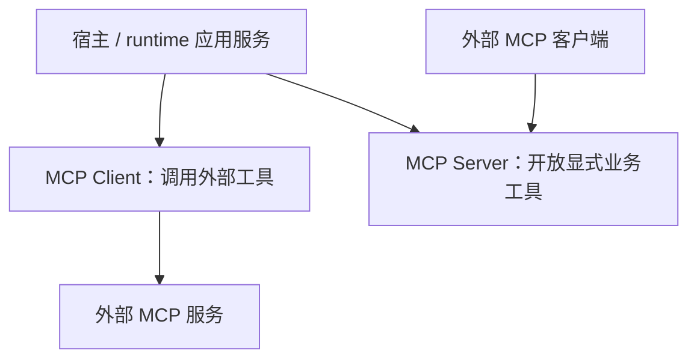

# 13 详细设计：MCP 索引与边界

> 状态：Client已拆同步Store与McpRuntime，Server已拆HTTP与handler；本轮验证记录见 [90](90-开发任务清单.md)。本文件只说明两个方向及设计导航，不保留Client/Server的第二套接口。详细合同见27/28；概要见 [03](03-契约优先架构与职责拆分设计.md)。

## 1. 两个独立方向

- `aether-mcp-client`：让本程序调用外部 MCP 工具，管理配置、凭据、信任、工具审批默认值及受控连接。Client 不决定宿主业务的最终授权。
- `aether-mcp-server`：把宿主显式注册的能力开放给外部 MCP 客户端，拥有回环 HTTP 入口、token 与 scope 边界。应用内 Chat 可用不等于对外开放。
- 两 crate 互不依赖，都不依赖 Chat、Skills 或 Providers；共享基础设施不成为通用工具/授权框架。Skills 不登记或管理 MCP。

Client 使用共享 net/sse 和 stdio 传输，不让 rmcp 客户端 HTTP 绕过地址策略；Server 使用 rmcp，但其类型不泄露到公开 API。同进程启用两方向时，由 Client session 的 own_port 规则防自调用，具体规则只在 27 定义。

## 2. 唯一权威与阅读顺序

| 主题                                                  | 唯一详细设计                                   |
| ----------------------------------------------------- | ---------------------------------------------- |
| Client Store/配置 DTO、数据迁移、凭据事务与缓存       | [27 MCP 客户端](27-详细设计-MCP客户端.md) §2   |
| McpRuntime、session、后台刷新和 shutdown/Drop         | 27 §3                                          |
| HTTP/stdio 协议、平台差异、进程与安全限制             | 27 §4                                          |
| McpCallResult、结构化/非文本/isError、形状与字节预算  | 27 §5                                          |
| Server 注册 API、token/settings、启停与端口           | [28 MCP 服务端](28-详细设计-MCP服务端.md) §2–3 |
| HTTP 认证、可信 Grant、scope、handler 与协议映射      | 28 §4–5                                        |
| MCP 与 Chat 的唯一适配、工具 payload 与应用服务所有权 | [25 运行应用服务](25-详细设计-运行应用服务.md) |
| 接入层命令、feature、权限                             | [15 接入层](15-详细设计-接入层.md)             |
| UI 配置生成和复制流程                                 | [16 UI](16-详细设计-kit-ui.md)                 |

配置 Store 不拥有运行任务，通用 MCP 结果不等于模型文本；Server HTTP 认证不等于 handler 可接受任意伪造授权 DTO。跨模块迁移顺序与验证安排由 24/90 记录，本文件不再通过旧定义与新定义“以某文档为准”维持双轨。

## 3. 保留范围与历史

- Client 的 OAuth、resources/prompts/sampling 仍不在范围；Worker HTTP Client配置/会话已实现，不能与Server侧OAuth混淆。
- Native Server仍只监听回环；Worker另实现HTTPS Public MCP/OAuth PKCE、API key/grant/scope与宿主业务授权，见23/28/29，不能由本地HTTP冒烟证明HTTPS OAuth。
- 原 13 Client 部分整体迁入 27，Server 部分整体迁入 28；原 SQL migration、接口安全限制、stdio Windows/Unix 差异及历史来源随各自章节迁入，不因索引缩短而删除证据。
- 历史蓝本：Client 参考 AutoBee `shell/src/llm/{mcp,mcp_url,mcp_external}.rs`，Server 参考 AutoNote `desktop/src-tauri/mcp/src/*`。蓝本不是当前接口权威。
- 本轮 Client 已移除 Store 异步 refresh/session 和旧文本结果 variant；Server handler 已从 HTTP 入口移出。宿主适配与集成验证由各自负责人统一完成，不能以文档状态替代执行证据。
