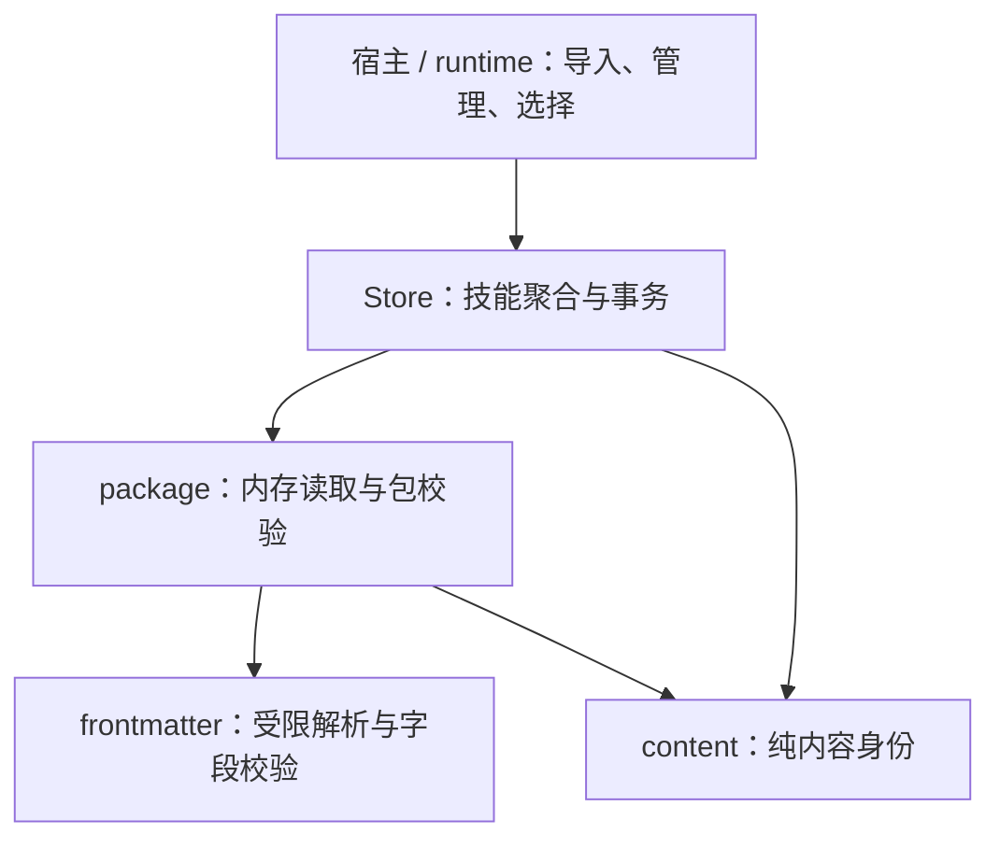
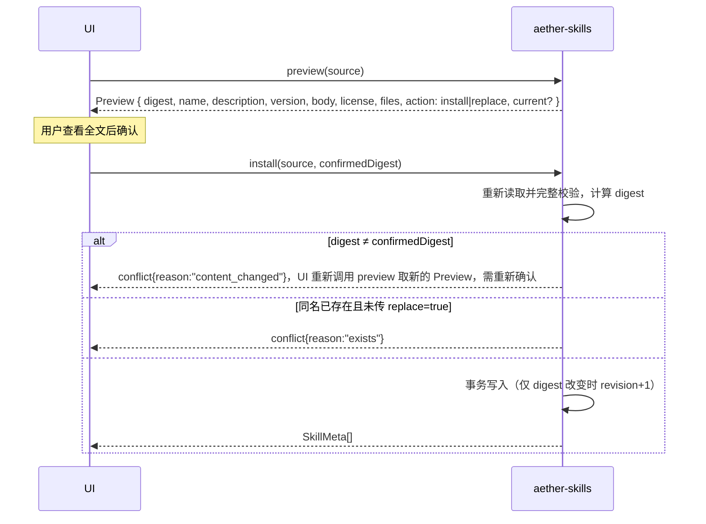

# 14 详细设计：aether-skills

> 状态：内容身份纯函数提取已实施；本轮验证记录见 [90](90-开发任务清单.md)。本文件是aether-skills包、内容身份、事务和公开接口的唯一权威。依赖aether-support，不依赖MCP、Chat；未选技能时，Chat行为与未安装Skills一样。概要见 [03](03-契约优先架构与职责拆分设计.md)。
> 蓝本：AutoBee `shell/src/llm/skills.rs`（内存解析 ZIP、白名单、大小上限、凭据检测）；voynote `src-tauri/src/skill.rs`（目录导入、手写技能）。不保留它们的包格式与 MCP 绑定。
> Web实现：`packages/core/src/skills` 已实现受限包解析、digest/修订/预览/安装与固定快照；`packages/worker/src/skills` 的SkillsService用actor隔离D1 catalog CAS和不可变R2包保存，加载核对引用/文件hash/digest。公共DTO来自`packages/contracts/src/generated`，HTTP与绑定见23。Skills只保存脚本、不执行；旧包对象保留供并发读取及显式GC，不承诺D1/R2跨服务事务。Native迁移/事务合同保持，真实验收记录见90。

## 1. 边界

- Skill = 用户可查看、选择、版本化的**领域指引正文**。它改变模型"怎么做"，不赋予任何工具、网络、文件或进程权限。
- 管：导入（单个 `SKILL.md` / 目录 / ZIP）、预览与确认、手写与编辑、修订号、删除、排序、宿主内置技能、按次选择的快照；保存包内的脚本、参考文档与资源文件，并按 `id + revision` 提供读取（§6 `files`/`file`）。
- 不管：**执行脚本**、安装钩子、下载依赖、把包内文件写到磁盘、读任意文件、模型自主加载其他技能（D5）、**登记或管理 MCP 服务**。包内文件只是数据：是否、何时、以何种方式运行脚本由宿主决定并负责审批，本 crate 只交出字节。技能正文可以写"需要地图工具"，实际服务由用户在 MCP 设置里配置。
- 没有"最多启用 3 个"之类的全局开关：技能按**每次运行**选择，受预算约束（12 文档 §2.1）。

### 1.1 模块与依赖



- `store.rs` 保留安装/替换、revision、内置同步、文件读写及快照聚合，不能因拆 digest 把事务切散。
- `package.rs` 负责路径、大小、链接、凭据检测及文件 hash；`frontmatter.rs` 负责既有解析归一与字段规则。
- 新公开 `content` 模块只编码已校验数据并计算身份，不引用 SQLite、Store、DB、文件系统或网络；它不是包解析器。
- `dto.rs` 定义现有管理 DTO，`lib.rs` 导出 content；不增加工具/脚本执行框架或能力权限。

## 2. 包格式

```text
example-skill/        # 或 example-skill.zip（根目录或唯一顶层目录），或单个 SKILL.md
├── SKILL.md          # 必需；frontmatter 规则见 §2.1
├── LICENSE           # 可选（LICENSE / LICENSE.md / LICENSE.txt；内容保存，展示用）
├── scripts/**        # 可选；脚本，UTF-8 文本（用法由 SKILL.md 正文说明）
├── references/**     # 可选；参考文档，UTF-8 文本
└── assets/**         # 可选；任意文件（可二进制）
```

- 采用开放的 Agent Skills 目录约定；frontmatter **不**列出脚本，文件归属只由所在目录决定（`scripts/` → `script`、`references/` → `reference`、`assets/` → `asset`）。
- 三个子目录可以嵌套，文件最多位于 4 层目录内（`scripts/a/b/c/x.py` 合法，`scripts/a/b/c/d/x.py` 超深）。每个路径段只允许 `[A-Za-z0-9._-]` 且不得以 `.` 开头（排除 `.git`、`.DS_Store` 等隐藏项）。

```markdown
---
name: travel-planner
description: 帮用户规划公共交通出行
version: 1.2.0
---

（正文）
```

### 2.1 受限 frontmatter 解析器（自写）

- 首行必须是 `---`，到下一个独占一行的 `---` 结束；文件开头的 BOM 去掉；`\r\n` 统一为 `\n`。
- 每行只能是 `key: value`；key 匹配 `^[a-z][a-z0-9_-]{0,31}$`；value 为纯标量，或单/双引号字符串（双引号内只支持 `\"` 与 `\\` 转义）。
- 拒绝：重复键、缩进行（嵌套）、`- ` 列表、`{`/`[` 流式集合、`&`/`*` 锚点与别名、`!` 标签、`|`/`>` 块标量、多文档、frontmatter > 4 KiB。
- 已知键：`name`（必需，`^[a-z0-9][a-z0-9-]{0,63}$`）、`description`（必需，1~500 字符）、`version`（可选，≤ 32 字符；缺省为 `null`，表示"未版本化"，不编造版本）。其他合法键保留在 `extra` 中原样展示，不解释。
- 这不是 YAML 的完整实现，只接受上述子集；不在子集内的一律 `bad_request{reason:"frontmatter_unsupported", field:"<行号>"}`。

### 2.2 限制（读取过程中强制执行，不相信压缩包声明的长度）

| 项                                                 | 上限                    |
| -------------------------------------------------- | ----------------------- |
| ZIP 文件                                           | 5 MiB                   |
| 条目数（ZIP 条目；目录导入时为遍历到的文件与目录） | 200                     |
| 累计解压/读取字节                                  | 16 MiB                  |
| 单个 `scripts/`、`references/`、`assets/` 文件     | 1 MiB                   |
| `SKILL.md`                                         | 64 KiB（正文 ≥ 1 字符） |
| `LICENSE`                                          | 32 KiB                  |
| 目录层级                                           | 4                       |

- 接受的文件：`SKILL.md`、`LICENSE`、`LICENSE.md`、`LICENSE.txt`，以及 `scripts/**`、`references/**`、`assets/**` 下的文件（§2）。其他任何路径 → `bad_request{reason:"unsupported_files"}`，并列出路径（目录带尾部 `/`）。
- ZIP 中拒绝：绝对路径、`..`、反斜杠路径、规范化后重复的路径、符号链接条目、加密条目。
- 目录导入：递归读取上述三个子目录，其他子目录列为不支持；遇到符号链接或 junction 一律拒绝，不跟随。
- 全程在内存中处理，不解压到磁盘。每个文件按 `min(自身上限, 剩余累计额度) + 1` 字节截断读取，单文件超限与累计超限都不依赖 ZIP 头里的长度。
- `scripts/`、`references/` 必须是合法 UTF-8；`assets/` 可为任意字节。
- 疑似凭据（`looks_like_secret`）→ 拒绝，并给出位置（`<路径>:<行号>`，如 `SKILL.md:6`、`scripts/run.py:2`），原文不进日志、不进错误消息。所有文本文件都检测：`SKILL.md`、许可文件、脚本、参考文档，以及能按 UTF-8 解码的资源文件。检测只是辅助，不保证发现所有秘密。
- 错误（均为 `bad_request`）：超限 `reason:"too_large"`，`field` 为 `zip`/`entries`/`total`/`SKILL.md`/许可文件名/文件路径，带 `limit`；ZIP 路径 `field:"zip"` + `absolute_path`/`path_traversal`/`backslash_path`/`duplicate_path`/`link`/`encrypted`/`invalid`；目录中的链接 `field:"<相对路径>"`（导入根本身为 `path`）+ `link`；非法文件名 `field:"<路径>"` + `invalid_name`；超深 `field:"<路径>"` + `too_deep`（带 `limit:4`）；脚本或参考文档非 UTF-8 `field:"<路径>"` + `not_utf8`；凭据 `field:"<路径>:<行号>"` + `secret_detected`；`unsupported_files` 的 `field` 为逗号分隔的路径。

## 3. 数据模型（`skills.db`，migration 1–2）

```sql
CREATE TABLE skills (
  id TEXT PRIMARY KEY,
  name TEXT NOT NULL UNIQUE,              -- frontmatter name（slug）
  description TEXT NOT NULL,
  version TEXT,                           -- NULL = 未版本化
  body TEXT NOT NULL,
  license TEXT,
  extra TEXT NOT NULL DEFAULT '{}',       -- 未解释的 frontmatter 键
  origin TEXT NOT NULL CHECK (origin IN ('imported','manual','builtin')),
  revision INTEGER NOT NULL,              -- 内容每变一次 +1
  digest TEXT NOT NULL,                   -- 见下；预览与安装用同一算法
  position INTEGER NOT NULL,
  created_at INTEGER NOT NULL, updated_at INTEGER NOT NULL
);
```

migration 2：

```sql
CREATE TABLE skill_files (
  skill_id TEXT NOT NULL REFERENCES skills(id) ON DELETE CASCADE,
  path TEXT NOT NULL,                     -- 包内相对路径，`/` 分隔，如 scripts/run.py
  kind TEXT NOT NULL CHECK (kind IN ('script','reference','asset')),
  size INTEGER NOT NULL,                  -- 字节
  sha256 TEXT NOT NULL,                   -- 小写十六进制
  content BLOB NOT NULL,
  PRIMARY KEY (skill_id, path)
);
```

### 3.1 纯内容身份（公开 `content` 模块）

```rust
pub struct ContentIdentity<'a> {
    pub name: &'a str,
    pub description: &'a str,
    pub version: Option<&'a str>,
    pub body: &'a str,
    pub license: Option<&'a str>,
}
/// 前置条件：文本字段、路径和文件 hash 已校验；files 按 path 稳定升序且路径唯一。
pub fn digest<'a>(content: ContentIdentity<'_>,
                  files: impl IntoIterator<Item = (&'a str, &'a str)>) -> String;
```

这是借用输入的纯函数，不查询 DB、不在每个 PackageFile 上 clone path/hash，不在内部增加 trim、大小写转换或换行归一化。包读取边界保证列表排序/唯一；Stored 来源在原事务内以 `ORDER BY path` 读取拥有的 `(path, sha256)` 后再借用调用。公开 API 文档必须写明前置条件；摘要不替代调用方校验。

#### 精确字节合同

输出为 SHA-256 的 64 位小写 hex，**不是 ZIP 原始字节 hash**。字段编码如下：

- `E(None)` = 单字节 `0`。
- `E(Some(s))` = 单字节 `1` + `s` 的 UTF-8 **字节长度**（u64 little-endian）+ 原 UTF-8 字节。因此 None 与 Some(空串) 不同，字段边界不可通过拼接碰撞。
- 输入顺序严格为 `E(Some(name))`、`E(Some(description))`、`E(version)`、`E(Some(body))`。
- **仅当** license 存在（含 Some(空串)）或 files 非空，继续追加 `E(Some("package"))`、`E(license)`，随后按 path 升序对每个文件追加 `E(Some(path))`、`E(Some(sha256))`。不额外写入文件数或新分隔符。
- `extra`、数据库 id/revision/origin/timestamps、position、文件 kind 和文件字节本身不直接参与；文件字节通过既有小写 sha256 参与。使用已有解析/校验后的内容（§2.1 的 BOM/CRLF 处理仍在解析边界），digest 不新增归一化。

无 license 且无文件时不写 package 尾段，保持 migration 1 摘要与 revision。migration 1 时代含许可的导入技能在下次替换/编辑时按既有 migration 2 规则可能增加一次 revision；本轮纯函数提取不得再改变这些值。`extra` 等不参与身份的字段变化不单独触发 revision。

#### 仓储适配

Store 的 `Content/FileSource` 仍是持久化聚合，不迁到纯 content。Package 来源直接借用已有文件列表；Stored 来源的 SQL 读取保持在仓储。删除旧混合的 `Content::digest(db)` 计算路径，改为显式读取身份输入后调用唯一纯 digest；不要留下第二份字节算法。`hex` 移到 content 中 crate-private 共享，package 文件 sha256 复用它，不对外新增万能 hex API，不保留 `store::hex` 重导出。

### 3.2 事务与 revision

- 文件与技能在同一 `skills.db` 事务写入；安装/替换整体替换文件，身份 digest 变化才 `revision+1`；相同内容重装不无故递增。增删文件、路径变化或字节变化通过 `(path, sha256)` 改变身份。删除技能级联删除文件。
- 手写新建与内置技能没有文件；编辑导入正文保留原文件与许可，hash 读取、revision 判断及写入不跨事务。`duplicate` 先开启 immediate 事务再读取源正文并复制文件，副本来自同一个源修订，避免另一连接中途替换/删除源技能。
- preview/install 复用同一个纯身份算法；install 重新读取校验包后比对确认 digest，之后在同一写事务内处理存在性、替换、revision 与文件写入。任一步失败不得留下部分更新。没有跨库事务或“预览后文件不可变”的保证。
- 内置同步在原单事务中完成：`Store::open` 按宿主内容和 name 同步；身份变化递增 revision，不再提供的内置删除；用户技能占名则跳过并安全 warn，不覆盖用户副本。内置不可编辑/删除；复制为 manual、新名称，之后内置更新不影响副本。
- migration 1→2 只新增表，已有技能、revision、排序不变。本轮不新增 migration、不重算全库 digest。排序不改变 revision；`extra` 等排除字段保持上节身份语义，不能用“任意内容变化”覆盖精确合同。

## 4. 导入、确认与更新



- "重新校验合法"不等于"用户批准过新内容"：安装必须带预览时的 `digest`，不一致就要重新确认。
- 同名替换必须显式 `replace=true`；`Preview.current` 给出现有版本与修订，供 UI 展示差异。版本号只用于提示，不自动覆盖用户编辑过的内容。
- `builtin` 同名的外部包 → `conflict{reason:"builtin_name"}`。
- 预览对话框列出包内全部文件（路径、类型、大小）；含 `scripts/` 时显示提示“包含脚本，本应用不会自动执行；宿主可能在你批准后运行”。列表项对含脚本的技能显示“含脚本”标记（`SkillMeta.hasScripts`）。

## 5. 选择与运行快照

```rust
pub use aether_support::SkillRef; // { pub id: String, pub revision: u32 }：定义在 aether-support，接入层在未启用 skills feature 时也要反序列化 RunRequest.skills
pub struct SkillSnapshot { pub id: String, pub revision: u32, pub name: String, pub body: String }
// Store::snapshot 的唯一签名见 §6；运行准备由 runtime 调用。
// 任一项修订号不符 → conflict{reason:"skill_changed", entity:id}；由 UI 刷新并重新确认。
```

- UI 列表只拿元数据（不含正文）；正文在用户打开查看或选中时才加载。
- 选择是**每次运行**的参数，由 UI 传入 `id + revision`；aether 不存"当前启用了哪些"。应用若要记住用户上次的选择，自己存 `SkillRef` 列表；修订变化后旧引用会被 `snapshot` 拒绝，从而强制重新确认。
- 快照在运行开始时固定；运行中的编辑、排序、删除不影响本次运行。
- 预算检查在 Chat `validate` 中做（所选正文合计 ≤ `skills_chars`），超出直接报错，不截断。
- 会话存储引用的保存与历史语义由 [26 会话与历史存储](26-详细设计-会话与历史存储.md) 定义；本模块只提供固定修订引用和运行正文快照，不把 SkillSnapshot 扩成完整历史包档案。脚本/资源依然只按当前 id+revision 读取，不新增历史包存储。

## 6. API 与 DTO

```rust
pub struct BuiltinSkill { pub name: &'static str, pub description: &'static str, pub version: Option<&'static str>, pub body: &'static str }
pub struct Store { /* Mutex<Connection> */ }
impl Store {
    pub fn open(root: &Path, builtin: &'static [BuiltinSkill]) -> Result<Self, KitError>;
    pub fn list(&self) -> Result<Vec<SkillMeta>, KitError>;
    pub fn get(&self, id: &str) -> Result<SkillDto, KitError>;                         // 含 files 清单，不含文件内容
    pub fn files(&self, id: &str, revision: u32) -> Result<Vec<SkillFileMeta>, KitError>;
    pub fn file(&self, id: &str, revision: u32, path: &str) -> Result<Vec<u8>, KitError>;
    pub fn preview(&self, source: &Source) -> Result<Preview, KitError>;
    pub fn install(&self, source: &Source, confirmed_digest: &str, replace: bool) -> Result<Vec<SkillMeta>, KitError>;
    pub fn save_manual(&self, input: &ManualSave) -> Result<Vec<SkillMeta>, KitError>;   // 新建或编辑（带 expectedRevision）
    pub fn duplicate(&self, id: &str, new_name: &str) -> Result<Vec<SkillMeta>, KitError>; // 连同文件复制
    pub fn reorder(&self, ids: &[String]) -> Result<Vec<SkillMeta>, KitError>;
    pub fn delete(&self, id: &str) -> Result<Vec<SkillMeta>, KitError>;                 // builtin → bad_request
    pub fn snapshot(&self, refs: &[SkillRef]) -> Result<Vec<SkillSnapshot>, KitError>;
}
pub enum Source { Path(PathBuf) /* 绝对路径：SKILL.md、目录或 .zip */, Bytes { file_name: String, bytes: Vec<u8> } /* 文件选择或拖拽 */ }
// JSON（ts-rs `Source`）：{ "path": "C:\\…" } | { "bytes": { "fileName": "x.zip", "bytes": [80, 75, …] } }
```

```ts
interface SkillMeta {
  id: string
  name: string
  description: string
  version: string | null
  origin: 'imported' | 'manual' | 'builtin'
  revision: number
  bodyChars: number
  updatedAt: number
  hasScripts: boolean
  fileCount: number
}
type SkillFileKind = 'script' | 'reference' | 'asset'
interface SkillFileMeta {
  path: string
  kind: SkillFileKind
  size: number
} // 按 path 排序
interface SkillDto extends SkillMeta {
  body: string
  license: string | null
  extra: Record<string, string>
  files: SkillFileMeta[]
}
interface Preview {
  digest: string
  name: string
  description: string
  version: string | null
  body: string
  license: string | null
  extra: Record<string, string>
  files: SkillFileMeta[]
  action: 'install' | 'replace'
  current: { version: string | null; revision: number } | null
}
interface ManualSave {
  id?: string
  expectedRevision?: number
  name: string
  description: string
  version?: string | null
  body: string
}
```

- `files`/`file` 供宿主（例如执行脚本前的审批与运行环境）按固定修订读取：`revision` 与当前不符或技能已删除 → `conflict{reason:"skill_changed", entity:id}`；路径不存在 → `not_found{entity:"skill_file"}`。修订检查与读取在同一个 SQLite 读事务（WAL 快照）里完成，另一个连接在两条语句之间替换技能也不会读到新修订的文件；`get` 的元数据与文件列表同理。本 crate 不执行、不落盘；`SkillSnapshot` 不变，Chat 只注入正文。Tauri 插件不新增 `skills_*` 命令，DTO 变化随生成类型生效。
- `save_manual` 编辑时 `expectedRevision` 必须等于当前修订，否则 `conflict{reason:"revision_changed"}`（防两个窗口互相覆盖）；缺省 → `bad_request{field:"expectedRevision"}`。新名称已被占用 → `conflict{reason:"exists"}`（内置名为 `builtin_name`）。

## 7. 陷阱

1. 预览与安装之间文件可能被换：靠 `digest` 比对，不靠"重新校验通过"。
2. 不在正文里做"清洗"：用户正文原样保存；安全边界在 Chat 的外部内容包装、工具目录与审批（12 文档 §2.2）。
3. 解压限制按实际读出的字节计数，不读 ZIP 头里声明的大小。
4. Windows 目录 junction 也算链接，必须拒绝（`symlink_metadata` + `FILE_ATTRIBUTE_REPARSE_POINT`）。
5. 名称是唯一键：重命名手写技能时检查冲突；内置技能的名称保留给内置。
6. 并发复制一致性回归每轮同时竞争一次替换与一次复制，再等待双方完成；保留 100 轮正文／脚本同修订断言。不能让独立复制循环持续抢占写锁，使 Windows 慢 runner 的替换线程超过 SQLite busy timeout；不增加超时、不忽略锁错误。

## 8. 实施状态与待验证验收

已新增并公开导出 `content.rs` 的 `ContentIdentity` / `digest`，唯一字节算法与 crate-private `hex` 位于 content，package 文件 hash 复用该 hex；已移除 `Content::digest(db)` 与 `store::hex`。Store 保留 Content/FileSource 聚合及原事务边界，包文件直接借用 path/hash，Stored 文件在写事务内按 `ORDER BY path` 读取拥有的 `(path, sha256)` 后借用调用纯函数；未新增 migration、全库摘要重算、Tauri 命令、脚本执行或能力权限。运行准备的消费方与所有权见 [25](25-详细设计-运行应用服务.md)，本模块不定义第二份运行服务。

已加入不依赖 Store/临时库的固定 SHA-256 向量行为测试，覆盖 None/空串、UTF-8 字节长度、字段边界、不新增文本归一化、package 条件尾段及文件路径/hash；仓储行为测试补充包条目排序与纯摘要一致性、Stored 编辑不误增 revision、extra/排序排除、文件新增/改名与确认失败不改内容，并扩充编辑/复制保留许可的断言。既有替换、迁移、并发复制与固定修订读取测试保留；这些是已写入的测试，未在本轮执行。

待统一验证：纯函数不依赖 Store/临时库，None/空串、UTF-8 字节长度、字段边界、package 标记/条件尾段、文件排序和旧值兼容；preview/install 身份一致、文件增删改驱动 revision、相同内容不增长、extra/排序不增长；失败回滚、manual 编辑保留文件、duplicate 同事务源快照、内置同步不覆盖用户副本、按修订读取不混读。上述是验收要求，不是本轮已执行结果。

历史记录：本文件保留原包格式、migration 1–2、安全限制与 Windows junction 规则；content 的纯函数提取只改变职责，不改变既有摘要字节、脚本只存储的事实或事务边界。开头列出的 AutoBee/voynote 是历史设计蓝本，不代表本轮实现或测试证据。
