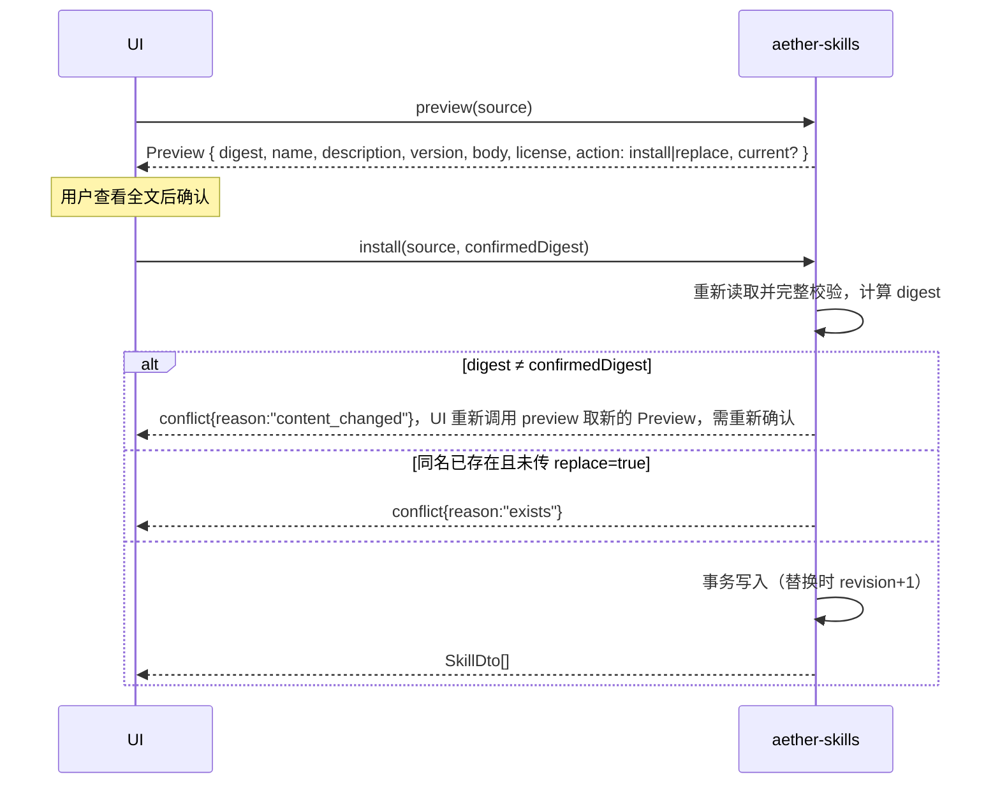

# 14 详细设计：aether-skills

> 依赖：aether-support。**不依赖** MCP、Chat。没选技能时，Chat 的行为与没装 Skills 完全一样。
> 蓝本：AutoBee `shell/src/llm/skills.rs`（内存解析 ZIP、白名单、大小上限、凭据检测）；voynote `src-tauri/src/skill.rs`（目录导入、手写技能）。不保留它们的包格式与 MCP 绑定。

## 1. 边界

- Skill = 用户可查看、选择、版本化的**领域指引正文**。它改变模型"怎么做"，不赋予任何工具、网络、文件或进程权限。
- 管：导入（单个 `SKILL.md` / 目录 / ZIP）、预览与确认、手写与编辑、修订号、删除、排序、宿主内置技能、按次选择的快照。
- 不管：执行脚本、安装钩子、下载依赖、读任意文件、模型自主加载其他技能（D5）、**登记或管理 MCP 服务**。技能正文可以写"需要地图工具"，实际服务由用户在 MCP 设置里配置。
- 没有"最多启用 3 个"之类的全局开关：技能按**每次运行**选择，受预算约束（12 文档 §2.1）。

## 2. 包格式

```text
example-skill/        # 或 example-skill.zip（根目录或唯一顶层目录），或单个 SKILL.md
├── SKILL.md          # 必需
└── LICENSE           # 可选（内容保存，展示用）
```

```markdown
---
name: travel-planner
description: 帮用户规划公共交通出行
version: 1.2.0
---
（正文）
```

### 2.1 受限 frontmatter 解析器（自写）

- 首行必须是 `---`，到下一个独占一行的 `---` 结束；文件开头的 BOM 去掉；`\r\n` 统一为 `\n`。
- 每行只能是 `key: value`；key 匹配 `^[a-z][a-z0-9_-]{0,31}$`；value 为纯标量，或单/双引号字符串（双引号内只支持 `\"` 与 `\\` 转义）。
- 拒绝：重复键、缩进行（嵌套）、`- ` 列表、`{`/`[` 流式集合、`&`/`*` 锚点与别名、`!` 标签、`|`/`>` 块标量、多文档、frontmatter > 4 KiB。
- 已知键：`name`（必需，`^[a-z0-9][a-z0-9-]{0,63}$`）、`description`（必需，1~500 字符）、`version`（可选，≤ 32 字符；缺省为 `null`，表示"未版本化"，不编造版本）。其他合法键保留在 `extra` 中原样展示，不解释。
- 这不是 YAML 的完整实现，只接受上述子集；不在子集内的一律 `bad_request{reason:"frontmatter_unsupported", field:"<行号>"}`。

### 2.2 限制（读取过程中强制执行，不相信压缩包声明的长度）

| 项 | 上限 |
| --- | --- |
| ZIP 文件 | 512 KiB |
| ZIP 条目数 | 8 |
| 累计解压字节 | 256 KiB |
| `SKILL.md` | 64 KiB（正文 ≥ 1 字符） |
| `LICENSE` | 32 KiB |

- 白名单文件：`SKILL.md`、`LICENSE`、`LICENSE.md`、`LICENSE.txt`。其他任何文件 → `bad_request{reason:"unsupported_files"}`，并列出文件名。
- ZIP 中拒绝：绝对路径、`..`、反斜杠路径、规范化后重复的路径、符号链接条目、加密条目。
- 目录导入：只读白名单文件；遇到符号链接或 junction 拒绝；不递归子目录。
- 全程在内存中处理，不解压到磁盘。
- 疑似凭据（`looks_like_secret`）→ 拒绝，并给出位置（`SKILL.md:<行号>`），原文不进日志、不进错误消息。检测只是辅助，不保证发现所有秘密。
- 错误（均为 `bad_request`）：超限 `reason:"too_large"`，`field` 为 `zip`/`entries`/`SKILL.md`/许可文件名，带 `limit`；ZIP 路径 `field:"zip"` + `absolute_path`/`path_traversal`/`backslash_path`/`duplicate_path`/`link`/`encrypted`/`invalid`；目录中的链接 `field:"<文件名>"`（导入根本身为 `path`）+ `link`；凭据 `field:"SKILL.md:<行号>"` + `secret_detected`；`unsupported_files` 的 `field` 为逗号分隔的文件名。累计解压上限由构造保证：只解压白名单文件且第二个许可文件读出即报 `duplicate`，实际最多约 128 KiB。

## 3. 数据模型（`skills.db`，migration 1）

```sql
CREATE TABLE skills (
  id TEXT PRIMARY KEY,
  name TEXT NOT NULL UNIQUE,              -- frontmatter name（slug）
  description TEXT NOT NULL,
  version TEXT,                           -- NULL = 未版本化
  body TEXT NOT NULL,
  license TEXT,
  extra TEXT NOT NULL DEFAULT '{}',       -- 未解释的 frontmatter 键
  origin TEXT NOT NULL CHECK (origin IN ('imported','manual','builtin')),
  revision INTEGER NOT NULL,              -- 内容每变一次 +1
  digest TEXT NOT NULL,                   -- sha256(name|description|version|body)，各字段带长度前缀，避免拼接歧义
  position INTEGER NOT NULL,
  created_at INTEGER NOT NULL, updated_at INTEGER NOT NULL
);
```

- 安装、编辑、替换都只在 `skills.db` 内一个事务完成，没有跨库操作。
- 修订号随任何内容变化递增；排序变化不改修订号。
- `builtin`：随应用版本发布，`Store::open` 时按宿主传入内容同步（`name` 匹配，内容不同则 `revision+1`；宿主不再提供的内置技能删除；名称已被用户技能占用则跳过并记 `warn`）。不可删除、不可编辑；用户可"复制为自定义技能"，副本 `origin='manual'`、新名称，之后内置更新不影响副本。

## 4. 导入、确认与更新



- "重新校验合法"不等于"用户批准过新内容"：安装必须带预览时的 `digest`，不一致就要重新确认。
- 同名替换必须显式 `replace=true`；`Preview.current` 给出现有版本与修订，供 UI 展示差异。版本号只用于提示，不自动覆盖用户编辑过的内容。
- `builtin` 同名的外部包 → `conflict{reason:"builtin_name"}`。

## 5. 选择与运行快照

```rust
pub use aether_support::SkillRef; // { pub id: String, pub revision: u32 }：定义在 aether-support，接入层在未启用 skills feature 时也要反序列化 RunRequest.skills
pub struct SkillSnapshot { pub id: String, pub revision: u32, pub name: String, pub body: String }
impl Store {
    /// 运行开始时由接入层调用。任一项修订号不符 → conflict{reason:"skill_changed", entity:id}，UI 刷新后让用户重新确认。
    pub fn snapshot(&self, refs: &[SkillRef]) -> Result<Vec<SkillSnapshot>, KitError>;
}
```

- UI 列表只拿元数据（不含正文）；正文在用户打开查看或选中时才加载。
- 选择是**每次运行**的参数，由 UI 传入 `id + revision`；aether 不存"当前启用了哪些"。应用若要记住用户上次的选择，自己存 `SkillRef` 列表；修订变化后旧引用会被 `snapshot` 拒绝，从而强制重新确认。
- 快照在运行开始时固定；运行中的编辑、排序、删除不影响本次运行。
- 预算检查在 Chat `validate` 中做（所选正文合计 ≤ `skills_chars`），超出直接报错，不截断。
- 会话存储只记录 `{id, revision}`，不复制正文；技能被删除不影响历史消息。

## 6. API 与 DTO

```rust
pub struct BuiltinSkill { pub name: &'static str, pub description: &'static str, pub version: Option<&'static str>, pub body: &'static str }
pub struct Store { /* Mutex<Connection> */ }
impl Store {
    pub fn open(root: &Path, builtin: &'static [BuiltinSkill]) -> Result<Self, KitError>;
    pub fn list(&self) -> Result<Vec<SkillMeta>, KitError>;
    pub fn get(&self, id: &str) -> Result<SkillDto, KitError>;
    pub fn preview(&self, source: &Source) -> Result<Preview, KitError>;
    pub fn install(&self, source: &Source, confirmed_digest: &str, replace: bool) -> Result<Vec<SkillMeta>, KitError>;
    pub fn save_manual(&self, input: &ManualSave) -> Result<Vec<SkillMeta>, KitError>;   // 新建或编辑（带 expectedRevision）
    pub fn duplicate(&self, id: &str, new_name: &str) -> Result<Vec<SkillMeta>, KitError>;
    pub fn reorder(&self, ids: &[String]) -> Result<Vec<SkillMeta>, KitError>;
    pub fn delete(&self, id: &str) -> Result<Vec<SkillMeta>, KitError>;                 // builtin → bad_request
    pub fn snapshot(&self, refs: &[SkillRef]) -> Result<Vec<SkillSnapshot>, KitError>;
}
pub enum Source { Path(PathBuf) /* 绝对路径：SKILL.md、目录或 .zip */, Bytes { file_name: String, bytes: Vec<u8> } /* 文件选择或拖拽 */ }
// JSON（ts-rs `Source`）：{ "path": "C:\\…" } | { "bytes": { "fileName": "x.zip", "bytes": [80, 75, …] } }
```

```ts
interface SkillMeta { id: string; name: string; description: string; version: string | null; origin: 'imported' | 'manual' | 'builtin';
  revision: number; bodyChars: number; updatedAt: number }
interface SkillDto extends SkillMeta { body: string; license: string | null; extra: Record<string, string> }
interface Preview { digest: string; name: string; description: string; version: string | null; body: string; license: string | null;
  extra: Record<string, string>; action: 'install' | 'replace'; current: { version: string | null; revision: number } | null }
interface ManualSave { id?: string; expectedRevision?: number; name: string; description: string; version?: string | null; body: string }
```

- `save_manual` 编辑时 `expectedRevision` 必须等于当前修订，否则 `conflict{reason:"revision_changed"}`（防两个窗口互相覆盖）；缺省 → `bad_request{field:"expectedRevision"}`。新名称已被占用 → `conflict{reason:"exists"}`（内置名为 `builtin_name`）。

## 7. 陷阱

1. 预览与安装之间文件可能被换：靠 `digest` 比对，不靠"重新校验通过"。
2. 不在正文里做"清洗"：用户正文原样保存；安全边界在 Chat 的外部内容包装、工具目录与审批（12 文档 §2.2）。
3. 解压限制按实际读出的字节计数，不读 ZIP 头里声明的大小。
4. Windows 目录 junction 也算链接，必须拒绝（`symlink_metadata` + `FILE_ATTRIBUTE_REPARSE_POINT`）。
5. 名称是唯一键：重命名手写技能时检查冲突；内置技能的名称保留给内置。
