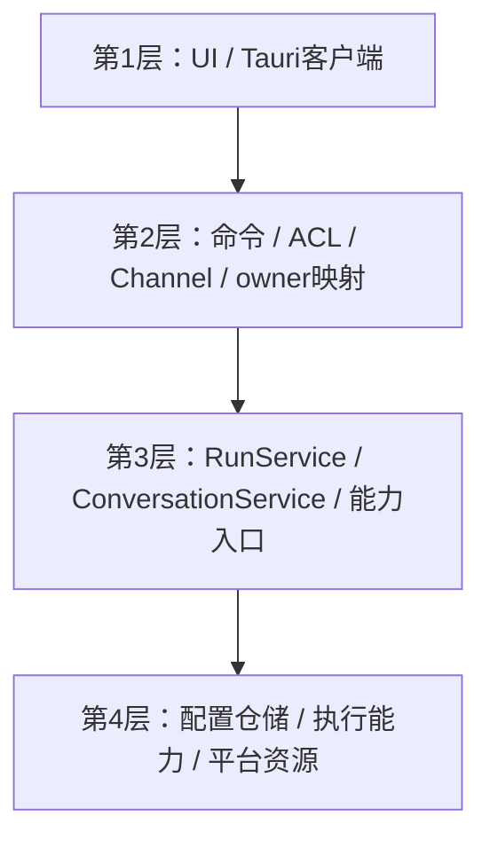

# 15 详细设计：接入层 tauri-plugin-aether

> 状态：2026-10-28接入层已切换为宿主注入运行/会话服务；实际验证与未运行项见 [90](90-开发任务清单.md)。本文唯一负责Tauri feature、Builder、IPC/权限、可信owner窗口映射与应用退出。
> 运行与KitHost定义见 [25](25-详细设计-运行应用服务.md)，会话领域/事务见 [26](26-详细设计-会话与历史存储.md)，公共JSON字段与客户端见 [22](22-详细设计-跨运行时公共契约.md)。插件不再定义第二套RunRequest、KitHost、ChatConfig或运行组装/保存算法。
> 历史蓝本：AutoNote commands/ai.rs（Channel与jobs取消）、lib/ipc/transport.ts（前端接入）。

## 1. 逐层模块与职责



命令只做解码与入口上限、权限/身份接入、调用服务、错误序列化和传输。窗口/AppHandle/Channel永不进入runtime；插件不读取会话祖先来拼RunInput、不组合ToolExecutor、不等待审批表、不直接保存TurnRecord。

## 2. Features与Builder

| feature       | 依赖与命令                                                             | 所需实例                                   |
| ------------- | ---------------------------------------------------------------------- | ------------------------------------------ |
| 始终          | observability；logs_*                                                  | LogHandle                                  |
| providers     | providers；providers_*                                                 | providers::Store                           |
| chat          | 可选runtime依赖的runs feature；仅四个运行命令，不隐式启用providers命令 | Arc<RunService>                            |
| conversations | 可选runtime依赖的conversations feature；独立八个历史命令               | Arc<ConversationService>                   |
| search        | search；search_*                                                       | Arc<search::Store>                         |
| skills        | skills；skills_*                                                       | Arc<skills::Store>                         |
| mcp-client    | mcp-client；mcp_client_*                                               | Arc<McpRuntime>（配置Store由其持有，见27） |
| mcp-server    | mcp-server；mcp_server_*                                               | McpServer                                  |

默认feature全关。runtime依赖optional；providers-only不含runtime/chat，MCP Server无需Chat，Skills/Search可独立接入。chat只表示运行IPC能力，不强制注册providers配置命令；conversations独立于chat，不构造RunEngine。详细底层feature图由25定义。feature只决定可编译能力，不等于ACL授权。

```rust
pub struct Builder { /* 接入配置和可选实例 */ }
impl Builder {
    pub fn new(logs: LogHandle) -> Self;
    #[cfg(feature = "providers")]
    pub fn providers(self, store: Arc<aether_providers::Store>) -> Self;
    #[cfg(feature = "chat")]
    pub fn runs(self, runs: Arc<aether_runtime::RunService>) -> Self;
    #[cfg(feature = "conversations")]
    pub fn conversations(self, conversations: Arc<aether_runtime::conversations::ConversationService>) -> Self;
    #[cfg(feature = "search")]
    pub fn search(self, store: Arc<aether_search::Store>) -> Self;
    #[cfg(feature = "skills")]
    pub fn skills(self, store: Arc<aether_skills::Store>) -> Self;
    #[cfg(feature = "mcp-client")]
    pub fn mcp_client(self, runtime: Arc<aether_mcp_client::McpRuntime>) -> Self;
    #[cfg(feature = "mcp-server")]
    pub fn mcp_server(self, server: aether_mcp_server::McpServer) -> Self;
    pub fn build<R: Runtime>(self) -> Result<TauriPlugin<R>, KitError>;
}
```

Builder不再接收空KitHost或RunConfig/Store来代建运行服务；宿主先构造服务，再注入。签名直接引用权威crate类型，不保留旧new(host,logs)、chat(config,store)、plugin::KitHost/ChatConfig等兼容入口。所有examples/宿主clean cutover。

build验证：

- 已启用接入feature未传对应实例 → bad_request{field:<能力>,reason:"missing_instance"}；chat检查runs，conversations检查conversations。RunService所需Providers/能力校验在构造服务时完成，不再保留旧Builder隐含Providers检查优先级。
- 已注入服务就是唯一实例；插件不重新创建RunService、ConversationService或McpRuntime。宿主将同一Arc Providers/Search/Skills/McpRuntime注入运行依赖和独立配置命令。
- 未启用conversations则无历史命令/集合；启用则必须注入服务，哪怕未启用chat也可用。RunService.deps.conversations=None为无历史运行，与是否提供独立历史管理界面解耦，不创建临时数据库。
- 各能力无注册顺序要求，不探测别的插件，不从RunService提取私有Store来拼第二套服务。请求使用能力的拒绝仍由25负责。

典型宿主组装（各构造参数详见对应能力文档）：先创建共享providers Store与可选ConversationStore，`RunService::new(host,config,deps,policy)?`；有历史管理时`Arc::new(ConversationService::new(store.clone()))`；插件以`Builder::new(logs).runs(runs).conversations(conversations).providers(providers)`接入。无chat的配置程序只用`Builder::new(logs).providers(providers)`；无chat的历史程序只用`.conversations(conversations)`。编译feature必须与实际链式方法相符，示例不意味着所有程序都注册全部能力。

## 3. 运行IPC与可信窗口映射

### 3.1 命令分派

1. Tauri命令取得框架注入的可信Window，并校验ACL及请求体。RunRequest字段只按22，不接受owner/window/principal。
2. 插件私有表保存window label→RunOwner，由`RunOwner::new()`创建、Clone复用；label不是runtime身份或用户输入。构造规则与无serde约束见25。
3. 创建RunContext，own_mcp_port取本插件当前MCP Server端口（未运行则None）。调用RunService.start，不自行组装连接/历史/工具。
4. EventSink只做Channel.send并返回Result；发送失败交服务触发cancel，不在传输层伪造End或重跑工具。
5. cancel/approve/snapshot总从当前可信Window取同owner，拒绝接受body自报身份。跨owner和已关闭owner语义见25。

### 3.2 销毁与接受竞态

窗口注册维护closed状态；销毁先关闭/移除映射，再cancel_owner。相同label重建获得新owner；旧OwnerState.closed永久为true，但无无限closed集合，引用释放即回收。接入取映射/关闭采用同一同步协议，不得为销毁Window重新懒建身份。prepare原子检查关闭，已commit的竞态run视为接受并立即取消保存/End（25）；不持registry锁等待SQLite。窗口销毁只取消本owner。

RunAccepted可晚于首事件送达；客户端按本次start回调绑定和缓冲，不要求新增run_started事件、事件传输字段或上游延迟启动。服务接受前错误直接命令Err，不发事件；接受后错误只经唯一End。快照不是事件回放，断线展示规则由22/16定义。

## 4. 命令与权限

命令权限由build.rs按feature生成到permissions/autogenerated（不提交）；能力集合`aether:<feature>`由宿主capability授给具体窗口。静态capability不得引用可能未启用集合；宿主按feature在setup add_capability，logs集合始终存在。无feature时调用保留Tauri ACL/Command not found行为。

| 命令                                                               | 参数/返回                                                                | 集合                      |
| ------------------------------------------------------------------ | ------------------------------------------------------------------------ | ------------------------- |
| logs_tail/get_level/set_level/ingest/open_dir                      | 10的日志接口；open_dir为桌面动作适配                                     | aether:logs               |
| providers_list/save/delete/model_options/probe/cancel              | 11的请求/返回                                                            | aether:providers          |
| search配置/执行/检查命令                                           | 17的命令表，不在本页重定义                                               | aether:search             |
| chat_run                                                           | {request:RunRequest,onEvent:Channel<RunEvent>} → RunAccepted（含turnId） | aether:chat               |
| chat_cancel                                                        | {runId} → Ack                                                            | aether:chat               |
| chat_approve                                                       | {runId,callId,allow} → Ack                                               | aether:chat               |
| chat_snapshot（新增）                                              | {runId} → RunSnapshot                                                    | aether:chat               |
| chat_conversations                                                 | {scope:string\|null} → ConversationSummary[]                             | aether:chat-history       |
| chat_conversation / chat_delete                                    | {id} → Conversation / Ack                                                | aether:chat-history       |
| chat_rename                                                        | {id,title} → ConversationSummary                                         | aether:chat-history       |
| chat_edit_turn                                                     | {conversationId,turnId,text,expectedText} → Conversation                 | aether:chat-history       |
| chat_remove_turn / chat_select_turn / chat_fork                    | {conversationId,turnId} → Conversation                                   | aether:chat-history       |
| skills_list/get/preview/install/save/duplicate/reorder/delete      | 14的请求/返回                                                            | aether:skills             |
| mcp_client_list/save/delete/refresh/set_tool_approval              | 27的请求/返回                                                            | aether:mcp-client         |
| mcp_server_status/tokens/scopes                                    | 28的请求/返回                                                            | aether:mcp-server-read    |
| mcp_server_start/stop/set_port/issue_token/revoke_token/set_scopes | 28的请求/返回                                                            | aether:mcp-server-control |

命令名保留现有命名：表内斜杠后的后缀仍带前缀（如chat_cancel），不是新命令。八个历史命令不改名。Snapshot必须纳入chat ACL/权限生成/客户端适配，不得无权限单独注册。Conversation/ConversationSummary是22的UI投影，不是26存储领域对象。

不提供任意工具执行、任意SQL/文件、导出凭据或普通运行接口显示密钥命令。凭据显式reveal另遵守11/22的受权合同。统一包装：参数上限→必要blocking→安全错误→失败记aether.command.failed；正文、reasoning、payload不进诊断日志。

## 5. 应用退出

在真正RunEvent::Exit收尾，不在可被宿主阻止的ExitRequested提前永久关闭服务：

1. 在可用async runtime上下文调用RunService.shutdown，保留最多3秒的运行收尾语义；服务负责拒新、取消、等终态保存和图片清理退出。
2. 关闭共享McpRuntime刷新/会话任务，再停止MCP Server和其他可取消探测任务。
3. 最后logs.flush；桌面目录打开归接入DesktopActions，不让observability启动shell。

不能在async executor线程同步自旋等待、嵌套阻塞runtime或用Drop冒充异步drain成功。到期未完成必须如实记录，不能强发成功或声称副作用撤销。所有后台任务有token和handle，插件只管理自己创建的能力生命周期，Store不持隐式无限循环。

真实窗口销毁后记录`aether.plugin.window_destroyed.cancelled`；应用退出记录shutdown.started，await各能力完成后记录shutdown.finished并flush。RunService另以complete/incomplete及active/preparing/left区分实际排空与超时，不把ExitRequested或取消token已设置当成任务退出证据。

## 6. 切换与待验收

插件通过独立 `runs` / `conversations` 适配模块消费runtime服务，旧插件KitHost、ChatConfig、assemble、运行登记、审批、工具组合、保存和图片清理实现已删除。Builder只接收宿主创建的共享Arc，CLI直接调用同一RunService并等待真正End后shutdown；assistant宿主类型从runtime导入。独立providers与MCP Server示例不再创建空KitHost。

历史服务返回26领域对象，插件仅调用runtime `contract::conversation_dto` 的投影函数；DTO与转换规则不归插件。运行owner只在setup的既有窗口及on_window_ready创建，命令只查询，不对已销毁窗口重新懒建。Exit在事件循环线程等待异步收尾，执行器不自旋；依次await RunService、McpRuntime、MCP Server，取消独立探测后flush日志。

主线permissionMode及扩展KitHost方法按25完整迁移，不回退旧接口。AutoNote等外仓宿主需迁runtime/images import和26破坏性ConversationStore trait，作为外仓调用方清单，本轮不编辑外仓或声称迁完。

验收范围：feature组合（providers-only无runtime/chat、独立conversations）、新Builder实例检查、四运行命令ACL、八历史命令、历史feature注册、owner跨窗口隔离、同label重建、窗口销毁/prepare/commit竞态、Channel失败、事件早到和有界退出。已执行证据与未覆盖平台统一记录于90，不把编译检查等同于所有窗口竞态均实测。
