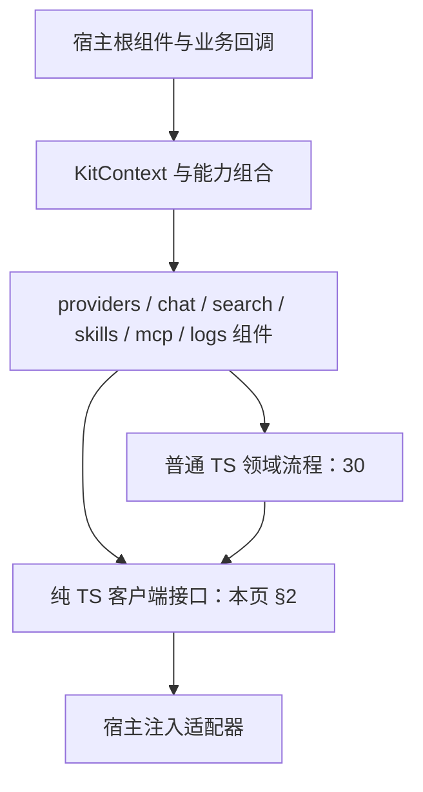

# 16 详细设计：@ouraihub/aether-ui

> 状态：2026-10-28客户端职责已切换，Rust生成绑定及本轮验证记录见 [90](90-开发任务清单.md)。本文是UI客户端接口、组合和组件边界的唯一规范；流程细节归 [30](30-详细设计-客户端流程与凭据会话.md)，wire DTO归 [22](22-详细设计-跨运行时公共契约.md)，Tauri命令/权限归 [15](15-详细设计-接入层.md)。
> 蓝本：AutoNote `packages/app/src/features/ai/{settings,chat}/*`（设置页、对话面板）、`desktop/src/lib/log/*`（日志面板、前端日志器）；AutoBee `src/lib/components/{ChatPanel,ChatBubble}.svelte`（工具调用展示）。

## 1. 包结构

### 1.1 自顶向下的模块边界



```text
组件层：布局、交互、翻译、确认、toast、picker、DOM/剪贴板
  ↓ 传入明确目标、草稿快照与客户端
流程层：保存队列、探测顺序、凭据失效、配置纯转换（30）
  ↓ 不依赖 Svelte、KitContext、Tauri 或宿主业务表
接口层：RunClient / ConversationClient / 各能力 Port
  ↓ DTO 只使用公共绑定，不重复定义近似类型
适配层：tauri/ → 15 的 IPC；其他宿主自供等价客户端
```

RunSession 是 chat 内 Svelte 展示状态组合，不是所有功能共用的 controller。各模块只依赖所需客户端；会话查询不依赖运行客户端，日志诊断不依赖桌面文件动作。TS Worker后端与Web客户端均已实现，真实浏览器验收结果独立记录于90。

### 1.2 目录与子路径

```text
packages/ui/src/
  ports/            # 纯TS客户端接口；DTO来自@ouraihub/aether-contracts
  tauri/            # 唯一可以 import @tauri-apps/* 的目录：createTauriPorts()
  web/              # createWebPorts()：公共HTTP/SSE客户端，不引入Tauri
  providers/        # ProvidersSettings 等组件、draft.ts（纯转换）、edit-session.ts（保存/探测流程）
  chat/             # ChatPanel、MessageItem、ToolCallItem、ApprovalCard、SkillPicker、run-session.svelte.ts
  search/           # SearchSettings、settings-flow.ts（保存/可选检测流程）
  skills/           # SkillsSettings、SkillPreviewDialog、SkillEditor
  mcp/              # McpClientSettings、McpServerSettings、config.ts（纯配置生成）、input.ts（纯输入转换）
  logs/             # LogPanel、LogSettings、createLogger
  components/ui/    # shadcn-svelte 生成的组件源码（button、dialog、select、field、empty、alert、sonner…），由 CLI 维护
  context.ts  i18n/  markdown.ts  utils.ts（cn、tv）  styles/kit.css  styles/tokens.css
  notify.svelte.ts  KitNotifier.svelte   # createDefaultNotify() 与其 Toaster + AlertDialog
  session.ts        # 普通 TS generation 失效原语；不提供通用 secret CRUD
  index.ts          # 根入口：setKitContext、createI18n、renderMarkdown、createDefaultNotify、KitNotifier
  dev/              # 组件试验页（`pnpm -F @ouraihub/aether-ui dev`），不导出
```

```json
"name": "@ouraihub/aether-ui",
"exports": { ".": "...", "./ports": "...", "./tauri": "...", "./providers": "...", "./chat": "...",
             "./search": "...", "./skills": "...", "./mcp": "...", "./logs": "...", "./styles.css": "...", "./tokens.css": "..." }
```

- 以源码发布，宿主 Vite 直接编译。一个包、子路径导出，不为每个组件建包。
- ESLint：除 `src/tauri/**` 外禁止 import `@tauri-apps/*`；`svelte/no-at-html-tags` 开启。
- **UI 基础组件用 shadcn-svelte**（仓库 `.claude/skills/shadcn-svelte`，开发 UI 前必读）：`packages/ui/components.json` 配置别名，组件经 `pnpm dlx shadcn-svelte@latest add <name>` 加入 `src/components/ui/`，不手写替代品。遵守其规则：语义色（`bg-primary`、`text-muted-foreground`），`cn()` 合并 class，`flex gap-*` 不用 `space-*`，表单用 `Field.*`，空状态用 `Empty`，提示用 `Alert`，toast 用 `svelte-sonner`，Dialog/Sheet 必须有 Title，覆盖层组件不手写 `z-index`。
- `src/components/ui/` 是 CLI 生成代码：允许按 shadcn-svelte 的 `update` 流程升级，修改须保持最小并在文件头注释原因。

## 2. 客户端接口（唯一签名定义）

本节只定义调用面，不重复 DTO 字段。`RunRequest/RunAccepted/RunEvent/RunSnapshot`、`ConversationSummary/Conversation`、`KitError` 及各能力 DTO 的入口见 [22](22-详细设计-跨运行时公共契约.md)；能力字段归11/17/14/27/28。Rust所有者输出到`packages/contracts/src/generated`，`@ouraihub/aether-contracts`统一导出类型及预编译校验；UI不手改生成文件。`CallOptions`是客户端本地选项，不是wire DTO。

### 2.1 运行、会话、日志与桌面动作

```ts
export interface CallOptions {
  signal?: AbortSignal
}

export interface RunClient {
  start(request: RunRequest, onEvent: (event: RunEvent) => void, options?: CallOptions): Promise<RunAccepted>
  cancel(runId: string): Promise<void>
  approve(runId: string, callId: string, allow: boolean): Promise<void>
  getSnapshot(runId: string): Promise<RunSnapshot>
}

export interface ConversationClient {
  list(scope?: string): Promise<ConversationSummary[]>
  get(id: string): Promise<Conversation>
  remove(id: string): Promise<void>
  rename(id: string, title: string): Promise<ConversationSummary>
  editTurn(conversationId: string, turnId: string, text: string, expectedText: string): Promise<Conversation>
  removeTurn(conversationId: string, turnId: string): Promise<Conversation>
  fork(conversationId: string, turnId: string): Promise<Conversation>
  selectTurn(conversationId: string, turnId: string): Promise<Conversation>
}

export interface LogsPort {
  tail(limit: number): Promise<LogEntry[]>
  ingest(batch: IngestBatch): Promise<IngestReceipt>
  getLevel(): Promise<LogStatus>
  setLevel(level: LogLevel): Promise<LogStatus>
}

export interface DesktopActions {
  openLogsDirectory(): Promise<void>
}
```

- `start` 只确认接受，不等待运行完成；真正结果取唯一最后的 `end`。接受前失败由 Promise 拒绝，接纳后失败由事件表达；`end` 可以先于接受 Promise 返回。
- `cancel` 成功仅确认取消请求已处理，不立即把 UI 标为 `cancelled`，不合成本地终态。幂等性、owner 隔离、审批过期/重复冲突遵守 [22](22-详细设计-跨运行时公共契约.md) 与 [25 运行应用服务](25-详细设计-运行应用服务.md)；审批失败的展示恢复规则见 30 §2。
- `getSnapshot` 用于确认运行状态，不承诺正文重放、断点恢复或自动续跑。直接状态枚举、`cancelRequested`、可选错误/轮数上限、最近 128 个终态的保留及 `not_found` 规则只在 22 定义；不另设嵌套状态或 `pendingApprovals`。
- `ConversationClient` 对应 [26 会话与历史存储](26-详细设计-会话与历史存储.md) 用例，独立于运行客户端；无会话存储时不暴露。会话领域类型与 22 的 UI DTO 映射归 26，不能让 UI 导入数据库记录。
- `LogsPort` 可由桌面或 Web 诊断实现提供；是否有本地文件不是能力存在条件。打开系统目录只归 `DesktopActions`。

### 2.2 能力客户端

```ts
export interface ProvidersPort {
  readonly revealNeedsPassword: boolean
  readonly keyStrategies: boolean
  list(): Promise<Provider[]>
  setEnabled(id: string, enabled: boolean): Promise<Provider[]>
  save(provider: ProviderSave): Promise<Provider[]>
  remove(id: string): Promise<Provider[]>
  modelOptions(filter?: ModelFilter): Promise<ModelOption[]>
  probe(target: ProbeTarget, options?: CallOptions): Promise<ProbeResult>
  saveKey(input: EndpointKeySave): Promise<Provider[]>
  removeKey(endpointId: string, keyId: string): Promise<Provider[]>
  revealKey(keyId: string, currentPassword?: string | null): Promise<string>
}

export interface SearchPort {
  revealNeedsPassword?: boolean
  settings(capability: SearchCap, options?: CallOptions): Promise<SearchSettingsDto>
  save(input: SearchSave, options?: CallOptions): Promise<SearchSettingsDto>
  setDefault(capability: SearchCap, provider: string, options?: CallOptions): Promise<SearchSettingsDto>
  savePreferences(input: SearchPreferences, options?: CallOptions): Promise<SearchPreferences>
  saveKey(
    capability: SearchCap,
    provider: string,
    value: string,
    keyId?: string,
    options?: CallOptions,
  ): Promise<SearchSettingsDto>
  removeKey(capability: SearchCap, provider: string, keyId: string, options?: CallOptions): Promise<SearchSettingsDto>
  reveal(
    capability: SearchCap,
    provider: string,
    keyId: string,
    currentPassword?: string,
    options?: CallOptions,
  ): Promise<string>
  check(capability: SearchCap, provider: string, options?: CallOptions): Promise<{ count: number }>
  search(query: string, options?: CallOptions): Promise<SearchResult>
  fetch(url: string, options?: CallOptions): Promise<SearchPage>
}

export interface SkillsPort {
  list(): Promise<SkillMeta[]>
  get(id: string): Promise<SkillDto>
  preview(source: Source): Promise<Preview>
  install(source: Source, confirmedDigest: string, replace: boolean): Promise<SkillMeta[]>
  save(input: ManualSave): Promise<SkillMeta[]>
  duplicate(id: string, newName: string): Promise<SkillMeta[]>
  reorder(ids: readonly string[]): Promise<SkillMeta[]>
  remove(id: string): Promise<SkillMeta[]>
}

export interface McpClientPort {
  list(): Promise<ServerDto[]>
  save(server: ServerSave): Promise<ServerDto[]>
  remove(id: string): Promise<ServerDto[]>
  refresh(serverId: string): Promise<ToolDto[]>
  setToolApproval(serverId: string, tool: string, approval: Approval): Promise<void>
}

export interface McpServerPort {
  status(): Promise<Status>
  tokens(): Promise<TokenRecord[]>
  start(): Promise<Status>
  stop(): Promise<Status>
  setPort(port: number): Promise<Status>
  issueToken(name: string, scopes: readonly string[]): Promise<IssuedToken>
  revokeToken(id: string): Promise<void>
  scopes(): Promise<ScopeState[]>
  setScopes(ids: readonly string[]): Promise<ScopeState[]>
}
```

`probe` 的业务探测失败保留 `ProbeResult`，传输/取消等错误用 `KitClientError`；组件翻译错误，不用文本判断错误种类。`refresh` 没有取消命令，不接收 `signal`。凭据 reveal 的权限及后端校验不因 UI 原语替代，明文生命周期只在 30 §5 定义。

### 2.3 宿主能力组合与错误

```ts
export interface KitPorts {
  logs?: LogsPort
  desktop?: DesktopActions
  providers?: ProvidersPort
  chat?: RunClient
  conversations?: ConversationClient
  search?: SearchPort
  skills?: SkillsPort
  mcpClient?: McpClientPort
  mcpServer?: McpServerPort
}
```

- `chat` 保留为功能区域名，不表示会话属于 run。删除旧 `ChatPort`、`ChatHistoryPort`、嵌套 `history` 与 `run` 方法，不保留兼容别名；调用分别迁到 `chat.start` 与 `conversations`。
- `ports` 导出上述接口、公共 DTO 绑定、`createFakePorts({ <port>?: Partial<…>, omit? })`、`KitClientError`/`isKitClientError`。fake 默认完整表达已声明能力，允许显式缺省能力，不能让测试依赖旧嵌套结构。
- fake 的 `initialConversations` 仅用于初始化内存会话；`conversations` 与其他能力一样接受 `Partial<ConversationClient>` 覆盖，两者不复用同一选项名。`omit: ['chat']` 不移除会话能力，`omit: ['desktop']` 不移除日志能力。
- 客户端失败统一抛 `KitClientError`（继承 `Error`；`code`、`message`、`details` 映射 22 的 `KitError`），不引入另一套错误码。不是每个方法都有取消命令；仅实际支持 `CallOptions` 的操作按其传输取消，运行取消不等价于接受 Promise 失败。
- 缺少能力时对应操作/区域不渲染，不冒充后端成功，也不把日志缺少桌面动作当成日志不可用。

### 2.4 Tauri 适配与选项

```ts
export interface TauriPortsOptions {
  providers?: boolean
  search?: boolean
  chat?: boolean
  conversations?: boolean
  skills?: boolean
  mcpClient?: boolean
  mcpServer?: boolean
}
export function createTauriPorts(options?: TauriPortsOptions): KitPorts & {
  logs: LogsPort
  desktop: DesktopActions
}
```

Tauri 始终提供 `logs` 和 `desktop`；其余按宿主声明暴露。`conversations` 不要求 `chat: true`，但后端必须注册会话服务且窗口获授权。移除旧 `chatHistory` 选项。接口选项不创建数据库或绕过命令权限。

Tauri适配器只做DTO/错误转换、Channel与AbortSignal生命周期，命令/权限映射见15；`start`接受/取消竞争与listener清理见30。仅`tauri/`可import Tauri API。已实现的`@ouraihub/aether-ui/web`提供`createWebPorts({baseURL,fetch,csrf,...能力开关})`，HTTP/SSE沿23实际路由，凭据与新鲜认证由宿主fetch/身份实现；不假装提供登录或MCP Server管理UI端口。

### 2.5 破坏性版本迁移与发布门禁

本轮客户端接口是破坏性变更，不是补充可选方法。以下对照仅用于迁移，不是旧 API 仍可用的声明；目标版本不保留别名或新旧双轨。

| 旧调用/选项                                                       | 目标调用/选项                                                                                       |
| ----------------------------------------------------------------- | --------------------------------------------------------------------------------------------------- |
| `ChatPort.run(request, onEvent, options)` / `ports.chat.run(...)` | `RunClient.start(...)` / `ports.chat.start(...)`                                                    |
| `ChatPort.history` / `ports.chat.history.<operation>`             | 独立 `ConversationClient` / `ports.conversations.<operation>`，保留全部八个操作                     |
| `createTauriPorts({ chatHistory: true })`                         | `createTauriPorts({ conversations: true })`，不要求同时启用 chat UI                                 |
| `LogsPort.openDir()` / `ports.logs.openDir()`                     | `DesktopActions.openLogsDirectory()` / `ports.desktop.openLogsDirectory()`；缺少 desktop 时隐藏按钮 |
| 仅靠 signal 停止                                                  | 保留 signal 竞争处理，新增显式 `chat.cancel(runId)` 与 `chat.getSnapshot(runId)`                    |

会话 IPC 命令和权限集合 `aether:chat-history` 保留名称，不因前端选项改名而更名；新增 `chat_snapshot` 归 `aether:chat`。命令参数、生成权限和 owner 校验的唯一规范见 15。

AutoNote、Actora 等外仓消费者本轮不修改；这不是允许它们直接升级的兼容承诺。发布前各消费者必须完成对应客户端、宿主适配器、能力注入、权限、生成 DTO、fake/测试的同版本迁移并验收；未迁移的消费者不得升级到破坏性目标版本。仓内调用方/示例随实施切换，外仓发布协调列为门禁，不以文档已完成代替迁移完成。

`RunClient.start` 使用 22 的完整最新 `RunRequest`，本轮仅拆分调用职责，不能退回旧字段白名单，尤其不能遗漏既有 `permissionMode`、图像、绘图、重试/翻译和思考强度。`PermissionMode`、`ToolEffect` 继续使用公共绑定，枚举权威归 12、22 仅引用并定义请求字段，不新造 UI 枚举或把工具效果信息丢在适配层。

## 3. 上下文与主题

```ts
interface KitContext {
  ports: KitPorts
  i18n: { t(key: string, params?: Record<string, string | number>): string; locale: string }
  notify: {
    toast(kind: 'info' | 'success' | 'error', text: string): void
    confirm(o: { title: string; body: string; danger?: boolean }): Promise<boolean>
  }
  logger: KitLogger
}
setKitContext(ctx) // 宿主根组件调用一次；未自带通知实现的宿主用 createDefaultNotify()（svelte-sonner + shadcn AlertDialog）
```

- aether 不读写宿主偏好；需要持久化的选择（默认模型、上次选的技能）通过组件 props/事件交给应用。
- **主题就是 shadcn-svelte 的 CSS 变量**（`--background`、`--foreground`、`--card`、`--muted-foreground`、`--primary`、`--destructive`、`--border` 等）。三个已用 shadcn-svelte 的宿主无需额外配置；未用的宿主引入 `@ouraihub/aether-ui/styles.css`（这组变量的默认值，亮/暗两套，中性色带少量 265° 色相）。aether 不定义自己的颜色变量。
- **状态色合同**：在 shadcn 变量之外，aether 只额外使用三个语义状态色 `success`（启用、视觉能力、成功）、`warning`（缺密钥、工具能力）、`info`（推理能力）。组件只写 `bg-success`、`text-info` 等语义类，禁止写具体色值或借用 `chart-*`。`styles.css` 提供亮/暗默认值；自带 Tailwind 入口的宿主必须在自己的 `@theme` 中映射 `--color-success/warning/info`（AutoNote 映射到其 `--success/--warning/--info`），新增主题只改变量。Switch 与 AutoNote 原生开关一致：开 = `primary`（宿主强调色），关 = `muted-foreground/35`，白色滑块，34×20；状态选择器必须用 bits-ui 实际输出的 `data-[state=checked|unchecked]`，不能写 `data-checked`（不存在，样式永远不生效）。
- **尺寸令牌**（`styles/tokens.css`，`styles.css` 已包含；自带 Tailwind 入口的宿主在 `@import 'tailwindcss'` 之后引入 `@ouraihub/aether-ui/tokens.css` 并 `@source` aether 的 `src`）。默认值取自 AutoNote，宿主在自己的 `:root` 覆盖：

  | 变量                 | 默认   | Tailwind 工具类                            | 用途                                    |
  | -------------------- | ------ | ------------------------------------------ | --------------------------------------- |
  | `--kit-text-xs`      | 11.5px | `text-kit-xs`                              | 元信息、分组标题                        |
  | `--kit-text-sm`      | 12px   | `text-kit-sm`                              | 次要文字、说明、状态行                  |
  | `--kit-text-base`    | 13px   | `text-kit-base`                            | 正文、控件文字                          |
  | `--kit-text-lg`      | 13.5px | `text-kit-lg`                              | 弹窗标题                                |
  | `--kit-control-h`    | 30px   | `h-kit-control` / `size-kit-control`       | 按钮、输入框、下拉                      |
  | `--kit-control-h-sm` | 28px   | `h-kit-control-sm` / `size-kit-control-sm` | `size="sm"` 控件                        |
  | `--kit-radius`       | 8px    | `rounded-kit`                              | 控件、卡片、气泡；`--radius` 默认也取它 |
  | `--kit-radius-sm`    | 6px    | `rounded-kit-sm`                           | 小控件、列表项、标签                    |

  字重：正文 400，标签与按钮 500，区块标题 600。暗色变体同时匹配 `.dark` 与 `[data-theme="dark"]` 祖先。组件内 `cn`/`tv` 用 `utils.ts` 中扩展过的合并配置，宿主传入的 `text-*`/`h-*`/`rounded-*` 能正确覆盖令牌类。

- **弹窗层级**：aether 的对话框用 shadcn Dialog，渲染到 body（portal），不手写 `z-index`。宿主若自己的设置面板也是 shadcn Dialog，后打开的天然在上层；宿主若用非 shadcn 的高 `z-index` 容器，由宿主负责不把 aether 弹窗嵌进该容器之下（陷阱 1）。

## 4. 组件

### 4.1 providers

- `ProvidersSettings`（Cherry 交互，详见 AutoNote docs/33）：左栏搜索 + 筛选图标 + 服务商行（首字母头像、名称、状态点：启用且有可读密钥=success、启用但缺密钥=warning、停用=无点）+ 添加服务商。右栏标题（名称、齿轮=服务商设置对话框：改名/删除；启用 Switch 走 `setEnabled` 立即生效）→ API 密钥（`SecretInput`，多密钥见 AutoNote docs/34：主密钥=第一个启用的，打码（中段压成 `****`）+ `+N`；文字区点开 `EndpointKeysDialog`；常驻眼睛，复制/编辑/删除（仅 1 个密钥时）在悬停或键盘聚焦时出现；无密钥时输入框失焦或 Enter 提交 `saveKey`）→ 密钥管理与检测（结果按密钥列出，可就地停用）→ API 地址（失焦提交，非法地址就地提示；添加端点；线路设置含协议/删除，多线路时出现选择）→ 模型（`EndpointPanel`：全部折叠、搜索、能力筛选、同步模型后打开 `ModelPickerDialog`、手动添加；按 id 前缀分组，组可移除；行含头像、名称、能力胶囊、设置与移除）。**没有保存按钮**，字段提交与 picker 增删触发 30 §3 的编辑流程；失败展示重试并在切换前确认。**不含角色区。**
- 密钥使用方式（AutoNote docs/43 §3、§6）：`ProvidersPort.keyStrategies` 为 `true` 的宿主（Web）在 API 密钥下方显示「密钥使用方式」选择：轮流使用（`round_robin`，默认）或用完再换（`fill_first`），随整份服务商一起保存（`EndpointSave.keyStrategy`）。`EndpointKeysDialog` 对 `exhaustedUntil` 晚于当前时间的密钥显示"暂停使用，{时间} 恢复 · 原因"，并提供「恢复」（`saveKey({ restore: true })`）。桌面这一期 `keyStrategies` 为 `false`：不显示选择，`Endpoint.keyStrategy` 恒为 `round_robin`，`exhausted*` 恒为 `null`。
- `ModelSelect`：`<ModelSelect value={ModelRef|null} filter={{ modelType: 'chat' }} onchange={...} placeholder? onOpenSettings? />`。应用用它做自己的"对话模型""写作模型"设置，值由应用保存；模型已被删除时显示"已失效，请重新选择"。外观对标 Cherry：触发器显示 `modelId | 服务商 · 线路`；弹层（bits-ui Popover + Command）含搜索框（匹配 modelId 与分组名）、能力筛选（推理/工具/联网，只列出现有模型具备的能力，多选取交集）、按 `label` 去掉 ` · modelId` 分组、行尾能力标签、当前模型左侧竖条；传了 `onOpenSettings` 时底部显示"配置模型"。视觉/音频/视频标签不做：`ModelOption` 未携带这些能力。
- 获取模型失败：按 `ProbeError.kind` 翻译 + `hint` + 上游原文。
- 字段提交触发保存的时机由组件决定；保存排队、失败保稿、等待保存再探测和模型合并的唯一算法在 30 §3。组件只接收数据结果并决定文案与 picker，不复制一套保存循环。
- `onchanged` 在当前目标保存/删除成功后通知宿主刷新模型与密钥线路，旧初始加载不得覆盖刚保存的结果；过期目标异步结果不驱动当前展示。服务商行菜单提供编辑／模型备注／删除，右键和行尾菜单复用同一操作；切换目标前保留现有未保存确认。备注字段约束归 11，不在 UI 另定存储规则。历史迁移证据见 §8。

### 4.2 chat

```ts
interface ChatPanelProps {
  purpose?: string // 默认 'chat'，原样放进 RunRequest
  model?: ModelRef | null // 应用给的默认模型；面板内可临时切换
  scope?: string
  context?: { kind: string; id: string; label: string } | null // 显示为可移除标签
  skills?: SkillRef[] // 受控：当前选中的技能
  onSkillsChange?: (refs: SkillRef[]) => void // 应用决定是否记住
  skillsBudget?: number // 仅展示预算；服务端预算与校验归所属模块
  onInsert?: (markdown: string) => void // 有它才显示"插入"；运行中禁用
  onSaveNote?: (markdown: string, images: ImageRef[]) => Promise<void> | void // 宿主真实创建笔记并持久化本条生成图片，无回调不显示；纯图片回复也可保存
  toolbar?: string[] // 输入框工具栏置顶工具的有序 id（new-conversation/web-search/attachment/generate-image），省略为默认前两项；见 AutoNote docs/38
  onToolbarChange?: (ids: string[]) => void // “+”面板底部“输入快捷面板”→自定义工具栏（开关/拖动/↑↓/恢复默认）；宿主决定是否记住
  onExportMarkdown?: (markdown: string) => Promise<void> | void // 桌面宿主原生保存，无回调用Web Blob下载
  onToolPayload?: (tool: string, payload: unknown) => void
  onOpenSettings?: () => void // 没有任何对话模型时显示"打开设置"；思考弹层的"打开设置"会先写settingsTarget，ProvidersSettings挂载时直接打开该模型设置
  reasoningEffort?: ReasoningEffort // 保存的思考档位，省略为default；每个模型按最近的合法档位发送（距离相同取较高），无能力则不发
  onReasoningEffortChange?: (effort: ReasoningEffort) => void // 用户选档/恢复默认时调用，宿主决定是否记住
  permissionModes?: PermissionMode[] // 宿主允许的模式；与 KitHost::permission_modes 一致
  permissionMode?: PermissionMode // bindable 非危险偏好；full_access 不持久化
  conversationId?: string | null // 挂载恢复；失败保持可见并阻止误发，显式重试或新建解除
  onConversationChange?: (id: string | null) => void // 显示的会话变化时调用（新运行建会话、打开历史、删除、新对话），应用据此持久化
  paintingModel?: boolean // 宿主是否绑定绘图模型；控制生成图片入口可用性
  onClose?: () => void
}
```

- 历史下拉（有 `ports.conversations` 时）、新对话、删除当前会话（`notify.confirm` 确认后 `ports.conversations.remove(id)`，再回到新对话）、上下文标签（× 本轮不带）、Markdown 渲染（`{@attach}` + 已清洗 HTML）、每轮复制（剪贴板，短暂显示"已复制"）/ 插入、最后一轮重新生成、停止、失败原因与重试（= 重新生成最后一轮）、空状态（无模型 → 提示 + "打开设置"；空会话 → 简短提示）、窄屏全屏 + Esc 关闭（有 `onClose`、焦点在面板内且没有运行时）。
- 2026-10-14 批准并延续的 Voynote 交互：紧凑两行顶部，一体输入卡片（Enter 换行、Ctrl/Cmd+Enter 发送、IME 期间不发送、展开保留草稿），AI 回复卡片与框架独立正文排版；末轮重新生成／重试在回复内。消息区单独滚动，向上阅读暂停跟随。历史／删除／重命名调用独立 `ConversationClient`；加载失败与无模型分开。输入未接纳失败可恢复，终态保留部分输出。通用局部 CSS 在完整框架入口与宿主 Tailwind 入口均有效，不覆盖宿主主题；该批准记录不限制后续已授权的图像功能。
- 上下文标签移除仅代表本轮context=null；scope仍为会话归属。宿主必须继续校验会话和关联资源访问权限，不能以无payload免鉴权；若非空context仍需匹配scope。写作必填由宿主继续执行。
- 用户复核后批准完整回复操作（对齐 Cherry）：展开按钮固定输入卡片右上角；回复操作栏依次为复制、重新生成、@、翻译、👍（仅多候选，设置为上下文）、保存到笔记、删除、更多；更多=编辑／分支／复制为新对话／保存›／导出›。候选共享 questionId 只显示一次问题，来源模型和选中态可读；`conversations.selectTurn` 持久选择同会话路径，“分支”也选择同会话路径并清空草稿，`conversations.fork` 仅“复制为新对话”。编辑调用 `conversations.editTurn` 保留 CAS，Markdown 下载有真实宿主／浏览器行为；编辑／语言 Dialog 错误保草稿。删除调用 `conversations.removeTurn`，生成中禁用结构变更；图结构和继任选择的服务端规则归会话存储合同。所有动作使用稳定 turnId；`end` 后读回通过独立客户端，异步有效性归 30 §2。并发比较不在本轮新增范围。
- 思考强度：Gauge／当前档位入口向上右对齐弹层，强度／恢复默认、更快—更智能、原生离散range；只遍历模型声明档位。default独立于显式档位，弹层打开和视觉中位不写medium；拖动／方向键／Home/End后才写合法值；none为显式关闭。选中模型时始终保留入口，无能力时明确说明并提供宿主设置入口，不显示伪造滑块；单显式档位用默认＋选项，切模型恢复default，运行中禁用，Esc先关弹层回焦点。复用RunRequest.reasoningEffort，不引入serviceTier/FastMode、模型目录或偏好存储。
- 思考滑块按合法档位绘制等距刻度点，每个点对应一个effort；当前点由圆形thumb替代，其余点保留在轨道中心。原生range仍step=1，刻度不接管鼠标／触摸／键盘事件；主题色进度和背景色刻度沿用现有token。
- 回复“换模型”（@）对标 Cherry：@ 按钮本身就是 `ModelSelect` 的自定义 `trigger`，弹层与顶部选择器完全相同，当前值为该回复来源模型（竖条标记）；点选通过 RunSession 使用带 `retryTurnId` 与所选 `model` 的 `RunRequest` 调 `RunClient.start` 生成新候选，原回复保留，不再经过确认 Dialog。末轮重新生成时来源模型失效只 toast 提示“请点 @ 选择其他模型”。Dialog 只保留编辑与翻译。
- 通用 `CopyInput`（根导出，Input 的替换件，对齐 Cherry ApiHostFields）：非空时在右侧悬停或聚焦才显示复制按钮，复制去掉首尾空白的值并 toast。已用于 API 地址、图像/改图地址、MCP URL 和搜索基础地址。
- `SkillPicker`：输入框上方的技能选择（列表只含元数据）；显示所选正文合计 / 预算；`end` 或请求错误为 `skill_changed` 时提示"技能已更新，请重新确认"并打开预览。
- 工具：`tool_call` 显示"正在调用 <name>"（MCP 标服务名）；`approval_required` 显示 `ApprovalCard`（工具名、来源、参数预览、"允许本次 / 拒绝"）；`tool_result` 折叠为一行，`unknown` 标"结果未知，可能已执行"，`denied` 标"已拒绝"。
- `end`：`completed` + `exhausted` 时显示"已达到工具调用轮数上限"；`failed` 显示错误与"重试"；`cancelled` 显示"已停止"。
- 一次性生成（如编辑器润色）不用 ChatPanel：应用直接调用 `ports.chat.start(request, onEvent, options)`；`request` 使用 22 的完整 `RunRequest`，例如宿主把 `purpose` 设为 `polish`，自行处理 `text_delta` 及 `end`，保留接受结果以便显式取消或查询快照。
- `RunSession` 只组合运行展示、草稿、消息与审批卡，构造时注入 `RunClient` 和独立可选 `ConversationClient`。generation、晚到接受补取消、终态读回、快照确认规则唯一归 30 §2；组件不再直接调用旧 `chat.history`。
- 权限模式选择保留 origin/main 已有能力：只展示宿主允许模式，运行中禁用，保留模式说明、plan 标识与危险提示。宿主可绑定非危险模式偏好；full_access 使用独立一次性确认，不写回持久偏好。具体选择/消费算法归 30 §2.4，PermissionMode/ToolEffect 枚举归 12，22 引用枚举并定义出站字段，后端裁决归 12/25；UI 选择不能提升宿主授权。

### 4.3 skills

- `SkillsSettings`：列表（名称、版本或"未版本化"、来源、修订、字数）、上移/下移排序、查看全文、编辑（手写）、复制内置、删除。
- 导入：`<input type="file" accept=".md,.zip">` 读出字节，以 `Source.bytes` 发送（不引入 `plugin-dialog`；目录导入只在 Rust `Source::Path` 提供）→ `SkillPreviewDialog` 显示**全文**、`extra` 键 → 确认时带 `digest`；返回 `content_changed` 时用新预览重新确认；同名时显示现有版本并要求勾选"替换"。
- `ChatPanel` 的 `skillsBudget` prop（默认 48 000）对应后端 `Budget.skills_chars`，只用于显示；超出由后端 `budget_exceeded` 拒绝。`SkillPicker` 保留已选项的原修订号，编辑后的技能由 `snapshot` 拒绝为 `skill_changed`，确认新全文后才换成新修订；关闭预览则移出选择。

### 4.4 mcp

- `McpClientSettings`：服务列表（名称、打码 URL、凭据键名、启用、信任、内网授权）；HTTP headers/query、stdio env 编辑均 write-only；测试连接后显示工具列表和 `auto/ask/deny`（默认 ask）；首次信任／内网授权保留确认。纯输入映射归 30 §6，明文生命周期归 30 §5。
- `McpServerSettings`：状态、启停、端口、作用域开关（destructive 二次确认）、token 列表与撤销；新建 token 一次性显示。提供“复制 Claude Code 配置（POSIX shell）”与“复制通用 JSON 配置”；组件只复制 30 §6 纯函数的结果，不声称支持 PowerShell/cmd。

### 4.5 logs

`LogPanel` 每 2 秒 `logs.tail(300)`，不可见时停止，支持“只看问题”；仅存在 `ports.desktop?.openLogsDirectory` 才渲染打开目录按钮，通过该动作调用。没有 desktop 仍能看日志。`LogSettings` 级别即时生效，`available=false` 提示写入失败。`createLogger(port)` 的白名单、队列、批次与脱敏只引用 10 的客户端日志合同，不在 UI 重定规则。

### 4.6 search

`SearchSettings` 组合 search/fetch 两种能力的默认提供方、地址/Basic Auth 配置、密钥对话框、偏好与测试结果展示。显式传递 capability/provider，不按当前 UI 选中项猜请求目标。保存与可选检查的部分成功、新编辑保护、凭据会话规则唯一归 30 §4–5；普通流程不承接搜索/读取演示、默认选择和所有偏好操作成为万能 controller。

## 5. i18n

键前缀 `providers.*`、`chat.*`、`search.*`、`skills.*`、`mcp.*`、`logs.*`、`errors.<code>`；`createI18n(locale, overrides?)` 允许应用覆盖文案；`pnpm kit:i18n` 检查两种语言键集合一致且组件中使用的键都存在。MCP 命令复制文案必须标注 POSIX shell，不能泛称支持所有终端。

## 6. 实施后的验收要求（本轮未执行）

- vitest + jsdom + `createFakePorts()`（完整声明全部端口，避免各处手写不完整的假对象）。
- 必测行为：凭据三态与"清除"显式操作；获取模型等待保存；流式、停止、唯一终态渲染；审批允许/拒绝/取消；`skill_changed` 重新确认；技能预览 `content_changed`；端口缺失时区域隐藏。
- 对话框关闭后 DOM 中不残留全屏 fixed 节点（包括 shadcn Dialog 的 overlay）。
- 30 §7 的流程与竞争行为须通过真实可观察测试覆盖；不以源码字符串/wiring 检查替代行为。fake、dev 入口、宿主示例与调用方须一起切换，不保留旧别名。
- 发布前须按 §2.5 完成破坏性版本协调；权限模式选择、full_access 一次性确认与 `permissionMode` 出站不得因重构回退。AutoNote/Actora 未迁移不得升级，不将外仓本轮未改记为迁移完成。
- 2026-10-28 源码切换记录（非验收）：`ports/contract.ts`、`tauri/index.ts`、RunSession/ChatPanel、fake/测试和 assistant 前端改用独立运行/会话/桌面动作；保留请求权限模式与一次性 full_access。Provider/Search/MCP 流程与凭据 generation 的组件接入见 30 §7。dev 仍是纯组件 playground，不伪造真实运行后端。

## 7. 陷阱

1. 弹窗层级：不手写 `z-index`（shadcn 规则）。aether 弹窗一律 portal 到 body；若宿主把 aether 组件放进自定义的高 `z-index` 容器，后果由宿主负责（AutoNote 曾因此出现挑选弹窗被设置弹窗遮住）。
2. 关闭弹窗时整个遮罩层卸载（不只是隐藏内容），否则透明全屏层会挡住整个窗口的点击。不要在 shadcn Dialog 外再包一层常驻的 fixed 容器。
3. 身份回填与运行切换不能由组件各写一套算法；分别遵守 30 §3 和 §2，既保留服务器 id，也隔离旧异步结果。

## 8. 历史证据（非本轮验收）

- 2026-10-14 UI 改造的原验收记录：完整 UI lint/格式/typecheck（0 错误 0 警告）与 11 文件 68 项通过，i18n 337 键、DTO 64 文件、依赖 13 crate 一致。真实 Chromium→AutoNote HTTP 端口→Hono/SQLite→HTTPS 回环 SSE 验 Enter/CtrlEnter、思考 high 出站参数、移除 context 且历史保留、重命名 HTTP 读回、Esc 只关会话 Dialog、长流向上阅读 scrollTop 保持 0；320/375/414/768 容器无横向溢出。独立 styles.css 入口与宿主 Tailwind 入口均读到有效正文背景／边框；静态运行期语义变量防止 inline 主题被裁剪。付费供应商与原生手机软键盘不在该回环证明中。此处保留历史记载，未在职责重构中重新运行，不证明新客户端/流程已实现。
- 服务商备注的既有数据迁移记录：桌面 providers.db v8、Web D1 v26 增列；本轮 UI 职责切分不新建第二个备注字段或迁移。数据库字段/迁移权威归 Providers 模块。
