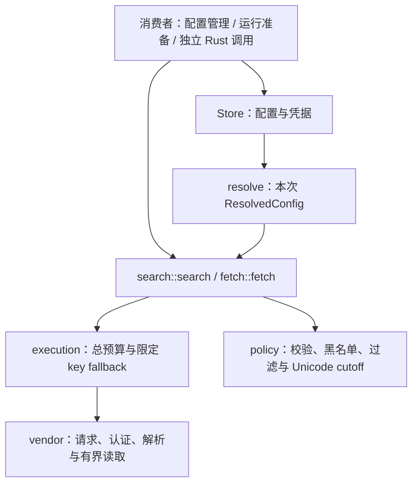

# 17 详细设计：aether-search 搜索与网页读取

> 状态：2026-10-28职责拆分已实施；本轮验证记录见 [90](90-开发任务清单.md)。本文件是Search/Fetch模块、配置API、显式执行输入、供应商协议和安全预算的唯一详细权威。概要见 [03](03-契约优先架构与职责拆分设计.md)，跨模块迁移见 [24](24-详细设计-职责分层与实现契约.md)。§8/9只保留历史证据。

## 目录

- [1. 范围与能力图](#1-范围与能力图)
- [2. 模块与 Rust API](#2-模块与-rust-api)
- [3. DTO、存储与事务](#3-dto存储与事务)
- [4. 供应商请求与解析](#4-供应商请求与解析)
- [5. 策略、取消与网络预算](#5-策略取消与网络预算)
- [6. 运行服务与 UI 接入](#6-运行服务与-ui-接入)
- [7. 切换与独立消费验收](#7-切换与独立消费验收)
- [8. 历史验证记录（2026-10-13）](#8-历史验证记录2026-10-13)
- [9. 历史多 Key 合同验收（2026-10-14）](#9-历史多-key-合同验收2026-10-14)

## 1. 范围与能力图

`aether-search` 是只依赖 support 的独立可选 Rust 能力：搜索/读取各选一个默认服务商，每家配置独立保存；原生密文凭据（Windows DPAPI / macOS Keychain / Linux Secret Service）、地址策略与有界网络访问沿用 support。显式配置消费者无需 Store、SQLite、原生凭据服务、Chat、runtime 或 Tauri 即可调用公开 search/fetch。



- 搜索：智谱、Tavily、SearXNG、Exa、Exa MCP、博查、Querit、Brave、Parallel、Jina、Firecrawl。
- 读取：Querit、直接获取、Jina、Firecrawl。
- 默认 Exa MCP 搜索、Jina 读取；匿名服务受上游限额影响，不承诺免费额度或可用性。
- 不迁移 Voynote 数据，不实现模型自主多轮检索。外部预搜索与模型原生搜索的运行编排归 [25 运行应用服务](25-详细设计-运行应用服务.md)，不是 Tauri 插件的职责。Chat 引擎不读搜索数据库。
- Native仍在现有crate按职责拆模块，不新增供应商trait、进程或服务总线。TS能力已在`packages/core/src/search`实现，Worker SearchService提供actor隔离配置/多key密文、显式resolve/search/fetch与fresh-password reveal；真实HTTP路由见23，公共类型由`@ouraihub/aether-contracts`导出，不重复UI DTO。
- Worker执行必须注入可信outbound；生产远程读取目标另需所有A/AAAA地址的可信DNS checker预检，实际连接仍由可信egress限制DNS rebinding、私网/特殊地址及redirect。配置binding不等于安全验收，普通fetch不能证明连接固定；受控loopback例外不进入生产。实现边界见23/29，实际证据见90。

## 2. 模块与 Rust API

### 2.1 模块责任

| 模块                       | 责任                                                                            | 不允许                                  |
| -------------------------- | ------------------------------------------------------------------------------- | --------------------------------------- |
| `dto`                      | 既有配置、偏好和结果 DTO；根部既有 DTO re-export 保持                           | 明文执行凭据进入公共 JSON               |
| `store`                    | SQLite 配置、默认选择、密文事务、解密与 cap/provider 独立游标，输出本次配置快照 | HTTP 执行实现、持配置锁跨网络、后台任务 |
| `execution`（公开类型）    | `ResolvedConfig`、单次执行期限、限定 key fallback 的共享内部逻辑                | SQL、原生凭据库、跨请求游标             |
| `search` / `fetch`（公开） | 类型明确的独立入口、query/URL 校验、结果处理                                    | 通用含糊响应、读取全局默认配置          |
| `vendor`（内部）           | 从既有 `protocol` 拆分/演进的请求、认证、解析与有界读取                         | 每家一套重试/预算或配置仓储             |
| `policy`（公开纯能力）     | 偏好校验、域名/URL 黑名单、命中处理、Unicode cutoff；按真实消费者复用现有纯逻辑 | 网络、SQL、运行状态或 UI                |

`policy` 不另建一套 DTO 或配置规则；公开入口必须复用同一规则。仅有内部 fallback 复用需要时可保留私有 `Output`，不得把 SearchResult 与 SearchPage 合为公开通用响应。

### 2.2 显式执行入口

```rust
pub mod execution {
    pub struct ResolvedConfig {
        pub provider: String,
        pub base_url: String,
        pub api_keys: Vec<Zeroizing<String>>,
        pub basic_auth_username: Option<String>,
        pub preferences: SearchPreferences,
        pub address_policy: AddressPolicy,
    }
}
pub mod search {
    pub async fn search(config: ResolvedConfig, query: &str)
        -> Result<SearchResult, KitError>;
}
pub mod fetch {
    pub async fn fetch(config: ResolvedConfig, url: &str)
        -> Result<SearchPage, KitError>;
}
```

- `base_url` 是已解析的明确地址，不隐式查库/查默认服务商；Direct fetch 的 API base 为空且被忽略，目标地址来自 `url`。Search 自有完整端点/相对路径规则，禁止套用 Providers 的 `api_base` 或强行加 `/v1`。
- `api_keys` 是本次尝试顺序，空代表匿名；独立入口只消费一次，不轮转跨请求状态。SearXNG 密钥用作 Basic 密码，其余按§4认证。
- `ResolvedConfig` 不派生 `Serialize`/`Debug`，不生成 TS/JSON、不进入 UI/事件/日志、不存回数据库；密钥使用 `Zeroizing<String>`，取消或完成后释放输入，不能为诊断额外复制明文。
- 公开 Rust 结构体不是可信边界：search/fetch 必须自行验证 provider-capability、必需 key、偏好与 URL/地址策略，不能假定只有 Store 能构造。unsupported provider 返回 `bad_request{provider:unsupported}`，缺必需 key 返回 `needs_config{keys}`；输入、网络与上游错误保持既有 KitError 分类。
- `search` 对 query trim，要求非空且 ≤4096 Unicode 字符，否则 `bad_request{query:invalid}`；`fetch` 目标 URL 原始输入 ≤8192 字节，否则 `bad_request{url:too_long}`，trim 后仍经 HTTP(S)/URL/地址校验。策略及响应预算见§5。

复用现有纯函数名作为 `policy` 的最小公开面，不另建策略对象：

```rust
pub mod policy {
    pub fn validate_preferences(prefs: &SearchPreferences) -> Result<(), KitError>;
    pub fn check_blacklist(url: &str, prefs: &SearchPreferences) -> Result<(), KitError>;
    pub fn cutoff(text: &mut String, prefs: &SearchPreferences);
    pub fn process_hits(hits: &mut Vec<SearchHit>, prefs: &SearchPreferences);
}
```

`validate_preferences` 拒绝整份非法输入；`check_blacklist` 解析 URL 并对命中返回 `bad_request{url:blacklisted}`；`cutoff` 原地按偏好截断；`process_hits` 原地移除非法/被屏蔽来源并处理摘要。调用者先验证偏好；search/fetch 入口不能省略该验证。黑名单规范化和 glob 匹配保持私有，纯策略不替代 `net` 地址/DNS授权检查。

### 2.3 Store 配置 API 与组合用例

```rust
pub struct Store { /* 配置锁、AddressPolicy、cap/provider 游标 */ }
impl Store {
    pub fn open(path: &Path, policy: AddressPolicy) -> Result<Self, KitError>;
    pub fn settings(&self, cap: SearchCap) -> Result<SearchSettings, KitError>;
    pub fn save(&self, input: SearchSave) -> Result<SearchSettings, KitError>;
    pub fn set_default(&self, cap: SearchCap, provider: &str) -> Result<SearchSettings, KitError>;
    pub fn save_key(&self, cap: SearchCap, provider: &str, value: &str, key_id: Option<&str>)
        -> Result<SearchSettings, KitError>;
    pub fn remove_key(&self, cap: SearchCap, provider: &str, key_id: &str)
        -> Result<SearchSettings, KitError>;
    pub fn reveal(&self, cap: SearchCap, provider: &str, key_id: &str) -> Result<String, KitError>;
    pub fn save_preferences(&self, input: SearchPreferences) -> Result<SearchPreferences, KitError>;
    pub fn preferences(&self) -> Result<SearchPreferences, KitError>;
    pub fn resolve(&self, cap: SearchCap, provider: Option<&str>)
        -> Result<execution::ResolvedConfig, KitError>;
    pub async fn search(&self, query: &str) -> Result<SearchResult, KitError>;
    pub async fn fetch(&self, url: &str) -> Result<SearchPage, KitError>;
    pub async fn check(&self, cap: SearchCap, provider: &str) -> Result<CheckResult, KitError>;
}
```

`resolve(cap, None)` 读取该 capability 的默认服务商；`Some(provider)` 明确选择该分区配置，不修改默认。读取地址/用户名、凭据、全局偏好与 Store 的策略，在同一准备操作中解密并固定本次顺序，释放所有锁后返回；只准备，不发网络请求。

`Store::search/fetch` 是保留的配置消费用例，先验证各自输入，再 resolve 一次并调用对应独立公开入口；`check` 对明确 cap/provider resolve 一次，再调用相同 `search::search` 或 `fetch::fetch`，输入保持 `"web search"` / `"https://example.com"`。成功返回命中数量或已读页面数1；搜索结果为空报 upstream（provider returned no results）。三者不保留另一条私有网络执行路径，不是旧实现兼容壳。

运行服务不同于这些配置便利用例：只在运行准备阶段调用 `resolve` 固定快照，接纳后执行调用独立 search/fetch，不再通过 `Store::search/fetch` 重读配置。生命周期只引用 [25](25-详细设计-运行应用服务.md)。

## 3. DTO、存储与事务

### 3.1 公共数据形状

既有 DTO 均保持 camelCase；请求对象拒绝未知字段，Rust 字段与生成绑定沿现有名称。

| DTO                 | 字段与意义                                                                                                                                                                     |
| ------------------- | ------------------------------------------------------------------------------------------------------------------------------------------------------------------------------ |
| `SearchCap`         | `search` / `fetch`，两个独立分区                                                                                                                                               |
| `SearchSettings`    | `capability`、`defaultProvider`、`preferences`、`providers`                                                                                                                    |
| `SearchProvider`    | `id/name/description`、可选官网/凭据网址、`keyMode`（required/optional/none）、`basicAuth`、可选 `defaultBaseUrl/baseUrl/basicAuthUsername`、`keys`、`ready`；从不返回明文凭据 |
| `SearchSave`        | `capability/provider`、可选 `baseUrl/basicAuthUsername`；省略保持，空地址恢复默认、空用户名清除；非 Basic 服务不保留用户名                                                     |
| `SearchKey`         | `id/masked`；解密失败仍可在设置中显示不可用，不在普通列表暴露明文                                                                                                              |
| `SearchPreferences` | `maxResults/compression/cutoffLimit/blacklist/modelToolsPreferred`，范围见§3.2                                                                                                 |
| `SearchHit`         | `title/url/snippet`，链接为 HTTP(S)                                                                                                                                            |
| `SearchResult`      | `query/provider/hits`，query 是实际上游查询；hits 有序去重并经策略处理                                                                                                         |
| `SearchPage`        | `title/url/content`，读取正文独立结果，不伪装成搜索命中                                                                                                                        |
| `CheckResult`       | `count`，检测命中数或已读页面数                                                                                                                                                |

### 3.2 数据库与保存

`Store::open(path, AddressPolicy)` 接收宿主选择的新系统独立数据库路径；旧 schema 返回 `incompatible_db`，不迁移、不读取旧凭据、不删除旧文件。保留现有 schema，不为拆模块创建新数据库或把执行快照存入表。

- `search_settings(capability,provider)` 保存各能力默认项。
- `search_providers(capability,provider,base_url,basic_username)` 保存分区配置，组合主键为 capability/provider。地址更新输入 ≤8192 字节、用户名 ≤200 字节；有效覆盖地址在保存时也经策略检查，空地址恢复供应商默认，Direct fetch 不保存 API base。
- `search_keys(id,capability,provider,key_ciphertext,position)` 每行独立加密；每分区最多16项，每项去首尾空白后1–4096 UTF-16 code units（复用既有凭据加密边界）。新增分配 id/position，更新保留 id。更新、删除、显式读取必须同时匹配 capability/provider/keyId，否则 `not_found{key}`；空输入拒绝，删除仅用显式 remove_key。无 key 服务不接受凭据，SearXNG 可保存 Basic 密码。
- `search_preferences` 单行 JSON 保存全局结果数1–50（默认5）、compression none/cutoff（默认none）、cutoffLimit 100–20000（默认2000）、最多32条256字符黑名单及 modelToolsPreferred（默认false）。非法范围或规则整次保存拒绝，不覆盖旧偏好。
- 配置锁只覆盖准备/SQL操作，不跨 HTTP。凭据先完成有效加密再提交；新增计数/更新归属与写密文在同一事务，失败不写明文、不丢旧凭据。配置、密钥、偏好为各自提交的动作；UI 的 save→saveKey→check 是顺序流程，不是原子事务，检测失败不回滚已经成功保存的配置或密钥。

### 3.3 解密与轮转

解密顺序为 `position,id`，跳过个别不可读 key；存在已保存 key 但全部不可读，或 required 服务无可读 key，返回 `needs_config{keys}`。这与 Providers 的“任一启用 key 不可读即失败”语义不同，不能统一成通用密钥仓储规则。

游标由 Store 按 capability/provider 独立保存在进程内，重启从头。每次成功 resolve 在可读 key 中预留下一起点并循环一圈，推进一次；匿名不推进。search/fetch/check 均只 resolve 一次，不在执行 fallback 时推进或跨 provider 继承。已固定配置不受之后保存/删除即时回写；下一次 resolve 才使用新配置。

## 4. 供应商请求与解析

本表保持既有供应商差异，不用统一认证/URL模板抹平。表中路径相对显式 base，完整端点标为“完整”；`count` 来自 maxResults，解析后仍执行全局结果/安全限制。

| id / 能力 / key 模式                   | 默认 base                                         | 请求与认证                                                                                                                           | 结果解析                                                                                                                 |
| -------------------------------------- | ------------------------------------------------- | ------------------------------------------------------------------------------------------------------------------------------------ | ------------------------------------------------------------------------------------------------------------------------ |
| zhipu / search / required              | `https://open.bigmodel.cn/api/paas/v4/web_search` | 完整 POST，Bearer；`search_query`、`search_engine:search_std`、`search_intent:false`                                                 | `search_result` 的 title/url/content                                                                                     |
| tavily / search / required             | `https://api.tavily.com`                          | POST `/search`，Bearer；query/max_results                                                                                            | results 的 title/url/content                                                                                             |
| searxng / search / none（可 Basic）    | `http://localhost:8080`                           | GET `/search`，q/format=json/language=auto；有 username 时 Basic(username:当前key)，无 key 可空密码                                  | results 的 title/url/content                                                                                             |
| exa / search / required                | `https://api.exa.ai`                              | POST `/search`，x-api-key；query/numResults/contents.text=true                                                                       | results 的 title/url/text                                                                                                |
| exa-mcp / search / optional            | `https://mcp.exa.ai/mcp`                          | 完整 POST，x-api-key（如有）；Accept JSON + SSE；JSON-RPC tools/call `web_search_exa`，query/type=auto/numResults/livecrawl=fallback | JSON 或 SSE 中 result.content 的文本；拒绝 JSON-RPC error/isError；按 Title 分块，URL、Text 或 Highlights 及多段摘要保留 |
| bocha / search / required              | `https://api.bochaai.com`                         | POST `/v1/web-search`，Bearer；query/count/exclude空/summary=true                                                                    | data.webPages.value 的 name/url/summary 或 snippet；code 非200拒绝                                                       |
| querit / search+fetch / required       | `https://api.querit.ai`                           | 搜索 POST `/v1/search`（query/count）；读取 POST `/v1/contents`（urls/format=markdown/extrasMeta=true）；Bearer                      | 搜索 results.result；读取 results 或 data 数组首项；error_code 非200拒绝                                                 |
| brave / search / required              | `https://api.search.brave.com`                    | GET `/res/v1/web/search`，x-subscription-token；q/count（最多20）                                                                    | web.results 的 title/url/description                                                                                     |
| parallel / search / required           | `https://api.parallel.ai`                         | POST `/v1/search`，x-api-key；objective/search_queries/advanced_settings.max_results                                                 | results 的 title/url/excerpts（数组摘要合并）                                                                            |
| jina / search required、fetch optional | `https://s.jina.ai` / `https://r.jina.ai`         | GET `/{编码query}` 或 `/{原目标URL}`；可用时 Bearer；读取加 x-retain-images:none                                                     | 搜索 data/results 的 title/url/content 或 description；读取 data 的 markdown/content/text                                |
| firecrawl / search+fetch / optional    | `https://api.firecrawl.dev`                       | POST `/v2/search`（query/limit/scrapeOptions.formats=[markdown]）或 `/v2/scrape`（url/formats=[markdown]）；可用时 Bearer            | 搜索 data.web；读取 data/metadata；success=false拒绝                                                                     |
| fetch / fetch / none                   | 无 API base                                       | 无服务商认证的直接 GET；重定向规则见§5                                                                                               | 静态 HTML 标题与纯文本提取                                                                                               |

搜索按表中供应商字段别名解析，兼容 url/link 和相应正文备选字段，按 URL 有序去重，丢弃非 HTTP(S)来源。读取兼容 metadata/title 与 markdown/content/text，空正文失败，缺标题时用 URL；标题最多500字符，正文先受安全预算约束再应用用户 cutoff。Exa MCP 的匿名模式不是通用 MCP Runtime 或运行工具结果类型，供应商私有封装不外泄为另一套公共 MCP 合同。

## 5. 策略、取消与网络预算

### 5.1 单次期限与限定 fallback

搜索15s、Exa MCP 搜索25s、网页读取20s：一个外层期限覆盖本次全部 key 尝试、连接和响应读取，不能给每个 key 重新计满；底层连接超时保持10s。仅明确 HTTP401/403/429 且仍有本次未使用 key 时切换，网络/超时/取消/5xx不重试，不跨 provider。没有 key 时仅匿名尝试一次；不把匿名作为已有 key 全部失败后的额外 fallback。

独立入口保持现有取消方式：宿主用 CancellationToken/select 等待并 drop 该 search/fetch future，取消后不再发下一 key/下一跳；不为此次拆分强制给插件 API 加第二套取消参数。网络取消不保证远端已收到请求无副作用，Store 已推进游标/已提交配置也不回滚。取消的运行终态归25，不在搜索模块发运行事件或保存会话。

### 5.2 地址与凭据

复用 `net::check_url/client` 的 URL/DNS/实际解析地址检查，不自动扩大私网权限。公开 API 必须 HTTPS，本地开发例外；显式 AddressPolicy 是宿主授权输入，来自用户的 URL 本身不是授权。供应商 API 请求禁止自动跟重定向；认证头标记 sensitive，错误按已使用凭据脱敏，不包含原始请求头、密码或完整机密 URL。日志仅记录必要分类和预算结果，不写正文/密钥。

Direct fetch 不携带任何搜索服务商 key、Basic 或服务商自定义头，最多跟随5次重定向；每次 GET 前（含首跳、相对 Location 解析后的下一跳）检查 URL、DNS 与黑名单，所有跳共用总期限。供应商读取的目标 URL 在向供应商发送前经 `net::check_target` 完成本机 DNS 全结果地址预检并检查黑名单，预检包含在本次总期限；不能只验证代理 API 地址而放行非法目标。本机预检不能锁定第三方代理实际使用的 DNS、连接地址或其内部重定向，不能宣称与 Direct 的逐跳连接检查等价。

### 5.3 结果策略与响应上限

成功体最多2MiB、错误体最多8KiB：检查声明长度并有界分块读取，不能仅依赖 Content-Length 或拿到全量 body 后再截断。网页正文保留24000 Unicode 字符安全预算；none 仅表示不再按用户摘要长度截断，不解除该安全上限。

搜索解析/去重后先黑名单过滤，再按 Unicode 字符 cutoff 并遵守 maxResults；读取先拒绝目标 URL，返回页再次检查来源 URL，再 cutoff page.content。规则支持域名及子域、host通配、完整HTTP(S)URL的 `*`/`?` 通配；host不区分大小写、path区分大小写，DNS末尾根点规范化，不支持正则。非法规则整次保存或独立执行输入校验失败，不静默忽略。截断按 Unicode 标量边界，不按字节/UTF-16截断造成损坏。

静态 HTML 提取只去脚本/样式/标签，不执行脚本，不承诺 readability 正文识别。搜索摘要/页面均为第三方不可信内容，使用方不得当作系统指令或本地授权。

## 6. 运行服务与 UI 接入

### 6.1 唯一运行编排

RunRequest/webSearch、预搜索时机、外部/原生路线选择、事件、失败/取消终态和会话保存只在 [25 运行应用服务](25-详细设计-运行应用服务.md) 定义。本文件仅提供搜索能力及 preferences.modelToolsPreferred 这一配置；模型 nativeWebSearch 的声明与协议约束归 [11 Providers](11-详细设计-kit-providers.md)，模型协议执行归 [12 Chat](12-详细设计-kit-chat.md)。Tauri 插件只接入应用服务与独立管理用例，CLI 和桌面共享编排，禁止把“Chat 由 Tauri 组合 Search”保留为第二规范。

原生供应商检索不经过本模块 search/fetch；本地黑名单/cutoff不能冒充控制供应商原生工具。UI 对完整模型请求可能包含会话/附带上下文的风险提示及来源展示按运行服务合同接入，不以搜索配置 API 替代运行授权。

### 6.2 配置与界面

`Builder.search(store)` + `search` Cargo feature 保留 search 命令和 `aether:search` 权限；管理/直接搜索读取是独立用例，不把整项 search feature 绑定到聊天。`KitPorts.search` 可选，`createTauriPorts({search:true})` 提供配置、检测、取消、搜索和读取，既有插件调用签名保持。

共享设置 SearchSettings 两张配置卡保留多 key 显式增改删/读取与全局偏好。Web 宿主通过 SearchPort.revealNeedsPassword 指示需要当前密码；由宿主验证后才返回指定 key，Aether 不持有 Web 登录信息。SearchPort 客户端签名只在 [16 UI](16-详细设计-kit-ui.md) 定义；配置保存与凭据会话流程只在 [30 客户端流程与凭据会话](30-详细设计-客户端流程与凭据会话.md) §4/5 定义，不在此复制排队/草稿/迟到结果算法。输入框地球联网开关保留 aria-pressed、双语提示与运行中禁用的可访问交互；运行/来源的客户端合同引用25与16。

## 7. 切换与独立消费验收

本节为本轮实施后的验收要求，已新增无 Store 的独立公开消费者 loopback 用例与配置组合回归；尚未运行构建/测试/格式化/真实上游请求。§8/9 的结果不得挪作本轮通过证据。

### 7.1 一次切换

现有 lib 按 dto/store/execution/search/fetch/vendor/policy 拆分，原 protocol 的供应商差异整体复用；Store::search/fetch/check 全部调用唯一公开执行路径，运行服务只在准备阶段 resolve，接纳后调用独立入口。保留原管理 API/插件命令、DTO、schema、cap/provider隔离及历史供应商解析修复；删除旧私有执行副本，不保留新旧两套搜索编排或含糊 Output 公共接口，不新增数据库/凭据迁移。

### 7.2 消费者行为证据

| 消费层          | 必须取得的证据                                                                                                                                                                |
| --------------- | ----------------------------------------------------------------------------------------------------------------------------------------------------------------------------- |
| 独立公开 search | 无 Store、无临时 DB/OS 凭据服务的真实 loopback；显式双 key，401/403/429限定 fallback、真实认证、query/结果解析、去重/黑名单/Unicode cutoff；给定顺序不被全局轮转改变          |
| 独立公开 fetch  | 无 Store真实读取；重定向到黑名单/禁止地址时目标没有收到请求；每跳和返回来源检查；Direct 不泄露配置中的供应商凭据；SearchPage 保持独立                                         |
| 显式输入与预算  | provider-cap不匹配、required key缺失、非法偏好、query/URL边界拒绝；15/25/20s总期限覆盖全部key、5xx/网络/取消不重试；超大声明/分块体有界；取消后不发下一请求                   |
| 配置与凭据      | 密文及重启、16key限制、cap/provider/keyId归属、部分不可读跳过/全部不可读报错、每次resolve仅推进一次、分区游标隔离、事务失败旧值保持、配置锁不跨网络                           |
| 组合与切换      | check 使用同一公开 search/fetch 路径及既定输入，空搜索明确失败；Store便利用例与独立入口产生同类输出；运行准备固定快照，接纳后配置变更不触发重读；无Chat/Tauri的独立消费者可用 |
| 供应商兼容      | 保留每家路径/认证/字段与 Exa MCP JSON/SSE、Text/Highlights 多段解析；匿名可用性不作保证，付费上游未联验明确标注                                                               |

以请求记录、返回值与目标未收到请求等行为断言验收，不用源码 wiring 测试冒充运行证据；命令、结果及未验平台记录在跨模块迁移记录中。

## 8. 历史验证记录（2026-10-13）

本节为此前单 Key 系统的历史验收记录，按当时范围原样保留，不代表本轮独立入口/职责切换验收。历史后续多 Key 结果见§9。

- Rust search 5 项行为测试：所有供应商字段解析、MCP SSE、凭据保持/清除/default/分区及重启、真实本地 HTTP Basic 密码与结果上限、Unicode/网页噪声、超大体提前拒绝；chat 34 项、plugin 16 项通过。
- Rust 三模块 all-target/all-feature Clippy `-D warnings` 通过；已有 ts-rs `deny_unknown_fields` 解析提示仍存在。
- UI lint/typecheck、49 项测试通过，57 个生成 DTO 与 Rust 一致，i18n/模块依赖边界检查通过。
- AutoNote 隔离真实 Tauri/WebView2 窗口：搜索/读取实际匿名 Exa MCP/Jina 返回结果；配置省略密钥保持、清除、结果数和重启读回通过。真实本地 HTTP 服务证明 chat 搜索在模型前、来源可见、笔记上下文保留、搜索失败和停止不发模型请求、关闭联网只发模型。
- 真实付费服务商凭据未联验；协议行为由固定响应与本地请求验证，不把夹具冒充上游联验。
- 使用用户授权的本地 Exa MCP 密钥，通过 AutoNote Worker 实际调用 `https://mcp.exa.ai/mcp`，HTTP 200 返回 Cloudflare 官方文档结果。发现上游已使用 `Highlights:`；两端解析补齐此标记，按 `Title:` 分隔结果而非按空行截断正文。新增多段摘要回归，Rust 搜索 6 项和 Worker 搜索/运行/配置 34 项通过。密钥不写入文档或源码。

## 9. 历史多 Key 合同验收（2026-10-14）

- 新schema、每Key密文/作用域、重启读回、401/403/429限定轮换、5xx/网络/取消不轮换、黑名单/重定向目标、Unicode cutoff均已有真实loopback Rust回归；`cargo test --workspace --all-features`退出0；严格workspace Clippy `--all-targets --all-features -D warnings`退出0，ts-rs属性解析提示仍存在。
- UI常显password输入、获取密钥邻标签、图标管理/检测、增改删读/复制、Web密码、默认折叠策略、检测前提交并失败保留草稿。11测试文件53项、typecheck0错误0警告、lint/格式通过；i18n326键、crate依赖13项、64生成DTO一致通过。
- 真实Chromium+AutoNote隔离HTTP/Hono+SQLite读取新合同：Key添加后只显示mask，密码验证显式显示，修改同keyId，Esc关闭后密码/明文清空；高级cutoff100、两条规则、modelToolsPreferred=true实际HTTP读回；刷新Key输入为空、mask保留。320/375/414/768宽无横向溢出。该HTTP宿主使用测试vault，不冒充生产CredentialVault加密；生产加密依赖既有宿主vault验证。
- 原生模型能力显式保存和重启读回；Rust实际HTTP验证Messages/Responses原生工具参数及可点击来源，server_tool_use不走本地执行。Worker原生与外部回落11项定向场景通过。真实供应商原生Key联验未做。
