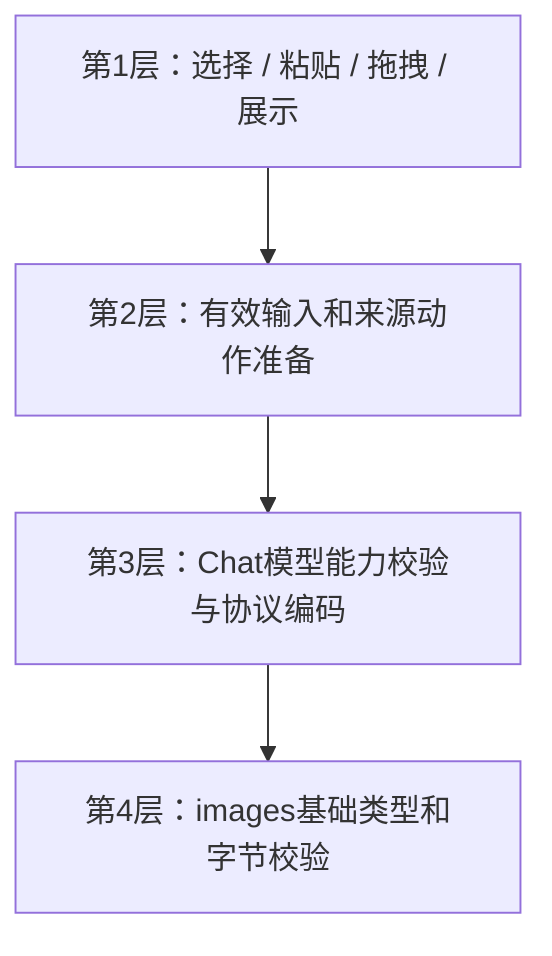

# 19 图片输入与视觉能力

> 状态：2026-10-28基础图像合同与字节校验已迁至aether-images，chat保留独立MAX_IMAGES输入策略；本轮测试证据与视觉验证限制见 [90](90-开发任务清单.md)。
> 本文是ImagePart/ImageRef基础输入合同、聊天图片输入策略与协议映射的唯一详细定义；独立生成/编辑接口见 [20](20-生成图片工具.md)，会话领域、图片TTL和数据库见 [26](26-详细设计-会话与历史存储.md)，运行准备见 [25](25-详细设计-运行应用服务.md)。RunRequest和UI Turn字段组合由 [22](22-详细设计-跨运行时公共契约.md) 定义，不在此复制DTO。
> 历史证据：2026-10-15视觉配置一期f9a037a；AutoNote docs/31为历史实施计划与验收记录，不是本轮结果。Cherry参考仅限能力目录默认/用户覆盖、needsVision、粘贴拖拽；不移植FileManager、AI SDK或OCR。
> Web实现：`packages/core/src/images` 负责MIME/base64/图片字节检查，`protocol`映射三协议视觉输入；WorkerRuntime沿同一effective request/历史路径规则选图并在接受前拒绝不支持视觉的当前输入。公共ImagePart/ImageRef由`packages/contracts/src/generated`导出；Worker会话图片URL是actor鉴权同源路由，TTL保留空引用，D1大文档可指向不可变R2 blob（23/29）。这些实现不等于浏览器粘贴/拖拽或真实视觉模型全部验过，证据见90。

## 1. 逐层模块与owner



| 内容                                                            | 唯一owner                                         |
| --------------------------------------------------------------- | ------------------------------------------------- |
| ImagePart、ImageRef、IMAGE_MIMES、MAX_IMAGE_BYTES、基础编码校验 | aether-images；本页定义                           |
| MAX_IMAGES=4（每次聊天用户输入）                                | aether-chat输入策略；本页定义，不借用编辑数量常量 |
| 模型canVision配置与推断                                         | aether-providers；11详细定义                      |
| 当前/历史user图片协议编码与当前模型vision检查                   | aether-chat；本页映射，12执行接缝                 |
| 来源输入图片选择、effective request、原子预留                   | runtime prepare/conversations；25/26              |
| TurnImage、turn_images、TTL、purge、generated存储               | runtime::conversations；26                        |
| 编辑图片数量/生成编辑HTTP                                       | aether-images；20                                 |

## 2. 基础类型和上限

```rust
pub struct ImagePart { pub mime: String, pub data: String }
pub struct ImageRef { pub mime: String, pub url: Option<String> }
```

两类型由images定义，camelCase serde/ts-rs绑定遵循22，迁移时chat不保留旧位置兼容导出。ImagePart输入deny_unknown_fields；data为标准base64，不含data:前缀。MIME只允许image/png、image/jpeg、image/webp、image/gif；单张解码后最多4MiB（MAX_IMAGE_BYTES），IMAGE_MIMES归images。

ImageRef是展示引用：url存在时为宿主受控地址（桌面可为data URL，Web为同源资源路由），过期为null，MIME仍存在。历史查询不另回传原始ImagePart/base64数组，不把展示URL当可传到上游的任意图片下载地址。

聊天每次当前有效输入最多4张（chat::MAX_IMAGES），与images::MAX_EDIT_IMAGES虽同为4但语义独立。RunRequest.images缺省空由22定义；source图片和历史图像的选择不是UI重新上传协议。

## 3. 能力与接受前校验

canVision在模型配置时确定：模型名称/族推断只是默认，用户保存覆盖为准，不在发送时猜；Model/ModelSave/ProbedModel/ModelOption的字段和infer/fixtures由11维护。EndpointCard可修改，重新获取模型保留已设值；ModelSelect视觉标签/筛选与UI能力流程由16维护。

1. 基础数量/MIME/base64/解码大小错误：bad_request{field:"images",reason:"count"|"mime"|"encoding"|"size"}。
2. 当前有效input带图片且connection.can_vision=false：bad_request{field:"images",reason:"vision_unsupported"}，接受前拒绝，不建turn、不请求模型。
3. 历史图片在非视觉模型只剥图、保留文字，不报错，允许切文字模型继续。
4. retry/regenerate/@换模型沿源turn输入图片；翻译无图；这些动作不接受客户端images，action_conflict。来源图片先进入effective request，宿主与模型校验必须看到同一输入，不能只校验客户端空images。
5. RunService入口先验证，RunEngine对直接消费RunInput者再守卫基础/vision约束；两个层次共用images检查，不各写一套解码实现。预留时源图片清理/变更如何conflict由26定义。

## 4. 三协议编码（当前和历史user同一函数）

| 协议               | user content                                                                            |
| ------------------ | --------------------------------------------------------------------------------------- |
| openai-chat        | [{type:"text",text},{type:"image_url",image_url:{url:"data:<mime>;base64,<data>"}}…]    |
| openai-responses   | [{type:"input_text",text},{type:"input_image",image_url:"data:<mime>;base64,<data>"}…]  |
| anthropic-messages | [{type:"image",source:{type:"base64",media_type,data}}…,{type:"text",text}]（图片在前） |

无图仍纯字符串，不改变旧纯文本请求体；过期图片不发、不加占位。UserImages仅由prepare为可用历史输入构造，不写turns.messages。generated不自动重放，需改图时走20工具引用。不做OCR、自动压缩、Gemini/文件API上传；图片不纳入token预算估算。

## 5. 存储与UI引用

原图保存、迁移v4/v5、NULL过期行、retry/fork复制和7天TTL全部由26唯一规定；插件不直接启动purge，images不依赖会话。独立ImagePart调用由宿主自行存储，不强迫建立通用资产系统。

UI行为保留：附件按钮仅接受白名单类型，粘贴/拖拽提取files，逐张移除；超限即时提示不入队。非视觉模型禁附件并解释，已附图则不能发送；切回视觉恢复。用户消息缩略图可打开受控原图，url=null展示“图片已过期”；有图来源@模型列表只列canVision；发送失败恢复草稿及图片。UI详细交互与客户端归16，不赋予其后端授权职责。

## 6. 验收范围

三协议当前/历史编码、无图体不变、过期不发、非视觉当前图拒绝且不出网、模型覆盖推断、迁移旧库、retry复制/TTL/fork、prepare期间purge冲突；UI粘贴/拖拽/移除/超限/@过滤/失败恢复；真实HTTP与WebView表现。场景列表不等于全部逐项手工运行，实际证据见90。
