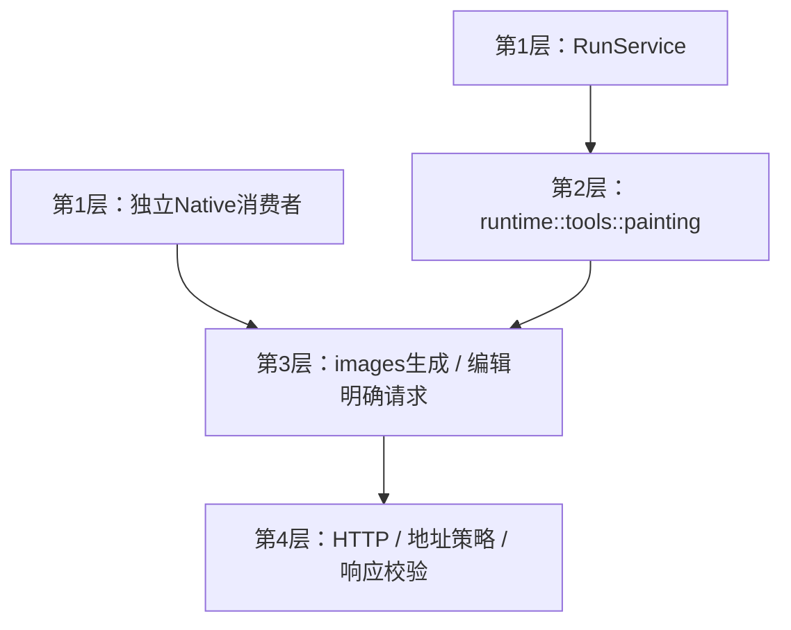

# 20 详细设计：独立图像生成、编辑与Chat工具适配

> 状态：2026-10-28已实现aether-images独立ImageRequest生成/编辑客户端（default=[]、client可选）及runtime绘图适配；本轮受控HTTP与测试记录见 [90](90-开发任务清单.md)，未调用付费上游。
> 本文唯一规定 `aether-images` 生成/编辑入口与HTTP规则，以及runtime中绘图工具的参数/引用策略；运行协调/适配接缝见 [25](25-详细设计-运行应用服务.md)，基础ImagePart/ImageRef及输入检查见 [19](19-图片输入与视觉能力.md)，持久化/TTL见 [26](26-详细设计-会话与历史存储.md)，公共DTO字段见 [22](22-详细设计-跨运行时公共契约.md)。
> 历史参考：AutoNote docs/32、docs/37为旧计划/证据；Cherry composer开关、PaintingTool和生成结果展示为行为参考，不移植其AI SDK或工具框架。

## 1. 逐层模块图与边界



images只依赖support，不依赖chat/runtime/providers/Tauri/会话；接受已解析Connection、AddressPolicy、明确ImageRequest与token。工具JSON、image-N候选、ImageOrigin、宿主painting角色、每run次数和保存属于runtime适配，不下沉images。chat不再拥有painting.rs客户端或generate_image规格，插件不承担组装或存储。

默认feature为空仅基础合同/检查，client才启生成/编辑HTTP与support/native；纯合同依赖support default-features=false，workspace合法继承及完整feature表见25 §1.1。runtime/runs消费images/client，独立会话只需基础类型，不启客户端。

## 2. 独立images公开接口

```rust
pub struct ImageRequest {
    pub prompt: String,
    pub size: ImageSize,
    pub images: Vec<ImagePart>,
}
pub enum ImageSize { Square, Portrait, Landscape }
pub async fn generate(
    connection: &Connection,
    policy: &AddressPolicy,
    request: &ImageRequest,
    cancel: &CancellationToken,
) -> Result<ImagePart, KitError>;
```

Square/Portrait/Landscape分别对应1024x1024、1024x1536、1536x1024，不接受任意尺寸字符串。prompt trim后非空、最多4000 Unicode字符；images为空生成，非空编辑，MAX_EDIT_IMAGES=4唯一归images，与聊天MAX_IMAGES不复用。编辑输入复用19基础MIME/base64/4MiB检查，Connection不支持编辑则明确unsupported，不偷偷丢参考图转生成。

独立入口每次返回一张ImagePart；多张批量不在本轮范围。取消使用KitError取消/超时/网络语义；独立入口不假装判断外部副作用完全没发生，工具适配据派发阶段映射Unknown。

## 3. HTTP与安全规则

- 生成：POST `{connection.imageBaseUrl ?? baseUrl}/images/generations`，JSON `{model,prompt,size,n:1}`。
- 编辑：POST `{connection.imageEditBaseUrl ?? baseUrl}/images/edits`，multipart含model/prompt/size/n=1；单图image，多图每项image[]；文件名image-N.{png|jpg|webp|gif}且各自MIME正确。只由multipart边界设置Content-Type，不再附JSON类型头。
- 自定义headers先应用，后加绘图端点Bearer；保留401/403/429限定密钥切换，不把超时/连接中断变成自动重复收费调用。凭据不输出Debug/Serialize/日志。
- 同support地址策略，私网/回环需宿主允许，禁止重定向绕过检查。生成/编辑与返回URL下载都检查目标，不信任供应商返回的URL自动白名单。
- 不发送response_format（gpt-image-*固定b64且不支持该参数）；响应data项b64_json或仅url两条路径共用解析/基础校验。url只下载一次，MIME白名单、解码后4MiB及读取预算约束与直接b64一致，拒绝无界响应。
- 总调用超时120秒，token取消向传输传播。请求已派发且结果不可知不得伪造“未生成”。单独client不持有运行次数或会话任务。

## 4. runtime绘图工具适配

25持有适配执行/授权/收尾，本节只定义绘图特有规则。

### 4.1 目录与参数

工具名generate_image；参数 `{prompt:string(1..4000),size?:"1024x1024"|"1024x1536"|"1536x1024",image_ids?:string[]}`。size缺省Square。模型自己决定何时调用，不在UI点击后绕过模型直接启动Chat工具。

`generateImage`缺省false、仅chat用途；打开且宿主painting角色未绑定 → 接受前needs_config{reason:"painting_model"}；对话模型supportsTools=false不提供工具且UI置灰解释。painting角色只允许ModelType=image，providers按11解析；工具目录只在显式打开且角色可用时加入。每run最多2次调用，由runtime计数防循环，不限制独立images消费者为“一生两次”。

### 4.2 固定image-N候选

仅绘图模型canVision=true才提供image_ids。准备时从仍有字节的图片收集最多8项，最新在前：本条输入后附者在前；再沿历史路径从新到旧，每轮generated先于input，各组后者在前。编号image-1…；描述含`Images you can pass in image_ids (newest first):`与来源文字（本条附件/历史附件/历史生成）。ImageOrigin只归runtime，不进入images请求。

清单非空才把image_ids作为enum数组、minItems=1、maxItems=4加入schema；空清单/模型不支持则不提供该参数。本轮刚生成图片不加进固定目录。

运行前候选依赖纳入26准备指纹；执行时按固定引用懒加载字节，不重新选图：不支持→bad_request{image_ids,unsupported}；超4→too_many；未知id→unknown；已purge→expired。确定这些错误时未派发生成请求，作为工具Error回灌，可让模型修正。加载后的ImageRequest不再携带会话ID或image-N字符串。

### 4.3 保存与结果

独立images返回ImagePart；有会话的适配通过ConversationService保存kind=generated后才给UI成功payload；无历史则生成本次展示ImageRef，不声称持久化。成功模型文本为`Generated N image(s).`，payload的images形状按22/19。

已生成但保存失败必须向模型/UI呈现明确失败或Unknown，并保留“生成已发生、不能确认保存”的事实，不仅warn后说已保存；派发后取消/超时结果不明为Unknown，禁止自动重试。已拿到明确生成结果且确认保存失败可为Error，不能说服务商没执行。工具Error/Unknown不等于运行终态，后续及最终保存由25统一处理。

generated不作为普通后续模型输入重放；历史只保留工具文本与展示引用。需要改图时通过固定image_ids取图。turn_images迁移、7天清理、NULL引用行由26唯一规定，不让images消费ConversationStore。

## 5. UI与宿主分工

UI保留“+”菜单生成开关及aria-pressed、开关打开标签/一键关、未绑定提示和onOpenSettings、工具进度行、回复内可打开原图的图片网格。它是会话级临时UI状态，不存历史，切会话复位；发送仅提交22的generateImage意图，不携带秘密连接。UI详细组件/流程由16维护。

桌面宿主配置painting角色并构造25服务；插件只接服务与传输。Web已实现`packages/core/src/images.generateImage`、Worker ImageService与WorkerRuntime绘图适配；宿主WorkerHost.paintingModel显式选择保存的image模型，受控存储回调返回ImageRef，有会话时runtime追加generated后才给成功payload。无会话且未配置持久化仅返回本次data引用，不宣称已存储；生成后保存失败保留已生成事实，不重放。公共HTTP未注册独立图片生成路由，独立消费者直接调用能力；平台出站/R2见23/29，实际模型/图片/UI证据分别见90。

## 6. 不做与待验收

不做蒙版/局部重绘、绘图页、多张批量、非OpenAI绘图协议、生成图自动普通历史重放或本轮新绘图费用统计。

验收范围：独立生成/编辑无需Chat/会话；三尺寸/multipart字段/MIME、base64与下载路径、私网/重定向/大小限制、认证限定换钥、取消/超时未知不重试、固定8候选/2次工具调用、引用过期、生成保存失败可见、generated不自动重放与UI状态。原绘图HTTP/multipart行为测试已迁images/client，目录规格测试迁runtime；本轮执行记录与限制见90。
