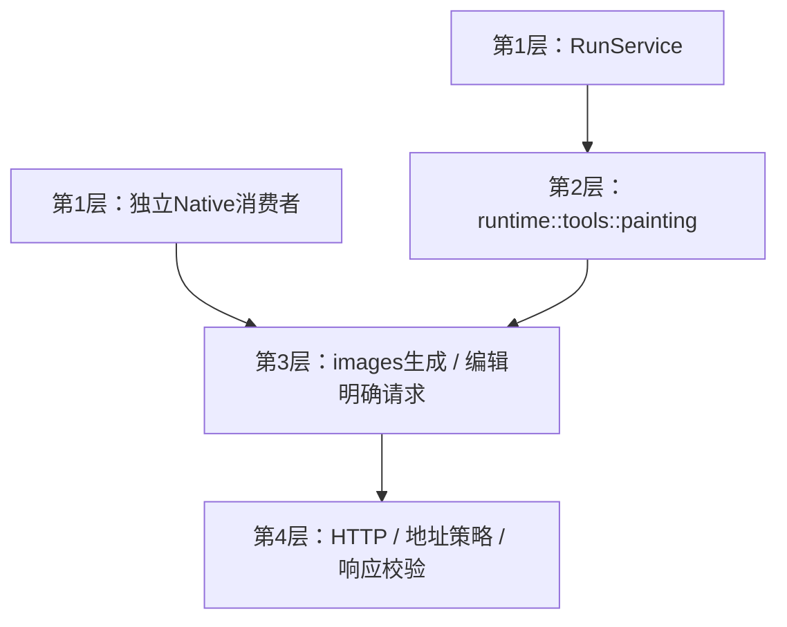

# 20 详细设计：独立图像生成、编辑与Chat工具适配

> 状态：2026-10-28已实现aether-images独立ImageRequest生成/编辑客户端（default=[]、client可选）及runtime绘图适配；本轮受控HTTP与测试记录见 [90](90-开发任务清单.md)，未调用付费上游。
> 本文唯一规定 `aether-images` 生成/编辑入口与HTTP规则，以及runtime中绘图工具的参数/引用策略；运行协调/适配接缝见 [25](25-详细设计-运行应用服务.md)，基础ImagePart/ImageRef及输入检查见 [19](19-图片输入与视觉能力.md)，持久化/TTL见 [26](26-详细设计-会话与历史存储.md)，公共DTO字段见 [22](22-详细设计-跨运行时公共契约.md)。
> 历史参考：AutoNote docs/32、docs/37为旧计划/证据；Cherry composer开关、PaintingTool和生成结果展示为行为参考，不移植其AI SDK或工具框架。

## 1. 逐层模块图与边界

images只依赖support，不依赖chat/runtime/providers/Tauri/会话；接受已解析Connection、AddressPolicy、明确ImageRequest与token。工具JSON、image-N候选、ImageOrigin、宿主painting角色、每run次数和保存属于runtime适配，不下沉images。chat不再拥有painting.rs客户端或generate_image规格，插件不承担组装或存储。

默认feature为空仅基础合同/检查，client才启生成/编辑HTTP与support/native；纯合同依赖support default-features=false，workspace合法继承及完整feature表见25 §1.1。runtime/runs消费images/client，独立会话只需基础类型，不启客户端。

## 2. 独立images公开接口

Rust `ImageRequest` 与 TS 同名请求保留 prompt、size、images，并补充可选 quality（low/medium/high）、mask（ImagePart）；独立执行策略 `ImageLimits` 提供 maxImageBytes（独立输入及输出默认4MiB、最大10MiB，参考图与mask合计20MiB）、timeoutMs（默认120秒、最大180秒），以及显式可选 profile（generic/gpt-image/siliconflow）。原有聊天附件4MiB限制不因独立能力策略放宽。Rust request 的构造调用与 TS 全部消费者同步迁移，不保留旧返回签名。

`generate` / `generateImage` 返回 `ImageGeneration { image:ImagePart,revisedPrompt:string|null,usage:TokenUsage,totalTokens:number|null }`（Rust为`total_tokens`），usage和totalTokens仅保留供应商真实报告；供应商只报total时，不伪造input/output，不丢失total。未报告为null。解析后的bytes仅在平台传输/存储适配转换，不将R2、文件ID、会话ID或operation带进独立能力。图像输入/输出PNG/JPEG/WebP/GIF沿用公开基础支持；宿主可在保存前进一步限制格式。mask必须PNG且有参考图片，数量与总量界限执行前验证，供应商不支持的quality/mask明确拒绝而非静默丢弃。

Square/Portrait/Landscape沿用1024x1024、1024x1536、1536x1024；prompt trim后非空、最多4000 Unicode字符；images为空生成，非空编辑。图像能力与供应商profile决定编辑/质量/遮罩支持，不能将canVision直接当作支持遮罩；保留显式声明，不按任意模型名称臆测功能。

## 3. HTTP与安全规则

- 通用OpenAI：生成POST images/generations，JSON model/prompt/size/n:1；编辑multipart单图image、多图image[]。GPT Image profile可发送quality/output_format:png/background:opaque和mask；不发送response_format。未知profile不擅自发送GPT专属字段。
- SiliconFlow：配置的图像base hostname为api.siliconflow.cn/com时显式使用image_size与images[].url；非该profile仍按通用data[]处理，不按供应商显示名称判断。
- 自定义headers与Bearer只用于模型端点。仅明确401/403/429可在派发未获接受时换钥；连接中断/超时/结果无法解析/保存失败不得重新生成。下载不携带供应商凭据。
- 返回data恰好一张，支持b64_json或url；SiliconFlow images同样一张。URL与端点共用注入安全出站策略，每跳检查，不信任返回URL。缺省/octet-stream按真实签名识别，显式图片MIME必须与字节一致；完整文件格式/尺寸及字节上限校验后才返回。
- 取消/超时遵守整个调用预算；错误区分not_dispatched/rejected/unknown/generated（生成后保存失败），Rust/TS相同场景。独立能力不维护业务审批、会话工具次数或历史存储。

## 4. runtime绘图工具适配

25持有适配执行/授权/收尾，本节只定义绘图特有规则。

### 4.1 目录与参数

工具名generate_image；参数 `{prompt:string(1..4000),size?:"1024x1024"|"1024x1536"|"1536x1024",image_ids?:string[]}`。size缺省Square。模型自己决定何时调用，不在UI点击后绕过模型直接启动Chat工具。

`generateImage`缺省false、仅chat用途；打开且宿主painting角色未绑定 → 接受前needs_config{reason:"painting_model"}；对话模型supportsTools=false不提供工具且UI置灰解释。painting角色只允许ModelType=image，providers按11解析；工具目录只在显式打开且角色可用时加入。每run最多2次调用，由runtime计数防循环，不限制独立images消费者为“一生两次”。

### 4.2 固定image-N候选

仅绘图模型canVision=true才提供image_ids。准备时从仍有字节的图片收集最多8项，最新在前：本条输入后附者在前；再沿历史路径从新到旧，每轮generated先于input，各组后者在前。编号image-1…；描述含`Images you can pass in image_ids (newest first):`与来源文字（本条附件/历史附件/历史生成）。ImageOrigin只归runtime，不进入images请求。

清单非空才把image_ids作为enum数组、minItems=1、maxItems=4加入schema；空清单/模型不支持则不提供该参数。本轮刚生成图片不加进固定目录。

运行前候选依赖纳入26准备指纹；执行时按固定引用懒加载字节，不重新选图：不支持→bad_request{image_ids,unsupported}；超4→too_many；未知id→unknown；已purge→expired。确定这些错误时未派发生成请求，作为工具Error回灌，可让模型修正。加载后的ImageRequest不再携带会话ID或image-N字符串。

### 4.3 保存与结果

独立images返回ImagePart；有会话的适配通过ConversationService保存kind=generated后才给UI成功payload；无历史则生成本次展示ImageRef，不声称持久化。成功模型文本为`Generated N image(s).`，payload的images形状按22/19。

已生成但保存失败必须向模型/UI呈现明确失败或Unknown，并保留“生成已发生、不能确认保存”的事实，不仅warn后说已保存；派发后取消/超时结果不明为Unknown，禁止自动重试。已拿到明确生成结果且确认保存失败可为Error，不能说服务商没执行。工具Error/Unknown不等于运行终态，后续及最终保存由25统一处理。

generated不作为普通后续模型输入重放；历史只保留工具文本与展示引用。需要改图时通过固定image_ids取图。turn_images迁移、7天清理、NULL引用行由26唯一规定，不让images消费ConversationStore。

## 5. UI与宿主分工

UI保留“+”菜单生成开关及aria-pressed、开关打开标签/一键关、未绑定提示和onOpenSettings、工具进度行、回复内可打开原图的图片网格。它是会话级临时UI状态，不存历史，切会话复位；发送仅提交22的generateImage意图，不携带秘密连接。UI详细组件/流程由16维护。

桌面宿主配置painting角色并构造25服务；插件只接服务与传输。Web已实现`packages/core/src/images.generateImage`、Worker ImageService与WorkerRuntime绘图适配；宿主WorkerHost.paintingModel显式选择保存的image模型，受控存储回调返回ImageRef，有会话时runtime追加generated后才给成功payload。无会话且未配置持久化仅返回本次data引用，不宣称已存储；生成后保存失败保留已生成事实，不重放。公共HTTP未注册独立图片生成路由，独立消费者直接调用能力；平台出站/R2见23/29，实际模型/图片/UI证据分别见90。

## 6. 不做与待验收

不新增绘图页、多张批量、任意供应商插件或自动重放生成结果；本轮承接已存在的GPT质量/遮罩与SiliconFlow实际需求，不将尚无需求的字段透传为自由JSON。

验收：双端独立生成/编辑、质量/遮罩、base64/URL/SiliconFlow、真实格式/缺省MIME、安全地址、大小/数量、拒绝换钥、派发后未知不重试；runtime和Worker消费新结果，AutoNote/Actora删除重复协议实现；产品私有存储/审批/上下文用量分开验证，实际证据见90。
