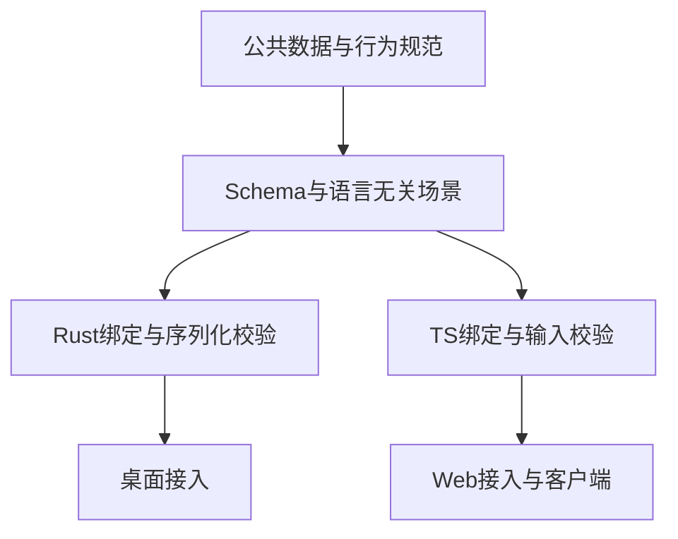

# 22 详细设计：跨运行时公共契约

> 状态：公共合同资产、Rust序列化、TS生成绑定及Core/Worker执行已实现；本轮验证见 [90](90-开发任务清单.md)。合同检查与真实平台/UI验收分别记录，不互相替代。
> 上位：[00 概要设计](00-概要设计.md)、[03 职责分层](03-契约优先架构与职责拆分设计.md)。本页是跨语言运行/会话wire数据与行为的唯一规范；各能力专用DTO归所属详细设计，不在此复制第二套形状。

## 1. 契约组织与类型所有者



图为Rust与TS共同验证关系；两端已有执行实现，内部类型、存储与调度模型不要求相同，行为等价须由共同场景与实际证据证明。

| 数据                                                    | 唯一字段规范                                 | Rust定义目标owner                   |
| ------------------------------------------------------- | -------------------------------------------- | ----------------------------------- |
| RunRequest/Accepted/Snapshot/ContextRef/Ack             | 本页§3–5                                     | runtime::contract                   |
| RunEvent、工具结果与结束状态                            | 本页§4，执行规则见12                         | chat                                |
| 会话展示DTO                                             | 本页§6                                       | runtime::contract::conversation_dto |
| 会话领域/SQL类型                                        | 26，不直接作为UI DTO                         | runtime::conversations              |
| ModelRef/Provider/Endpoint/Model/Key/Probe              | 11                                           | providers                           |
| ProviderPreset                                          | 11的宿主模板合同                             | TS客户端类型，无后端秘密            |
| SearchCap/Settings/Save/Preferences/Key/Result/Hit/Page | 17                                           | search及TS客户端绑定                |
| Skills的Source/Preview/修订/快照                        | 14                                           | skills                              |
| MCP配置、发现结果、调用结果                             | 27                                           | mcp-client                          |
| MCP Scope/Token/注册工具                                | 28                                           | mcp-server                          |
| ImagePart/ImageRef                                      | 19；生成请求见20                             | images                              |
| Reasoning/TokenUsage/ContextUsage/Cost                  | 18及21、10                                   | support公共类型                     |
| PermissionMode/ToolEffect/Approval                      | 本页§3定义wire枚举；12定义执行矩阵及风险规则 | support公共合同、chat消费           |
| KitError/Details                                        | 本页§7；原生适配见10                         | support公共错误                     |
| UI端口方法                                              | 16，不是wire DTO                             | TS ports                            |

同一概念只有一个定义owner和一份字段合同。Rust存储领域的Turn/Conversation与展示DTO分命名空间，领域类型不以同名ts-rs文件导出。迁移后仍用现有生成脚本，禁止两个定义竞争写同名生成文件。

本轮图像执行补充 ImageRequest/生成结果（图像、修订提示词、可空真实 usage）与策略限制，归20；思考配置、上下文估算/最近请求统计及用量合同归18。能力接口升级同步Rust/TS全部调用者和生成资产，不保留 ImagePart-only 旧入口 shim；产品的权限和持久 operation envelope 不进入公共DTO。共享 fixtures 同时校验正常、边界、错误和派发阶段，不能只断言连线或复制字段。

公共TS包为`@ouraihub/aether-contracts`；canonical ts-rs输出位于`packages/contracts/src/generated`，UI ports只消费/导出这些类型，Core/Worker不依赖UI。`pnpm kit:dto`更新Rust生成绑定，随后`pnpm --filter @ouraihub/aether-contracts generate`更新`src/index.ts`、`validation.ts`、`validators.js`与声明；`check-generated`比对产物。该脚本从绑定及`src/search.ts`提取专用数据形状，manifest声明的run/error/conversation schema优先；AJV校验提前生成，Worker运行时不编译schema或eval代码。

## 2. JSON与边界规则

- 公共JSON camelCase；事件kind、错误code等枚举按明确值，未知值拒绝。
- 外部数据先当unknown解析与校验，不用类型断言制造可信对象。
- 请求拒绝未知字段；响应的未知字段策略由schema固定，不能各实现随意猜测。
- 可省略表示未提供；null仅在字段声明允许时表示空，不与空字符串混用。
- 时间为Unix milliseconds，有限安全整数；token计数非负，未知为null，不用0冒充。
- ID不携带产品业务含义，按操作原有上限与归属校验，不对已有合法ID另施一套26位格式。
- JSON Schema只定义数据，行为场景定义时序，两者不能互相替代。
- 密钥、OAuth token、凭据请求头不进入运行事件、快照、错误或诊断日志。正文与宿主允许的payload是功能数据，不复制进日志。凭据写入/reveal另有授权合同。
- `contractVersion:1`放契约manifest或连接级声明，不重复每条小对象；删除字段、改类型或枚举须先迁移全部消费者，不留长期同义别名。

## 3. 运行输入与接受

```ts
type PermissionMode = 'default' | 'plan' | 'accept_edits' | 'auto' | 'full_access'
type ToolEffect = 'read' | 'edit' | 'exec' | 'other'
type Approval = 'auto' | 'ask' | 'deny'
interface ModelRef {
  endpointId: string
  modelId: string
}
interface ContextRef {
  kind: string
  id: string
}
interface SkillRef {
  id: string
  revision: number
}
interface RunRequest {
  purpose: string
  model?: ModelRef | null
  skills: SkillRef[]
  context?: ContextRef | null
  input: string
  images?: ImagePart[]
  conversationId?: string | null
  scope?: string | null
  webSearch?: boolean
  regenerate: boolean
  replyToId?: string | null
  retryTurnId?: string | null
  translateTurnId?: string | null
  targetLanguage?: string | null
  language: string
  reasoningEffort?: ReasoningEffort
  permissionMode?: PermissionMode
  generateImage?: boolean
}
interface RunAccepted {
  runId: string
  conversationId: string | null
  turnId: string | null
}
interface Ack {
  ok: true
}
```

ModelRef字段在11定义，本处仅示意引用所需形状，不增加providerId。purpose/context/scope由宿主解释，不作为授权凭证。RunRequest不包含owner、Window、principal、任意网络执行端点或连接秘密。

| 输入约束                | 规则                                                        |
| ----------------------- | ----------------------------------------------------------- |
| input                   | 原有100000 Unicode字符上限，空输入/图片与动作组合按用例校验 |
| skills                  | 最多20，revision固定，不静默采用新版本                      |
| images                  | 缺省空，MIME/base64/字节规则见19                            |
| language                | 1–80字符                                                    |
| 动作ID                  | 每个最多128字符，必须属于目标会话                           |
| scope/title             | 上限分别200字符，空值等规则见26                             |
| 重答/翻译               | 互斥，不与regenerate任意组合；来源和模型回退见25/26         |
| webSearch/generateImage | 缺省关闭，仅允许已有purpose与能力组合                       |

permissionMode是主线已有字段，缺省default，允许值与宿主可选范围见12/25，不能因重构删除。旧草案的context数组/providerId/events传输字段不加入当前合同；未来新增须先迁移所有消费者。

接受前失败返回KitError，不创建活动run、不请求模型。接受后失败只经End；事件可先于start的Promise/IPC响应到达，但后端内部必须已经接受。RunAccepted不携带SSE URL、token或通道对象，传输信封另在15/23定义。

## 4. 事件合同

```ts
type EndStatus = 'completed' | 'failed' | 'cancelled'
type ToolOutcome = 'ok' | 'error' | 'denied' | 'unknown'
type RunEvent =
  | { kind: 'search_start' }
  | { kind: 'search_result'; query: string; provider: string; hits: SearchHit[] }
  | { kind: 'round_start'; round: number }
  | { kind: 'text_delta'; text: string }
  | { kind: 'reasoning_delta'; text: string }
  | { kind: 'tool_call'; callId: string; name: string; source: 'host' | 'mcp'; server?: string }
  | { kind: 'approval_required'; callId: string; name: string; argsPreview: string }
  | { kind: 'tool_result'; callId: string; outcome: ToolOutcome; summary: string; payload?: unknown }
  | {
      kind: 'usage'
      inputTokens: number | null
      outputTokens: number | null
      cacheReadTokens: number | null
      cacheWriteTokens: number | null
      reasoningTokens: number | null
      cost: Cost | null
    }
  | { kind: 'context'; usage: ContextUsage }
  | { kind: 'end'; status: EndStatus; error?: KitError; exhausted?: boolean }
```

SearchHit使用17既有title/url/snippet形状；Cost使用已实现amount/currency形状，不增reported_price字段。usage/context不合并成另一套近似事件。暂不增加run_started。

### 4.1 时序与不变量

1. 正常连接中end唯一且最后。后端最多一次终态转换，不承诺断线/崩溃时网络恰好送达。
2. 保持文本与reasoning的可观察顺序；不同实现可以采用不同分片，不能要求逐token块大小一致。
3. tool_call对应本次固定工具目录；Ask才发approval_required，预览最多2000字符，不表示完整参数已授权暴露。
4. tool_result遵循实际执行结果；unknown不是运行终态，也不能改成普通error以触发重试。
5. 已确认工具失败可回灌继续，运行仍可completed；轮数上限保留completed+exhausted，不借重构改失败。
6. 启用持久化时，保存成功后才发成功终态；保存失败变failed。事件发送失败取消后续工作，不重放副作用。
7. payload只包含经宿主明确允许、受限的功能结果；原生reasoning块、任意资源链接不自动加载或执行。

## 5. 快照、取消与审批

```ts
interface RunSnapshot {
  runId: string
  conversationId: string | null
  turnId: string | null
  status: 'running' | 'completed' | 'failed' | 'cancelled'
  cancelRequested: boolean
  error?: KitError
  exhausted?: boolean
}
```

- 准备阶段不公开run；审批/收尾期间保持running，保存结束后转终态。
- error仅failed有效；exhausted沿End。取消受理置cancelRequested，不立即改成cancelled。
- 快照不保存正文、参数、凭据，不承诺回放执行。Native内存终态缓存保留最近128项，活跃run不被淘汰；Worker持久DO快照保留/回收策略归23及部署，不套用128项缓存。
- Native重启或缓存回收后返回not_found；Worker在重启恢复时将未终态记录置failed/interrupted并保留可查询快照，绝不重放工具。两端跨owner均not_found，持久会话另查。
- cancel对未知、跨owner及已结束run统一幂等Ack，只有owner匹配才生效，不能用不同错误泄露存在性。approve/snapshot对未知或跨owner统一not_found；本owner重复/过期审批返回conflict/not_found，不再次执行。
- 未派发工作取消后不再执行；已派发副作用不能保证撤回，结果不明记unknown，禁止自动重放。任意跨进程exactly-once须有业务幂等证据，本合同不承诺。

## 6. 会话展示DTO与领域模型隔离

```ts
interface ConversationSummary {
  id: string
  title: string
  scope: string | null
  selectedTurnId: string | null
  createdAt: number
  updatedAt: number
}
interface Conversation {
  summary: ConversationSummary
  turns: Turn[]
}
interface Turn {
  id: string
  parentId: string | null
  questionId: string
  supersedesId: string | null
  kind: 'reply' | 'translation'
  status: 'running' | 'completed' | 'failed' | 'cancelled'
  input: string
  text: string
  modelId: string | null
  endpointId: string | null
  errorCode: string | null
  usage?: TokenUsage | null
  contextUsage?: ContextUsage | null
  reasoningEffort?: ReasoningEffort | null
  cost?: Cost | null
  reasoningText: string | null
  images: ImageRef[]
  generated: ImageRef[]
}
```

runtime中展示DTO是唯一ts-rs导出源，领域Turn/Message保持用于存储与重放的结构，不直接导出同名TS类型。DTO转换只投影可显示文本和reasoning，不公开原生reasoning JSON或工具凭据。过期图片仍保留ImageRef且url=null，不伪造已删除整个回合。

分支、CAS编辑、重答、翻译、删除重挂、fork、图片复制和schema迁移见26；接口方法见16。这里不重复SQL或用例实现。

## 7. 错误

```ts
type KitErrorCode =
  | 'bad_request'
  | 'not_found'
  | 'conflict'
  | 'unsupported'
  | 'cancelled'
  | 'unauthorized'
  | 'forbidden'
  | 'rate_limited'
  | 'upstream'
  | 'timeout'
  | 'network'
  | 'needs_config'
  | 'budget_exceeded'
  | 'incompatible_db'
  | 'internal'
interface Details {
  field?: string
  reason?: string
  status?: number
  limit?: number
  entity?: string
  port?: number
  errorId?: string
}
interface KitError {
  code: KitErrorCode
  message: string
  details?: Details
}
```

code/reason用于分支，message是安全兜底不作为判断条件。cause、堆栈、SQL、秘密不序列化；internal有errorId关联日志。上游正文脱敏且限长。当前Worker HTTP错误直接返回`KitError`，IPC直接拒绝KitError；客户端端口归一为KitClientError。错误定义与适配各维护一处，不以String(error)泄漏任意底层内容。

## 8. 工具与能力专用数据

工具的模型目录/执行接口属于后端内部，不强制序列化成与UI相同对象。ToolCall的Rust内部id与公开事件callId的映射显式完成，不通过随意serde展开。

- 目录默认approval → 宿主authorize终裁 → 必要时等待用户；前端选项不得越权。
- 名称/schema/描述、结果预算和外部内容边界见12；MCP原结果及Chat投影见27/25。
- 相同callId+相同工具/参数复用结果，冲突拒绝；只保证本次run，不保证持久副作用幂等。
- Provider/Search凭据保留、清除、替换和reveal分别遵守11/17；MCP只写凭据遵守27，不统一成可reveal合同。
- MCP对外协议使用自身版本和身份机制，Web OAuth不自动等同Native回环token；见28/29。

## 9. 契约资产与验收

`contracts/`按run/error/conversation及场景组织schema和样本，声明版本、字段owner与覆盖范围。Rust现有ts-rs链保留，生成TS只是语言绑定，不反过来成为唯一规范；不要求立即建设新的通用代码生成器。

### 9.1 必须验证

| 范围     | 行为                                                                           |
| -------- | ------------------------------------------------------------------------------ |
| 数据     | 合法/非法样本、枚举、缺省/null、未知字段与长度边界                             |
| 事件     | 每种事件、单末尾End、部分输出后失败、接纳响应竞争                              |
| 工具     | 审批允许/拒绝/取消/过期、ID冲突、不重放unknown                                 |
| 持久化   | 接受前失败不留半回合、保存先于End、保存失败可见                                |
| 快照     | running/cancelRequested/最终状态、owner隔离、Native128终态回收与Worker持久恢复 |
| 敏感数据 | 错误/快照/日志不含token/cause，payload按功能授权                               |
| 等价实现 | 相同场景的内容/动作/状态一致，不比较内部SQL或分片                              |

Rust后端、TS Core/Worker与客户端均须消费共同合同；真实workerd HTTPS冒烟已执行，完整CI、UI、重启和平台限制见90。平台网络/凭据/进程/实际UI另验，schema与单测不能替代，也不把Native历史测试挪作本轮通过证据。

### 9.2 变更流程

先改本页或所属能力合同 → schema/场景 → Rust/TS绑定与全部消费者 → 生成检查 → 行为与平台验收。24只跟踪跨模块迁移，不再复制接口。任何未定扩展放未来设计任务，不留当前同名示意对象让实施者猜测。
