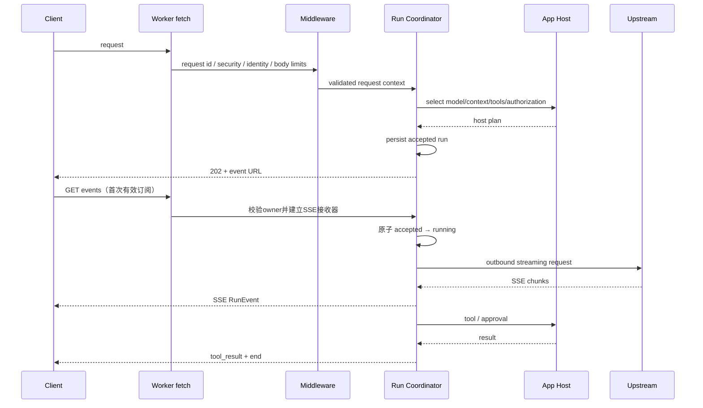

# 23 详细设计：Aether Web Worker 运行时

> 本文规定 Aether 公共能力如何适配 Cloudflare Worker；不规定 AutoNote 或 Actora 的业务路由和表。
> 上位设计：[02-概要设计-Web共享基座.md](02-概要设计-Web共享基座.md)、[22-详细设计-跨运行时公共契约.md](22-详细设计-跨运行时公共契约.md)。
> 当前状态：contracts/core/worker 与 UI Web 客户端已实现；真实 workerd HTTPS 冒烟已覆盖模型、工具/审批、actor 隔离、D1 历史、R2 副作用、取消、拒绝 replay 与 OAuth PKCE/MCP scope。完整 CI、浏览器 UI 与真实重启验收状态由 [90](90-开发任务清单.md) 统一记录，不以源码或单测代替。
> 公共数据和行为沿22；Native服务见25，Web安全见29。新增TS执行层与Worker适配，不修改两个产品的业务路由或数据库。

## 1. 运行时边界

Cloudflare Worker 是 Aether 的 Web Adapter，不是 Aether Core，也不是产品应用：

```text
Request
  ↓
Worker HTTP composition root
  ├── public middleware
  ├── identity/session adapter
  ├── Aether services
  ├── application host
  └── application routes/tools
  ↓
Response / SSE / MCP
```

Worker 可以访问：

- `fetch` 出站 HTTP；
- D1、Durable Object、KV、R2、Queues 等由宿主显式绑定的端口；
- Web Crypto；
- Worker request `AbortSignal`。

Worker 不可以或不得默认访问：

- 本机文件系统、shell、子进程、stdio MCP；
- 应用密钥、完整对话正文、工具参数的日志输出；
- 未声明的 Cloudflare binding；
- 另一个产品的数据库或业务工具。

## 2. 组合根

实际包为 `@ouraihub/aether-contracts`（`packages/contracts`）、`@ouraihub/aether-core`（`packages/core`）、`@ouraihub/aether-worker`（`packages/worker`）；UI 的 `@ouraihub/aether-ui/web` 提供 `createWebPorts`。公共生成 DTO 唯一路径是 `packages/contracts/src/generated`，不从 UI 反向导入后端类型。

Worker 使用原生 `Request`/`Response`/`fetch`，不依赖 Hono；产品可在自己的路由框架外层组合。真实公开入口见 `packages/worker/src/index.ts`，可运行组合见 `examples/worker/src/index.ts`：

```ts
import { createAetherWorkerApp, createRunCoordinator, WorkerRuntime } from '@ouraihub/aether-worker'
```

`createAetherWorkerApp(options)` 接收 `WorkerAppOptions`：必需 `applicationId`、精确 `origin`、`identity`、`runs: DurableObjectNamespace`、`authorizeRoute(actor, request)`、`verifyCsrf(request, actor)`；可选 `handlers`、`publicHandlers`、`logger`、`maxBodyBytes` 和仅本地 `allowLoopbackHttp`。返回 `{ fetch(request): Promise<Response> }`。

`handlers` 消费认证后的 `WorkerContext`；`publicHandlers` 处理 HTTPS MCP/OAuth 并执行自身认证。公共入口不提供产品登录、业务工具或通用配额服务，宿主必须在 `authorizeRoute` 执行业务授权与所需准入限制。`WorkerRuntime` 显式接收 `WorkerHost`、ProviderService、可空的 ConversationService、OutboundHttp、参数校验器与可选 Search/Skills/MCP/Image 服务；`createRunCoordinator(env => runtime)` 创建 DO 类，不读取全局 env 或单例发现依赖。

## 3. 请求生命周期



### 3.1 请求前失败

以下检查在创建运行前完成：

1. Method、路径、Content-Type；
2. request body byte size；
3. JSON parse 和 schema；
4. 身份、产品主体和会话；
5. CSRF/Origin（Cookie 会话）；
6. 公共权限、配额和请求频率；
7. 宿主模型/上下文/工具计划；
8. Provider connection 和模型能力；
9. budget、权限模式、MCP 工具目录；
10. Durable Object/RunStore 是否能接受运行。

失败响应使用 `KitError`，不启动上游请求。

### 3.2 请求接受后

- Web平台需持久化接受记录后返回RunAccepted；平台内部accepted/preparing不是22公开status。无历史/Native内存快照的能力不被本页隐式要求持久化。
- SSE response 使用 `text/event-stream`、`no-cache`、`X-Accel-Buffering: no`（上游/平台支持时）；
- 每个事件带 `id`（仅用于诊断和未来重连，不代表可重放）；
- 发送失败触发取消；
- 收尾关闭上游 reader、等待已派发工具并释放宿主资源，会话保存后持久 DO 终态，再发送唯一 end；
- 运行结束只允许 `completed`、`failed`、`cancelled` 之一；
- 无法确认工具结果时保留unknown工具记录，运行最终为failed/cancelled；unknown不是第四种公开运行终态，也不能伪造completed。

## 4. HTTP API

公共 API 前缀冻结为 `/api/v1`；产品可以在组合根下增加自己的 `/api/v1/<product>` 路由，但不能覆盖公共路由。

### 4.1 AI runs

```text
POST /api/v1/runs
GET  /api/v1/runs/:runId
GET  /api/v1/runs/:runId/events       # SSE
POST /api/v1/runs/:runId/cancel
POST /api/v1/runs/:runId/approval
GET  /api/v1/conversations?scope=...
GET|DELETE /api/v1/conversations/:id
POST /api/v1/conversations/:id/rename       # {title}
POST /api/v1/conversations/:id/edit-turn    # {turnId,text,expectedText}
POST /api/v1/conversations/:id/remove-turn # {turnId}
POST /api/v1/conversations/:id/select-turn # {turnId}
POST /api/v1/conversations/:id/fork        # {turnId}
GET /api/v1/conversations/:id/turns/:turnId/images/:kind/:index
```

重答/重试/翻译沿 `RunRequest` 提交 `/runs`，不提供第二条 regenerate 执行路由。

`POST /runs`：

- 成功：`202 application/json`，返回 `{accepted: RunAccepted, events: '/api/v1/runs/<runId>/events'}`；其他成功 JSON 为原始 DTO，错误为原始 `KitError`；
- 参数、身份、授权、配置失败：`4xx` + `KitError`；
- 请求不可接受的服务器故障：`5xx` + `internal` 和 `errorId`；
- 不返回 provider secret、完整上下文或工具参数。

接受与订阅已实现两阶段门禁：POST只准备/预留并保存接受记录，不发模型、搜索、绘图或业务工具执行请求；第一次经owner校验的GET/events建立事件接收器后才原子启动执行，重复活动订阅返回conflict，不再次执行。接受后30秒未订阅则由alarm取消并写终态；连接断开触发取消，已派发副作用结果不明仍为unknown，禁止自动重放。MCP目录/连接准备属于接受前能力解析，不等于执行模型或业务工具。

`GET /api/v1/runs/:runId`返回22的RunSnapshot，鉴权同owner；持久记录保留策略属平台配置，不能假称等同Native内存128终态缓存。SSE传输URL位于HTTP接受响应的外层信封，内部RunAccepted字段不增加events/token。

`GET /events`：

- 身份必须与 run owner/授权主体匹配；
- 不支持 replay；任何 `Last-Event-ID` 返回 `conflict{reason:"event_replay_unavailable"}`，客户端读取快照；
- 已终态的订阅只发送持久快照投影的一个 `end`，不重放正文或工具调用；
- SSE 关闭前必须发送唯一 `end`，除非连接在终态发送前已经断开。

`POST /approval`：

```ts
interface ApprovalInput {
  readonly callId: string
  readonly decision: 'allow' | 'deny'
}
```

只允许当前运行的 owner/授权主体审批；过期、已取消、callId 不匹配返回 `conflict`/`not_found`，不改变运行。

### 4.2 Provider

```text
GET|POST /api/v1/providers
GET  /api/v1/providers/model-options
POST /api/v1/providers/probe
POST /api/v1/providers/keys
POST /api/v1/providers/keys/:keyId/reveal
DELETE /api/v1/providers/:providerId/keys/:keyId
POST /api/v1/providers/:providerId/enabled
DELETE /api/v1/providers/:providerId
```

Web 端列表只返回 mask/capabilities；保存请求的 secret 只通过 HTTPS body 到 credential port，不能写日志。具体 provider CRUD 字段沿用 Aether contracts，不以 AutoNote 或 Actora 的旧字段为准。

### 4.3 Search

```text
GET  /api/v1/search/settings?capability=search|fetch
POST /api/v1/search/settings
POST /api/v1/search/default
PUT  /api/v1/search/preferences
POST|DELETE /api/v1/search/keys
POST /api/v1/search/keys/reveal
POST /api/v1/search/check
POST /api/v1/search/search
POST /api/v1/search/fetch
```

Search 请求必须使用 request-scoped outbound client 和明确的 `AbortSignal`；不复用用户模型 provider 的 secret。

### 4.4 MCP

```text
GET  /.well-known/oauth-protected-resource
GET  /.well-known/oauth-authorization-server
POST /oauth/register
GET  /oauth/authorize
POST /oauth/token
POST /mcp
GET  /api/v1/mcp/grants
POST /api/v1/mcp/grants/:id/revoke
GET  /api/v1/mcp/api-keys
POST /api/v1/mcp/api-keys
POST /api/v1/mcp/api-keys/:id/revoke
```

MCP endpoint 是应用注册的工具视图，不自动暴露 AI Chat 工具目录；认证、scope 和应用业务授权分层执行，详见安全设计。

`GET|POST /oauth/authorize` 包括认证后的同意表单及一次性 CSRF。管理还实现 `GET|PUT /api/v1/mcp/settings` 与 `/api/v1/mcp/servers` 的 Client 配置、refresh、tool approval。Public MCP/OAuth 只在精确 HTTPS origin 启用；本地 HTTP 运行不构成 OAuth 验收，也不提供 HTTP 例外。

Skills 提供 `/api/v1/skills` 列表、`/:id` 查询/删除、`/:id/files?revision=...` 文件列表、`/:id/file?revision=...&path=...` 字节读取、`save`、`preview`、`install`、`reorder`、`snapshot`、`/:id/duplicate`；精确输入见 `skills/service.ts`。ImageService 是显式连接/输入的独立调用及 runtime 工具适配，不虚构尚未注册的公共图片生成 HTTP 路由。

## 5. 平台与存储适配

实际端口由 `packages/worker/src/index.ts` 导出，不另维护 `DatabasePort`/`RunStore` 空接口。`D1DocumentStore` 实现 `DocumentStore.get/list/compareAndSet/remove`，每次都绑定 application/tenant/subject；null tenant 不是通配符。`list` 为 key 升序分页，默认/最大200，完整消费者使用末项 key 续读至短页。

单会话的图、预留和版本保存在一个 JSON 文档，D1 单语句 revision CAS 原子提交；不存在 `transaction(async callback)`。删除写 tombstone，旧 key 不可通过 expectedRevision=null 复活。`packages/worker/migrations/0001.sql` 是公共 schema，宿主显式执行，`validateD1Schema` 只校验版本，不在请求中迁移产品表。

文档 ≤256 KiB 内联 D1，更大文档先写 scoped immutable R2 blob，再 CAS 小指针；默认文档上限64 MiB，缺 R2 时大文档失败。已替换/删除引用及不确定 SQL 提交的旧 blob **有意保留**，避免读者竞争或误删已提交对象；只有确定 CAS 冲突的新 blob 才即时回收。部署方须安排显式、引用感知且具安全保留期的 GC，不能把 R2 生命周期任意过期当成实现。`R2FileStore` 独立保存 actor 隔离的文件/Skills 包；D1 与 R2 不承诺跨服务事务。

`createCredentialPort({currentKeyId, keys})` 使用非可导出的 AES-256-GCM CryptoKey ring；旧 key 用于读取与显式 rotate，AAD 绑定版本/keyId/application/tenant/subject/purpose/recordId，跨记录复制密文无法解开。DO 不持久化明文连接、完整准备输入或凭据；运行快照仅保存公共状态。

`createWorkerOutbound` 实现 Core 的 `OutboundHttp.fetch(url, init)`：精确 origin allowlist、手工 redirect、首字节/空闲/总超时、响应字节上限和取消；远程请求必须走可信 connect-time egress gateway，不能降级全局 fetch。网关必须在连接时校验所有 A/AAAA、私网/特殊地址、DNS rebinding 并禁止开放代理/自动跳转；配置了 service binding 本身不是安全证明。Search 页面目标还须可信 all-address DNS checker 预检；预检不能替代网关连接时约束。只有显式测试授权的字面量 loopback 可使用本地 HTTP/直接 fetch，生产不得开启。详细安全合同归29。

## 6. 身份与请求上下文

`WorkerContext` 实际字段为 `{actor, signal, requestId, now}`；不可变 Actor 包含 `subjectId`、`kind: user|service|mcp_client`、`applicationId`、`tenantId`、`sessionId` 和 `scopes`。`applicationId` 由部署组合根固定，不信任调用者 header。

`IdentityPort.resolve` 由宿主验证真实 session/bearer，`verifyFresh` 用于凭据显式读取的重新认证；`OpaqueSessionStore` 提供不透明 session 存储而不是产品登录。认证不代替业务授权，公共路由调用 mandatory `authorizeRoute`，Cookie 用户写请求还要求同 origin 与 mandatory `verifyCsrf`。MCP bearer 与宿主登录方向分离，OAuth consent 仍须宿主身份和业务 scope 同意。

数据 owner 为 application/tenant/subject；run 另绑定 sessionId（null 与非null不同）。跨owner snapshot/approve 返回not_found，cancel为幂等Ack；只匹配的owner能取消或审批。不从 URL/body 接受任意owner，也不把 null 作为授权通配符。

## 7. Durable Object 与长运行

实现固定为一个 runId 一个 DO，app 用 `idFromName(applicationId + ':' + runId)` 路由。DO 保存 actor/session、runId、预定会话handle、phase、revision、approval pending 和公共snapshot，不保存正文、完整工具事件或明文连接。

```text
creating → accepted → running → completed | failed | cancelled
重启：creating/accepted/running → failed(interrupted)，绝不重放工具
```

接受前先持久 `creating`，runtime `onPlan(handle)` 在会话 reserve CAS 前持久固定handle，再提交reservation，最后持久accepted。恢复只清理该handle对应预留；creating尚未提交预留的not_found允许安全收尾，不能重选输入或重建执行。准备输入仅内存保留，重启无“恢复模型执行”路径。真实重启的验收结果由90单独记录。

审批先登记并持久 callId/revision，再发 `approval_required`，因此事件送达后立即返回的审批不会丢失。重复/过期/非当前callId拒绝；取消等待已派发工具结束后才清理宿主。工具unknown不是运行第四终态，保存会话后持久唯一公共终态，再发送end。

## 8. SSE 实现

事件格式：

```text
event: run_event
id: <monotonic event id>
data: {"kind":"text_delta","text":"..."}

```

规则：

- 每个 event data 是一行 JSON；超过事件上限拆分不允许改变 JSON 语义，优先拒绝过大事件；
- `Cache-Control: no-cache, no-transform`；
- 不发送 secret、完整 token 或未经限制的工具 payload；
- 浏览器 `AbortSignal` 断开触发运行取消；
- writer 失败只记录一次并结束发送，不在同一连接重试；
- event id 用于诊断和将来扩展，不承诺当前可重放；
- 上游 SSE parser 与 Worker SSE encoder 分离，不能把上游原始事件透传给客户端。

## 9. 认证、限流与安全中间件

原生fetch入口实际执行：requestId/时间 → TLS与精确Origin → 内容类型/请求体预算 → public MCP/OAuth处理器，或IdentityPort → Cookie写请求CSRF → mandatory authorizeRoute → DO/能力handler →安全KitError映射及响应头。MCP/OAuth处理器独立校验登录/bearer、client、redirect URI、PKCE、一次性code/CSRF与scope，详见29。

通用租户配额/公网滥用限流不由本实现自动提供；生产宿主须在入口/平台边界及authorizeRoute补齐自己的准入限制，公开OAuth注册/token同样不能豁免。不把注册成功或binding配置当作生产安全验收。

HTTP 安全默认：

- JSON API `Content-Type` 精确校验；
- SSE `X-Content-Type-Options: nosniff`；
- CORS allowlist 由部署配置，不能 `*` 配合 credential；
- Cookie `Secure`、`HttpOnly`、`SameSite` 按部署场景设置；
- body、header、URL、工具 schema、模型响应均有限制；
- 普通API错误返回原始安全KitError，不回显原始上游body；OAuth/JSON-RPC沿其协议错误形状；
- 日志字段使用固定 schema。

## 10. 配置与环境

组合根 `examples/worker/src/index.ts` 将 unknown bindings 验证为 `D1Database`、`R2Bucket`、`DurableObjectNamespace` 和可信 `FetchBinding`。真实绑定为 `AETHER_DB`、`AETHER_FILES`、`RUNS`；远程 egress 使用 `OUTBOUND_GATEWAY`，远程 Search 页面读取还需 `TARGET_CHECKER`。生产必须配置 HTTPS origin、精确 outbound origins、真实资源标识、Credential key ring/current key id 与宿主身份/授权实现。

`examples/worker/wrangler.jsonc` 提供 local/production 组合，示例数据库 UUID/域名不是可用部署配置。secret 不写配置/源码/日志；`init:local` 仅产生忽略的本地随机secret，显式loopback例外只在test mode有效。完整启动、迁移和HTTPS证书操作见 [Worker示例](../examples/worker/README.md)，不复制第二套配置或声称绑定声明已验证实际安全。

## 11. 可观测性

当前app在最终边界记录`request.finished`，字段为requestId、applicationId、status、durationMs；不会自动采集route/actor或请求内容。宿主若扩展日志须通过固定字段allowlist，不得把正文/凭据或任意URL加入。

AI run 只记录：`runId`、model/endpoint 的非敏感 ID、rounds、状态、usage 是否可用、耗时。禁止记录：input、output、prompt、工具参数、token、完整 URL query、密钥。

同一错误在最终边界记录一次；Worker adapter 把下层 unknown 映射成公共 `KitError`，保留 cause 仅在受控诊断系统。

## 12. 测试与真实验收

### 12.1 纯端口测试

- body/schema/unknown 字段和上限；
- error envelope 和 status 映射；
- DO phase/revision、单终态、creating计划handle恢复；
- approval/cancel race；
- SSE event 编码、断开和唯一 end；
- Outbound redirect/地址/超时/响应上限；
- identity audience、过期、撤销和 actor 隔离。

### 12.2 Miniflare/Workers runtime

使用真实 Worker runtime 和本地 D1/DO/R2 绑定测试：

1. 未认证请求拒绝；
2. AutoNote/Actora 两个 host 的工具只暴露各自注册项；
3. 真实模型 loopback 上游流式返回；
4. 浏览器断开后上游 abort；
5. approval、cancel 和 stale recovery；
6. Worker 重启后不伪造完成；
7. API key/OAuth/MCP endpoint；
8. 无 secret 进入 response、SSE、日志和 D1 明文列。

必须进行一次真实部署/预览环境验收；单测不替代 Cloudflare binding 和连接断开验证。

## 13. 已实施决策

1. 原生fetch组合作为公共入口，不增加Hono依赖；产品可包在自身Hono中。
2. 一个run一个Durable Object。DO持久保存主体、预定会话handle、阶段与公共快照；接受前先保存creating和固定handle，再原子预留会话，最后保存accepted。重启不重放执行，按计划handle恢复interrupted，避免预留提交后崩溃遗留running。
3. 不回放正文或工具事件；仅持久终态/快照可查询。POST接受后30秒订阅门禁，GET首次原子启动，断开取消，重复活动订阅冲突。
4. 本轮流式运行由DO请求/stream生命周期托管；不新增Queue作隐性重试。工具结果不明保留unknown，不重派发。
5. D1公共文档表迁移由Worker包提供，宿主显式执行；单会话图使用版本CAS单行原子提交，不承诺D1交互事务。产品表仍归产品。
6. 凭据使用WebCrypto AES-GCM，key ring和active key id由宿主secret绑定导入，AAD绑定application/tenant/subject/purpose/recordId；不持久化明文连接快照。
7. Worker不能固定第三方DNS连接；出站适配要求平台可验证的安全网关或可信传输，DNS预检不冒充连接固定。显式本地loopback授权仅用于受控验收。
