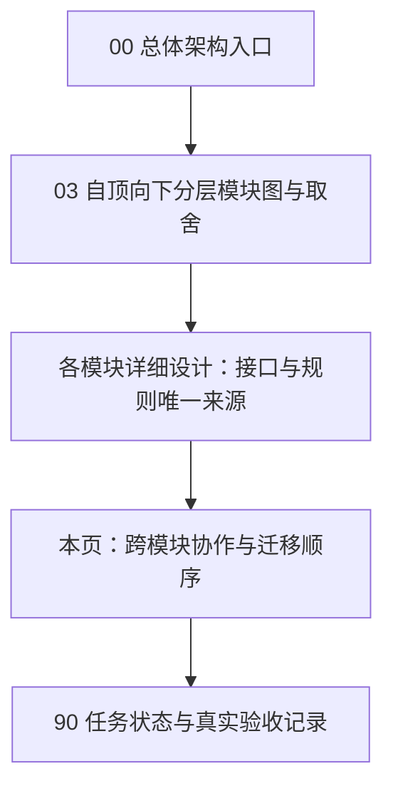
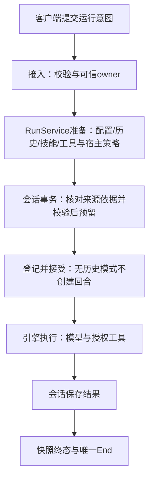

# 24 跨模块协作、迁移与验收

> 状态：概要、模块详细设计、Native职责切换及TS contracts/core/worker已实施；真实workerd HTTPS冒烟已执行，本轮完整CI/UI/重启和平台限制集中见90。本页不是模块接口的第二份规范。
> 分支：`refactor/contract-first-boundaries`。先完成概要和模块详细设计，再按本页切片实施。设计完成不等于实现完成，验收进度见90。

## 1. 阅读顺序与唯一规范

本次直接更新原有设计，不另建平行新版文件夹。超长主题按职责拆文件并引用，不复制同名接口；旧版本由Git追溯。文档明确区分目标设计、当前实现与已验收，不用“以新文档为准”长期保留旧矛盾。

| 主题                                     | 唯一规范                                                                    |
| ---------------------------------------- | --------------------------------------------------------------------------- |
| 层次与能力归属                           | [00](00-概要设计.md)、[03](03-契约优先架构与职责拆分设计.md)                |
| 基础设施、纯/Native编译边界与日志        | [10](10-详细设计-基础与可观测性.md)                                         |
| Provider配置、连接准备与独立探测         | [11](11-详细设计-kit-providers.md)                                          |
| 引擎、模型协议与工具循环                 | [12](12-详细设计-kit-chat.md)                                               |
| MCP阅读入口                              | [13](13-详细设计-kit-mcp.md)                                                |
| Skills内容与存储                         | [14](14-详细设计-kit-skills.md)                                             |
| Tauri接入、权限与生命周期映射            | [15](15-详细设计-接入层.md)                                                 |
| UI客户端接口、组件与能力声明             | [16](16-详细设计-kit-ui.md)                                                 |
| Search/Fetch配置与独立执行               | [17](17-详细设计-kit-search.md)                                             |
| 思考与用量；模型预设                     | [18](18-思考强度与用量统计.md)、[21](21-共享模型服务预设设计.md)            |
| 图像输入；独立生成与编辑                 | [19](19-图片输入与视觉能力.md)、[20](20-生成图片工具.md)                    |
| 公共wire数据、事件、错误、快照与语言绑定 | [22](22-详细设计-跨运行时公共契约.md)                                       |
| Web平台目标与数据安全                    | [23](23-详细设计-Web%20Worker运行时.md)、[29](29-详细设计-Web数据与安全.md) |
| 无UI运行用例与宿主策略接缝               | [25](25-详细设计-运行应用服务.md)                                           |
| 会话领域、原子预留、分支与SQL            | [26](26-详细设计-会话与历史存储.md)                                         |
| MCP Client；MCP Server                   | [27](27-详细设计-MCP客户端.md)、[28](28-详细设计-MCP服务端.md)              |
| 保存/探测/凭据异步会话与配置生成         | [30](30-详细设计-客户端流程与凭据会话.md)                                   |

## 2. 本次范围与非目标

本次完成现有Aether能力职责重构、公共合同资产、TS客户端和仓库内所有消费者迁移：

- 插件内运行准备/登记/审批/工具组合/保存收尾迁无Tauri服务，CLI与桌面共同使用。
- Providers/Search配置与网络执行解耦，支持无Store消费。
- MCP Client的Store/Runtime与完整结果、Server协议handler分层。
- Skills纯内容身份、独立images、support纯/Native及日志壳能力分离。
- UI运行与会话端口分离，复用领域交互流程，不改视觉或建立万能controller。

已新增独立TS Core执行层、Worker平台/运行服务与Web客户端；不迁产品业务，不强制全Rust/WASM，不替换Svelte或引入GPUI，不新建守护进程/服务总线。Worker实际API与实现归23/29，完整验收状态归90，不能把源码存在等同全部验证。

### 2.1 功能基线与发布边界

本分支初建于`fix/skill-copy-stdio-environment`，设计审查发现当时落后本地`origin/main` 11个提交，包含权限模式/工具风险规则。实施前必须保留文档与用户改动后合入主线，再核对源码；不能以旧分支内容覆盖已发布能力。本轮保留PermissionMode/ToolEffect、risk、KitHost的run_id绑定、run_finished、permission_modes、mcp_tools和AuthorizeContext，以及UI的一次性full_access确认。具体合同归12/25/16/30，wire归22。

Rust类型位置、ConversationStore trait、Builder与TS客户端改动均属于破坏性API切换。仓库内消费者以及本轮 AutoNote Web/桌面、Actora 实际消费者均须迁移到相同公共能力版本；未实现的 Actora 桌面入口不伪称已验收。迁移保留各产品授权、审批和文件存储，删除被替代的网络/协议分支；不复制公共源码到宿主或以运行时补丁代替升级。保留 `aether:chat`/`aether:chat-history` 权限名称，不借重构静默扩大窗口权限。

## 3. 跨模块协作

### 3.1 完整运行用例

这是协作顺序，不定义第二套函数。无历史跳过会话预留与保存；独立探测/搜索/绘图/MCP调用不必经过运行服务。来源effective request、事务内指纹比较和接纳锁规则分别由25/26定义，不能在接入层另写一次。

### 3.2 类型与资源所有权

- 公共wire字段只在22或其指定能力文档定义；Rust定义位置不自动成为另一份语义规范。
- images拥有图像基础类型，chat使用不复制；runtime::conversations拥有领域存储，展示DTO独立投影，不竞争ts-rs同名导出。
- RunService拥有活动运行及维护任务；McpRuntime拥有刷新任务；session拥有连接/stdio进程；Store只管一致性与存取。
- Tauri拥有窗口到不透明owner的映射，不传窗口/AppHandle进服务；Worker HTTP由可信IdentityPort构造actor，数据绑定application/tenant/subject，run另绑定session。
- 结果保存先于成功End；发送失败不触发工具重放。unknown和取消意图不能被UI展示状态覆盖成成功。
- 原始MCP结果在协议层保留；给模型的文本/JSON投影及给UI的payload由唯一工具适配处理，权限、预算和外部内容边界不被绕过。

## 4. 实施顺序与调用方迁移

| 切片                 | 前置                 | 交付与迁移范围                                                                |
| -------------------- | -------------------- | ----------------------------------------------------------------------------- |
| RF0 设计统一         | 无                   | 00/03及所有模块详细设计无旧矛盾，接口/状态/事务/生命周期具体可实施            |
| RF1 合同与基础设施   | RF0                  | contracts schema/样本、support native隔离、日志公共DTO/桌面动作；更新依赖门禁 |
| RF2 Providers/Search | RF0                  | 独立执行入口、Store用例复用、配置/凭据/预算行为不变                           |
| RF3 MCP/Skills       | RF0                  | Runtime管理任务、完整结果、Server handler、纯digest；通知服务接入接口         |
| RF4 Runtime/Images   | RF1–RF3              | 无Tauri服务、独立会话/绘图，迁插件、CLI、assistant等Rust宿主和测试            |
| RF5 TS客户端/流程    | RF0，最终联验依赖RF4 | ports、Tauri、RunSession、组件、fake、示例UI、生成DTO及竞态行为               |
| RF6 集成             | RF1–RF5              | 完整CI、实际CLI/UI受控冒烟、文档与所有消费者完成                              |

独立切片可并行，不能在接口冻结前边实现边猜。根Cargo注册由Runtime集成负责人修改，依赖检查/公共合同由主集成负责；共享文件只一个编辑所有者。新增API需要更新实际使用方，不留占位分支。

### 4.1 清洁切换

- 迁完ChatPort/ChatHistoryPort/history/chatHistory/openDir旧调用，保留必要IPC名字不是保留旧职责。
- 移除chat/plugin旧类型owner的兼容导出，宿主直接引用公开runtime/images合同。
- Store配置用例通过新执行模块复用是实际业务入口，不保留两套网络实现。
- 迁workspace依赖检查、feature矩阵、权限生成、ts-rs导出、CLI与所有示例。
- 不改数据库格式只是移动代码时，不人为增加migration；需要格式变更须对应26/11/14等先写迁移与备份设计。
- 发现设计不可行先改唯一规范再实施，不做临时shim遮蔽冲突。

## 5. 验收矩阵

| 范围         | 必须观察的行为                                                                        |
| ------------ | ------------------------------------------------------------------------------------- |
| 合同         | schema合法/非法、Rust序列化与TS绑定符合、错误脱敏、枚举和null语义                     |
| Providers    | 无Store探测、显式header/key、限定fallback、取消与key归属                              |
| Search/Fetch | 无Store执行、共享预算、cap/provider隔离、每跳地址检查与结果策略                       |
| Chat/Runtime | 无历史/有历史、审批/取消/重复冲突、unknown不重放、保存失败、End时序                   |
| Conversation | 接受前失败无半回合，effective request来源一致，重答/翻译/分支/删除/fork/CAS与图片行为 |
| MCP          | 结构化/非文本/isError保持、非法应答拒绝、session/后台刷新关闭、stdio清理、scope规则   |
| Skills       | digest旧值稳定、字段与文件变化、修订与事务不分裂、不执行脚本                          |
| Images       | 无Chat独立生成/编辑、引用/存储失败可见、取消不重复收费调用                            |
| UI流程       | 保存期间新编辑保留、probe等待保存、晚到结果不污染新目标、关闭后秘密不重现             |
| 平台接入     | owner隔离、关闭/销毁竞争、receiver失败取消、任务有界关闭、快照回收                    |
| 全量         | `pnpm run ci`和新增合同/feature门禁，不跳过原检查                                     |

受控网络验收使用真实HTTP/HTTPS与实际模型，不记录或提交凭据；无上游权限时明确标未验，不伪造模型回复。实际CLI/UI不能由单测代替；截图仅目标窗口。未运行的OS、UI、重启等逐项列于90，不将Windows或workerd局部结果泛化。

## 6. 交付与证据

90只在全部判据通过后勾选，记录变更文件、执行命令、关键观察、失败修复及未验证项。本页不预填成功，不存长篇历史日志。概要看结构，模块详细设计看接口，本页看如何切换，90看进度。

完成意味着端到端行为及所有调用方已迁移，不是编译成功的目录、空实现、mock回声或源码字符串检查。设计文件拆分后不得同时保留另一份同名字段或状态机供实施者择一执行。
