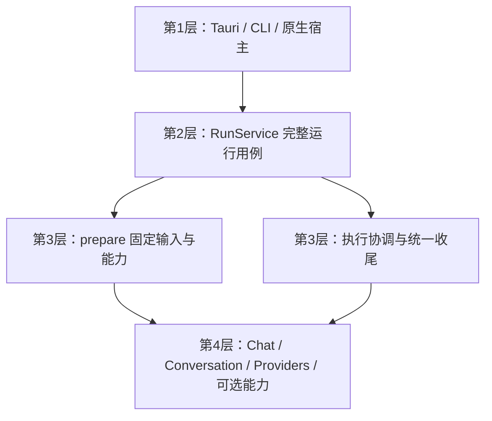
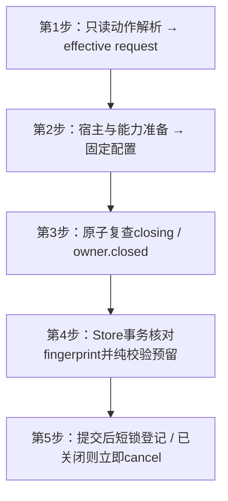
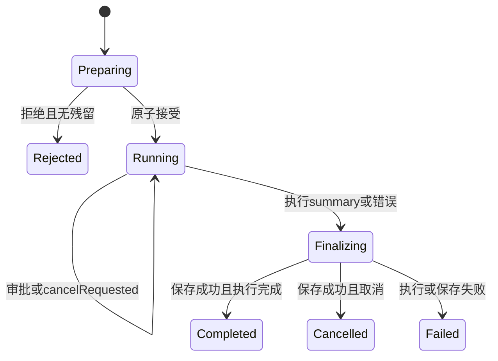

# 25 详细设计：运行应用服务 aether-runtime

> 状态：2026-10-28 Native实现已迁入aether-runtime；本轮测试、CLI和真实Tauri窗口验证记录见 [90](90-开发任务清单.md)。
> 本文是 Native `RunService`、`KitHost`、运行准备、工具组合和生命周期的唯一详细定义。公共 JSON 请求、接受结果、事件、快照与 UI 会话投影字段见 [22 公共契约](22-详细设计-跨运行时公共契约.md)，不在此复制另一套 DTO。会话领域和事务接口见 [26](26-详细设计-会话与历史存储.md)，引擎见 [12](12-详细设计-kit-chat.md)，接入见 [15](15-详细设计-接入层.md)。
> Web对应实现为`packages/core` RunEngine与`packages/worker/src/runtime.ts` WorkerRuntime，公开输入/事件来自`@ouraihub/aether-contracts`（canonical DTO：`packages/contracts/src/generated`）。WorkerHost显式提供selectModel/systemPrompt/context/tools/permissionModes/authorize/callTool/runFinished，可选mcpTools/paintingModel；不把产品路由/角色模型写入Aether。prepare固定能力与连接、onPlan先持久reservation handle，再CAS预留；execute/abandon/recover统一保存/清理。DO两阶段订阅、重启interrupted、不重放与实际HTTP由23定义，不把下文Native RunOwner/线程/SQLite实现机械搬到Worker。真实HTTPS冒烟及待完成CI/UI/重启证据统一见90。

## 1. 职责与逐层模块图



`aether-runtime` 是无 UI Native 应用服务；允许 Tokio、同步 Store 的 `spawn_blocking`、显式取消 token，不依赖 Tauri、AppHandle、Window、Channel、Svelte 或 observability。不提前引入 WASM/local executor 兼容层。

| 内部模块      | 责任                                                                 | 不负责                     |
| ------------- | -------------------------------------------------------------------- | -------------------------- |
| contract      | KitHost、RunRequest/Accepted/Snapshot 的 Rust 绑定及可信上下文       | Tauri 传输、重复 JSON 规范 |
| prepare       | 动作归一、effective request、连接/技能/工具/搜索快照、历史裁剪及预算 | 上游执行、终态保存         |
| service       | 接受登记、任务/取消/审批表、最终保存、快照及关闭                     | SQL、供应商协议            |
| conversations | 独立会话用例、领域与存储，详见26                                     | 模型客户端、审批等待       |
| tools         | Host/MCP/绘图分派与结果转换                                          | 模型循环、窗口             |

开启runs时直接依赖 support、chat/native、providers、images/client；`skills` / `search` / `mcp-client` features 分别启用其能力。MCP Server 不成为 runtime 依赖，本机排除端口由可信 `RunContext` 注入。不为内部 prepare/service 各建一层 trait；真实替换边界保留 KitHost、ConversationStore、ToolExecutor、Approver。

### 1.1 最小feature图（本次切换权威）

| crate / feature                                              | 启用内容                                                                     | 不隐式启用                            |
| ------------------------------------------------------------ | ---------------------------------------------------------------------------- | ------------------------------------- |
| chat default=[]                                              | 执行/消息/事件合同、纯protocol/SSE/校验                                      | Native transport、RunEngine           |
| chat/native                                                  | support/native、reqwest及Native ModelGateway/RunEngine                       | runtime、会话SQLite                   |
| images default=[]                                            | ImagePart/ImageRef与基础纯校验                                               | 生成/编辑HTTP                         |
| images/client                                                | support/native及生成/编辑客户端                                              | chat、会话                            |
| runtime default=[]                                           | 空闲模块边界，不启动任何任务                                                 | runs、conversations、可选能力         |
| runtime/conversations                                        | 会话领域/Store/SQLite/ConversationService，消费chat纯Message/EndStatus       | chat/native、RunEngine、Providers     |
| runtime/runs                                                 | conversations、chat/native、providers、images/client、Tokio运行服务与KitHost | Skills/Search/MCP，除非显式feature    |
| runtime/skills / search / mcp-client                         | 对应能力依赖及RunDependencies条件字段；与runs组合使用                        | Tauri、MCP Server                     |
| plugin default=[]                                            | 日志接入                                                                     | runtime、chat                         |
| plugin/chat                                                  | optional runtime依赖的runs feature、四个运行IPC                              | providers配置命令、历史命令           |
| plugin/conversations                                         | optional runtime依赖的conversations feature、八个历史IPC                     | runs、chat/native                     |
| plugin/providers / skills / search / mcp-client / mcp-server | 对应独立接入                                                                 | runtime/chat，不通过弱feature强拉它们 |

chat/images纯合同消费support时必须default-features=false；chat/native与images/client再显式开启support/native。Cargo workspace继承必须合法：如workspace依赖已开启默认feature，成员不能假称局部default-features=false就可靠关闭；应在workspace对应依赖项禁默认，再由Native消费者显式开native。runtime/conversations可因SQLite启用support/native，因此不承诺整个闭包完全无reqwest，只保证不启chat/native、不构造模型客户端/RunEngine。Providers-only插件没有runtime/chat依赖，不再需要空KitHost。外部workspace feature统一可能合并Native能力，测试feature隔离需单独选择对应包组合。

### 1.2 宿主组装与实例共享

宿主在接入前创建共享Arc能力实例，构造`RunService::new(host, config, deps, policy)?`。同一会话Store同时注入RunDependencies.conversations和`Arc::new(ConversationService::new(store.clone()))`；同一McpRuntime/Providers/Search/Skills可另传独立管理接入。Tauri使用15的`Builder::new(logs).runs(runs).conversations(conversations)`，不再从配置创建服务；CLI调用相同RunService.start并等待真正End后shutdown，无需Builder。只管理历史的程序仅开启runtime/conversations，完全不创建RunService。

## 2. Native 公共入口

以下是目标公开签名；`Budget`/`RunEvent` 来自 chat，`ConversationStore` 来自 runtime::conversations，`AddressPolicy`/`KitError` 来自 support。`Ack` 的 JSON 形状由22定义。

```rust
pub struct RunConfig {
    pub budget: Budget,
    pub approval_timeout: Duration,
}
pub struct RunDependencies {
    pub providers: Arc<aether_providers::Store>,
    pub conversations: Option<Arc<dyn ConversationStore>>,
    #[cfg(feature = "skills")]
    pub skills: Option<Arc<aether_skills::Store>>,
    #[cfg(feature = "search")]
    pub search: Option<Arc<aether_search::Store>>,
    #[cfg(feature = "mcp-client")]
    pub mcp: Option<Arc<aether_mcp_client::McpRuntime>>,
}
#[derive(Clone)]
pub struct RunOwner { /* 私有、不透明的进程内归属键 */ }
impl RunOwner {
    pub fn new() -> Self;
}
pub struct RunContext {
    pub owner: RunOwner,
    pub own_mcp_port: Option<u16>,
}
pub type EventSink = Arc<dyn Fn(RunEvent) -> Result<(), KitError> + Send + Sync>;
impl RunService {
    pub fn new(host: Arc<dyn KitHost>, config: RunConfig,
               deps: RunDependencies, policy: AddressPolicy)
        -> Result<Arc<Self>, KitError>;
    pub async fn start(self: &Arc<Self>, context: RunContext,
                       request: RunRequest, events: EventSink)
        -> Result<RunAccepted, KitError>;
    pub fn cancel(&self, owner: &RunOwner, run_id: &str) -> Result<Ack, KitError>;
    pub fn approve(&self, owner: &RunOwner, run_id: &str,
                   call_id: &str, allow: bool) -> Result<Ack, KitError>;
    pub fn snapshot(&self, owner: &RunOwner, run_id: &str)
        -> Result<RunSnapshot, KitError>;
    pub fn cancel_owner(&self, owner: &RunOwner);
    pub async fn shutdown(&self, grace: Duration);
}
```

- `RunConfig` 默认 Budget 见12；模型已知的输出/上下文上限覆盖默认值；审批超时默认5分钟。
- `new` 检查可用配置和能力组合。请求使用未编译能力返回 `unsupported`；已启用但缺实例返回 `bad_request{field:<能力>,reason:"missing_instance"}`，不得静默关掉请求的能力。
- Search 的 Store 仅供准备阶段读取偏好与 `resolve` 固定配置，执行调用17定义的独立 search/fetch 入口。不通过 Store 发网络请求，也不新建空壳 SearchRuntime。
- `RunOwner::new()` 创建Arc<OwnerState>，含进程级原子单调编号及AtomicBool closed；Clone共享同一身份/关闭状态。编号非secret、不跨重启稳定、不接受外部字符串、不回绕复用；极端耗尽fail-stop，不用unwrap随机失败。返回Self，无serde/TS。服务不保留无限增长的closed owner集合，最后一个映射/任务/快照引用释放后自然回收。
- `RunContext` 只由可信接入创建；owner 不进入 RunRequest。`own_mcp_port` 仅用于排除本机 MCP Server 自环，不作为通用地址授权。
- sink 必须快速、同步、不重入服务锁。发送错误转为取消意图，不重放已执行的工具。CLI 可以明确采用 stdout 关闭后继续的策略，但必须由自己的 sink 返回 Ok，不能假装错误送达。

## 3. KitHost：宿主策略接缝

```rust
#[async_trait]
pub trait KitHost: Send + Sync + 'static {
    fn select_model(&self, request: &RunRequest) -> Result<ModelRef, KitError>;
    fn system_prompt(&self, request: &RunRequest) -> Option<String>;
    fn context(&self, request: &RunRequest) -> Result<Option<ContextBlock>, KitError>;
    fn tools(&self, request: &RunRequest, run_id: &str) -> Vec<HostTool>;
    fn run_finished(&self, run_id: &str);
    fn permission_modes(&self, request: &RunRequest) -> Vec<PermissionMode>;
    fn mcp_tools(&self, request: &RunRequest) -> bool;
    fn painting_model(&self) -> Option<ModelRef>;
    async fn call_tool(&self, call: &ToolCall, cancel: &CancellationToken)
        -> Result<ToolOutput, ToolError>;
    fn authorize(&self, call: &ToolCall, context: &AuthorizeContext<'_>) -> Approval;
}
```

默认行为保留主线：select_model用显式模型否则needs_config{reason:"model"}；system_prompt/context/painting_model为None，tools为空，call_tool返回not_found，authorize返回context.proposed；run_finished为空且同步非阻塞，permission_modes返回BASELINE(default/plan/accept_edits)，mcp_tools=true。auto/full_access必须宿主显式列入许可。ContextBlock{source,text}、HostTool{spec}、ToolOutput{text,payload}、ToolError{code,message,unknown}均为后端类型；unknown=true表示副作用不可知。

准备阶段同步宿主方法及同步 Store I/O 在 `spawn_blocking` 调用，可以读取宿主自己的数据库。执行前 `authorize` 是快速同步终裁，不放宽为阻塞 I/O，也不宣称它已经在 blocking 池。call_tool 通过传入 token 协作取消。宿主负责 scope/context 所指业务资源的访问控制，RunOwner 只隔离运行归属，不能替代业务授权。

RunRequest.permissionMode遵循22，缺省default；准备时用effective request调用permission_modes，未获允许报bad_request{field:"permission_mode",reason:"not_allowed"}。每个服务分配的run_id仅有一个清理guard，先于任何宿主调用创建，接受前全部失败路径调用run_finished恰好一次；接受后guard移入唯一收尾出口，在所有在途host.call_tool结束、保存和End尝试之后调用恰好一次，不因超时提前释放仍被执行器使用的修订/能力快照。强制进程终止不承诺回调。mcp_tools=false完全不开MCP session。ToolEffect、AuthorizeContext和模式/risk细则归12，不放宽目录Deny。

## 4. 准备、预留与接受

### 4.1 effective request 必须先于所有宿主准备

1. 先校验公共请求结构、动作互斥和服务/owner 的关闭状态。动作和来源解析使用26的唯一规则，得到固定 source/parent、权威 input、可用输入图片及来源模型。
2. 建立本次 effective request：保留请求的 purpose/context/skills/语言/能力意图，用权威 input 和 images 覆盖动作输入；重答/翻译无显式模型时填来源模型。`host.select_model`、system_prompt、context、tools 必须都看到这同一份有效请求，不能模型按源图、宿主却按空 input/images 准备。
3. 重答/翻译的来源模型快照缺失且无显式模型，或动作所用模型 resolve 为 not_found，保持 `needs_config{reason:"source_model_unavailable"}`，不静默改成宿主默认模型。显式换模型只覆盖模型，不改变源 input/图片/parent。
4. 固定 providers 连接、技能修订、宿主上下文和工具、MCP session、绘图连接与候选引用、搜索偏好和执行配置。准备不调用模型、搜索、绘图或任何业务工具。MCP session 的协议发现是能力准备，不执行工具副作用。
5. 完成无历史输入的 validate；有历史输入的最终校验放在下述事务内。prepare 是 start 内部模块，不公开可遗弃的 PreparedRun 租约。

输入仍沿22现有上限和动作用途：input 100000 Unicode字符、skills最多20、language 1–80、动作ID最多128。无 Store 时拒绝引用会话/重答/翻译；`conversationId`/`turnId` 返回 null，不新建临时历史库。已有 writing 特殊历史处理保留：prepare 不把 writing 的历史分支扩成新的聊天功能，动作拒绝仍由原请求/宿主规则承担。

### 4.2 原子接受



- 无历史：短registry锁内复查原子closing/owner.closed并登记；无Store提交可在已关闭时直接拒绝。
- 有历史：使用26的 `ActionRequest` 和 `PreparationFingerprint`；同步 `reserve_action` 在同一事务读取权威 input/images/history_path，核对准备所用依据，再运行对象安全纯校验回调，最后插入 running 候选。
- 指纹明确覆盖被消费的 source/parent/路径内容、来源模型、输入与图片可用性/内容，以及确实参与选头的 selection guard。变化即 `conflict{reason:"preparation_changed"}` 并整笔回滚，不能在回调中重读宿主/Providers 或偷偷换头。字段、摘要算法和图片无大拷贝要求由26定义。
- 回调显式返回Result<RunInput,KitError>（26定义），只做预算/图像/历史裁剪/组装；禁止网络、宿主I/O、嵌套Store，不用可变闭包偷传输出。错误整笔回滚。
- 原子closing及owner.closed无须争用Store锁；reservation期间绝不持registry锁，Store持锁不得申请registry。提交前原子复查仍开放；若关闭与commit竞争、事务已提交，则run已接受，必须登记为cancelRequested并立即托管cancelled保存/唯一End，start返回RunAccepted而非请求错误。资源先分配，commit后无可失败校验。未登记提交者必须在持registry短锁时复查closing/owner.closed后再登记，cancel_owner扫描持同一把锁；该锁内不执行SQLite或宿主回调，因而不会漏取消或阻塞窗口到长事务结束。
- 不新增 `abort_action` 假装现有 API；当前源码 begin 后失败会写 failed，旧15“删除刚开始的轮”从来不是可靠事实。本轮改为事务校验先行，所有旧 begin_turn/regenerate/begin_action 调用直接迁 reserve_action，不留兼容壳。

`start` 拒绝时返回 Result 错误且不发运行事件、不发上游副作用；一旦登记接受，所有执行与保存错误只走唯一 End。托管任务可能在 IPC/Promise 交付 RunAccepted 前发事件，接入和客户端须按本次调用缓冲绑定，不能假定第一事件晚于返回。

## 5. 执行与工具组合

运行协调顺序：可选外部预搜索 → 不可信搜索上下文包装与预算重裁剪 → RunEngine → 统一保存和终态。

webSearch默认关闭且仅purpose=chat。外部搜索按本轮用户原话执行一次预搜索；regenerate采用来源原始input，不另做“优化查询”，retryTurnId/translation与显式联网的互斥仍按26保留。先search_start，成功search_result，再以不可信来源边界拼上下文并重裁剪预算；保留已有宿主Context段，不覆盖它。失败或停止不继续请求模型，进入统一收尾。搜索供应商内部可多次检索但运行服务不额外编排多轮。结果URL只允许HTTP(S)，模型回答保留Markdown引用；来源卡只属于当前turn，后续历史只保留回答及引用，不重复注入来源卡。

原生搜索只在显式联网且modelToolsPreferred与Connection.native_web_search能力同时满足时开启；Responses编码web_search，Messages编码web_search_20250305且max_uses=5。不经过ToolExecutor，不静默切换外部provider。外部Search/Fetch输入和执行入口见17；配置在prepare固定，执行中不重读配置。

组合 ToolExecutor 只按已固定目录分派，最终 authorize 对 Host、MCP、绘图均有效。Approver 使用服务持有的 pending 表，超时/拒绝均为 denied；取消、超时、决定消费后立即移除等待项。

| 来源     | 适配行为                                                                                                                                   |
| -------- | ------------------------------------------------------------------------------------------------------------------------------------------ |
| Host     | 调用 KitHost.call_tool；ToolError.unknown=true 转 Unknown，其余转 Error                                                                    |
| MCP      | 消费[27 §5](27-详细设计-MCP客户端.md)的 Completed/Failed/Unknown；Completed保留content/structured_content，is_error=true转 Error，不当成功 |
| Painting | 20定义的JSON参数/引用/次数规则；调用独立images能力，通过ConversationService保存generated                                                   |

MCP text 块作为模型文本，非文本块转明确 JSON 表示；structured_content 保留在可选 payload，`ToolExecution::Error` 同样允许 `payload: Option<Value>`，由12定义后端类型、22定义事件字段，不能丢弃错误结构化内容。外部内容边界只由Chat根据ToolSource::Mcp包装一次。绘图已生成但保存失败必须返回明确 error/unknown 并保留已生成事实，不能只记 warn 后说成功；副作用结果未知不自动重试。

## 6. 状态、归属、终态



Preparing/Finalizing 是内部阶段；公开快照只使用22的 running/completed/failed/cancelled、cancelRequested、可选 error/exhausted，没有 pendingApprovals。先保存 TurnRecord → 确定最终 End → 写快照终态 → 发唯一 End → 释放活动资源。引擎的原始 End 被截获，不先发给 UI。保存失败替换为 failed，不得发送 completed；无 Store 同样只有一个终态出口。

- cancel 对未知、跨owner、本owner终态统一返回Ack且仅对owner匹配的活动run生效，避免存在性探测。cancelRequested是受理意图，不代表副作用撤销或已经终结。
- approve 只允许当前owner、活动run和有效pending call；重复/过期/已取消返回 conflict，未知运行或跨owner返回 not_found，绝不创建等待项。
- snapshot 未知/已回收/跨owner返回 not_found。全部活动记录保留，终态按完成顺序只保留最近128条；不引入新的活动容量限制。
- 终态快照不保留正文、完整输入、连接凭据、工具参数或MCP session；不回放增量、不恢复任务、不重演副作用。重启丢失内存快照后查持久会话。
- sink失败触发取消；最终End发送失败不重试执行/保存，不声称客户端收到了事件。

## 7. 关闭与后台任务

RunService拥有执行任务、取消token、审批表及启用会话时的图片清理任务；Store不spawn。McpRuntime拥有自己的刷新/连接任务。

`cancel_owner` 先原子设置共享OwnerState.closed，再在短registry锁内取消其活动run；不等待Store事务、不维护永久closed集合。晚到prepare在提交前拒绝；若已commit则按§4.2视为接受并立即取消收尾。窗口label映射属于15。shutdown同样先原子closing，追踪已进入准备/预留的任务以便有限等待其提交/回滚和收尾。

`shutdown(grace)` 停止接受 → 取消活动运行和准备许可 → 异步限时等待执行/保存及清理任务退出。到期记录未完成数量/状态，不伪称外部副作用停止，不强发completed；工具已派发仍按明确完成或unknown处理。关闭不在async线程自旋/同步join；Drop仅取消和必要abort兜底，不声称完成异步drain。

图片清理保留启动立即及每小时运行，截止时间按26的7天TTL；无Store不启动。服务持有维护任务token与join handle，shutdown一并收尾。Tauri退出严格按RunService→McpRuntime→MCP Server→logs.flush；CLI显式await服务shutdown后flush，见15。

## 8. 实施与验收边界

运行组装、归属登记、审批、保存和图片清理现归 `aether-runtime`；插件只消费共享服务。KitHost 与运行 DTO 唯一归 runtime，CLI 和 assistant 直接使用同一服务，不保留 plugin::KitHost 或 chat 会话旧路径重导出。领域到 UI DTO 的投影按22，Store 仍只返回26领域类型。带会话存储的 `RunService::new` 在已进入的 Tokio 上下文构造，以立即启动由服务持有的图片清理任务。

破坏性迁移还包括主线permissionMode、tools(req,run_id)、run_finished、permission_modes、mcp_tools与AuthorizeContext等完整方法，不能用旧分支方法覆盖。AutoNote等外仓宿主import/ConversationStore实现需迁runtime/images及26新trait，实施时单独授权，本轮不修改外仓、不假称完成迁移。

验收范围：接受前无上游/残留；effective模型/输入/图片一致；prepare期间来源/选头/图像清理变化冲突；关闭/owner销毁竞态；跨owner隔离；审批重复/过期；外部搜索失败；唯一End且保存先行；保存失败快照failed；无历史；独立会话与绘图；CLI/Tauri同用例。实际执行证据见90，历史通过记录不替代本轮结果。
