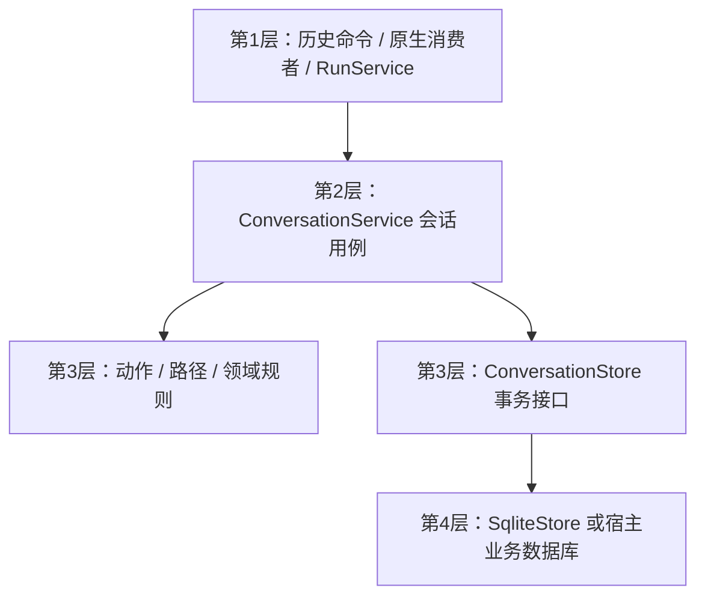
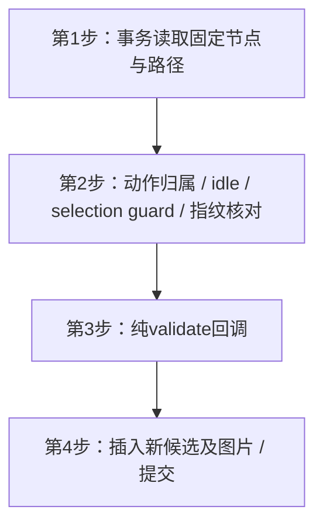

# 26 详细设计：会话与历史存储

> 状态：2026-10-28会话领域、服务和SQLite存储已迁入runtime；本轮行为测试和真实窗口持久化证据见 [90](90-开发任务清单.md)。
> 本文是 `aether-runtime::conversations` 的领域模型、会话用例、分支动作、预留事务和图片存储策略唯一详细定义。UI/JSON 会话投影字段由 [22 公共契约](22-详细设计-跨运行时公共契约.md) 定义；本页领域模型不是第二套 UI DTO。运行接受和终态协调见 [25](25-详细设计-运行应用服务.md)。
> Worker对应实现：`packages/worker/src/conversations/{model,action,index}.ts`拥有独立ConversationService，保持分支/CAS编辑/重答/翻译/选择/fork与图像引用语义；公共展示DTO来自`packages/contracts/src/generated`。每个actor的单会话图、准备依据与reservation在D1单文档revision CAS原子提交，不承诺Native回调式事务；大JSON以不可变R2 blob+CAS指针保存，旧blob有意保留至显式安全GC。DO在reserve前持久creating/计划handle，重启只恢复匹配预留为interrupted而不重放执行。公共schema/分页/安全边界见23/29，Native trait和v1–v6迁移不变，真实重启/持久化验证见90。

## 1. 职责与逐层模块图



ConversationService 不构造 Runner、HTTP 客户端或 MCP runtime；查询/编辑/删除/选择/分叉无需模型可用。ConversationStore 是真实替换边界：内置 SQLite 与宿主自己的数据库；无历史用 None，不造假内存实现。不另建 conversations crate，不让 chat 引入 SQLite。

领域、Store、SqliteStore、history_path、translation_input 从 chat 迁到 runtime::conversations；`trim_history` 是 runtime::prepare 的纯函数，输入本页选定路径，输出 chat::Message。清理任务由RunService持有，不由Store启动。

独立编译启用runtime/conversations（默认feature为空）；仅消费chat纯Message/EndStatus，不启chat/native、RunEngine或Providers。SQLite可启support/native，不承诺依赖闭包完全无HTTP库。完整feature图唯一见25 §1.1；历史Tauri接入使用15的独立conversations feature，不要求chat。

## 2. 领域模型（后端，不导出 TS）

字段保留现有持久数据；以下 snake_case 为 Rust/存储名称，不代表对外 JSON。`Message`/`EndStatus` 来自chat，SkillRef/ContextUsage/ReasoningEffort/Cost 来自support，ImagePart/ImageRef来自images。

| 类型                | 完整字段与语义                                                                                                                                                                                                                                                                                                                                                                                                                                                                                                                                                                             |
| ------------------- | ------------------------------------------------------------------------------------------------------------------------------------------------------------------------------------------------------------------------------------------------------------------------------------------------------------------------------------------------------------------------------------------------------------------------------------------------------------------------------------------------------------------------------------------------------------------------------------------ |
| ConversationSummary | id、title、scope: Option<String>、created_at/updated_at: i64（Unix ms）、selected_turn_id: Option<String>                                                                                                                                                                                                                                                                                                                                                                                                                                                                                  |
| Conversation        | summary: ConversationSummary、turns: Vec<Turn>（seq升序，包含非完成候选）                                                                                                                                                                                                                                                                                                                                                                                                                                                                                                                  |
| TurnStatus          | Running / Completed / Failed / Cancelled；只有Completed进入后续模型历史                                                                                                                                                                                                                                                                                                                                                                                                                                                                                                                    |
| TurnImage           | mime: String、data: Option<String>（标准base64，None为已过期，引用行仍存在）                                                                                                                                                                                                                                                                                                                                                                                                                                                                                                               |
| Turn                | id: String、seq: u32、status: TurnStatus、input: String、messages: Vec<Message>、model_id: Option<String>、skills: Vec<SkillRef>、error_code: Option<String>、input_tokens/output_tokens/cache_read_tokens/cache_write_tokens/reasoning_tokens: Option<u32>、context_usage: Option<ContextUsage>、reasoning_effort: Option<ReasoningEffort>、endpoint_id: Option<String>、cost: Option<Cost>、conversation_id: String、parent_id: Option<String>、question_id: String、supersedes_id: Option<String>、kind: String（reply/translation）、created_at: i64、images/generated: Vec<TurnImage> |
| TurnHandle          | conversation_id、turn_id、input、parent_id、question_id、supersedes_id、kind；预留后固定的身份及动作，不可用客户端伪造                                                                                                                                                                                                                                                                                                                                                                                                                                                                     |
| TurnRecord          | status: EndStatus、messages: Vec<Message>、model_id/endpoint_id/error_code: Option<String>、skills: Vec<SkillRef>、五项token计数: Option<u32>、context_usage: Option<ContextUsage>、reasoning_effort: Option<ReasoningEffort>、cost: Option<Cost>                                                                                                                                                                                                                                                                                                                                          |

一轮 = 用户input/输入图片 + 本轮全部assistant/tool消息；failed/cancelled也保存已输出部分。模型原生reasoning、工具调用/结果保留在messages；skills只存id/revision，不复制正文；cost在完成时固定，不按后续价格重新计算；供应商未报告usage保留None，不编造估算usage。

runtime投影层将领域assistant可见文本合并为22的UI字段，映射状态/分支/usage/context/reasoning/images/generated，不把messages、连接或数据库形状直接暴露给前端。历史查询不回传base64数组；ImageRef.url是受控展示地址或过期null。ImageRef作为展示类型的字段在19定义，UI会话字段的组合仍归22。

## 3. 独立会话服务与 Store

```rust
impl ConversationService {
    pub fn new(store: Arc<dyn ConversationStore>) -> Self;
    pub fn list(&self, scope: Option<&str>) -> Result<Vec<ConversationSummary>, KitError>;
    pub fn get(&self, id: &str) -> Result<Conversation, KitError>;
    pub fn rename(&self, id: &str, title: &str) -> Result<ConversationSummary, KitError>;
    pub fn edit_turn(&self, conversation_id: &str, turn_id: &str,
                     text: &str, expected_text: &str) -> Result<Conversation, KitError>;
    pub fn remove_turn(&self, conversation_id: &str, turn_id: &str) -> Result<Conversation, KitError>;
    pub fn fork(&self, conversation_id: &str, turn_id: &str) -> Result<Conversation, KitError>;
    pub fn select_turn(&self, conversation_id: &str, turn_id: &str) -> Result<Conversation, KitError>;
    pub fn delete(&self, id: &str) -> Result<(), KitError>;
}
```

同步服务由异步调用方放blocking线程，不阻塞executor。list固定最近200条、updated_at降序，scope最多200 Unicode字符、None列全部scope；scope只是过滤不是业务授权。rename输入最多200 Unicode字符、trim后非空；初始标题由首轮input去CR/LF取前40 Unicode字符。

```rust
pub trait ConversationStore: Send + Sync {
    fn list(&self, scope: Option<&str>, limit: usize) -> Result<Vec<ConversationSummary>, KitError>;
    fn load(&self, id: &str) -> Result<Conversation, KitError>;
    fn reserve_action(&self, action: &ActionRequest,
        validate: &mut dyn FnMut(&ReservationInput) -> Result<chat::RunInput, KitError>)
        -> Result<TurnReservation, KitError>;
    fn finish_turn(&self, turn: TurnHandle, record: TurnRecord) -> Result<(), KitError>;
    fn delete(&self, id: &str) -> Result<(), KitError>;
    fn rename(&self, id: &str, title: &str) -> Result<ConversationSummary, KitError>;
    fn edit_turn(&self, conversation_id: &str, turn_id: &str,
                 text: &str, expected_text: &str) -> Result<Conversation, KitError>;
    fn remove_turn(&self, conversation_id: &str, turn_id: &str) -> Result<Conversation, KitError>;
    fn fork(&self, conversation_id: &str, turn_id: &str) -> Result<Conversation, KitError>;
    fn select_turn(&self, conversation_id: &str, turn_id: &str) -> Result<Conversation, KitError>;
    fn purge_images(&self, before_ms: i64) -> Result<usize, KitError>;
    fn add_generated(&self, turn_id: &str, images: &[ImagePart]) -> Result<(), KitError>;
}
```

所有实现都必须实现事务与动作，不提供默认no-op。`finish_turn`只接受本handle的running轮，原子写messages/终态/模型/完整usage及cost，完成选择更新沿既有规则；缺失或已结束返回not_found/conflict。没有公开begin_turn/regenerate/begin_action兼容方法；`regenerate`只保留为22请求动作字段，被归一为新候选。没有既存abort API可依赖，预留拒绝靠下节事务回滚。

## 4. 动作、模型与历史选择

### 4.1 固定动作

- 普通回复：显式replyToId优先，其次持久selectedTurnId，再其次最近completed。head必须同会话且completed；无head为空历史。新轮parent=head，question_id=新轮id，kind=reply。
- retryTurnId：来源不可running，保留source的input、输入图片行、parent、question_id、kind；新轮supersedes_id=source.id。原候选完整保留，绝不清空原轮。
- regenerate：只读解析时按上述选头选择来源，再归一为同一个retry动作。事务不得重新选择“最新”来源。
- translateTurnId：来源不可running，取assistant可见text（排除工具结果与reasoning），构建固定翻译指令，parent=source.id、question_id=新轮id、kind=translation、supersedes_id=None，不带图片。空可见文本报bad_request；目标语言trim后1–80 Unicode字符。
- retry/translation/regenerate默认沿来源endpoint_id+model_id；来源缺失/模型不可用保持25的source_model_unavailable。显式换模型只替换模型，不替换来源input/图片/分支。
- retry/translation互斥，不与regenerate/replyToId组合；retry/translation与显式预搜索的既有限制保留；这类动作带客户端images报bad_request{field:"images",reason:"action_conflict"}；有动作来源必须有conversationId。writing的原有特殊历史/动作限制留在25的prepare，不扩展新用途。
- 同会话只允许一个running轮，所有修改动作检查idle。ID非空且最多128字符，输入最多100000 Unicode字符。前端传来源引用不代表拥有该资源，接入/宿主必须先做业务授权。

### 4.2 路径与纯裁剪

`history_path(turns, head)` 沿parent回溯到根再反转，只返回该分支，不把同question其他候选拼入历史；拒绝缺失节点、循环和外来会话节点。translation在来源子节点上，retry沿source.parent，不把来源答案误当本问题的先前上下文。

prepare::trim_history只取路径中completed轮；按完整轮从最早丢弃，直到字符数估算token（向上取整字符数/3）落在 `context_window − max_output − system − 当前input` 的剩余预算。最新一轮单独也放不下则空历史，不能拆散工具调用/结果。模型usage仍只用真实报告；此估算只用于预算。

可用输入图片合成chat::Message::UserImages；无可用图仍为User字符串；该临时user消息不写进turns.messages。非视觉模型剥离历史图片、保留文字；当前有效输入带图则接受前vision_unsupported。generated不自动重放为普通模型输入，只可由20的绘图引用规则使用。不按图片估算token，不改变现有reasoning重放规则。

## 5. reservation：准备依据核对与无半接受事务

### 5.1 明确的内部数据

以下结构归runtime::conversations，不序列化给UI；ResolvedAction/SelectionGuard/PreparationFingerprint 是具体数据，不是新trait或公共事务框架。

```rust
pub struct ActionRequest {
    pub conversation_id: Option<String>,
    pub scope: Option<String>,
    pub input: String,
    pub images: Vec<ImagePart>,
    pub action: ResolvedAction,
    pub selection_guard: SelectionGuard,
    pub expected: PreparationFingerprint,
}
pub enum ResolvedAction {
    Reply { parent_id: Option<String> },
    Retry { source_id: String },
    Translate { source_id: String, target_language: String },
}
pub enum SelectionGuard {
    Explicit,
    Selected { selected_turn_id: String },
    LatestCompleted { head_id: Option<String> },
}
pub struct PreparationFingerprint([u8; 32]);
pub struct ReservationInput {
    pub input: String,
    pub images: Vec<ImagePart>,
    pub history_path: Vec<Turn>,
    pub source_model: Option<SourceModelRef>,
}
pub struct SourceModelRef { pub endpoint_id: String, pub model_id: String }
pub struct TurnReservation {
    pub handle: TurnHandle,
    pub input: ReservationInput,
    pub run_input: chat::RunInput,
}
```

只读动作解析加载会话一次，固定source/parent和selection_guard，构造ReservationInput及expected，先生成effective request后才允许25的宿主/连接/工具准备。ActionRequest.input/images保留原普通请求内容；重答/翻译的有效内容从source推导，客户端内容不覆盖它。新会话用Reply{parent_id:None}、Explicit；已有会话缺selected且回退最新completed时记录LatestCompleted。显式source/parent不因无关selected变化拒绝；Selected和LatestCompleted只核对确实用于本次决策的选头依据。

### 5.2 指纹字段与算法

指纹采用带版本前缀、定长整数及长度前缀字符串的规范字节序列做SHA-256；枚举带明确tag，None/Some区分，JSON按结构规范化（对象键排序、数组保序），不以Debug或普通JSON对象键顺序比较。只包含下面本次实际消费字段，不使用整个会话revision/updated_at造成无关改名冲突：

1. 会话id/scope、归一动作、显式source/parent和selection_guard的被消费值；新会话包含请求scope/input/images。
2. 来源（若有）的id、status、parent_id、question_id、supersedes_id、kind、endpoint_id/model_id、权威input；翻译另含实际可见assistant文本和目标语言。模型引用用于核对准备所依赖的来源，不重新在事务里resolve Providers。
3. 有序history_path中每轮的id、parent_id、status、input、完整messages（含结构化工具及reasoning）、endpoint_id/model_id与reasoning_effort；只覆盖生成历史或重放规则实际使用内容，不含title、费用、未读取的其他候选。
4. 当前有效输入图片和所用历史图片：行身份（turn_id/kind/idx）、MIME、顺序、None/Some可用状态、字节内容摘要。20用于工具候选的原始路径generated及input引用也包含同样依据，因为它们已影响固定工具目录；不相关路径的图片不纳入。

摘要直接流式读借用的字符串/图片字节，不为指纹clone整幅base64或整个会话；可复用一次加载的领域数据。hash不是持久revision、授权凭据或可外传日志数据。图片purge导致可用性变化也必须conflict，不接受“宿主按原图准备、实际输入已换成空图”。Providers/技能配置已被固定为本次快照，不把之后无关配置编辑纳入会话指纹。

### 5.3 同步事务算法



1. runtime先分配run/任务资源并原子复查closing/owner.closed；reservation不持registry锁。Store事务及回调不得申请registry锁，cancel_owner不等待SQLite。
2. Store事务内读取固定source/parent/祖先和必要图片，检查同会话归属、idle、动作合法及selection_guard，不重选selected或最新head。若先前存在的依据已删除/变更，统一 `conflict{reason:"preparation_changed"}`；首次解析就不存在仍为not_found。已有running冲突保留turn_running。
3. 重算权威ReservationInput及fingerprint，必须与expected一致；不同回滚。不能只在新值上validate就继续沿旧模型、旧prompt或旧工具目录。
4. 对象安全回调`&mut dyn FnMut(&ReservationInput)->Result<chat::RunInput,KitError>`只做预算/图像/裁剪/输入组装，并在返回前读取捕获的closing/owner.closed原子状态；这不是外部I/O或隐藏输出。显式返回最终执行输入，无网络/宿主I/O/嵌套Store/配置resolve；关闭或校验错误整笔回滚。
5. 回调成功后立即插入running候选及图片并提交，返回handle、同一权威ReservationInput与回调run_input；新会话也在本事务。原子关闭检查与commit仍可能竞争，不能假装跨SQLite原子化；已commit竞态由下一步处理。
6. 已提交就是接受；提交与关闭竞争时不得返回请求拒绝而遗留轮，25短锁登记并立即取消，统一保存cancelled/发End。Store释放锁后才登记，不再额外SQL/validate。事务内错误无新会话/failed占位/元数据变化，不用remove_turn或假abort回滚。

## 6. 查询与编辑的既有行为

- edit_turn：正文trim后非空、最多24000 Unicode字符；会话idle且目标为叶节点（包括parent/supersedes依赖检查），用合并可见文本与expectedText做CAS，不匹配conflict。替换为单个assistant纯文本，清除原生reasoning/工具结构，context_usage失效；历史生成usage/cost保留。
- remove_turn：保留现有真实语义，不沿旧12稿“有后代一律拒绝”。原子删除目标及其直接翻译节点；后继优先同question的下一个reply候选，否则前一个，否则parent。依赖parent重挂到后继，supersedes修复并避免自引用；删除当前选择时移到后继向下逐级seq最大的reply叶，后继为空则从最新根reply向下，无剩余reply为None。被删除翻译的图片也级联，不删除不相关候选。会话running时拒绝。
- select_turn：会话idle、目标同会话且completed；持久selected_turn_id，不更换conversationId，不复制会话。
- fork：会话idle；只复制指定节点的祖先路径，新会话/new turn id，重映射parent/question/supersedes，仅路径内关联保留；复制所有原有消息、usage/cost及input/generated图片行，保持scope/title，原会话不变。
- delete：删除整个会话及外键级联轮和图片。rename仅原子修改title，保持现有不改变updated_at的行为；edit/remove/select更新原会话updated_at，fork给新会话建立时间而不改原会话；失败不部分更新。

## 7. SQLite、迁移与图片保存

`SqliteStore::open(root)` 使用既有chat.db，不因crate迁移新建另一库或丢弃旧数据。表字段含义以本页领域定义为准；已有schema版本按顺序保留，不重编号、不重放已应用SQL。

| 历史migration | 保留内容                                                                                                                                                                                                                        |
| ------------- | ------------------------------------------------------------------------------------------------------------------------------------------------------------------------------------------------------------------------------- |
| v1            | conversations(id,title,scope,created_at,updated_at)，scope/updated_at索引；turns(id,conversation_id,seq,status,input,messages,model_id,skills,error_code,input_tokens,output_tokens,created_at)，conversation/seq唯一与外键级联 |
| v2            | cache_read_tokens/cache_write_tokens/reasoning_tokens、context_usage、reasoning_effort、endpoint_id                                                                                                                             |
| v3            | selected_turn_id、parent_id/question_id/supersedes_id/kind；旧线性轮按seq回填parent，question_id=id，选择completed head；保留消息/真实用量，升级备份                                                                            |
| v4            | turn_images(turn_id,idx,mime,data,created_at)，原图base64可NULL，复合主键(turn_id,idx)，外键级联                                                                                                                                |
| v5            | kind=input/generated，默认input，不重新解释旧图片                                                                                                                                                                               |
| v6            | cost/cost_currency，已有cost保留，不用新价格重算                                                                                                                                                                                |

一会话一running及reserve_action的并发检查必须在同一事务内成立。打开旧库时残留running转failed/error_code=interrupted，保留已写数据，不声称崩溃执行未发生；数据库安全/版本拒绝/备份沿10。领域crate移动不需要为了文件位置增加schema迁移。

`IMAGE_TTL_DAYS=7` 唯一归本模块；启动立即及每小时清理任务由25拥有。`purge_images(before_ms)`仅将早于截止时间且非NULL的data置NULL，返回实际清空行数，保留mime/引用行；input/generated同策略。删除会话/轮由外键级联；fork复制图片；retry在预留事务复制源input行，包括已过期NULL行，保留原created_at，不因重答延长原图寿命。翻译不复制图片。

`add_generated` 由ConversationService的图像存储适配调用，校验目标轮并原子追加kind=generated；失败向25工具适配传播，不仅warn。独立images调用不要求有会话，返回ImagePart给调用宿主自行存储；无历史run的工具图片由runtime转换成仅本次展示的ImageRef，不伪称持久保存。

## 8. 迁移与待验收

清洁迁移所有chat::ConversationStore/SqliteStore/Turn/TurnHandle/TurnRecord等import及插件/CLI/mock Store测试；删除旧begin/regenerate存储接口与“清空原轮”描述，不保留别名。公共UI投影只按22生成绑定，不能把本页领域结构导出替代它。

实现位置：`crates/aether-runtime/src/conversations/{mod,action}.rs` 分别持有领域/同步会话服务/SQLite 与只读动作解析/规范 SHA-256 指纹；`prepare/history.rs` 持有完整轮裁剪，`contract/conversation_dto.rs` 是唯一展示投影。只读 `resolve_action` 接收调用方一次加载的 `Option<Conversation>` 和原请求字段，返回固定 `ActionRequest` 与 `ReservationInput`，不再由预留事务重选来源。SQLite 使用 immediate 事务，将准备依据核对、纯回调和插入合并为一次提交；拒绝不会新增会话或更新元数据。迁移后的行为测试覆盖拒绝无痕、来源/选头/图片变动、跨连接 running 排斥、无关改名、固定回调结果、过期图片 TTL 与已有分支 CRUD，尚未运行。

第三方ConversationStore为破坏性迁移：删除begin_turn/regenerate/begin_action实现，采用对象安全reserve_action及完整事务指纹/回调/返回RunInput语义；所有宿主实现和mock一并迁，不提供默认成功/no-op或旧trait别名。SourceModelRef是本模块纯领域引用，runs将其转为providers::ModelRef；独立conversations不因来源模型字段依赖Providers。AutoNote等外仓调用方需迁新runtime/images路径，本轮仅列切换要求，不编辑外仓或声称迁完。

验收范围：旧库v1–v6数据/备份/崩溃恢复；source模型与有效图片；事务校验失败无痕；source/选头/路径/图像purge竞态；无关改名不误冲突；一会话一running；分支/候选/翻译；remove后继重挂；CAS；fork完整usage/reasoning/cost/图片；TTL；生成保存失败可见；历史只含完整completed轮。实际运行证据和平台限制见90。
