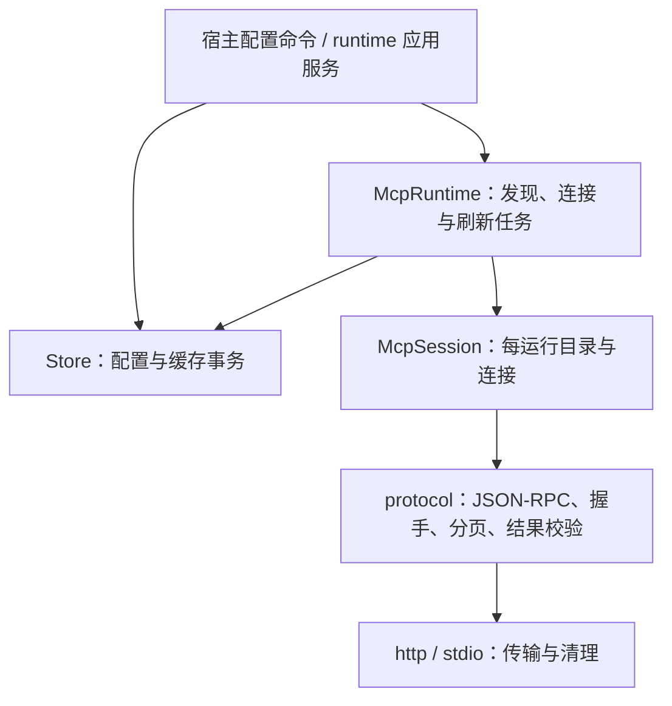

# 27 详细设计：MCP 客户端

> 状态：Store保留同步配置/缓存事务，McpRuntime托管连接、目录准备与后台刷新，session/protocol保留有界完整结果并共同观察关闭token；本轮验证记录见 [90](90-开发任务清单.md)。本文件是aether-mcp-client配置、运行时、session、协议和结果接口唯一权威；概要见 [03](03-契约优先架构与职责拆分设计.md)，总边界见 [13](13-详细设计-kit-mcp.md)。
> Web对应实现：`packages/core/src/mcp`的HTTP McpRuntime/session与`packages/worker/src/mcp/client.ts`的actor配置服务已实现；公开配置DTO由`packages/contracts/src/generated`提供，HTTP管理见23。Worker拒绝stdio，HTTP经注入trusted outbound执行；header/query凭据只写入CredentialPort密文、列表过滤，不提供reveal。仅enabled+trusted的配置进入当前actor会话，allowPrivate仍须显式target-bound私网网关授权而非普通fetch绕过。此处Client不实现OAuth；HTTPS OAuth PKCE属于对外Server（28/29），不能混淆两个方向。实际验证证据见90。

## 1. 职责与模块

Client 让本程序调用外部 MCP 工具，不依赖 Chat、Skills、Providers 或 MCP Server。只依赖共享基础设施；HTTP 使用 `aether_support::net` 的地址策略与 `sse` 解析，stdio 使用 Tokio 子进程，不使用会绕过地址策略的 rmcp 客户端传输。OAuth、resources/prompts/sampling 不在本轮范围。



| 模块                        | 拥有的责任                                                     | 不得承担                                              |
| --------------------------- | -------------------------------------------------------------- | ----------------------------------------------------- |
| `store.rs`                  | 配置校验、密文事务、同步配置/缓存读取、发现结果事务替换        | 网络、启动进程、spawn、timeouts、异步 session/refresh |
| `runtime.rs`（新增）        | `McpRuntime`、timeouts、连接函数、发现策略、托管刷新任务与关闭 | Chat 投影、最终业务授权                               |
| `session.rs`                | 固定目录、每服务连接、调用和通用结果                           | 查询配置以暗改在途授权、模型文本格式化                |
| `protocol.rs`               | 传输无关 JSON-RPC、握手、分页、结果解析/校验、unknown 分类     | SQLite、Chat                                          |
| `http.rs` / `stdio.rs`      | 各自的线路、安全策略与差异化清理                               | 仓储用例、刷新任务所有权                              |
| `credentials.rs` / `dto.rs` | 凭据与配置 DTO                                                 | 另一套授权或运行服务                                  |

数据库映射 `Target::from_row` 只映射配置；不得继续在行对象上实现 `connect` 或启动进程。`lib.rs` 显式导出 `McpRuntime`，删除旧 `Store::refresh/session`，不留兼容转发。

## 2. 配置与持久化

### 2.1 数据模型（`mcp-client.db`，migration 1–2）

```sql
CREATE TABLE servers (
  id TEXT PRIMARY KEY,
  slug TEXT NOT NULL UNIQUE,              -- [a-z0-9_]{1,24}；工具名前缀 mcp_<slug>_<tool>
  name TEXT NOT NULL, url TEXT NOT NULL,  -- 不含凭据
  secret_ciphertext BLOB,                 -- secret::seal 的不透明 BLOB
  enabled INTEGER NOT NULL DEFAULT 0,
  trusted INTEGER NOT NULL DEFAULT 0,
  allow_private INTEGER NOT NULL DEFAULT 0,
  position INTEGER NOT NULL, created_at INTEGER NOT NULL, updated_at INTEGER NOT NULL
);
CREATE TABLE tools (
  server_id TEXT NOT NULL REFERENCES servers(id) ON DELETE CASCADE,
  name TEXT NOT NULL, description TEXT NOT NULL, input_schema TEXT NOT NULL,
  read_only INTEGER NOT NULL DEFAULT 0,
  approval TEXT NOT NULL DEFAULT 'ask' CHECK (approval IN ('auto','ask','deny')),
  fetched_at INTEGER NOT NULL,
  PRIMARY KEY (server_id, name)
);
```

migration 2：

```sql
ALTER TABLE servers ADD COLUMN transport TEXT NOT NULL DEFAULT 'http' CHECK (transport IN ('http','stdio'));
ALTER TABLE servers ADD COLUMN command TEXT;
ALTER TABLE servers ADD COLUMN args TEXT;     -- JSON 字符串数组
ALTER TABLE servers ADD COLUMN cwd TEXT;      -- 绝对目录；NULL = 继承
```

既有行保持 `http`。HTTP 行不带 stdio 列；stdio 行 `url` 为空串、`allow_private=0`。读写校验列组合，损坏行报错，不用默认值掩盖。职责拆分不新增 schema 或改写已有凭据。

### 2.2 公共配置接口与 DTO

```rust
pub struct Store { /* 同步 SQLite 仓储 */ }
impl Store {
    pub fn open(root: &Path) -> Result<Self, KitError>;
    pub fn list(&self) -> Result<Vec<ServerDto>, KitError>;
    pub fn save(&self, input: ServerSave) -> Result<Vec<ServerDto>, KitError>;
    pub fn delete(&self, id: &str) -> Result<Vec<ServerDto>, KitError>;
    pub fn set_tool_approval(&self, server_id: &str, tool: &str,
                             approval: Approval) -> Result<(), KitError>;
}
```

```ts
type McpTransport =
  { kind: 'http'; url: string /* 列表中打码 */ } | { kind: 'stdio'; command: string; args: string[]; cwd?: string }
interface ServerDto {
  id: string
  slug: string
  name: string
  transport: McpTransport
  secretKeys: string[]
  enabled: boolean
  trusted: boolean
  allowPrivate: boolean
  tools: ToolDto[]
}
interface ToolDto {
  name: string
  description: string
  readOnly: boolean
  approval: 'auto' | 'ask' | 'deny'
}
interface ServerSave {
  id?: string
  slug: string
  name: string
  transport: McpTransport
  secret?: { headers?: Record<string, string>; query?: Record<string, string>; env?: Record<string, string> }
  enabled: boolean
  trusted: boolean
  allowPrivate: boolean
}
```

- 新服务默认禁用且不可信。只有 `enabled && trusted` 进入运行目录。信任不等于最终授权；新工具 `approval=ask`，用户可改 `auto/deny`。上游 `readOnlyHint` 只是 UI 建议，不能自动改为 `auto`。
- HTTP 明文凭据 JSON 只含 `headers/query`；stdio 只含 `env`。另一传输的凭据 → `bad_request{field:"secret", reason:"transport_mismatch"}`。`secret` 缺省保持、`{}` 清空；切换传输而继续保留已有凭据 → `reason:"transport_changed"`。
- 凭据只存密文、只回显键名；连接时解密。不可读报needs_config{reason:"key_unreadable"}。HTTP按MCP的HeaderName/HeaderValue规则校验secret.headers，允许合法Authorization；不能用Provider的net::custom_headers过滤掉MCP认证头。headers/query仅在请求时组合，不写回URL、不进日志；保留现有secret/header错误分类。
- URL userinfo 或疑似秘密 query（`looks_like_secret` 或打码名单）拒绝，提示移到 `secret.query`。`allowPrivate` 是用户对该 HTTP 服务的显式内网授权；stdio 无此网络授权含义。
- stdio `command` 非空、单行、≤1024 字符；`args` ≤64 项、各 ≤4096 字符，列表中明文展示。疑似凭据参数（包括 `--flag=value` 各段）→ `bad_request{field:"args", reason:"credential_arg"}`，改用 `secret.env`。`cwd` 为存在的绝对目录（`not_absolute/not_found`），宿主保存前另行限制工作区归属；连接时重新检查目录仍存在。env 键匹配 `^[A-Za-z_][A-Za-z0-9_]{0,127}$`。
- 保存的配置修改、密文替换/清空及旧密文 `secret::forget` 保持原事务与失败语义；seal 失败不修改数据库。删除先按既有 secret 合同 forget，再删除服务与级联工具，不以级联删除跳过凭据清理。不扩展为新的跨系统事务保证。
- `open` 保留 newer schema → `incompatible_db`；SQLite 失败 → `internal`。保存保留校验错误、重复 slug 的 `conflict{reason:"duplicate_slug", field:"slug"}`、未知 id 的 `not_found`、seal 的 `unsupported/internal`；删除未知服务或设置不存在工具审批值均 `not_found`。

### 2.3 内部仓储合同

Store 以 crate-private 同步入口提供单个连接配置、启用且可信的配置集合、缓存读取和成功发现后的事务替换。同步锁不得跨 `await`；先读取快照、释放锁，再由 runtime 连接。

`tools` 是最近一次成功发现结果；替换在同一事务保留同名已知工具的 approval，新工具默认 ask，移除已消失工具。失败不覆盖成功缓存。零工具结果沿用既有表示（无 tools 行，下次 session 仍可能同步发现），本轮不新增 freshness 表或字段。

## 3. McpRuntime 与 session

### 3.1 唯一运行接口

```rust
pub struct McpRuntime { /* Arc<Store>、关闭状态和托管刷新任务 */ }
impl McpRuntime {
    pub fn new(store: Arc<Store>) -> Self;
    pub fn store(&self) -> &Arc<Store>;
    pub async fn refresh(&self, server_id: &str, cancel: &CancellationToken)
        -> Result<Vec<ToolDto>, KitError>;
    pub async fn session(&self, cancel: &CancellationToken,
                         own_port: Option<u16>) -> McpSession;
    pub async fn shutdown(&self);
}
pub struct McpSession { /* 每服务一个按需连接；运行时关闭 token */ }
impl McpSession {
    pub fn tools(&self) -> Vec<McpTool>;
    pub async fn call(&mut self, prefixed: &str, args: Value,
                      cancel: &CancellationToken) -> McpCallResult;
}
```

`store()`只借用构造时的同一配置实例，不I/O、不建立第二个仓储。独立设置命令使用该Store执行配置事务；运行命令用Runtime连接/发现。这个访问口不把网络运行职责塞回Store，不复制其CRUD转发方法。

`McpTool` 字段为 `server/slug/name/prefixed/description/schema/approval`，分别是展示名、服务 slug、原工具名、`mcp_<slug>_<tool>`、有界描述、JSON schema 和工具审批默认值。它与 `McpCallResult` 不依赖 Chat；应用服务的适配权威见 [25](25-详细设计-运行应用服务.md)，这里不再定义 `ToolSpec/ToolExecution` 或第二份转换规则。

`new` 不 I/O、不启动任务。`refresh` 是显式“测试连接/刷新目录”，不要求服务已启用/信任；读取配置快照，连接握手、发现、事务替换缓存，返回工具列表。保留 `not_found`、凭据不可读、地址/command/cwd 校验、`network/timeout/upstream/unauthorized/unsupported/cancelled`，stdio 退出保留 `network{reason:"server_exited"}`。

### 3.2 目录准备策略

1. 读取启用且可信的配置快照。只对 HTTP 过滤 `own_port` 指向本进程 Server 的 localhost/回环地址并安全 warn，避免自调用环路；不把 stdio 当 HTTP 过滤。
2. 无缓存则同步发现，成功连接供本次 session 复用；有缓存直接构建目录；超过 10 分钟立即使用旧缓存，并交 runtime 调度后台刷新，不阻塞本次运行。
3. 单服务读取/发现失败仅安全 warn 并从目录排除，不使其他工具或整次运行失败。整体配置读取失败返回空目录并安全记录。
4. session 目录、连接配置、审批默认值固定于创建时。后续配置更新、信任变更或缓存刷新不偷偷改写已创建 session；不新增运行中撤销机制。宿主最终授权仍由宿主负责。

### 3.3 任务所有权、取消与关闭

- 插件/宿主持有全局 `Arc<McpRuntime>`；RunService 持有或借用同一实例准备 session，设置命令调用 `runtime.refresh`。每次运行持有自己的 session 和连接，不增设全局 session 注册表。
- 每个后台刷新均登记到 runtime 持有的 JoinSet/等价句柄集合，不 detach；后续调度回收已完成句柄。runtime 关闭 token 的 child token 控制后台刷新，单次运行取消不取消无关的后台缓存刷新。
- session 保留 runtime 关闭 token；连接、握手、发现、调用共同观察 runtime 关闭与调用方取消，关闭后不得新启动进程或新发请求。没有可信应答的已发送调用仍按 §5 的 Unknown 处理。
- `shutdown` 为不可逆终态且幂等：原子停止接纳任务 → 取消关闭 token → 取出并等待登记任务。并发重复 shutdown 也须等待同一次 drain 完成，不得因句柄已被另一调用取走而提前报告关闭完成。任何同步锁不得跨 await；任务失败仅做已有安全日志，不产生未观察 panic。
- 关闭后 `refresh` 返回 cancelled，`session` 返回空目录；既有 session 后续 call 返回取消结果且不新建连接，不悄悄重启 runtime。需要重启须新建实例。
- `Drop` 同步 cancel 并 abort 已登记后台任务，不能在 Drop 阻塞等待。正常退出应 await shutdown；Tauri 同步退出仅能触发 Drop 兜底，不声称已异步 drain。
- 每个 session 拥有自身 stdio 进程；session Drop 结束进程。runtime shutdown 取消在途工作，但不替代 session 的所有权释放；宿主退出同时结束运行并释放 session。完整运行服务关闭顺序由 25 定义。

## 4. 协议与平台限制

### 4.1 共用协议与 HTTP

- `POST <url>`，`Accept: application/json, text/event-stream`；SSE 由共享解析器取 id 匹配的 JSON-RPC 应答。
- 握手：`initialize` 发送 `2025-03-26`，接受 `2024-11-05/2025-03-26`；结果必须有 `protocolVersion`，其他版本 unsupported；随后 `notifications/initialized`。
- 响应 `Mcp-Session-Id` 在后续请求携带；HTTP 404 会话过期按现有规则重握手一次，不自动重放结果不确定的副作用调用。
- `tools/list` 分页最多 10 页、200 工具；描述截到 1024 字符；schema ≤32 KiB，超出工具丢弃并 warn。
- HTTP 连接 10s、单次请求 60s；响应单消息最多 2 MiB，JSON/SSE/stdio 不可绕过。地址经共享 net 策略、禁止重定向；显式 `allow_private` 仅将该服务 `host:port` 加入策略，不给予任意地址通行。
- 本轮不发明退避/重试策略；已有 HTTP 连接重建及请求前/请求后失败分类保留。

### 4.2 stdio

- 每个 session 按需启动每服务一个进程，连接可复用但不跨运行常驻。进程意外退出报 server_exited；结束的连接不能复用，后续调用按既有连接重建规则启动新进程，但不自动重放先前 Unknown 调用。
- Tokio `Command` 经 `process-wrap`（`=10.0.1`），参数原样传入，不经 shell。Windows 裸命令名（无路径分隔符、无扩展名）按最终子进程 `PATH/PATHEXT` 查找，支持 `npx/uvx` 的 `.cmd` 启动器，由 std 对 `.cmd/.bat` 安全转义；使用 `CREATE_NO_WINDOW`。
- Windows 根进程放入 kill-on-close Job Object，Unix 使用独立进程组；后代默认留在其中，根先退出亦然。会话结束、取消或断开时同步结束整个 Job/进程组（`TerminateJobObject/killpg(SIGKILL)`），回收交运行时、Drop 不阻塞；Windows 关闭 Job 句柄也结束进程树。主动脱离 Job 或另建进程组/会话的后代不在保证内。不调用 taskkill/kill 外部命令；采用 process-wrap，保持工作区仅 DPAPI 一处 unsafe 的约束。
- 清空后复制父环境，去掉名称（大小写不敏感）以 `_KEY/_TOKEN/_SECRET` 结尾或含 PASSWORD 的变量，再叠加配置 env。同名去重、配置优先；Windows 名称比较不区分大小写。程序解析与启动使用同一最终环境，配置 PATH/PATHEXT 不被继承值遮蔽。
- stdout 一行一条 JSON-RPC、单行 ≤2 MiB，超出断开；非 JSON 行忽略并 debug。stdin 一行一条；请求写入或 flush 失败整行可能已送达，返回 Unknown 并结束进程；仅通知写入失败为确定失败。
- stderr 持续读完防阻塞，仅前 64 KiB 打码摘要记 info，不进入错误消息。启动至 initialize 完成上限 10s，调用与发现沿共用请求限制。
- 程序不存在 → `bad_request{field:"command", reason:"not_found"}`；无执行权限 → `not_executable`；其他启动失败 → `spawn_failed`。工作目录与命令安全检查不能因曾经保存成功而跳过。

## 5. 通用调用结果

```rust
pub enum McpCallResult {
    Completed {
        content: Vec<serde_json::Value>,
        structured_content: Option<serde_json::Value>,
        is_error: bool,
    },
    Failed { code: String, message: String },
    Unknown { reason: String },
}
```

- Completed 表示获得有效 MCP 工具应答，不等于业务成功；`isError=true` 仍保留完整 content 和 structuredContent，不能压成安全错误字符串。
- Failed 仅表示派发前的确定失败，或收到有效 JSON-RPC error；code/message 仅为既有安全错误，不拿任意上游内容冒充安全消息。不能将已派发后的非法 result 归入 Failed，诱导消费者按明确失败重试。
- Unknown 表示请求已发送但没有可信终局，reason 为 `timeout/network/cancelled/budget_exceeded/invalid_response`；不自动重放副作用调用。取消发生在发送前为明确取消失败，发送后无可信终局则 Unknown。`tools/call` 已派发而 result 形状非法时返回 `Unknown{reason:"invalid_response"}`，不能据应答格式错误推断工具未执行。
- 删除旧 `Ok{text}`、`Error{code,message}` 和 `content_text`，不保留旧字段、variant 或兼容别名。

### 5.1 解析与字节预算

`result` 必须为 object，`content` 必须存在且为 array（允许空数组）；每项为 object 且有非空 string type，text 项的 text 必须为 string。`isError` 缺省 false，出现须 boolean。`structuredContent` 缺省 None，出现须 object（允许空 object），显式 null 不是缺省。已派发的 `tools/call` 违反上述任一形状要求均返回 `Unknown{reason:"invalid_response"}`，不转换为空成功或 Failed。

保留合法非文本及未知扩展 content 条目；不加载网络资源、不解引用链接、不执行脚本、不解码 base64。所有结构（含 structuredContent 和非文本 data）共同受 `MAX_MESSAGE_BYTES=2 MiB` 传输预算约束，不能仅限制 text。若传输超限导致已发送调用缺少可信应答，保持 Unknown，不把它改成确定未执行。

模型投影、工具错误 payload、Chat 的结果/上下文预算及外部内容包装只由 25 的唯一 MCP 工具适配定义。客户端保留有界原始结果，UI/自动化可直接消费，不必须经过 Chat。

## 6. 接入、迁移与验收合同

配置命令仍使用 Store；显式刷新命令、运行准备与 CLI 调用改用 McpRuntime，所有 `McpCallResult` match 一次性迁移。宿主接入权限保持 [15](15-详细设计-接入层.md) 的命令/feature/权限分组，不能因引入 runtime 省略 enabled/trusted、approval 或宿主最终授权。新的 crate 公开 API 不等于为前端新开绕过权限的命令。

主线既有 `Approval` 仍为 `auto/ask/deny`，Client DTO 与缓存字段不改成另一套 risk/权限枚举。运行级 PermissionMode、ToolEffect 和宿主风险/最终授权规则由 [12 Chat](12-详细设计-kit-chat.md) 与 [25 运行应用服务](25-详细设计-运行应用服务.md) 定义；外部 readOnlyHint 不可信，不能据此将 MCP 工具提升为宿主只读/可自动执行工具，也不能让权限模式绕过 Deny。本轮保留既有能力，不在 Client 再定义权限矩阵。

待统一验证：配置/secret 事务与 forget 失败、迁移 1→2 不回归；缓存保留 approval；无缓存与过期缓存策略；后台句柄回收、取消及并发幂等关闭；HTTP 重握手；Windows/Unix stdio 环境/进程树清理；结构化/非文本/isError 无损、非法 result 形状返回 invalid_response Unknown、2 MiB 总预算；已发送 Unknown 不重放。已迁移并补充消费者行为回归，尚未执行；不写文件位置或源码 wiring 断言，未在某平台执行不能写作该平台通过。

## 7. 历史与设计来源

从原 13 的 Client 部分迁入本文件，并由本文件替换旧 Store 异步职责和文本压平结果定义；不是两套并行接口。migration 1–2 和既有平台/安全限制是保留的历史合同，不是本轮验证证据。蓝本为 AutoBee `shell/src/llm/{mcp,mcp_url,mcp_external}.rs`；参考来源不覆盖本文件冻结接口。原文“一期不做 OAuth”在本轮仍成立，不暗示本轮补齐 OAuth。本轮已将 Client 源码设计引用迁至本文件。
