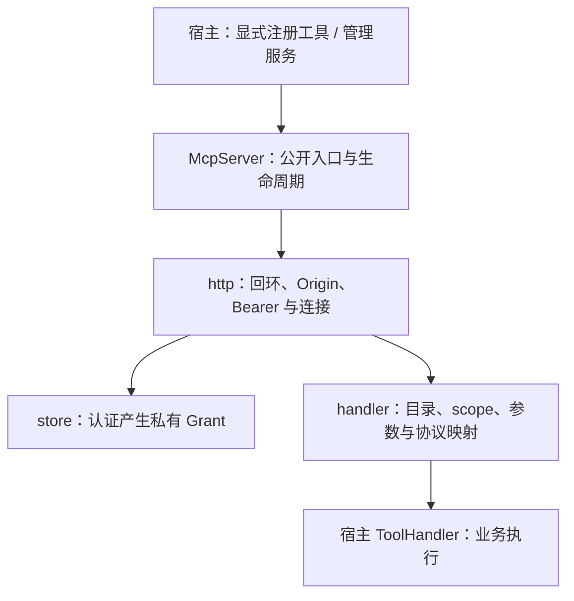

# 28 详细设计：MCP 服务端

> 状态：handler职责迁移已实施；本轮验证记录见 [90](90-开发任务清单.md)。本文件是aether-mcp-server公开注册、HTTP入口、handler、认证和授权合同唯一权威。总边界见 [13](13-详细设计-kit-mcp.md)，概要见 [03](03-契约优先架构与职责拆分设计.md)。

## 1. 边界与模块

Server 将宿主显式注册的业务能力开放给外部 MCP 客户端，不依赖 Client、Chat、Skills、Providers。使用 rmcp 实现 Streamable HTTP，但 rmcp 类型不得进入公开 API。工具在内部 Chat 可用不等于对外开放；本模块不承担工具业务、业务幂等/去重，也不使用应用内对话的授权来替代外部 token 授权。

Native `aether-mcp-server`只监听回环；非回环Native listener不在范围。Worker对外Server已独立实现HTTPS endpoint，不扩大Native监听权限，也不让HTTP/宿主登录绕过业务授权。

Web公开入口为`createMcpService`（`packages/worker/src/mcp`），组合D1 CAS、CredentialPort、OutboundHttp与显式工具/scope注册。`handlePublic`提供HTTPS `/mcp`、metadata、动态注册、OAuth PKCE/S256、一次性code/CSRF consent与refresh轮换；API keys仅hash存储、一次显示、可撤销，grant与application/tenant/subject/audience隔离。宿主仍必须实现resolveIdentity/authorizeConsent/authorizeTool；token scope不等于业务资源授权，内部Chat目录不自动公开。管理路由见23，密钥/可信egress边界见29。真实HTTPS OAuth/MCP scope冒烟已执行，其余完整验证统一记90；local HTTP即使能跑AI也不启用MCP/OAuth，不充当HTTPS证据。



| 模块         | 唯一责任                                                                                                                                |
| ------------ | --------------------------------------------------------------------------------------------------------------------------------------- |
| `lib.rs`     | `McpServer`、公开工具注册类型、启动/停止/改端口、宿主 scope 校验                                                                        |
| `store.rs`   | token/settings 持久化、认证和有效 scope 快照、crate-private Grant                                                                       |
| `http.rs`    | listener/connection、peer/Origin、路径、Bearer 提取与认证、可信 Grant 注入、rmcp HTTP 配置、body 上限及连接取消                         |
| `handler.rs` | 已从 http 迁入 Mcp、rmcp ServerHandler、grant 提取、describe/result/to_error/FORBIDDEN；工具目录与调用、参数预算、CallContext、宿主分派 |
| `dto.rs`     | 服务状态、token 记录与 scope 状态等公开 DTO                                                                                             |

迁移是将 handler 实现从 http **移走**，不复制第二套实现；不改 `ExposedTool/ToolHandler/CallContext/McpServer` 公开形状。

## 2. 持久化与凭据

`mcp-server.db`，migration 1 保持：

```sql
CREATE TABLE tokens (
  id TEXT PRIMARY KEY, name TEXT NOT NULL, token_hash TEXT NOT NULL UNIQUE,
  scopes TEXT NOT NULL,                     -- JSON 数组，⊆ 宿主声明
  created_at INTEGER NOT NULL, last_used_at INTEGER, revoked_at INTEGER
);
CREATE TABLE settings (id INTEGER PRIMARY KEY CHECK (id = 1),
  port INTEGER NOT NULL, autostart INTEGER NOT NULL DEFAULT 0,
  enabled_scopes TEXT NOT NULL DEFAULT '[]');
```

- token 为 `<prefix>_` + 32 字节 getrandom 随机值的 base64url，只存 SHA-256 小写 hex。明文仅 `IssuedToken.token` 创建响应出现一次，此后不可恢复；日志、列表和持久化不包含明文。
- token 名称 trim 后非空，scope 非空且必须已声明；重复 scope 按既有语义去重。未声明的 scope 拒绝，不能用工具名称推断授权。
- `last_used_at` 每分钟最多更新一次，不增加逐工具调用写库。
- 本轮仅职责迁移，不改 schema、token 格式或既有 UI/接入层命令权限。接入层分组和 destructive 开关确认见 [15](15-详细设计-接入层.md)。

## 3. 宿主公开接口

```rust
pub type BoxFuture<'a, T> = Pin<Box<dyn Future<Output = T> + Send + 'a>>;
pub type ToolHandler =
    Arc<dyn Fn(Value, CallContext) -> BoxFuture<'static, Result<Value, KitError>>
        + Send + Sync>;
pub const DEFAULT_MAX_REQUEST_BYTES: usize = 64 * 1024;

pub struct ScopeSpec {
    pub id: &'static str,
    pub label_key: &'static str,
    pub destructive: bool,
}
pub struct ExposedTool {
    pub name: &'static str,
    pub description: &'static str,
    pub input_schema: Value,
    pub scope: &'static str,
    pub read_only: bool,
    pub destructive: bool,
    pub idempotent: bool,
    pub max_request_bytes: usize,
    pub handler: ToolHandler,
}
pub struct CallContext {
    pub token_id: String,
    pub scopes: Vec<String>,
    pub cancel: CancellationToken,
}
pub struct ServerConfig {
    pub default_port: u16,
    pub token_prefix: &'static str,
}
pub struct McpServer { /* store、注册工具和运行状态 */ }
impl McpServer {
    pub fn new(root: &Path, config: ServerConfig, scopes: Vec<ScopeSpec>,
               tools: Vec<ExposedTool>) -> Result<Self, KitError>;
    pub async fn start(&self) -> Result<Status, KitError>;
    pub async fn stop(&self) -> Result<Status, KitError>;
    pub async fn set_port(&self, port: u16) -> Result<Status, KitError>;
    pub fn issue_token(&self, name: &str, scopes: &[&str]) -> Result<IssuedToken, KitError>;
    pub fn revoke_token(&self, id: &str) -> Result<(), KitError>;
    pub fn tokens(&self) -> Result<Vec<TokenRecord>, KitError>;
    pub fn set_enabled_scopes(&self, ids: &[&str]) -> Result<(), KitError>;
    pub fn scopes(&self) -> Result<Vec<ScopeState>, KitError>;
    pub fn status(&self) -> Status;
}
```

- 闭包注册每工具一个处理函数，可复用业务用例，不增加大 trait 再 match 工具名。`new` 拒绝重复工具名、未声明 scope、非 object 的 input_schema 和无效默认端口。
- `read_only/destructive/idempotent` 只映射 MCP annotations；不替代 scope，不自动带来 exactly-once 或业务幂等保证。
- `Status` 给出 `running/port/url/toolCount`；`scopes()` 返回宿主声明及用户总开关状态，供现有管理命令使用。`IssuedToken` 为一次性明文加 token 记录；`tokens()` 返回记录（包括撤销记录），绝不返回旧明文。

### 3.1 生命周期

- 端口为 `1024..=65535`，绝不 bind(0)，避免外部客户端配置随启动变化。`start` 绑定 `127.0.0.1:<port>` 的 `/mcp`，已启动返回当前状态；占用返回 `conflict` 并带 port。
- start/stop/set_port 以既有异步生命周期锁串行，不能持同步状态锁跨 await。
- `stop` 取消 listener、连接与在途调用的 `CallContext.cancel`；返回时端口已释放。取消信号不等于证明已发生的业务副作用撤回，工具必须观察 cancel。
- `set_port` 先保存再按需重启；新端口占用时服务保持停止，新端口仍已保存，不假称原端口已回滚。
- Server 的 stop/start 可重复启停，不等同于 Client McpRuntime 的不可逆 shutdown；不得混用两个生命周期。

## 4. HTTP 入口与可信授权上下文

### 4.1 逐请求 HTTP 边界

顺序保持：检查 peer/Origin → 检查 `/mcp` 路径 → 提取 Bearer → Store::authenticate → 将私有 Grant 放入 request extensions → rmcp 服务。认证存储操作不得阻塞异步执行线程中的网络流程，沿用既有 blocking 边界。

- peer 必须为回环，否则 403。存在的每个 Origin 都必须为合法 `http/https` 回环来源（localhost、回环 IPv4/IPv6）；不可解析、`null`、非回环或多个头中任何一个不合法均 403，防 DNS 重绑定。
- 非 `/mcp` 路径 404；缺失/无效 Bearer、未知或撤销 token 返回 401 并有 `WWW-Authenticate: Bearer`。认证内部错误返回安全 500，不泄露 token 或存储错误。
- SHA-256(token) 按唯一 token_hash 索引匹配。保留随机 256 位 token 摘要索引查询的安全前提；不依赖数据库查询具备常量时间保证，也不将摘要比较的时间信息等同于可恢复 token。
- rmcp 使用无状态、逐请求 Bearer 的 HTTP 模式（NeverSessionManager、非 legacy session、JSON 响应、无 SSE keep-alive），防止会话复用绕过后续认证/撤销。
- HTTP body 上限为注册工具中最大 `max_request_bytes`（无工具用默认 64 KiB）加 8 KiB JSON-RPC envelope，使用饱和加法。它是入口总上限，不能替代 handler 的逐工具参数上限。

### 4.2 Grant 与授权快照

`Grant` 是 crate-private 的可信授权上下文，只由 Store::authenticate 生成并由 HTTP 注入；不公开为可由普通调用者构造的 DTO，不提供绕过 HTTP 的任意 Grant 分派入口。handler 从请求扩展中取不到 Grant 返回安全 internal error，不能回落为全权限。

认证时计算 token scope 与 `enabled_scopes` 的有效集合。`list_tools` 与 `call_tool` 必须严格共用 `Grant::allows(scope)`，调用不可仅因为工具曾在目录中出现就跳过授权。目录只列该快照可调用的工具；调用无有效 scope 返回 JSON-RPC `-32001 forbidden`，安全记录 `warn!(tool, scope, "mcp.server.forbidden")`。

token 撤销和总开关变更对**下一请求**生效；已认证接纳的调用继续使用认证时快照，不在工具执行中再次验证 token，也不因撤销追加在途取消。Server stop、客户端取消/断连仍沿既有 CallContext.cancel，不改变授权快照语义。`CallContext.scopes` 由可信 Grant 提供，不从工具 arguments 读取。

## 5. handler 的调用与结果合同

1. `tools/list` 从注册工具按 Grant::allows 过滤，以注册描述、object schema 和 annotations 返回目录。
2. `tools/call` 查找工具（不存在 → not_found），校验相同 scope；arguments 缺省为空 object。rmcp 参数结构保证 object，不信任模型声明的 scope/token。
3. 对该 object 的序列化字节数执行该工具 `max_request_bytes` 限制（通常 64 KiB）；超限 → `bad_request{field:"arguments", reason:"too_large", limit}`，序列化失败按超限安全拒绝，不分派宿主。
4. 从 Grant 生成 token_id/scopes，沿请求上下文传递取消 token，调用唯一 ToolHandler。不在 handler 里实现业务幂等或第二次审批。
5. 宿主成功 Value：object 映射 structuredContent；string 映射 text；null/bool/number/array 映射 JSON 文本。协议映射复用 rmcp，不引入 Chat 文本投影；客户端的通用结果定义仅见 [27](27-详细设计-MCP客户端.md)。
6. 宿主 KitError 映射安全 JSON-RPC 错误，message 为安全英文、data 为可序列化的安全 KitError；日志只记录工具名/错误码，不记录参数与 token。

错误映射保持：bad_request → `-32602`，not_found → `-32004`，conflict → `-32009`，其余 KitError → `-32603`。缺少 scope 使用独立 `-32001 forbidden`，不是所有 KitError::Forbidden 自动改映射；本轮不扩展错误码体系。

## 6. 接入与待验证验收

宿主显式声明 scope 和工具，用户总开关与 token scope 同时约束；destructive scope 在 UI 开启时二次确认。内部 Chat 工具授权与外部 Server 完全独立。对外注册不能推导为内部可调用，内部目录也不能自动变成对外目录。

本轮已将 handler 从 http 移至独立 handler.rs，HTTP 保留认证、可信 Grant 注入、body 上限及连接生命周期；公开 API 形状不变，scope 检查与取消/授权快照逻辑原样迁移。现有 tests/server.rs 消费者行为测试保持不变，未增加源码 wiring 断言，尚未运行验证。后续统一验证应覆盖：注册错误；端口占用及保存后重启失败；回环/Origin/Bearer/path；明文只出现一次；目录/调用 scope 一致；总开关/撤销下一请求生效但已接纳调用保持快照；缺失 Grant 失败；逐工具字节上限与 HTTP envelope；成功值形状与安全错误映射；stop/客户端取消的 CallContext。这里均为待验证验收，不宣称已执行。

## 7. 历史与设计来源

原 13 的 Server 部分、migration 1、权限与陷阱已迁入本文件；原混合文档不再保留第二套公开定义。蓝本为 AutoNote `desktop/src-tauri/mcp/src/*`；“远程监听一期不做”仍是本轮范围事实。旧 http.rs 同时含 HTTP gate 与 ServerHandler 的混合实现已拆分，相关入口与 handler 注释改为引用本文件。
