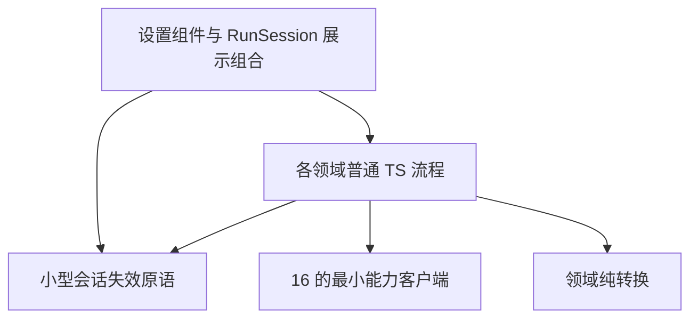

# 30 详细设计：客户端流程与凭据会话

> 状态：2026-10-28客户端源码已切换，公共Rust DTO已生成；本轮行为测试与真实宿主验证记录见 [90](90-开发任务清单.md)，生成绑定不手改。
> 上位边界：[03 概要](03-契约优先架构与职责拆分设计.md)。客户端接口唯一归 [16 §2](16-详细设计-kit-ui.md)，公共 wire DTO/类型归属唯一归 [22](22-详细设计-跨运行时公共契约.md)，IPC 与权限归 [15](15-详细设计-接入层.md)，运行/会话应用规则归 [25](25-详细设计-运行应用服务.md)/[26](26-详细设计-会话与历史存储.md)。本文唯一规定客户端保存、探测、运行展示竞争、凭据会话与配置转换的算法；不重复后端存储/运行状态机。

## 1. 分层与落点



各领域内部再分，不建共享万能 controller：

```text
providers/ProvidersSettings.svelte
  → providers/edit-session.ts：整份保存队列、身份回填、串行 probe
    → providers/draft.ts：现有草稿、toDraft/toSave/savable/adopt/probeTarget 与模型合并
    → ProvidersPort
search/SearchSettings.svelte
  → search/settings-flow.ts：配置保存 → 可选 key 保存 → 可选 check
    → SearchPort
chat/ChatPanel.svelte
  → chat/run-session.svelte.ts：Svelte 展示组合与运行 generation
    → RunClient + 可选 ConversationClient
mcp/McpClientSettings.svelte → mcp/input.ts：纯输入转换
mcp/McpServerSettings.svelte → mcp/config.ts：JSON/POSIX 字符串纯生成
凭据组件 → session.ts：目标/generation 失效
```

- 只有组件处理 DOM、翻译、notify/confirm、CSS、picker 和剪贴板；普通 TS 流程接收显式输入、普通函数回调和客户端，不读取 Svelte 状态、KitContext、Tauri、浏览器全局或宿主业务表。
- 不新建第二套 ProviderDraft 或公共请求 DTO；使用已有领域草稿和 22 指向的类型。本文的 session token、流程结果仅是进程内控制信息，不生成 wire schema。
- RunSession 保留 Svelte 组合，不为了对称改成全域状态机。相同失效规则复用一个小原语，不统一 Provider/Search/MCP 的请求、权限或 secret CRUD。
- 普通领域流程不新增独立包、后台任务或定时TTL。Worker客户端已实现在`packages/ui/src/web`，它只负责HTTP/SSE和DTO校验，不把本页保存/凭据会话算法再复制一份。
- Web `createWebPorts` 显式注入baseURL/fetch/CSRF与能力开关；run POST返回接受信封后自动订阅SSE，取消竞争仍回收已接受run。断流先请求取消并查询快照，仅已确认终态投影end；仍running/查不到时通过onStreamError报告未知，不伪造completed或replay正文。真实浏览器与完整CI证据见90。

## 2. 运行展示会话与传输竞争

### 2.1 RunSession 的边界

RunSession 构造注入 16 的 `RunClient` 和独立可选 `ConversationClient`；前者只运行，后者只查询/编辑持久会话。会话操作不通过运行对象取 `history`，也不为了读历史启动运行服务。

每个运行保存独立 generation、AbortController、接受信息和终态标记；当前会话加载/结构操作也捕获相应会话 generation。按以下顺序处理：

1. 开始新运行前固定目标会话与本次 generation，注册事件闭包，再调用 `start`。事件可能早于接受结果，不能靠先拿到 runId 才允许展示。
2. 只有仍属当前活跃 generation 的事件更新正文、reasoning、usage、审批卡及错误；旧事件不更新当前会话。终态后不再接纳该运行后续展示更新。
3. `start` 接受结果只设置其所属 generation 的标识；若所属会话已经切换/卸载或请求已取消，仍使用晚到 runId 补发 `cancel`，不恢复旧 UI。
4. 切换会话/新建/销毁先使旧 generation 失效并请求取消，不等待外部任务真正停止才允许显示新会话。已知 runId 显式取消；等待接受时 abort，使适配器在拿到 runId 后补取消。重复请求遵循幂等取消，不产生重复本地 `end`。
5. `cancel` 返回仅表示请求已处理；只有 `end` 或明确查询到的终态能够确认运行结果。保留已有部分输出，不把停止按钮响应当成 `cancelled`。
6. 正常收到 `end` 后才读取已保存会话；服务端须先完成保存再发送终态。读回仍检查会话 generation，旧会话读回不能覆盖新会话、重新清空新草稿或改变当前选择。无 ConversationClient 时仅保留本次临时展示，不假造持久化成功。
7. 审批点击捕获运行 generation 与 callId；请求失败只为仍活跃且同一等待项恢复审批卡。旧请求失败不恢复新运行的卡，不把 `conflict/not_found` 误称审批成功；显示明确错误。终态、取消或工具结果已移除卡片后，不复活旧等待项。

### 2.2 Tauri `start` 的 AbortSignal 生命周期

每次 `start` 单独持有 listener、结束标记、接受信息和“取消已请求”标记，不能共用全局 listener：

| 竞争位置               | 必须行为                                                                     |
| ---------------------- | ---------------------------------------------------------------------------- |
| 调用前 signal 已 abort | 拒绝为 `KitClientError(cancelled)`，不发 `chat_run`                          |
| 等待接受期间 abort     | 记取消意图；收到接受 runId 后补 `cancel`，不能因接受尚未返回而丢取消         |
| 已接受后 abort         | 用该 runId 请求取消；不把已接受的 Promise 改成失败，也不合成 `end`           |
| `end` 早于接受返回     | 先标结束并清 listener；晚到接受不能再挂 listener，不把完成的运行重新标成活动 |
| `end` 或 `start` 拒绝  | 移除本次 listener；start 拒绝由调用方处理，不再伪造第二个失败事件            |
| 重复取消来源           | 共享本次取消意图；即使服务端收到重复取消也不能制造重复展示终态               |

事件包装须先更新本地终态标记/清理，再交给消费者回调，避免回调触发切换后再次挂载旧 listener。Channel 自身没有可靠断线通知时，不引入假 disconnect 事件、轮询或任意超时来推断完成；真正传输失败的服务端取消责任归 15。

### 2.3 快照确认

`RunSnapshot` 的字段、直接状态枚举、可选失败原因、取消意图、终态保留和 owner 语义只在 22 定义。UI 用 `getSnapshot` 重新确认运行，而不是重新获取丢失正文。快照不携带 pending 审批、工具参数或明文秘密。

如果某个实际适配器能够报告连接中断，UI 保留已接收文本并标“待确认”，再查询快照；查询到终态可确认状态，有存储时通过 ConversationClient 读取持久结果。`not_found` 表示未知/已回收，不能伪造成完成或停止。没有事件回放时不能以快照自动拼正文、恢复审批或续跑；`running` 也不代表旧事件已重新接通。

### 2.4 权限模式选择与一次性授权

保留 origin/main 的现有权限能力，不借职责切分删功能。16 的 ChatPanel props 接收宿主允许的 `permissionModes` 与 bindable `permissionMode`；`PermissionMode`/`ToolEffect` 枚举和权限矩阵唯一归 12，22 引用并定义 wire 字段，最终授权归 12/25，不在 UI 再定义一份后端裁决。

- 默认允许列表延续既有 default/plan/accept_edits；仅在宿主明确允许时显示 auto/full_access。展示顺序沿公共模式顺序；只有一个普通模式时可不显示选择器，存在 full_access 时仍提供明确危险选择入口。
- 普通选择仅在未运行且目标属于允许列表时写入 bindable 非危险偏好；选择器显示模式说明与选中态，plan 提供可见标识，auto/full_access 保留额外权限提示。外部提供 full_access 偏好不能直接激活危险授权；无效偏好回落到允许的非危险项，服务端仍校验宿主模式列表。
- 选择 full_access 必须先通过危险确认；确认 await 返回后重新检查未运行与宿主仍允许该模式，再设置组件私有的一次性标记。不将该标记写到 bindable 偏好、会话历史或宿主持久设置。
- 发送、重试、换模型候选和翻译均在 await 接受之前固定本次 `RunRequest.permissionMode` 并消费/清空一次性 full_access 标记；即使接受失败或取消，也不自动恢复危险授权。下一次运行需要重新确认。会话切换/卸载同样清标记。
- RunSession 的 base/请求组合保留最新 `RunRequest` 字段，普通和动作请求都透传固定 permissionMode；接受后模式固定，UI 后续偏好更改不修改活动运行。工具效果/审批决策来自后端，不按工具名或按钮猜测，不以 full_access 取消宿主最终否决权。

## 3. Providers 编辑与探测

### 3.1 最小普通 TS 接口

`ProviderDraft`/`EndpointDraft` 沿用 `providers/draft.ts`；不重新定义草稿。下列是流程内部接口，不是对外 DTO：

```ts
interface ProviderProbeBatch {
  results: { keyId: string | null; result: ProbeResult }[]
  usable: ProbeResult | null
}

interface ProviderEditSession {
  commit(): Promise<void>
  probe(endpointSlug: string, options?: CallOptions): Promise<ProviderProbeBatch>
  invalidate(): void
}

function createProviderEditSession(
  port: ProvidersPort,
  state: {
    readDraft(): ProviderDraft
    writeDraft(next: ProviderDraft): void
    readProviders(): readonly Provider[]
    onSaved(next: Provider[]): void
  },
): ProviderEditSession
```

一个实例对应一个选中/新建 Provider 编辑会话；目标切换使旧实例失效，再为新目标建立实例。回调均为普通同步函数；流程只在自身 generation 有效时调用，不传翻译文案、CSS 或打开对话框操作。组件基于 Promise 展示 pending/error，处理失效目标的结果时也不得弹出旧错误。`invalidate` 幂等：终止后续排队保存、停止后续 probe、禁止晚到结果写草稿或 `onSaved`，所有未结算等待者拒绝为 `KitClientError(cancelled)`，不能悬挂或伪称保存成功。失效实例后续 commit/probe 同样拒绝，不承诺撤回已提交写入；已发请求仍须消费其响应/拒绝以完成清理。

### 3.2 保存与身份回填

1. 字段提交时组件更新草稿并调用 `commit`。同一有效编辑会话最多一个 save 在途；在途期间再次提交只记“还需保存最新草稿”，不保存每个中间击键副本。
2. 开始每次 save 时固定 `sent = savable(readDraft())` 的不可变快照及发送前 Provider id 集，再调用 `port.save(toSave(sent))`。提交后用户新编辑留在当前草稿，不能被后端整份响应覆盖。
3. 成功后按 sent 的已有 id 找回记录；新增项按发送前后 id 差识别本次新 Provider，并按既有 endpoint id/slug 回填。不能拿当前新草稿或另一个未保存目标代替 sent。身份缺失/结果歧义不得任取列表第一项继续回填，作为明确失败保留草稿。
4. 有效会话使用 `adopt(current, sent, stored)` 合并服务器身份，只更新本次 sent 对应的已保存记录，保留发送后对名称、地址、模型等本地编辑。endpoint id 必须继续带回后端，不以全新线路替代旧线路及其密钥。
5. 仍有后续提交时，再读最新草稿生成下一次 sent，串行保存。所有已加入当前保存队列的 `commit` Promise 只有队列真正排空后才成功；“已有 saving”不能直接 resolve。probe 调用同一屏障，不能绕过排队保存。
6. 任一步失败停止自动循环；所有等待者接收失败，草稿与 dirty 保留，组件提供重试。新提交/用户重试才开启新循环，不在后台无限自动重试；旧错误不能清除新会话的错误状态。
7. 目标切换后旧 save 可实际写入服务器，但只属于旧目标；不能回填另一个 draft、覆盖当前列表、清当前错误或 dirty。后续明确加载可以重新读取已持久结果。

不把 key CRUD、独立 setEnabled 等所有 Providers 操作塞进该流程；它们继续使用能力客户端和凭据会话规则。组件仍保留筛选、active endpoint、对话框与确认。

### 3.3 串行探测与模型合并

- `probe(slug)` 首先等待 `commit` 屏障成功，之后从仍有效目标固定 endpoint 配置与启用 key 顺序快照，再调用已有 `probeTarget`。保存失败不发网络探测。
- 启用 key 数量至少 2 时按原顺序逐个指定 key 探测，记录每个 `ProbeResult`，`usable` 为第一个 `error === null` 的结果；没有可用结果为 null。0 或 1 个启用 key 时保留默认 target 探测，结果的 keyId 为 null，不暗中改变后端轮转策略。
- 每次新 probe 失效/中止上一 probe；在 await 返回后与发下一项前检查编辑 generation、probe generation 和 signal。取消或失效不再发下一 key；迟到结果不改新 probe 的展示，不弹出旧 picker。错误分类及业务失败继续采用 16 的客户端规则。
- 批量 probe 返回数据，不包含本地化 CheckOutcome。组件按 `ProbeError.kind`/hint/原文转换展示，根据 usable 与用户动作决定是否打开 ModelPickerDialog。
- 模型合并为 `draft.ts` 内纯函数：以 modelId 去重，已有模型的用户配置优先，probe 元数据不能覆盖已保存/本地设置；新模型才使用探测默认元数据。picker 增删立即触发 commit，延续无确认保存按钮交互。

## 4. Search 配置、key 与可选检查

### 4.1 接口与局部成功通知

不抽象所有 Search 操作，只提取当前“保存配置、可选写 key、可选 check”的流程。DTO 沿用 17/22 指向的实际类型。配置/凭据明文输入只在本次调用内持有，不返回带明文结果。

```ts
function saveSearchSettings(
  port: SearchPort,
  input: {
    config: SearchSave
    key?: { value: string; keyId?: string }
    check: boolean
  },
  session: {
    isCurrent(): boolean
    onSettings(next: SearchSettingsDto): void
    onConfigSaved(sent: SearchSave): void
    onKeySaved(): void
  },
  options?: CallOptions,
): Promise<{ settings: SearchSettingsDto; checked?: { count: number } }>
```

组件在调用前固定 config、key 以及各自本地编辑 revision，并用闭包实现 selective cleanup；不在异步步骤里重新读当前选中 provider 作为目标。`onKeySaved` 不回传 key 明文。每次同一目标流程有自身 generation；当前 UI 的 pending 策略保持同能力互斥，不新增跨目标万能请求队列。

### 4.2 顺序与失败

1. 保存 `input.config`，成功且会话仍有效时立即 `onSettings` 与 `onConfigSaved(sent)`；清理只针对已成功发送的字段 revision，保存期间新编辑保留。
2. 若有非空 key，按固定 capability/provider 调 `saveKey`；成功且仍有效时先应用 settings 并调用 `onKeySaved`，立即清除已成功保存的那份旧明文。不能等后续 check 完成才清。
3. 若要求 check，且前序均成功、仍有效且未取消，才调相同目标的 `check`；全部成功返回最新 settings 与可选 checked。
4. 任一步失败即拒绝原 `KitClientError`，不继续后续步骤。前序成功回调已经生效，不回滚 UI settings。配置成功但 key 失败时保留成功配置，保留当前会话内失败 key 草稿供用户重试；check 失败不能恢复已经清除的已保存明文。
5. invalidation/abort 后不发下一步骤，流程拒绝为 `KitClientError(cancelled)`，不悬挂或返回虚构的成功值；已发保存可能实际成功，不宣称后端回滚。晚到结果与错误不写当前展示、不清新会话草稿；关闭行为无条件清秘密，不能为了等迟到保存结果而持有已关闭会话明文。

草稿清理不能只比较字符串相等：采用本地编辑 revision 判断成功发送的版本，避免“新输入恰好与旧输入同文”也被错误清除。组件仍独立负责默认提供方、偏好保存、搜索/读取演示与 toast，不塞进该函数。

## 5. 凭据会话与明文清理

### 5.1 小型失效原语

```ts
interface SessionToken {
  readonly generation: number
}
interface ClientSession {
  capture(): SessionToken
  isCurrent(token: SessionToken): boolean
  invalidate(): void
}
function createClientSession(): ClientSession
```

token 仅在创建它的实例上有效；实现须区分实例身份，不能只比较两个实例碰巧相同的数字。`invalidate` 推进 generation；不在原语里保存 secret、做 reveal、访问剪贴板或计时。每个打开目标拥有自己的实例/代际；关闭后即使再次打开相同 id，也不能接纳上次结果。

### 5.2 共同生命周期

适用 `SecretInput`、`EndpointKeysDialog`、Search key dialog、MCP write-only 编辑器与新 token 显示会话：

| 事件             | 失效与清理                                                              |
| ---------------- | ----------------------------------------------------------------------- |
| 打开/换目标      | 失效旧代，固定完整目标身份；清旧 password、编辑明文、reveal 缓存与错误  |
| 关闭/卸载        | 失效并无条件清上述值，清当前 issued token；不只隐藏 DOM                 |
| 凭据替换/删除    | 失效旧 reveal/复制请求，清对应缓存与 password，新的目标动作另捕获 token |
| 当前有效请求失败 | 显示当前错误；write-only 编辑明文可保留供重试，但关闭仍必须清           |
| 旧请求成功/失败  | 不显示、不写新错误、不复制、不复活已关闭对话框                          |

每个异步 reveal/copy/save 捕获目标、session token 及相关编辑 revision；resolve/reject 后先校验再操作当前展示。password 为单次 reveal 的临时输入，成功失败均在 finally 清理对应请求所用值；不因旧 finally 清掉用户后来新输的 password，须按请求/revision 清理。密码不保存在流程长期状态、不写日志。

copy 在拿到明文后、调用系统剪贴板前再次校验 session；失效请求不能发起复制。剪贴板写入一旦发起无法撤回，关闭不能撤销系统剪贴板；写入晚到后也不能向新会话显示“已复制”。不承诺能擦除已创建的 JS 字符串内存，只约束引用清理、缓存与可观察生命周期。

无产品要求不新增定时 TTL。本文“过期”是目标/请求 generation 失效，与后端凭据认证时效、运行审批超时、会话图片 TTL 均不同。

### 5.3 能力差异不能抹平

- Providers reveal 继续用 `ProvidersPort.revealNeedsPassword` 与 `revealKey`；Search 用其 `revealNeedsPassword` 与完整 capability/provider/keyId。前端会话检查不替代密码、窗口权限或用户归属校验。
- MCP 始终 write-only，不为复用 UI 增加 reveal；secret 缺省/显式空对象/带值的保留、清空、替换语义，以及传输切换保护，唯一归 MCP Client 文档。当前打开的会话失败可保留输入重试，关闭无条件清。
- MCP 新签发 token 仅存当前显示会话，关闭/替换/卸载即清，不记日志、不持久化到偏好；旧 issue 响应不向新会话暴露 token。已签发凭据仍可能在服务端有效，不能将关闭 UI 谎称已撤销；撤销必须调用实际 revoke 接口。

## 6. MCP 纯输入与配置生成

### 6.1 Client 输入映射

`mcp/input.ts` 复用/抽出现有映射，而不是添加 shell 执行策略：

- HTTP 输出 URL，凭据 headers 用 `Name: value`、query 用 `name=value` 的逐行输入；只在第一个分隔符切分、忽略空行，非法行返回数据错误供组件翻译，不自行 toast。
- stdio 的 command、cwd 去首尾空白；args 每行一个参数，保留非空行原值，只去掉空白行，直接作为参数数组传递，不经 shell。env 用 `name=value`；不把 HTTP 凭据混进 env，也不反向混用。
- 编辑输入按当前/新建 DTO 与明确的替换意图构建 `ServerSave`；替换未选不发 secret，新建无凭据可省略，编辑明确清除发空 secret。传输切换时必须显式替换/清除旧类型 secret，不能悄悄保留另一传输的秘密；失败沿服务端 `transport_changed` 等错误展示。
- stdio 的 allowPrivate 为 false；HTTP 信任/内网授权仍由组件确认与服务端校验。不得借纯转换放宽 URL、凭据或执行权限规则。

### 6.2 Server 配置纯函数（唯一命名）

```ts
function buildMcpJsonConfig(input: { serverName: string; url: string; token: string }): string

function buildClaudePosixCommand(input: { serverName: string; url: string; token: string }): string
```

二者不读取 status/context/Svelte、不访问系统、DOM/剪贴板、平台或网络。组件仅在存在实际非空 `status.url`、服务名及当前 issued token 时提供配置动作，传入已明确的值；不以空字符串占位掩盖不可用状态。配置包含 token，禁止日志化。

JSON 使用 `JSON.stringify(value, null, 2)`，保持已有结构，服务名为对象动态键，所有字符串让 JSON 编码器转义：

```json
{
  "mcpServers": {
    "aether": {
      "type": "http",
      "url": "http://127.0.0.1:3849/mcp",
      "headers": { "Authorization": "Bearer example-token" }
    }
  }
}
```

以上 `example-token` 仅为文档示意，不是真实凭据。

POSIX 输出固定命令结构：`claude mcp add --transport http <quotedName> <quotedUrl> --header <quotedAuthorization>`。每个动态参数都作为单个参数以 POSIX 单引号引用；原值中的 `'` 转为 `"'"` 所在的拼接序列 `'<前段>'"'"'<后段>'`，包括整个 `Authorization: Bearer <token>` 参数。不能使用 JSON 转义代替 shell 引用，不能直接插值后放双引号。示例输出：

```sh
claude mcp add --transport http 'aether' 'http://127.0.0.1:3849/mcp' --header 'Authorization: Bearer example-token'
```

服务名/URL/token 的语义约束沿各自权威来源，不对输入偷偷改名、去特殊字符或“修复”值。引用解决 shell 元字符和空白分词，不替代 CLI 的合法参数规则；服务名仍须满足实际 CLI 的命名约束，不能用引用宣称任意参数值都有效。函数只生成 POSIX shell 片段，按钮及 i18n 必须明确“POSIX shell”；不声称 PowerShell/cmd 可直接使用，不暴露没有实现的 shell 枚举或同名跨 shell helper，不实际执行命令。

## 7. 实施迁移与验收范围

干净切换：`ports` exports、tauri、RunSession、所有组件、fake、测试及仓内宿主示例迁移至 16 的目标接口；移除旧命名/嵌套 history/日志目录方法和组件内被替代的保存/配置实现，不留第二套算法或别名。dev 为纯组件 playground，没有旧运行客户端调用。破坏性迁移对照与发布门禁唯一归 16 §2.5，IPC/权限名称唯一归 15，不在本页复制第二张迁移表。AutoNote/Actora 等外仓本轮不修改，但发布前必须同版本迁移并验收；未迁不得升级目标版本，不以本轮不改外仓免除发布门禁。Rust 与 generated 的变更由相应模块实施和集成生成负责。

实施后须验证以下用户可观察行为，不以 mock 转发次数、源码包含某文本或“编译通过”代替：

| 层              | 验收行为                                                                                                                                                                 |
| --------------- | ------------------------------------------------------------------------------------------------------------------------------------------------------------------------ |
| 能力组合        | conversations 不需 chat；无 desktop 时日志仍可读且不显示打开目录按钮；缺少能力隐藏对应操作                                                                               |
| 运行适配        | 开始前 abort、等待接受 abort、end 早于接受、start 拒绝均正确清理 listener；取消不伪造终态                                                                                |
| 展示竞争        | 旧事件/接受/审批失败/终态读回不污染新会话；晚到接受补取消；快照 not_found 不当作完成                                                                                     |
| 权限模式        | 宿主允许列表、运行中禁用、plan/危险提示保留；普通偏好可绑定；full_access 确认后只消费一次，接受失败不恢复，重试/翻译也消费；最新请求字段不丢失，后端权限否决不被 UI 绕过 |
| Providers 保存  | 在途新编辑保留；多次提交最终保存最新值；所有等待 commit 真正等待队列；失败保稿停止循环；新增身份回填准确；切目标不回填新草稿                                             |
| Providers probe | 等保存成功才开始；多 key 按序；取消不发下一 key；旧 probe 不覆盖新结果/picker；模型合并保留用户配置                                                                      |
| Search          | 配置成功而 key 失败保留局部成功；check 失败不恢复旧明文；成功只清对应 revision；取消不宣称服务器回滚                                                                     |
| 凭据            | 关闭/换目标/卸载/替换后 reveal 晚到不显示、不发起复制；finally 清本次 password 且不清新输入；旧错误不污染新会话；MCP 保持 write-only                                     |
| 配置纯转换      | 原 JSON 结构、动态键/字符串转义；POSIX 空白、引号、换行、`$`/反引号/分号作为参数值而非命令；明确不测试虚构 cmd/PowerShell 支持；HTTP/stdio 输入及 secret 三态不回归      |

旧 UI 验收与数据迁移证据留在 16 §8，仅作历史，不作为本轮通过记录。本轮未运行 build、lint、测试、formatter 或浏览器验收。

2026-10-28 源码实施记录（非验收）：

- `providers/edit-session.ts` 实现整份保存队列、等待排空的 commit 屏障、身份回填和串行 probe；`draft.ts` 模型合并保留用户设置，设置组件与 picker 直接接入。
- `search/settings-flow.ts` 实现配置→key→可选 check，成功步骤即时应用；组件以字段/key revision 清理已发送版本，保留在途新编辑与部分成功。
- `session.ts` 提供实例身份安全的 generation token；Providers/Search 凭据、MCP write-only 编辑与签发 token 会话在关闭、换目标、替换及卸载时失效并清理明文引用，过时代请求不显示或复制。
- `mcp/input.ts` 与 `mcp/config.ts` 由现有组件实际调用；配置保留 JSON 结构、POSIX 单参数引用和明确的 POSIX shell 标签，不增加其他 shell 的虚构支持。
- RunSession 注入独立 RunClient/ConversationClient，隔离旧事件、晚到接受、审批失败与终态读回；停止确认不合成本地终态。Tauri start 对每次调用独立清理 abort listener，并处理 end 早于接受。
- 对应行为测试已添加/迁移并由集成运行；执行命令、实际结果、失败修复和未验证项集中记录于90，不在各模块重复保存验收流水。
