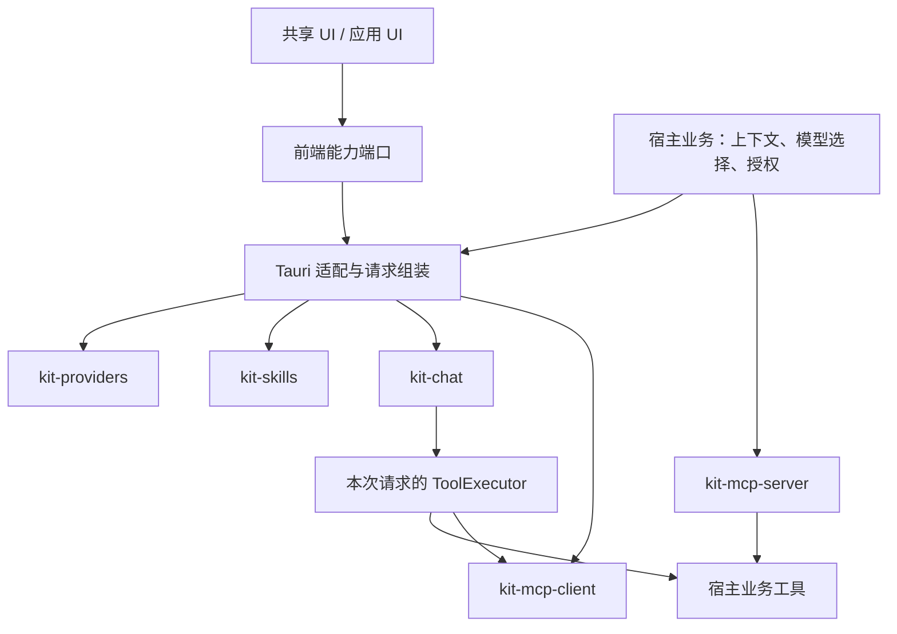

# desktop-kit：面向新项目的共享 AI 能力架构

> 版本：0.2｜状态：推荐设计，尚未实施验证
>
> 设计目标：让新桌面项目以尽可能少的接入代码，组合稳定的 AI 能力，而不是兼容已有项目的内部实现。
>
> 本文替代本文件之前以四个项目迁移为主线的版本。其他方案和 `desktop-kit/` 下的详细设计是参考材料，不自动成为本文的实现契约；发生冲突时需先统一设计，不能把两套要求叠加到实现中。

## 1. 先定原则：框架优先，不背历史包袱

1. **为新项目设计公共能力，而不是为旧项目设计兼容层。** 不接受项目名称分支、旧 DTO 别名、旧目录探测、旧包解析或历史行为开关进入核心。
2. **统一语义，不统一业务。** 配置、聊天、技能、工具和权限有明确契约；笔记、路线、安装器等业务由应用拥有。
3. **组件可独立使用，也可一起使用。** 使用 Skills 不要求安装 MCP；发起聊天不要求使用框架的配置数据库或历史数据库。
4. **复用实现，不建设扩展平台。** 使用 Rust crate 和前端包，不引入动态库加载、WASM 沙箱、服务总线、远程插件市场或常驻后台进程。
5. **少量具体模块、少量必要接口。** 普通数据和函数足够时，不增加 trait、注册中心、工厂或通用仓储层。
6. **安全和数据正确性不是兼容包袱。** 去掉历史代码约束，不代表可以自动删除旧用户数据、放宽密钥保护或跳过授权。

旧项目可以按新契约重写。确需保留用户数据时，编写应用侧一次性迁移工具；它不参与框架启动，也不进入公共 API。

## 2. 能力边界

| 模块                | 提供什么                                           | 明确不做什么                                 |
| ------------------- | -------------------------------------------------- | -------------------------------------------- |
| `kit-providers`     | 服务商、连接配置、凭据、模型探测、能力元数据       | 聊天、业务角色、CLI 配置生成                 |
| `kit-chat`          | 协议适配、流式运行时、工具循环、取消；可选历史存储 | 读取其他模块数据库、选择业务提示词、实现 MCP |
| `kit-skills`        | 技能导入、编辑、版本、选择、受限指引片段生成       | 执行脚本、自动安装工具、管理 MCP 服务        |
| `kit-mcp-client`    | MCP 连接、工具发现和调用、服务信任与凭据           | 聊天循环、技能存储、业务授权决策             |
| `kit-mcp-server`    | 对外 MCP 协议、认证、工具暴露和访问控制            | 自动暴露宿主全部工具或反向依赖 Client        |
| `kit-observability` | tracing 日志、脱敏、轮转、查询和诊断               | 初始化业务模块、承载通用业务类型             |

不建立包揽错误、路径、ID、数据库、日志的 `foundation/base` 大包。共享代码先放在拥有其语义的模块内；只有出现稳定、实际重复的底层实现时，才抽成私有工作区模块。

例如，凭据保护可被 Providers 和 MCP 复用，但它不因此成为所有模块的必选依赖。核心内部保留各自的错误类型，在对外接入层映射为统一错误 DTO。

## 3. 组合架构

下图箭头表示调用或使用方向，不是启动顺序。



### 3.1 三层分工

- **核心层**：纯 Rust crate，不依赖 Tauri、前端或宿主业务模型。独立 CLI 可直接调用。
- **接入层**：把已创建的能力实例组合起来，完成 DTO、权限、流式传输和任务生命周期管理。
- **UI 层**：组件只使用明确的能力端口，不直接 `invoke`，不访问数据库。

默认提供一个 `tauri-plugin-kit` 接入包，通过默认关闭的 Cargo features 启用能力。权限按命令分别声明，启用模块不等于向所有窗口授权。只有出现独立发布、权限隔离或生命周期冲突的实际需求时，才拆成多个插件。

前端默认一个 `@desktop-kit/ui` 包，使用 `providers`、`chat`、`skills`、`mcp`、`logs` 子路径导出；Tauri 端口实现单独位于 `@desktop-kit/ui/tauri`。不为每个组件建立一个 npm 包。

### 3.2 核心依赖规则

- Providers、Skills、MCP Client、MCP Server 不依赖 Chat。
- Chat 不依赖 Providers、Skills 或 MCP 的实现，只消费已解析的请求数据和工具执行接口。
- Skills 不依赖 MCP。技能是指引，不是连接管理器或权限授予者。
- MCP Client 与 Server 不相互依赖；可共用上游协议库。
- 接入层可以同时依赖多个模块，并承担模块间组合。
- 没启用的能力不注册命令、不创建数据库、不启动后台任务，也不拉入该能力的运行时依赖。
- 不通过全局状态或插件注册顺序偷偷解决依赖。宿主显式创建实例并传入接入层，缺少声明所需的实例时在启动阶段报错。

## 4. Chat：只运行一次明确的请求

### 4.1 输入边界

Chat 的一次运行输入包含：

- 模型连接快照：协议、地址、模型 ID 和后端使用的凭据；
- 宿主系统指令、业务上下文、已有消息和本轮输入；
- 用户本次选中的 Skill 指引片段；
- 本次允许暴露的工具定义和一个 `ToolExecutor`；
- 输出、上下文、工具轮次和超时预算，以及取消信号。

连接快照只存在于后端，不是返回 UI 的 DTO。Chat 不认识 Provider 数据库主键，也不自行查询全局“当前模型”。模型选择、角色回落等属于应用策略。

适配层负责：解析用户模型选择、取出选中的技能、合并可用工具，再调用 Chat。协议编码、消息预算和工具循环仍在 Chat，不能搬到适配层重复实现。

### 4.2 工具契约

Chat 拥有最小的工具调用契约：稳定名称、JSON Schema 参数、调用 ID、结果和结构化失败。

`ToolExecutor` 是必要接口，因为它确实有宿主业务工具和 MCP 工具两类来源。MCP 到该接口的适配放在接入层；MCP crate 不必为了实现工具接口依赖整个 Chat。

- 工具目录在一次运行开始时确定，重名必须报错，不静默覆盖。
- 模型只能调用该目录内的工具；真正执行前仍检查当前权限和参数。
- 调用 ID 的去重范围是一次运行，不能承诺跨进程崩溃的 exactly-once。
- 对写入、删除、外发等副作用，宿主执行明确授权；未知执行结果不自动重试。
- 取消后不启动新请求或新工具。已经提交的外部副作用不能靠取消撤销，结果中必须区分取消和执行结果未知。

### 4.3 流式语义

第一批协议为 OpenAI Chat Completions、OpenAI Responses、Anthropic Messages；支持范围由协议 fixture 和实测验证，不以“接口相似”代替兼容性。

每次运行分配 `run_id`。事件区分消息、文本增量、工具参数增量、工具结果、用量和运行终态。

- 文本按顺序输出；工具参数完整、合法并通过授权后才执行。
- 运行终态只有 `completed`、`failed`、`cancelled`，恰好一个；中间模型轮次结束不是运行结束。
- 接受运行前的输入错误走请求错误；接受后的运行失败走终态事件，不通过两条通道重复报告。
- 输出部分内容后不自动重放整次请求。
- 运行中断开 UI 连接，默认取消；后台运行是另行明确启用的产品能力。
- 活动会话历史按消息和工具调用/结果的完整组裁剪，不能留下半组工具记录。

### 4.4 Agent 核心与宿主状态分离

参考 pi 将 `pi-ai`、通用 Agent runtime 和具体 coding-agent 分开，`kit-chat` 不拥有宿主会话、页面或业务状态。它只接受一次运行的输入快照，并产生事件流；会话持久化通过可选的 `ConversationStore` 注入。

推荐提供两个实现：

- `MemoryConversationStore`：测试、一次性任务和无历史聊天；
- `SqliteConversationStore`：需要恢复、分支或搜索历史的应用自行启用。

Chat runtime 不能通过全局单例查找当前会话。宿主显式持有 session/runtime，并在关闭、切换会话或取消时调用生命周期方法。

每轮保持清晰边界：输入排队/预处理 → 请求准备 → 模型流 → 工具预检与执行 → 结果归档 → `turn_end`；所有自动继续都必须由显式策略返回，禁止无条件在事件回调中递归发起下一轮。

## 5. Skills：一等能力，不是隐式插件系统

### 5.1 语义和范围

Skill 是用户可查看、选择和版本化的领域指引。它告诉模型“如何完成任务”，不直接赋予工具、网络、文件或进程权限。

首版提供导入、预览、安装、手写编辑、删除、排序、宿主内置技能和本次运行选择。不支持脚本执行、安装钩子、自动下载依赖、任意文件读取或模型自主加载其他技能。

这不是完整复刻任一现有 Skill 生态。支持的格式子集必须明确，不为旧项目的包格式加入特判。

### 5.2 包格式

```text
example-skill/
├── SKILL.md       # 必需：UTF-8、YAML frontmatter + Markdown 正文
└── LICENSE        # 可选：许可证文本
```

frontmatter 必需 `name`、`description`；可选 `version`。名称使用稳定 slug，缺省版本按未版本化处理，不编造发布版本。解析采用安全、受限的 YAML 解析器，拒绝重复键、对象构造和超限嵌套；不能用简单按冒号切分冒充 YAML 兼容。

不采用 `skill.json` 自动登记 MCP 的设计。包内不保存连接地址、请求头和凭据；技能正文可描述需要的能力，实际服务由应用或用户在 MCP 设置中独立配置。以后若确需机器可读的工具需求，可增加声明字段，但声明仍不能触发安装或授权。

### 5.3 导入和更新

- 支持单个 `SKILL.md`、目录和 ZIP；ZIP 只接受根目录或唯一顶层目录中的允许文件。
- 默认限制：ZIP 输入 512 KiB，条目 8 个，累计解压 256 KiB，`SKILL.md` 64 KiB。读取过程中执行限制，不相信压缩包声明的长度。
- 不执行、不释放任意文件到磁盘；拒绝路径穿越、绝对路径、重复规范化路径、符号链接及非白名单文件。目录导入也不得跟随链接越过选定目录。
- 预览生成内容摘要，安装重新读取并校验；内容不同必须重新确认，不能把“重新校验合法”误认为“用户批准过新内容”。
- 同名安装返回冲突；替换需要用户明确确认。版本仅辅助判断，不自动覆盖用户编辑内容。
- 检出疑似凭据时拒绝并给出字段位置；检测只是辅助，不能承诺发现所有秘密，也不能将原文记录到日志。
- 本地编辑或替换后，旧内容的选用确认失效，必须重新查看确认。内置技能正文随应用发布管理，不覆盖用户复制出来的自定义技能。

### 5.4 选择和运行快照

不硬编码“所有项目最多启用 3 个”。默认显式选择少量技能，并同时应用数量上限和模型上下文预算；数量不能替代 token 预算。

Skills 输出有顺序的指引片段和 `id + revision`。Chat 开始运行时固定快照，运行中编辑、排序或删除不改变已经开始的请求，下一次运行使用新内容。

- 没选技能时，Chat 的行为与未安装 Skills 相同。
- 完整指引超出预算时，在发请求前报错，请用户减少选择；不静默截断指引或丢弃某个技能。
- 指引必须标为用户选用的外部内容；不拼成能够伪造宿主消息角色的自由模板。
- 固定安全声明用于说明来源，不能作为提示词注入防护保证。真正的安全边界是工具白名单、权限校验和副作用授权。

Skill 的读取策略采用两级模型：先加载名称、描述、来源和版本等目录元数据；正文在用户明确选择后加载。若某宿主确实提供安全的只读资源工具，可将正文改为模型按需读取，但这不是 `kit-skills` 自动获得文件访问权，也不能执行 Skill 目录中的脚本。

Skill 目录、正文和运行快照使用 `id + revision` 标识。内容发生变化后，旧快照失效；已经开始的 Chat 运行继续使用原快照。

- 技能推荐的 MCP 服务即使已连接，也只能使用本次运行授权的工具；选中技能不扩大授权范围。

## 6. Providers 与 MCP：配置不等于执行授权

### 6.1 Providers

Provider 是配置身份，Endpoint 是协议与连接地址，Model 是模型 ID 与能力元数据。不要把“写作角色”“路线助手”等业务场景编码进核心。

凭据更新统一为 `Keep / Clear / Set`；读取配置只返回是否设置等安全状态，不返回明文。后端解析模型连接时才获取凭据。

凭据走系统安全存储：Windows 可用 DPAPI，其他平台采用明确支持的系统方案；不可用就拒绝持久化，不回落明文。探测有超时、取消、响应大小限制和稳定错误分类，不自行添加无差别重试。

### 6.2 MCP Client

独立完成连接、协议状态、工具发现和调用。服务配置、凭据、信任和启用状态由此模块拥有。

- 新建服务默认不启用、不信任；认证凭据按目标服务隔离。
- 默认远程 HTTPS；HTTP 仅允许经验证的 loopback。重定向默认禁止，连接前后均不得绕过地址策略。
- 用户确需内网服务时，按显式目标授权，不以关闭全部 SSRF 检查代替配置。
- 服务被信任不代表所有工具获准执行，仍经过运行时工具过滤和操作授权。
- 限制发现数量、描述长度、网络响应和工具输出；不信任外部描述、指引和返回内容。

### 6.3 工具暴露与执行策略

借鉴 pi 对工具 exposure 和 `beforeToolCall` / `afterToolCall` 的区分，但只保留必要部分：

- `direct`：工具声明给模型并允许本次运行调用；
- `deferred`：已注册但不自动声明，宿主显式激活后才可调用；
- `hidden`：仅供宿主工具编排使用，不出现在模型工具列表。

工具必须经过参数解析、`before_execute` 授权和实际执行；`after_execute` 只能整理结果或记录诊断，不能伪造已发生的副作用。多工具并发时先顺序完成全部 preflight，再按配置并发执行，最终结果按原调用顺序归档。工具的 exposure 是可见性，不是权限；权限仍由宿主策略最终决定。

### 6.4 MCP Server

只暴露宿主显式注册的工具。默认回环监听，token 安全存储、可撤销且有工具范围；远程监听需显式配置传输保护和认证。

Server 可以复用宿主的业务工具实现，但外部访问授权独立于应用内部对话授权。不能因工具已经在 Chat 中注册，就自动向外部开放。

## 7. 数据、路径和生命周期

### 7.1 数据所有权

每个应用指定一个数据根目录。需要持久化的模块独占其文件和 schema，例如 `providers.db`、`skills.db`、`chat.db`、`mcp-client.db`、`mcp-server.db`。没启用存储就不创建空库。

- Chat 运行时默认可无状态使用；框架历史存储是可选功能，不为了聊天强制引入 SQLite。
- 数据库之间不直接查表、建立跨库外键或假装共享事务。
- Skills 不自动登记 MCP，所以安装技能是 `skills.db` 内的本地事务，没有跨库回滚问题。
- 历史可记录使用过的技能 ID 和修订号，不级联删除消息，也不默认复制全部技能正文。
- 应用数据根目录由宿主明确选择；框架不检测历史目录或在写入失败后静默换目录。
- 数据文件和日志各应用独立；代码复用不等于多应用共享同一数据库。

### 7.2 生命周期

宿主拥有实例：先配置并打开所选能力，再构造接入层，最后启动 UI。关闭时停止新请求、取消活动运行、等待受限清理并 flush 日志。

核心库输出 tracing 事件，不私自安装全局 subscriber。宿主只初始化一次日志系统。不存在依赖插件注册先后的 `try_state` 探测链。

### 7.3 框架自身升级

不承担旧项目内部 schema 的兼容，但必须承担已发布框架数据的升级责任。每个模块有独立 schema 版本，升级前备份，事务失败保留原数据，高于支持版本的库拒绝打开。

代码回滚不等于数据库回滚。回退需要兼容 schema 或恢复备份，恢复前明确提示升级后新增数据的影响。

## 8. Tauri 接入与 UI 契约

### 8.1 命令和权限

共享 Tauri 接入包按能力注册命令。每个命令有确定 DTO、窗口权限和输入限制；不提供万能 SQL、万能文件读写、任意工具执行或明文凭据导出命令。

请求组装在后端完成。前端传模型选择、技能 ID 和业务输入，不能直接声明自己拥有权限。宿主提供上下文和授权回调，但不把整个数据库连接或 `AppHandle` 注入核心。

统一对外错误字段为 `code`、安全兜底 `message`、白名单 `details`；各核心错误在接入边界映射。稳定代码用于 UI 翻译，内部错误链只进入脱敏诊断。

### 8.2 UI 组合

提供 ProvidersSettings、ChatPanel、SkillsSettings、McpClientSettings、McpServerSettings、LogPanel 等组件，通过明确的能力端口接入。

- 不规定应用布局、路由、全局状态库或业务按钮。
- 样式使用主题变量；必要业务动作使用 props、事件或插槽。
- SkillsSettings 覆盖导入预览、内容查看、编辑、替换确认、选择和预算提示；MCP 连接和信任仍在 MCP 设置中管理。
- Tauri API 只存在于端口实现；组件不静态导入它。
- 不提供虚假的通用 Web 后端。将来有 Web 产品时实现相同端口，不能假设浏览器可直接调用原生 Rust 或系统密钥库。

## 9. 一个新项目如何使用

不要求新项目接入整套框架：

| 项目需求           | 选择的能力                          | 项目仍需要写什么                              |
| ------------------ | ----------------------------------- | --------------------------------------------- |
| 只管理模型配置     | Providers + 对应设置 UI             | 配置如何用于自身业务                          |
| 无历史的简单聊天   | Chat + Tauri 接入 + ChatPanel       | 连接数据、上下文和提示词                      |
| 技能驱动的聊天     | Providers + Chat + Skills + 对应 UI | 技能选择策略、业务上下文；不需要 MCP          |
| 使用外部工具的助手 | 前项 + MCP Client                   | 可用工具范围和副作用授权                      |
| 向外开放应用能力   | MCP Server                          | 工具实现及外部访问策略；不需要 Chat 或 Skills |

## 10. 从 pi 项目吸收的设计，以及明确不照搬的部分

### 10.1 值得吸收

| pi 的做法                                                           | desktop-kit 的采用方式                                                       |
| ------------------------------------------------------------------- | ---------------------------------------------------------------------------- |
| `pi-ai` / `pi-agent-core` / coding-agent 分层                       | Provider 协议、Chat runtime、应用 UI/会话分离；核心不认识具体宿主            |
| SDK 允许注入 model runtime、session manager、resource loader、tools | 用显式构造参数注入连接快照、会话存储、Skill catalog、ToolExecutor 和取消信号 |
| Skill 先展示描述、命中后读取正文                                    | Skill 元数据与正文分离；默认用户选择后加载，具备只读工具的宿主才启用按需读取 |
| `prepareRequest`、`finishTurn` 和清晰的 turn 生命周期               | 请求准备、工具结果完成和继续策略拥有明确边界；不在普通事件回调里隐式递归     |
| 工具 exposure、preflight、结果后处理和并发模式                      | 保留 direct/deferred/hidden、执行前授权、执行后整理及稳定结果顺序            |
| ResourceLoader 统一发现 skills/prompts/themes 并报告冲突            | 提供能力资源目录接口、来源/优先级/冲突诊断；不让每个 UI 自己扫描文件         |
| 内存会话与持久会话可替换                                            | Chat 默认无状态，`ConversationStore` 由宿主选择 memory 或 SQLite             |
| Pi package 的资源声明和固定版本分发                                 | 未来以 manifest 打包 Skills、提示模板和 UI 资源；依赖固定、来源可审计        |
| Chord 的 service token、依赖图、生命周期和稳定 facade               | 只借鉴“构造时校验依赖、显式拥有资源、逆序清理”的原则，不引入运行时服务总线   |

### 10.2 不照搬

- **不照搬 Pi 的同进程可执行 Extension。** Pi 明确说明 Extension 与进程拥有相同操作系统权限，可以读取凭据、提示词和会话。desktop-kit 的默认复用单元是编译时 crate 和受控 UI 包，不允许安装一个包就执行任意代码。
- **不照搬 Skill 执行脚本。** Pi 的 Skill 可以包含脚本、references 和 assets，并指导模型执行脚本；桌面应用首版只允许不产生代码执行的指引正文，工具权限仍由应用注册。
- **不照搬工作目录递归扫描和自动加载。** 新项目由宿主显式声明资源根和允许的包，避免当前目录内容隐式改变应用行为；需要项目资源时，先经过宿主信任决策。
- **不照搬 Chord 的动态 facet、远程 service、热替换和复制状态。** 这些适合通用 Node 应用组合或跨进程场景，当前桌面框架尚无跨进程复用需求；先用普通函数、显式实例和事件流。
- **不把 Pi 的“默认给用户进程全部 OS 权限”当作安全模型。** desktop-kit 对密钥、路径、网络地址、工具副作用和 MCP 外部访问单独设权限门槛。

结论：Pi 提供的最重要启发不是“增加一个插件系统”，而是**把核心运行时、资源加载、会话状态和产品应用拆开，并让宿主显式注入组合**。Chord 进一步证明，依赖图和生命周期应在激活前验证；但当前不需要为此引入动态运行时。

这张表是核心验收标准：如果纯文本技能必须注册 MCP，或者 MCP Server 必须初始化 Chat，边界就是错的。

## 11. 构建顺序：验证组合，而不是依次迁移旧应用

1. **确定公开契约。** 固定一次 Chat 运行、工具执行、Skill 快照、错误 DTO 和 UI 端口；用小型编译验证确认 Tauri 与异步 API 可行，不预建全套空壳。
2. **完成最小 Providers → Chat 纵向场景。** 一个新建示例宿主能够配置模型、发送消息、接收流式结果并取消。验证配置存储与 Chat 运行时分离。
3. **加入 Skills。** 在不安装 MCP 的宿主中完成导入、确认、选择和实际请求组装，验证运行快照和预算。
4. **加入工具与 MCP Client。** 先执行宿主工具，再通过同一工具契约调用 MCP 工具，验证授权和取消。
5. **独立验证 MCP Server。** 用没有 Chat、Providers、Skills 的宿主对外提供一个受控业务工具。
6. **形成稳定的共享 UI 和发布制品。** 用完整助手与仅 Providers 的两个示例验证按需组合；日志与安全门槛随各场景一起完成，不推迟到最后。

旧应用接入是框架稳定后的独立工作。按新契约重写调用方，删除被替代实现；不以继续支持旧模型为由增加核心分支。

## 12. 验收与发布

### 12.1 行为验收

- Providers：凭据三态、失败不覆盖原凭据、探测取消及脱敏错误。
- Chat：真实协议增量、UTF-8 分片、工具参数聚合、唯一终态、部分输出失败、副作用未知结果和实际取消。
- Skills：合法包导入；畸形 YAML、ZIP 炸弹、重复路径、链接、超限正文被拒绝；预览后换文件必须重新确认。
- Skills：更新不静默覆盖；超预算不静默截断；运行中修改不影响已固定快照；无技能与未安装模块行为一致。
- 权限：Skill 不能扩大工具权限；MCP 信任、工具可见范围、实际执行授权分别生效。
- 存储：新库、框架版本升级、升级中断和备份恢复；不靠删库恢复正常。
- 生命周期：窗口关闭、运行取消、应用退出后不遗留未管理任务。
- 组合：只 Providers、纯 Chat、Skills 无 MCP、MCP Server 无 Chat 均实际启动并完成各自场景。

测试验证宿主可见行为，不用类型存在、调用转发或源码字符串匹配冒充功能证明。网络边界可用可控本地上游；发布前再完成所声明协议的真实服务联验。

### 12.2 实际表面验证

示例宿主必须在真实 Tauri 窗口中完成配置、技能导入、流式聊天、工具授权和取消；同时以 CLI 验证核心不依赖 Tauri。检查失败提示、日志脱敏和重启后状态，不只运行单元测试。

### 12.3 版本策略

初期共享仓库统一 release 版本，应用固定不可变提交或可验证发布制品。DTO 从单一来源生成；schema 版本独立管理。

公开 API 可以在明确的大版本升级时清洁切换，不长期保留废弃别名。每次发布记录契约变更、数据升级和回退条件。不能因不兼容旧项目而免除框架对自身已发布契约的责任。

## 13. 设计底线

**优雅复用不是把所有能力串成一个框架启动链，而是每项能力都能独立说明、独立使用，再用少量明确的组合代码连接。**

Skills 提供指引，MCP 提供工具通道，Providers 提供连接配置，Chat 运行一次请求；应用决定业务和权限。具体项目适应这套边界，而不是让这些边界适应某个旧项目。
