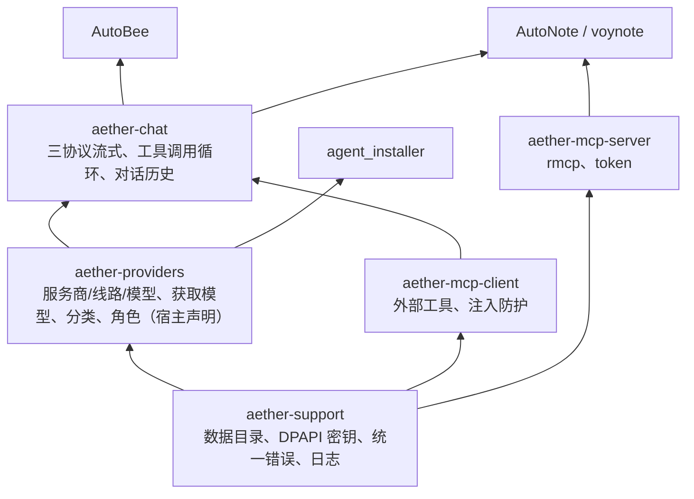

# 桌面程序共享插件方案

> 2026-10-10。范围：AutoNote、voynote、agent_installer、AutoBee 四个 Tauri 2 + Svelte 5 桌面程序里重复实现的 AI 模型配置、AI 对话、MCP、Skills、日志等横切能力。现状数据来自对四个仓库的只读盘点（文件路径、行数、依赖），未逐行复核。
>
> 本文是背景与选型分析。实施以 [00-概要设计.md](00-概要设计.md) 及其详细设计、任务清单为准；两者不一致时以当前模块文档为准。

## 1. 痛点

同一套能力在四个项目里各写一遍，而且每遍写法不同：

- **重复劳动**：服务商/线路/密钥/获取模型/模型分类/设置界面/日志面板，四个项目共写了 3～4 遍；AutoNote 的 Web 端又用 TypeScript 把三协议对话和获取模型写了第 5 遍。
- **实现漂移**：每份副本各自演进，一处修 bug、加协议，其他项目都享受不到。例如：
  - 密钥"保持 / 清空 / 新值"三态有三种表达：installer 用 `None` 表示不改；voynote 用 `None` 不改、`""` 清空；AutoNote 用 `KeyChange::Keep|Clear|Set`。
  - 协议支持不同：installer 多了 `openai-completions`、`@ai-sdk/openai-compatible`；AutoBee 流式只支持 openai-chat。
  - 错误格式四套：`{code,message,details}`、`{kind,detail}`、`{code,message,status}`、自定义。
  - 数据目录规则各异：只用 exe 旁 `data\`、exe 旁优先再回落 `%LOCALAPPDATA%`、自定义 `paths::data_dir`。

目标：这些能力只写一份，四个程序（以及以后的新程序）都通过依赖接入。

## 2. 四个项目现状

| 能力                 | AutoNote                                     | voynote                                 | agent_installer                               | AutoBee                         |
| -------------------- | -------------------------------------------- | --------------------------------------- | --------------------------------------------- | ------------------------------- |
| 服务商/线路/密钥配置 | ✓ SQLite（与笔记共用 `library.db`）          | ✓ SQLite                                | ✓ SQLite `settings.db`                        | ✓ SQLite `settings.db`          |
| 密钥 DPAPI 加密      | ✓                                            | ✓                                       | ✓ `settings/crypto.rs`                        | ✓ `credentials/crypto.rs`       |
| 获取模型列表         | ✓ 20s 超时、8 种错误类型                     | ✓                                       | ✓ `probe/client.rs` 758 行、6s 超时、错误提示 | ✓ 结果只放内存                  |
| 模型分类推断         | ✓ 有共享测试数据 `fixtures/ai-classify.json` | ✓                                       | ✓ `probe/metadata.rs` 511 行                  | —                               |
| 角色                 | chat / writing（writing 回落 chat）          | 11 个角色                               | 按 CLI 工具                                   | —                               |
| 流式对话             | ✓ 3 种协议                                   | ✓ 多模型、重试、取消                    | —                                             | 仅 openai-chat                  |
| 工具调用             | —                                            | 定义了类型，未实现                      | —                                             | ✓ 最多 5 轮循环 + 流式拼接      |
| MCP                  | 服务端（rmcp）                               | 仅配置增删改查                          | —                                             | 客户端（手写 Streamable HTTP）  |
| 日志                 | 5MB 轮转、写盘诊断、前端批量上报、日志面板   | 按天 + 50MB 轮转、双文件、`mask_secret` | 7 天清理、日志面板                            | 5MB 保留 3 份、`tail`、日志面板 |
| 错误类型             | `{code,message,details}`，13 种码            | `{kind,detail}`                         | 自定义                                        | `{code,message,status}`         |

各项目一句话定位：

- **AutoNote**：笔记应用，桌面 + Web 双宿主；Cargo workspace 已拆出 `note-ai`、`note-mcp`、`autonote-shell` 等不依赖 Tauri 的 crate，前端已拆出 `packages/app`（共享 UI）和 `packages/shared`（契约）。
- **voynote**：笔记应用；所有横切能力写在单个 app crate 内，没有内部 crate。
- **agent_installer**：AI CLI 工具（Claude Code、Codex、pi、omp、opencode、omo）一键安装与配置器。**没有对话**，服务商配置只用来写各 CLI 自己的配置文件。
- **AutoBee**：路线规划 + 出行 AI 助手；横切能力集中在不依赖 Tauri 的 `autobee-shell` crate，但 LLM 代码与路线业务（HTTP 客户端、`AppError`、路线工具）耦合。

## 3. 方案选型：编译时复用，不做运行时插件

四个程序都是自己写的，要解决的是"同一功能不写多遍"，不是"让第三方给程序写扩展"。

| 方案                    | 做法                                       | 结论                                                                                 |
| ----------------------- | ------------------------------------------ | ------------------------------------------------------------------------------------ |
| 动态库，运行时加载      | `libloading` / `abi_stable`                | ✗ Rust 没有稳定 ABI，编译器或依赖版本一变就崩；走 C 接口还得自己处理异步、流式、取消 |
| WASM 插件               | `wasmtime` / `extism`                      | ✗ 面向不受信任的第三方。HTTP、SSE 流式、数据库、密钥都要经宿主转一层，复杂度翻倍     |
| 独立后台进程（sidecar） | 本地常驻服务，各程序走 HTTP                | 暂不采用。多程序共用一份配置时有价值，代价是多一个进程要管理                         |
| **编译时复用（采用）**  | Rust crate + Tauri 插件 + npm 包，git 依赖 | ✓ 类型安全、零运行时开销，也是 Tauri 官方插件形态（一个 Cargo crate + 可选 npm 包）  |

对外扩展需求由 MCP 承担：MCP 本身就是插件协议，不另造插件机制。

## 4. 分层设计



每一层分三件：

1. **纯 Rust crate**（不依赖 Tauri）：可单测，命令行工具（如 AutoBee 的 `cli`）也能直接用。
2. **薄 Tauri 插件** `tauri-plugin-aether`：只做命令注册、Channel 流式、任务取消、权限声明。
3. **Svelte 组件包** `@ouraihub/aether-ui`：基于 shadcn-svelte + lucide（四个项目里三个已在用），主题只通过 CSS 变量传入。

### 4.1 拆分依据

- **服务商配置与对话分开**：agent_installer 没有对话，但服务商配置是它的核心。"服务商、线路、密钥、获取模型、分类"必须能单独使用。
- **MCP 客户端与服务端分开**：AutoBee 是调用外部 MCP 工具，AutoNote 是把笔记能力开放给外部，方向相反、依赖不同（手写 HTTP 客户端 vs rmcp 服务端）。
- **对话自带工具调用**：工具来源有两类——宿主注册的业务工具、MCP 客户端发现的外部工具，都在 aether-chat 的工具循环里统一调度。

### 4.2 各层职责

| 层                | 职责                                                                                                                                                                                                                 | 不做                                   |
| ----------------- | -------------------------------------------------------------------------------------------------------------------------------------------------------------------------------------------------------------------- | -------------------------------------- |
| aether-support    | 数据目录解析；原生凭据保护（Windows DPAPI / macOS Keychain / Linux Secret Service；不可用绝不存明文，细节以 10 §2 为准）；统一错误 `{code, message, details?}`；日志（见第 6 节）；`mask_secret` / `mask_url_secret` | 业务配置                               |
| aether-providers  | 服务商/线路/模型 CRUD（独立 `providers.db`，自带迁移）；密钥三态 `Keep/Clear/Set`；获取模型（多种响应形状、错误类型 + 提示）；模型分类推断；角色绑定与回落                                                           | 发起对话                               |
| aether-chat       | anthropic-messages / openai-chat / openai-responses 流式；工具调用循环与流式工具调用拼接；取消；对话与消息存储（独立 `chat.db`）                                                                                     | 业务提示词、业务工具                   |
| aether-mcp-client | Streamable HTTP 客户端、会话 ID、工具发现与调用、工具名前缀；外部内容加随机边界防提示词注入；URL 校验（HTTPS 或仅本机 HTTP）                                                                                         | 具体服务商的密钥注入规则               |
| aether-mcp-server | rmcp Streamable HTTP 回环监听；token 哈希、撤销；工具注册接口                                                                                                                                                        | 业务工具实现                           |
| aether-skills     | `SKILL.md` 导入（单文件/目录/ZIP）、预览确认、手写、修订号、按次选择的快照与预算检查；蓝本 AutoBee `llm/skills.rs` + voynote `skill.rs`                                                                              | 执行脚本、登记或管理 MCP、扩大工具权限 |

## 5. 宿主接入

宿主只写和自身业务相关的部分：

| 宿主提供       | 例子                                                                         |
| -------------- | ---------------------------------------------------------------------------- |
| 角色列表       | AutoNote `[chat, writing→chat]`；voynote 11 个；installer 不用               |
| 对话上下文     | 当前笔记、当前路线                                                           |
| 业务工具       | AutoBee `plan_route` / `search_place` / `life_circle`；AutoNote 笔记增删改查 |
| MCP 服务端工具 | AutoNote 笔记工具                                                            |
| 系统提示词     | AutoBee 出行助手提示词；AutoNote 笔记助手提示词                              |
| 界面挂载点     | 对话面板放哪、"插入到光标"怎么插                                             |

Rust 侧接入示意：

```rust
// main.rs：日志必须在 Builder 之前初始化，否则启动阶段和其他插件 setup 的日志会丢
let log = aether_observability::init(/* 日志配置 */)?;
let dirs = aether_support::data_root("autonote")?;

tauri::Builder::default()
    .plugin(log.plugin())
    .plugin(tauri_plugin_aether_providers::init(dirs.data(), &[Role::Chat, Role::Writing.fallback(Role::Chat)]))
    .plugin(tauri_plugin_aether_chat::init(MyContext::new(db.clone()), MyTools::new(db.clone())))
    .plugin(tauri_plugin_aether_mcp_server::init(MyMcpTools::new(db)))
```

前端接入示意（AutoNote 已有的 `HostExtensions.workspacePanel` / `WorkspacePanelProps { note, insert, openSettings }` 可直接作为挂载契约）：

```svelte
<ProvidersSettings {roles} />
<ChatPanel context={currentDoc} onInsert={insertAtCursor} />
<LogPanel />
```

## 6. 日志模块（aether-support::log）

不直接用官方 `tauri-plugin-log`：

- 它基于 `log` crate；四个项目都用 `tracing`，迁移要么全改写，要么经桥接丢掉结构化字段。
- `.level()` 在构建时固定，不能运行时切换；AutoNote 设置页需要运行时改级别。
- 没有读取最近日志（tail）、脱敏、写盘失败诊断。

设计：

- `tracing-subscriber` + `reload` 层，运行时切换级别。
- 沿用 AutoNote 的轮转写入器（按大小，保留 N 份，写盘失败可检测），加"按天轮转"选项覆盖 voynote。
- 命令：`logs_tail`、`logs_set_level`、`logs_open_dir`、`logs_ingest`（接收前端批量日志，事件名与字段走白名单）。
- 级别存在插件自己的 JSON 文件，不进宿主数据库。
- 前端：`LogPanel`、`LogSettings`、`createLogger()`（即 AutoNote 现有 `IpcLogger`：队列 200 条、满了先丢 debug/info、20 条或 250ms 批量上报）。

暂不做：远程日志收集、多日志通道（voynote 的 `retrieval.log`）。需要时在配置里加"按 target 分流到额外文件"，不改现有接口。

## 7. 各模块蓝本

| 模块              | 蓝本                                                                                                         | 理由                                                         |
| ----------------- | ------------------------------------------------------------------------------------------------------------ | ------------------------------------------------------------ |
| aether-support    | AutoNote `autonote-shell`（`logging.rs` 466 行，含测试）                                                     | 日志最完整：轮转、写盘诊断、退出 flush                       |
| aether-providers  | AutoNote `note-ai` + `core/src/ai.rs` 存储；加 installer `probe/client.rs` 的错误提示                        | AutoNote 分类有 Rust/TS 共享测试数据；installer 错误提示最细 |
| aether-chat       | AutoNote `note-ai/chat.rs` 三协议流式；加 AutoBee `llm/agent.rs` 工具循环 + `llm/sse.rs` `StreamAccumulator` | 两边互补：一个协议全，一个有工具调用                         |
| aether-mcp-client | AutoBee `llm/mcp.rs` + `mcp_external.rs`                                                                     | 唯一实现；注入防护可直接复用                                 |
| 设置界面          | AutoNote `packages/app/src/features/ai/settings`                                                             | 已从 voynote 移植改版，最新                                  |

## 8. 抽离时要解开的耦合

| 项目            | 耦合点                                                                                                                                    | 解法                                                                                        |
| --------------- | ----------------------------------------------------------------------------------------------------------------------------------------- | ------------------------------------------------------------------------------------------- |
| AutoNote        | `note-ai`、`note-mcp` 依赖 `note-core`；AI 表在笔记库迁移 v5/v6 里；`commands/ai.rs` 用 `note_core::Error`；系统提示词硬编码笔记标题/内容 | 独立 `providers.db` / `chat.db`；错误换成 aether-support 统一错误；提示词改由宿主上下文提供 |
| voynote         | `ai/` 引用 `crate::error`（12 处）、`crate::ipc`（8 处）、`crate::db`（3 处）；`mcp.rs` 依赖 `crate::ai`、`crate::db`                     | 同上；11 个角色改由宿主声明                                                                 |
| agent_installer | `settings/resolve.rs` 与 `tools::config::ToolConfig` 耦合                                                                                 | 保留在宿主：只从 aether-providers 读"线路 + 明文密钥"                                       |
| AutoBee         | LLM 依赖 `route_core::http` 和 `AppError`；`conversations.rs` 存路线快照；`mcp_url.rs` 特判百度 MCP 注入 AK                               | HTTP 换成 aether 自带 reqwest；路线快照留宿主表；AK 注入做成宿主回调                        |

存储原则：每个 aether 模块用自己的 SQLite 文件和迁移，放在宿主传入的数据目录下，不进宿主业务库。这是分开后最省心的一点：宿主升级迁移和插件升级迁移互不影响。

## 9. 迁移顺序

1. **建共享仓库**：Cargo workspace（aether-support、aether-providers、aether-chat、aether-mcp-client、aether-mcp-server + `tauri-plugin-aether`）+ pnpm workspace（`@ouraihub/aether-ui`）。git tag 发版，Rust crate 与 npm 包同一个版本号。
2. **aether-support**：从 AutoNote 抽出；四个项目都接入并删掉各自的日志、DPAPI、数据目录代码。顺便跑通发版流程。
3. **aether-providers**：先用 agent_installer 验证（只用到 support + providers，最容易判断抽象是否成立），再接 AutoNote。
4. **aether-chat**：AutoNote 先接（协议最全），再接 AutoBee（验证工具调用循环），最后 voynote。
5. **aether-mcp-client**：AutoBee 接入。
6. **aether-mcp-server**：AutoNote 接入；它与宿主耦合最深（工具全是业务），留到最后。

验收标准：每接入一个项目，就删掉该项目里对应的旧代码。删不掉说明抽象不对，先修 aether，不在宿主里打补丁。

## 10. 决策（2026-10-10 已定）

1. **数据目录**：exe 旁 `data\` 可写时用，否则系统用户数据目录。
2. **模型配置**：每个桌面程序存自己的，不跨程序共用。
3. **平台**：先做 Windows；设计按 macOS 后续接入（密文为带格式标记的不透明 BLOB，macOS 用 Keychain）。

实现细节见 Aether/docs/00-概要设计.md §7.1、§7.3、§11。
